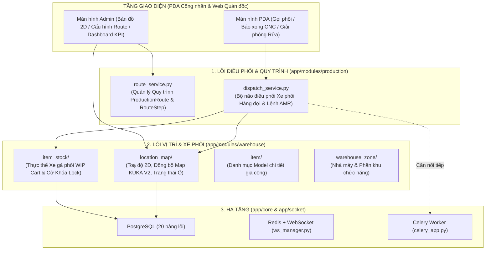

# TÀI LIỆU GIẢI PHẪU CHI TIẾT HỆ THỐNG LÕI HIỆN TẠI (ACTIVE CORE REFERENCE)

> **Mục đích tài liệu**: Giúp bạn nắm vững 100% cấu trúc mã nguồn hiện tại trong `backend/app/`, hiểu rõ **từng file, từng bảng, từng hàm cụ thể đang làm nhiệm vụ gì, nhận tham số gì, xử lý logic từng bước ra sao**, và chỉ ra những chỗ đang còn thiếu hoặc cần sửa để bạn hoàn toàn làm chủ công nghệ.

---

## 1. SƠ ĐỒ KIẾN TRÚC LÕI HIỆN TẠI (`backend/app/`)

Sau khi tách bỏ 6 module WMS FMCG cũ, hệ thống hiện tại chạy xoay quanh **4 trụ cột chính**:



---

## 2. GIẢI PHẪU CHI TIẾT TỪNG MODULE & HÀM XỬ LÝ

### 2.1. Module Điều phối Sản xuất & Vận chuyển AMR (`app/modules/production/`)

Đây là "trái tim" mới của toàn bộ hệ thống, thay thế cho Inbound/Outbound cũ.

#### A. File [`production_models.py`](file:///D:/Cty_sptech/kuka/backend/app/modules/production/production_models.py) — 6 Bảng Điều phối Lõi
1. **`UserLocation` (bảng `user_locations`, dòng 22–41)**:
   - Gán tài khoản công nhân (`user_id`) với vị trí trạm máy (`location_id`) mà họ được phép bấm trên PDA.
2. **`ProductionRoute` (bảng `production_route`, dòng 43–65)**:
   - Quy trình công nghệ của 1 Model sản phẩm (`item_id`), có `route_code`, `version`, cờ `is_active` (mỗi Model chỉ có 1 route `is_active = True` tại một thời điểm).
3. **`RouteStep` (bảng `route_step`, dòng 67–95)**:
   - Từng bước nguyên công trong quy trình:
     - `step_number` (thứ tự 1, 2, 3...)
     - `stage_level` (cấp độ phôi sau khi xong bước này: Level 1, 2, 3...)
     - `operation_code` (`OP10`, `OP20`...), `machine_type`, `cycle_time_minutes`, `program_number`
     - `allowed_machines` (mảng JSONB danh sách máy được phép chạy bước này, ví dụ `["CNC-01", "CNC-02"]`)
     - `is_final_cnc_step` (`True` nếu đây là bước gia công cuối cùng trước khi đem đi rửa).
4. **`TransportRequest` (bảng `transport_request`, dòng 97–135)**:
   - Yêu cầu vận chuyển sinh ra từ PDA hoặc tự động:
     - `request_type`: `'CALL_MATERIAL'` (gọi phôi vào máy), `'MOVE_WIP'`, `'SEND_TO_WASH'` (chuyển ra khu rửa), `'RETURN_EMPTY_CART'` (trả xe rỗng về bãi).
     - Lưu `source_location_id`, `destination_location_id`, `cart_id` (`item_stock.id`), `required_stage_level`.
     - `status`: `'pending'` $\rightarrow$ `'assigned'` $\rightarrow$ `'in_progress'` $\rightarrow$ `'completed'` / `'cancelled'`.
5. **`TransportQueue` (bảng `transport_queue`, dòng 137–164)**:
   - Hàng đợi tự động khi chưa thể điều xe ngay:
     - `queue_type`: `'WAITING_CART'` (máy CNC gọi phôi nhưng trên sàn chưa có xe phôi đạt Level yêu cầu) hoặc `'WAITING_WASH_SLOT'` (máy CNC chạy xong bước cuối nhưng cả 4 ô rửa đều đang kín).
     - `status`: `'PENDING'` $\rightarrow$ `'PROCESSING'` $\rightarrow$ `'RESOLVED'` / `'CANCELLED'`.
6. **`FleetTask` (bảng `fleet_task`, dòng 166–195)**:
   - Lệnh điều khiển vật lý gửi xuống hệ thống quản lý đội xe KUKA AMR (RCS / Fleet Manager):
     - `task_code` (`FLT-TR-...`), `request_id`, `amr_code`, `pickup_location_id`, `dropoff_location_id`, `cart_id`.
     - `status`: `'created'` $\rightarrow$ `'sent'` $\rightarrow$ `'executing'` $\rightarrow$ `'completed'` / `'failed'`.
7. **`ProductionRecord` (bảng `production_record`, dòng 197–217)**:
   - Nhật ký hoàn thành từng công đoạn gia công tại máy CNC (thay thế cho bảng `transaction` và `history` cũ): lưu `cart_code`, `item_id`, `machine_code`, `location_id`, `stage_level`, `operator_id`, `completed_at`.

---

#### B. File [`dispatch_service.py`](file:///D:/Cty_sptech/kuka/backend/app/modules/production/dispatch_service.py) — Bộ máy Điều phối & Lock (`DispatchService`)

Dưới đây là giải phẫu chi tiết **từng hàm một** trong `DispatchService`:

##### 1. [`calculate_distance(loc1: Location, loc2: Location) -> float`](file:///D:/Cty_sptech/kuka/backend/app/modules/production/dispatch_service.py#L39-L45)
- **Nhiệm vụ**: Tính khoảng cách đường chim bay 2D (Euclidean) giữa 2 điểm trên bản đồ xưởng: $\sqrt{(x_1 - x_2)^2 + (y_1 - y_2)^2}$.
- **Mục đích**: Dùng để tìm chiếc xe phôi (WIP Cart) đang nằm gần máy CNC đang gọi nhất.

##### 2. [`find_nearest_available_cart(db, target_location, item_id, required_stage_level) -> Optional[ItemStock]`](file:///D:/Cty_sptech/kuka/backend/app/modules/production/dispatch_service.py#L48-L94)
- **Nhiệm vụ**: Tìm 1 xe phôi hợp lệ để cấp cho trạm `target_location`.
- **Điều kiện lọc bắt buộc (dòng 62–72)**:
  1. Đúng mã sản phẩm: `ItemStock.item_id == item_id`
  2. Đúng cấp độ phôi đầu vào: `ItemStock.current_stage_level == required_stage_level`
  3. **Chưa bị lệnh khác khóa**: `ItemStock.is_locked.is_(False)`
  4. Đang hoạt động và có vị trí xác định khác vị trí đích: `is_active == True`, `location_id IS NOT NULL`, `location_id != target_location.id`.
- **Thuật toán ưu tiên**:
  - Nếu `required_stage_level == 0` (gọi phôi thô từ khu nguyên liệu vào máy CNC bước 1): Bốc theo **FIFO** (`ORDER BY created_at ASC, id ASC`) — xe nào nạp phôi trước thì chạy trước.
  - Nếu `required_stage_level > 0` (chuyển phôi bán thành phẩm giữa các máy CNC): Duyệt các xe ứng viên, tính `calculate_distance` tới máy đang gọi và chọn **xe có khoảng cách gần nhất**.

##### 3. [`get_stage_info_for_machine(db, machine_code, item_id, default_stage_level) -> Tuple[int, int, bool]`](file:///D:/Cty_sptech/kuka/backend/app/modules/production/dispatch_service.py#L97-L139)
- **Nhiệm vụ**: Xác định xem máy `machine_code` khi gia công sản phẩm `item_id` thì:
  - Cần phôi đầu vào Level mấy (`input_required_level`)?
  - Gia công xong sẽ lên Level mấy (`target_stage_level`)?
  - Có phải bước CNC cuối cùng để đem đi rửa không (`is_final_cnc_step`)?
- **Thứ tự ưu tiên**:
  1. Lấy theo `Location.default_stage_level` (nếu Quản đốc cấu hình cứng Level cho vị trí đó trên bản đồ).
  2. Tra cứu trong bảng `ProductionRoute` $\rightarrow$ `RouteStep` xem `machine_code` nằm trong `allowed_machines` của bước nào.
  3. Fallback mặc định nếu chưa cấu hình: `CNC-01/02` $\rightarrow$ `(0, 1, False)`, `CNC-03` $\rightarrow$ `(1, 2, False)`, `CNC-04` $\rightarrow$ `(2, 3, True)`.

##### 4. [`request_material_for_station(db, destination_location_id, item_id, user_id) -> Dict`](file:///D:/Cty_sptech/kuka/backend/app/modules/production/dispatch_service.py#L142-L278)
- **Nhiệm vụ**: Xử lý khi công nhân bấm nút **[GỌI PHÔI]** trên PDA tại một vị trí máy CNC.
- **Logic từng bước**:
  1. **Kiểm tra hợp lệ (dòng 158–193)**:
     - Vị trí đích phải tồn tại và có `location_type == "CNC_SLOT"`.
     - Kiểm tra xem tại vị trí đó đang có xe nào đỗ chưa (`ItemStock.location_id == destination_location_id`). Nếu có rồi $\rightarrow$ Chặn, báo lỗi phải gia công xong trước khi gọi xe mới.
     - Kiểm tra xem vị trí đó có đang có lệnh `TransportRequest` nào ở trạng thái `pending / assigned / in_progress` đang trên đường tới không. Nếu có $\rightarrow$ Trả về `status = "already_calling"`, chống bấm đúp 2 lần!
  2. **Xác định Level phôi cần tìm (dòng 195–211)**:
     - Gọi `get_stage_info_for_machine` để biết `input_lvl`.
     - Tạo bản ghi `TransportRequest(request_type="CALL_MATERIAL", status="pending")`.
  3. **Tìm xe & Đặt khóa Atomic Lock (dòng 213–253)**:
     - Gọi `find_nearest_available_cart`.
     - **Nếu tìm thấy xe (`cart`)**:
       - **ĐẶT LOCK XE & VỊ TRÍ ĐÍCH**:
         ```python
         cart.is_locked = True
         cart.locked_by_task_id = req_code
         cart.destination_location_id = destination_location_id  # <-- Khoá luôn ô đích thành 'reserved'!
         cart.status = "locked"
         ```
       - Cập nhật `TransportRequest` sang `status = "assigned"`, gán `cart_id` và `source_location_id`.
       - Sinh lệnh robot `FleetTask(status="sent", pickup_location_id=cart.location_id, dropoff_location_id=destination_location_id)`.
  4. **Nếu chưa có xe phôi nào sẵn sàng (dòng 254–278)**:
     - Đưa yêu cầu vào hàng đợi `TransportQueue(queue_type="WAITING_CART", target_stage_level=input_lvl, status="PENDING")`. Ngay khi có máy bước trước báo xong, hệ thống sẽ tự động đẩy xe tới!

##### 5. [`report_stage_completed(db, station_location_id, operator_id, notes) -> Dict`](file:///D:/Cty_sptech/kuka/backend/app/modules/production/dispatch_service.py#L281-L467)
- **Nhiệm vụ**: Xử lý khi công nhân bấm **[BÁO XONG CÔNG ĐOẠN]** trên PDA tại trạm CNC.
- **Logic từng bước**:
  1. Tìm chiếc xe `cart` đang đỗ tại `station_location_id`.
  2. Tăng cấp độ phôi của xe lên Level mới: `cart.current_stage_level = target_lvl`.
  3. Ghi nhật ký sản xuất vào `ProductionRecord`.
  4. **Rẽ nhánh theo công đoạn**:
     - **Nhánh A — Nếu là công đoạn CNC cuối cùng (`is_final == True`, dòng 334–445)**:
       - Tìm một ô rửa trống (`location_type == "WASHING_SLOT"`) thỏa mãn:
         - Không có xe nào đang đỗ (`~Location.id.in_(SELECT location_id FROM item_stock)`).
         - Không có lệnh `TransportRequest` nào đang trên đường tới đó (`~Location.id.in_(SELECT destination_location_id FROM transport_request WHERE status IN ('pending','assigned','in_progress'))`).
       - **Nếu có ô rửa trống**: Khóa xe (`cart.is_locked = True`, `cart.destination_location_id = empty_wash_slot.id`), tạo `TransportRequest("SEND_TO_WASH")` và tạo `FleetTask` điều robot chở xe ra khu rửa.
       - **Nếu cả 4 ô rửa đều đầy**: Tạo `TransportRequest("SEND_TO_WASH", status="pending")` và xếp vào hàng đợi `TransportQueue(queue_type="WAITING_WASH_SLOT")`.
     - **Nhánh B — Nếu là công đoạn trung gian (`is_final == False`, dòng 446–467)**:
       - **MỞ KHÓA XE**:
         ```python
         cart.is_locked = False
         cart.locked_by_task_id = None
         cart.destination_location_id = None
         cart.status = "available"
         ```
       - Gọi ngay `try_resolve_waiting_cart_queue(db, cart)` để kiểm tra xem có máy CNC công đoạn sau nào đang nằm chờ trong hàng đợi `WAITING_CART` không. Nếu có, điều xe đi ngay lập tức!

##### 6. [`release_wash_slot_and_return_empty(db, wash_location_id, operator_id) -> Dict`](file:///D:/Cty_sptech/kuka/backend/app/modules/production/dispatch_service.py#L470-L601)
- **Nhiệm vụ**: Xử lý khi công nhân khu Tẩy Rửa bấm **[ĐÃ DỠ HÀNG / GIẢI PHÓNG SLOT RỬA]**.
- **Logic kép (2 việc cùng lúc)**:
  1. **Trả xe rỗng về bãi đệm (`EMPTY_CART_BUFFER`)**:
     - Tìm ô trống tại khu `EMPTY_CART_BUFFER`.
     - Reset xe về trạng thái rỗng: `cart.quantity = 0`, `cart.current_stage_level = 0`.
     - Đặt lock xe hướng về bãi đệm: `cart.is_locked = True`, `cart.destination_location_id = buf_loc.id`.
     - Tạo `TransportRequest("RETURN_EMPTY_CART")` + `FleetTask` điều robot chở xác xe rỗng về bãi.
  2. **Kéo xe đang đợi rửa vào thế chỗ ngay lập tức (dòng 550–587)**:
     - Quét bảng `TransportQueue` xem có xe nào đang `WAITING_WASH_SLOT` (`status == "PENDING"`) không.
     - Nếu có: Mở đơn chờ đó ra, gán `destination_location_id = wash_location_id`, khóa xe đó (`is_locked = True`, `destination_location_id = wash_location_id`), đổi trạng thái hàng đợi thành `RESOLVED` và bắn `FleetTask` kéo xe từ máy CNC vào ô rửa vừa trống.

##### 7. [`try_resolve_waiting_cart_queue(db, available_cart) -> Optional[Dict]`](file:///D:/Cty_sptech/kuka/backend/app/modules/production/dispatch_service.py#L604-L654)
- **Nhiệm vụ**: Khi một xe vừa hoàn thành công đoạn trước (hoặc vừa nạp phôi thô Level 0), hàm này tìm yêu cầu `WAITING_CART` có độ ưu tiên cao nhất & chờ lâu nhất khớp `item_id` và `target_stage_level == available_cart.current_stage_level`.
- Nếu khớp: Khóa xe ngay (`is_locked = True`), cập nhật `TransportQueue.status = "RESOLVED"`, và sinh `FleetTask` điều xe tới máy đang đợi.

##### 8. [`simulate_fleet_arrival(db, fleet_task_id) -> Dict`](file:///D:/Cty_sptech/kuka/backend/app/modules/production/dispatch_service.py#L657-L685)
- **Nhiệm vụ**: Xử lý khi Robot AMR báo đã hạ xe thành công tại điểm đích (`dropoff_location_id`).
- **Logic**:
  - Đổi `FleetTask.status = "completed"` và `TransportRequest.status = "completed"`.
  - **Chốt vị trí mới & Nhả khóa cho Xe**:
    ```python
    task.cart.location_id = task.dropoff_location_id
    task.cart.destination_location_id = None
    task.cart.is_locked = False
    task.cart.locked_by_task_id = None
    task.cart.status = "available"
    ```

---

#### C. File [`route_service.py`](file:///D:/Cty_sptech/kuka/backend/app/modules/production/route_service.py) & [`route_api.py`](file:///D:/Cty_sptech/kuka/backend/app/modules/production/route_api.py)
Quản lý cấu hình quy trình công nghệ (CRUD cho `ProductionRoute` và `RouteStep`):
- `get_routes(db, item_id, is_active)`: Lấy danh sách quy trình.
- `get_route_by_id(db, route_id)`: Lấy chi tiết quy trình kèm các bước `steps` sắp xếp theo `step_number`.
- `create_route(db, payload)`: Tạo quy trình mới + các bước; nếu `is_active=True` thì tự động tắt `is_active` của các quy trình cũ cùng `item_id`.
- `update_route(db, route_id, payload)`: Cập nhật tên/version và ghi đè danh sách `RouteStep` mới.
- `set_active_route(db, route_id)`: Kích hoạt 1 quy trình làm quy trình chuẩn.
- `delete_route(db, route_id)`: Xóa quy trình.
- `get_available_machines(db)`: Gom nhóm các `Location` có `machine_code` để trả về danh sách máy CNC và các vị trí docking (`POS1`, `POS2`) cho giao diện cấu hình Route.

---

### 2.2. Module Bản đồ 2D, Vị trí & Cơ chế Khóa Ô (`app/modules/warehouse/location_map/`)

#### A. File [`location_model.py`](file:///D:/Cty_sptech/kuka/backend/app/modules/warehouse/location_map/location_model.py) — Cột Trạng thái Động của Vị trí (`Location.status`)

Đây là nơi cài đặt **Cơ chế Lock vị trí đích trên bản đồ** mà không cần bảng Inbound/Outbound:
- Hàm [`_location_status_expression(location_id_col)`](file:///D:/Cty_sptech/kuka/backend/app/modules/warehouse/location_map/location_model.py#L12-L39) được gắn vào `Location.status = column_property(...)`:
  1. Trả về **`"has_stock"`** nếu tồn tại `ItemStock` đang đỗ tại đó (`ItemStock.location_id == Location.id`, `is_active == True`, `quantity > 0`).
  2. Trả về **`"reserved"`** (Đang khóa chờ xe tới) nếu tồn tại `ItemStock` có:
     - `ItemStock.destination_location_id == Location.id`
     - `ItemStock.is_locked.is_(True)`
     - `ItemStock.is_active.is_(True)`
  3. Ngược lại trả về **`"empty"`**.

#### B. File [`location_service.py`](file:///D:/Cty_sptech/kuka/backend/app/modules/warehouse/location_map/location_service.py) — Quản lý Vị trí & Đồng bộ Bản đồ KUKA SLAM V2

Các hàm quan trọng nhất trong file này:
1. **`LOCATION_FK_COLUMNS` (dòng 69–78)**:
   - Danh sách toàn bộ các cột khóa ngoại trong DB đang trỏ vào `location.id` (`ItemStock.location_id`, `ItemStock.destination_location_id`, `TransportRequest.source/destination_location_id`, `FleetTask.pickup/dropoff_location_id`, `ProductionRecord.location_id`, `UserLocation.location_id`).
   - Dùng để kiểm tra ràng buộc và tự động chuyển đổi (remap) khi người dùng import bản đồ mới mà không làm đứt lịch sử hay mất vị trí xe!
2. **`list_locations`, `get_location_by_id`, `get_location_detail`, `upsert_location`, `update_location`, `delete_location`**:
   - Bộ hàm CRUD vị trí và xem chi tiết xe đang đỗ tại một vị trí.
3. **`import_warehouse_map` (dòng 655–720) & `preview_warehouse_map_import` (dòng 723–755)**:
   - Cho phép tải lên file bản đồ `.json` (định dạng KUKA V2 `floorList`) hoặc `.zip` (`compress.json`).
   - Hàm `preview_warehouse_map_import` chạy thử toàn bộ logic đồng bộ trong transaction rồi `db.rollback()` (Dry-run) để báo trước cho người dùng biết: có bao nhiêu vị trí khớp (`matched`), tạo mới (`created`), ngừng sử dụng (`retired`), hoặc bị chặn (`blocked` do đang có xe đỗ mà vị trí đó bị xóa khỏi bản đồ mới).
4. **`sync_locations_from_map` (dòng 1015–1208)**:
   - Giữ nguyên `location.id` bằng cách so khớp theo thứ tự ưu tiên: `bin_code` $\rightarrow$ `(row, column, level)` $\rightarrow$ `location_code` (`_match_shelf_to_location`).
   - Xử lý đổi mã node (`_assign_node_numbers`, dòng 906–942) bằng cách gán mã tạm `__tmp__{id}` trước khi flush để không bao giờ bị lỗi trùng Unique Constraint `uq_location_warehouse_code`.
   - Nếu có truyền `remap=[{"from_bin": ..., "to_bin": ...}]`, hàm `_move_location_references` (dòng 945–961) sẽ tự động dời toàn bộ xe và lịch sử từ vị trí cũ sang vị trí mới.
5. **`_extract_shelves_from_kuka_floor_map` (dòng 1286–1351) & `adapt_kuka_floor_map_to_canvas` (dòng 1354–1419)**:
   - Đọc cấu trúc JSON chuẩn của KUKA (`floorList` $\rightarrow$ `nodeList`, `edgeList`), đổi tọa độ từ mét sang milimét (`* 1000`), phân loại `functionType`:
     - `functionType == 4` $\rightarrow$ Trạm máy `CNC_SLOT` (`position_index = 1`)
     - `functionType == 10` $\rightarrow$ Điểm Docking kế cận `CNC_SLOT` (`position_index = 2`, ghép cặp thông qua `relativeNodeLabel`)
     - `functionType == 2` $\rightarrow$ Vị trí kệ phôi `RAW_MATERIAL`
     - `functionType == 3` $\rightarrow$ Trạm sạc `CHARGING_SLOT`.

---

### 2.3. Module Xe Gá Phôi / Tồn kho (`app/modules/warehouse/item_stock/`)

- **[`item_stock_model.py`](file:///D:/Cty_sptech/kuka/backend/app/modules/warehouse/item_stock/item_stock_model.py)**:
  - Bảng `item_stock` đóng vai trò là **Thực thể Xe gá phôi (WIP Cart)** (hoặc Kệ hàng di động).
  - Các cột điều phối & khóa:
    - `cart_code`: Mã QR định danh gắn cố định trên khung xe (ví dụ `RCK-001`).
    - `location_id`: Vị trí hiện tại xe đang đỗ (`NULL` nếu chưa đặt lên bản đồ).
    - `destination_location_id`: Vị trí đích mà xe đang được AMR chở tới (dùng để khóa ô đích thành `"reserved"`).
    - `current_stage_level`: Cấp độ gia công hiện tại của phôi trên xe (`0` = phôi thô, `1, 2, 3` = đã qua bước CNC 1, 2, 3).
    - `is_locked`: Cờ khóa chống tranh chấp (`True` khi xe đang được gán cho 1 lệnh vận chuyển).
    - `locked_by_task_id`: Mã lệnh `TransportRequest` đang giữ khóa chiếc xe này.
- **[`item_stock_service.py`](file:///D:/Cty_sptech/kuka/backend/app/modules/warehouse/item_stock/item_stock_service.py)**:
  - Các hàm `list_item_stocks`, `get_item_stock_by_id`, `create_item_stock`, `update_item_stock`, `delete_item_stock` (có chặn không cho xóa nếu `stock.is_locked == True`).

---

### 2.4. Các Module Phụ trợ Đang Giữ Lại

1. **Danh mục Model Sản phẩm (`app/modules/warehouse/item/`)**:
   - Quản lý bảng `item` (mã `sku`, `name`, `standard_quantity_per_cart = 120`).
   - *Lưu ý*: Trong [`item_service.py`](file:///D:/Cty_sptech/kuka/backend/app/modules/warehouse/item/item_service.py#L386-L800) và [`item_model.py`](file:///D:/Cty_sptech/kuka/backend/app/modules/warehouse/item/item_model.py#L68-L79) vẫn còn class `QR_Code` và các hàm in tem QR cũ (nhưng bảng `qr_code` đã được lên lịch bỏ vì xe dùng `cart_code` cố định).
2. **Nhà máy & Khu vực (`app/modules/warehouse/warehouse_zone/`)**:
   - Quản lý bảng `warehouse` (Nhà máy/Xưởng) và `zone` (Khu nguyên liệu, Line CNC, Khu rửa, Bãi xe rỗng), hàm `assign_locations_to_zone` để gán danh sách vị trí vào từng khu.
3. **Dashboard KPI thời gian thực (`app/modules/warehouse/dashboard/dashboard_service.py`)**:
   - Hàm [`get_report_kpis`](file:///D:/Cty_sptech/kuka/backend/app/modules/warehouse/dashboard/dashboard_service.py#L15-L73) tính 4 chỉ số realtime cho xưởng CNC:
     - `active_carts_count`: Số xe phôi đang có hàng trên sàn.
     - `in_transit_amr_count`: Số lệnh AMR đang di chuyển.
     - `queued_requests_count`: Số yêu cầu đang nằm chờ trong `TransportQueue`.
     - `parts_completed_today`: Số lượt công đoạn hoàn thành trong ngày từ `ProductionRecord`.
4. **Phân quyền (`app/modules/auth/`) & Thông báo WebSocket (`app/socket/ws_manager.py`, `app/modules/warehouse/notificcation/`)**:
   - Đăng nhập JWT, phân quyền Role/Permission, và đẩy thông báo qua Redis Pub/Sub $\rightarrow$ WebSocket xuống trình duyệt/PDA.

---

## 3. CÁC ĐIỂM CẦN LƯU Ý / CẦN SỬA NGAY TRONG CORE HIỆN TẠI

Khi rà soát từng dòng code trong Core hiện tại để viết tài liệu này cho bạn, tôi phát hiện **5 điểm kỹ thuật** bạn cần biết để quyết định xử lý:

1. **`DispatchService` chưa được gắn vào API Router (`route_api.py`)**:
   - Hiện tại [`route_api.py`](file:///D:/Cty_sptech/kuka/backend/app/modules/production/route_api.py) mới chỉ mở các API cấu hình quy trình (`/production/routes`, `/production/machines`), **chưa có các API endpoint gọi vào `DispatchService`** (như `POST /production/dispatch/call-material`, `POST /production/dispatch/complete-stage`, `POST /production/dispatch/release-wash`, và webhook nhận callback từ Robot).
2. **Lỗi `NameError: Transaction` trong [`location_service.py` dòng 605](file:///D:/Cty_sptech/kuka/backend/app/modules/warehouse/location_map/location_service.py#L604-L612)**:
   - Hàm `delete_location()` vẫn còn câu lệnh `db.query(Transaction)` trong khi model `Transaction` đã bị gỡ khỏi file. Nếu gọi API xóa vị trí sẽ bị lỗi `NameError`. Cần đổi sang kiểm tra `TransportRequest` / `FleetTask` hoặc `LOCATION_FK_COLUMNS`.
3. **Lệch chữ hoa/thường trạng thái trong [`dashboard_service.py` dòng 34 & 42](file:///D:/Cty_sptech/kuka/backend/app/modules/warehouse/dashboard/dashboard_service.py#L31-L45)**:
   - `DispatchService` lưu `TransportQueue.status = "PENDING"` (chữ hoa) và `FleetTask.status = "sent"`, nhưng `dashboard_service.py` đang đếm `TransportQueue.status == "pending"` (chữ thường) và `FleetTask.status.in_(["pending", "dispatched", ...])`.
4. **Trạng thái ô chứa "Xe rỗng" (`quantity == 0`) trong [`location_model.py` dòng 19](file:///D:/Cty_sptech/kuka/backend/app/modules/warehouse/location_map/location_model.py#L18-L21)**:
   - Đang lọc `ItemStock.quantity > 0`, nên khi xe rỗng (`quantity = 0`) đỗ ở bãi đệm hoặc trên sàn, ô đó vẫn hiện là `"empty"` thay vì đang có xe đỗ.
5. **Chưa kết nối hàm bắn HTTP xuống Robot & Webhook Callback thực tế**:
   - Hiện mới dùng `simulate_fleet_arrival`, cần lấy phần HTTP Client + Celery Retry từ module `robot` cũ sang để điều khiển robot thật và thêm hàm **Rollback Lock** khi lệnh robot bị lỗi/hủy.
