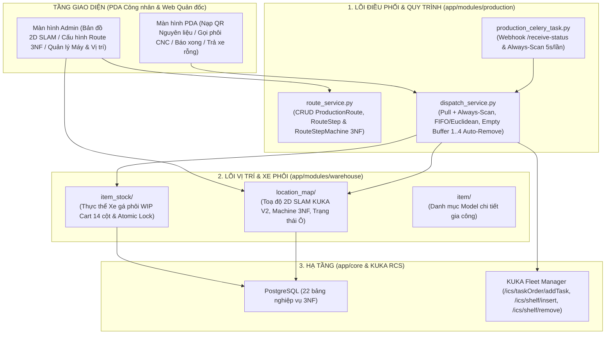

# TÀI LIỆU GIẢI PHẪU CHI TIẾT HỆ THỐNG LÕI HIỆN TẠI (ACTIVE CORE REFERENCE - BẢN MỚI NHẤT)

> **Mục đích tài liệu**: Nắm vững 100% cấu trúc mã nguồn hiện tại trong `backend/app/`, hiểu rõ **từng file, từng bảng chuẩn hóa 3NF, từng hàm trong `DispatchService`** đang vận hành ra sao sau khi hoàn tất đồng bộ kiến trúc.

---

## 1. SƠ ĐỒ KIẾN TRÚC LÕI HIỆN TẠI (`backend/app/`)

---

## 2. GIẢI PHẪU CHI TIẾT MODULE ĐIỀU PHỐI (`backend/app/modules/production/`)

### 2.1. File [`production_models.py`](file:///D:/KuKA/KUKA_WMS/backend/app/modules/production/production_models.py) — 9 Bảng Sản xuất & Điều phối 3NF
1. **`Machine` (bảng `machine`)**: Danh mục máy CNC vật lý (`machine_code`, `machine_name`, `default_stage_level`, `warehouse_id`, `is_active`).
2. **`RouteStepMachine` (bảng `route_step_machine`)**: Bảng nối chuẩn 3NF giữa `route_step.id` và `machine.id` (thay thế hoàn toàn mảng JSON `allowed_machines` cũ).
3. **`UserLocation` (bảng `user_locations`)**: Gán tài khoản công nhân (`user_id`) với các vị trí (`location_id`) — **không giới hạn số lượng vị trí**.
4. **`ProductionRoute` (bảng `production_route`)**: Quy trình công nghệ theo `item_id`.
5. **`RouteStep` (bảng `route_step`)**: Từng bước gia công (`step_number`, `stage_level`, `step_name`, `is_final_cnc_step`).
6. **`TransportRequest` (bảng `transport_request`)**: Đơn yêu cầu vận chuyển (`CALL_MATERIAL`, `MOVE_TO_WASH`, `RETURN_EMPTY_CART`).
7. **`TransportQueue` (bảng `transport_queue`)**: Hàng đợi tự động (`WAITING_CART` chờ xe, `WAITING_SLOT` chờ ô rửa/ô bãi rỗng).
8. **`FleetTask` (bảng `fleet_task`)**: Lệnh điều khiển gửi xuống KUKA Fleet Manager (`task_code`, `pickup_location_id`, `dropoff_location_id`, `cart_id`, `process_code`, `task_order_detail`).
9. **`TaskStatus` (bảng `task_status`)**: Lưu lịch sử gói tin callback từ KUKA Fleet Manager (`/receive-status`).
10. **`ProductionRecord` (bảng `production_record`)**: Nhật ký hoàn thành công đoạn gia công tại máy CNC.

---

### 2.2. File [`dispatch_service.py`](file:///D:/KuKA/KUKA_WMS/backend/app/modules/production/dispatch_service.py) — Các Hàm Điều Phối Trọng Tâm

1. **[`assign_locations_to_user(db, user_id, location_ids)`](file:///D:/KuKA/KUKA_WMS/backend/app/modules/production/dispatch_service.py#L247-L287)**:
   - Gán danh sách vị trí trạm cho tài khoản công nhân mà không giới hạn số lượng vị trí.
2. **[`register_raw_material_cart(db, cart_code, item_id, location_id, quantity, operator_id)`](file:///D:/KuKA/KUKA_WMS/backend/app/modules/production/dispatch_service.py#L293-L395)**:
   - Xử lý khi công nhân Khu Nguyên Liệu chọn vị trí + chọn Model + quét QR `cart_code`:
   - Gọi [`fleet_insert_rack`](file:///D:/KuKA/KUKA_WMS/backend/app/modules/production/dispatch_service.py#L166-L184) (`/ics/shelf/insert`) báo cho KUKA Fleet biết kệ đã đặt lên vị trí.
   - Tạo mới hoặc tái kích hoạt bản ghi `ItemStock` (`is_active = True`, `current_stage_level = 0`, `status = 'available'`, `quantity = standard_quantity_per_cart`).
   - Gọi ngay [`try_resolve_waiting_cart_queue(db, stage_level=0)`](file:///D:/KuKA/KUKA_WMS/backend/app/modules/production/dispatch_service.py#L1245-L1293) để nếu có máy CNC bước 1 đang chờ phôi thì điều AMR kéo đi ngay.
3. **[`get_stage_info_for_machine(db, location, item_id)`](file:///D:/KuKA/KUKA_WMS/backend/app/modules/production/dispatch_service.py#L412-L477)**:
   - Tự động tra cứu `ProductionRoute` $\rightarrow$ `RouteStep` $\rightarrow$ `RouteStepMachine` (3NF) của `item_id` để suy ra `(input_required_level, target_stage_level, is_final_cnc_step)` cho máy CNC đang gọi hàng.
4. **[`find_fifo_available_cart(db, item_id, stage_level, target_location)`](file:///D:/KuKA/KUKA_WMS/backend/app/modules/production/dispatch_service.py#L479-L533)**:
   - Sử dụng `with_for_update(of=ItemStock, skip_locked=True)` chống tranh chấp:
   - Nếu `stage_level == 0`: lấy theo **FIFO** (`created_at ASC, id ASC`).
   - Nếu `stage_level > 0`: lấy theo khoảng cách **2D Euclidean gần nhất** ([`calculate_distance`](file:///D:/KuKA/KUKA_WMS/backend/app/modules/production/dispatch_service.py#L402-L410)) kết hợp FIFO.
5. **[`call_material_to_cnc(db, destination_location_id, item_id, required_stage_level=None, ...)`](file:///D:/KuKA/KUKA_WMS/backend/app/modules/production/dispatch_service.py#L676-L773)**:
   - Tự động chuyển sang vị trí đệm `POS2` cùng máy nếu `POS1` đang bận.
   - Tự động suy ra `required_stage_level` nếu không truyền vào.
   - Khóa xe và phát lệnh `FleetTask` nếu có xe; ngược lại đưa vào `TransportQueue` (`WAITING_CART`).
6. **[`complete_machining_stage(db, cart_code=None, location_id=None, ...)`](file:///D:/KuKA/KUKA_WMS/backend/app/modules/production/dispatch_service.py#L779-L965)**:
   - **Bước trung gian (`is_final_cnc_step = False`)**: Nâng `current_stage_level`, mở khóa xe đứng tại chỗ (`status = 'available'`), và quét ngay `WAITING_CART` (`DISPATCHED_TO_WAITING_CNC` nếu đã có máy bước sau gọi trước, hoặc `STAGE_COMPLETED_WAITING_CALL` nếu chưa có máy nào gọi).
   - **Bước cuối (`is_final_cnc_step = True`)**: Tự động tạo lệnh `MOVE_TO_WASH` đẩy sang `WASHING_SLOT` trống hoặc xếp hàng `WAITING_SLOT`.
7. **[`find_next_empty_buffer_slot(db)`](file:///D:/KuKA/KUKA_WMS/backend/app/modules/production/dispatch_service.py#L636-L670) & [`complete_fleet_task(db, task_code)`](file:///D:/KuKA/KUKA_WMS/backend/app/modules/production/dispatch_service.py#L1176-L1243)**:
   - Phân bổ xe rỗng xoay vòng tuần tự **Round-Robin `1 -> 2 -> 3 -> 4 -> 1`** qua các ô `EMPTY-01..04`.
   - Khi AMR báo hạ xe rỗng thành công tại bãi đệm (`EMPTY_CART_BUFFER`), tự động gọi [`fleet_remove_rack`](file:///D:/KuKA/KUKA_WMS/backend/app/modules/production/dispatch_service.py#L186-L202) (`/ics/shelf/remove`) và xóa trạng thái xe khỏi vị trí (`location_id = None, is_active = False, quantity = 0, status = 'empty'`).
8. **[`scan_all_transport_queues(db)`](file:///D:/KuKA/KUKA_WMS/backend/app/modules/production/dispatch_service.py#L1373-L1385)**:
   - Quét toàn diện cả `WAITING_CART` (mọi Level) và `WAITING_SLOT`, được kích hoạt cả theo sự kiện (Event-driven) lẫn định kỳ mỗi **5 giây** qua Celery Beat (`always-scan-transport-queue`).
