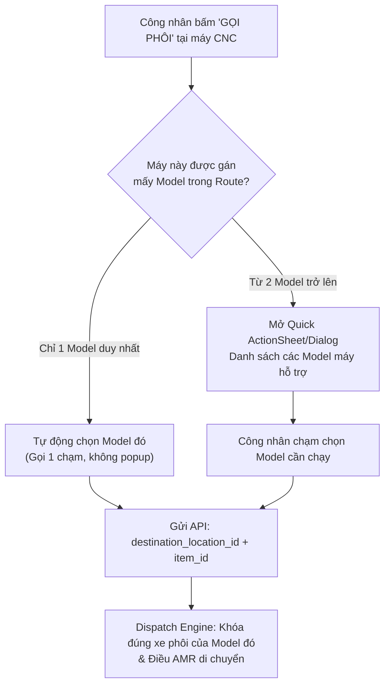

# ADR-002: BỔ SUNG LỰA CHỌN MODEL SẢN PHẨM KHI CÔNG NHÂN GỌI PHÔI TẠI MÁY CNC TRÊN PDA

* **Mã quyết định**: `ADR-002`
* **Trạng thái**: `ACCEPTED` (Đã phê duyệt kiến trúc & Sẵn sàng triển khai)
* **Ngày tạo**: 2026-10-23
* **Người quyết định**: Quản đốc xưởng (User) & Senior System Architect (Antigravity)
* **Phạm vi tác động**: 
  - Khối 5 (Lõi điều phối AMR / Dispatch Engine)
  - Khối PDA CNC (Giao diện điều khiển tại trạm máy xưởng)
  - Router API & Schema Production (`route_api.py`, `route_schema.py`)

---

## 1. BỐI CẢNH & VẤN ĐỀ (CONTEXT & PROBLEM)

### 1.1. Hiện trạng trước đây
Tại commit gần đây, tham số `item_id` (Model sản phẩm) và `required_stage_level` (Cấp độ công đoạn yêu cầu) đã bị gỡ bỏ khỏi payload API Gọi phôi của máy CNC (`CallMaterialRequest`), với giả định rằng hệ thống có thể tự suy luận Model dựa vào vị trí máy:
```python
# Code cũ trong dispatch_core.py:
step_link = (
    db.query(RouteStepMachine)
    .join(RouteStep, ...)
    .filter(RouteStepMachine.machine_id == dest_loc.machine_id)
    .first()  # <--- NGUY CƠ TIỀM THẨM
)
```

### 1.2. Lỗ hổng nghiệp vụ thực tế xưởng
Trong môi trường sản xuất cơ khí linh hoạt:
1. **Một máy CNC tham gia gia công cho nhiều Model sản phẩm khác nhau**:
   * Ví dụ: Máy `CNC-01` vừa có khả năng tiện thô cho `MODEL-A` (Phôi Trục Chính), vừa có khả năng tiện thô cho `MODEL-B` (Phôi Mặt Bích).
2. **Hệ thống bị bất định (Ambiguity)**:
   * Khi công nhân đứng tại `CNC-01` bấm nút **"GỌI PHÔI"** mà không chỉ định Model, lệnh `.first()` trong cơ sở dữ liệu sẽ chọn ngẫu nhiên Model nào được tạo trước.
   * **Hậu quả**: Công nhân trong ca làm việc muốn gia công `MODEL-B`, nhưng Robot AMR lại tự động chở xe phôi `MODEL-A` tới máy, gây sai lệch kế hoạch sản xuất và gián đoạn dây chuyền.

---

## 2. QUYẾT ĐỊNH KIẾN TRÚC (THE ARCHITECTURAL DECISION)

Chúng tôi quyết định **khôi phục và chuẩn hóa việc chọn Model khi gọi phôi**, nhưng nâng cấp trải nghiệm người dùng theo hướng **tự động hóa thông minh (Context-Aware UI)**:



### Nguyên tắc dữ liệu 3NF (Không sinh bảng mới, không cấu hình lại):
Danh sách Model mà một máy CNC hỗ trợ được truy vấn động đảo ngược từ cấu trúc 3NF hiện có:
$$\text{Machine} \leftarrow \text{RouteStepMachine} \rightarrow \text{RouteStep} \rightarrow \text{ProductionRoute} \rightarrow \text{Item (Model)}$$

---

## 3. DANH SÁCH CÔNG VIỆC CẦN LÀM (TASK TRACKER)

File tài liệu này đóng vai trò là bảng theo dõi tiến độ thi công. Bạn và các kỹ sư có thể theo dõi và bổ sung các hạng mục tiếp theo:

### Giai đoạn 1: Backend Router, Schema & Dispatch Core
- [ ] **Task 1.1** ([`route_schema.py`](file:///D:/KuKA/KUKA_WMS/backend/app/modules/production/route_schema.py)):
  - Bổ sung `item_id: int` (bắt buộc) vào schema `CallMaterialRequest`.
  - Tạo schema mới `PdaCncSupportedModel`:
    ```python
    class PdaCncSupportedModel(BaseModel):
        item_id: int
        model_code: str
        model_name: str
        stage_level: int
        stage_name: str
        input_stage_level: int
    ```
  - Bổ sung `supported_models: list[PdaCncSupportedModel] = []` vào schema `PdaCncStation`.
- [ ] **Task 1.2** ([`route_api.py`](file:///D:/KuKA/KUKA_WMS/backend/app/modules/production/route_api.py)):
  - Trong `get_pda_cnc_stations`: Viết query lấy toàn bộ các Model + Step mà máy CNC tại vị trí đó được gán trong `RouteStepMachine`, map vào `supported_models`.
  - Trong `call_material`: Nhận `body.item_id` và truyền trực tiếp vào `dispatch_service.call_material_to_cnc`.
- [ ] **Task 1.3** ([`dispatch_core.py`](file:///D:/KuKA/KUKA_WMS/backend/app/modules/production/dispatch/dispatch_core.py)):
  - Bỏ triệt để câu lệnh `.first()` suy đoán ngẫu nhiên.
  - Thêm bước kiểm tra: Nếu `item_id` không nằm trong danh sách các Model mà máy được phép gia công $\rightarrow$ Báo lỗi `400 Bad Request` rõ ràng cho công nhân.
  - Xác định chính xác `required_stage_level` tương ứng với cặp `(machine_id, item_id)`.

### Giai đoạn 2: Frontend Types, API Client & Zustand Store
- [ ] **Task 2.1** ([`types/pda.ts`](file:///D:/KuKA/KUKA_WMS/frontend/src/types/pda.ts)):
  - Thêm interface `CncSupportedModel`.
  - Bổ sung `supportedModels: CncSupportedModel[]` vào interface `CncMachineStation`.
- [ ] **Task 2.2** ([`api/pda.ts`](file:///D:/KuKA/KUKA_WMS/frontend/src/api/pda.ts)):
  - Cập nhật payload `CallMaterialPayload` yêu cầu `item_id: number`.
  - Map trường `supported_models` trong hàm chuyển đổi `getPdaCncStationsApi`.
- [ ] **Task 2.3** ([`usePdaStore.ts`](file:///D:/KuKA/KUKA_WMS/frontend/src/store/usePdaStore.ts)):
  - Cập nhật hàm `callMaterialToCnc: (stationId: string, itemId: number) => Promise<void>`.
  - Truyền `item_id` chính xác xuống API; cập nhật tên Model gọi phôi trên giao diện ngay lập tức (Optimistic UI).

### Giai đoạn 3: Giao diện Người dùng PDA ([`CncLineModal.tsx`](file:///D:/KuKA/KUKA_WMS/frontend/src/components/pda/CncLineModal.tsx))
- [ ] **Task 3.1** (Logic kích hoạt nút):
  - Khi bấm nút gọi phôi:
    - Nếu `st.supportedModels.length === 1`: Tự động gọi ngay Model duy nhất đó (bảo toàn 1-chạm cho máy chuyên dụng).
    - Nếu `st.supportedModels.length > 1`: Mở Dialog/Modal chọn Model.
- [ ] **Task 3.2** (Thiết kế Dialog chọn Model công nghiệp):
  - Hiển thị danh sách thẻ lớn, dễ bấm bằng găng tay bảo hộ trên thiết bị PDA cầm tay.
  - Mỗi thẻ hiển thị: Mã Model, Tên chi tiết, Cấp phôi đầu vào cần nạp (Level 0 phôi thô hay Level 1 phôi đã tiện).
  - Nút đóng/hủy thao tác nhanh.

### Giai đoạn 4: Kiểm thử End-to-End (E2E Verification)
- [ ] **Task 4.1**: Kiểm thử máy CNC chỉ có 1 Model $\rightarrow$ Bấm nút gọi phôi 1 chạm thành công.
- [ ] **Task 4.2**: Cấu hình 1 máy CNC làm cả Model A và Model B $\rightarrow$ Mở popup chọn Model B $\rightarrow$ Hệ thống dispatch đúng xe Model B và AMR di chuyển chính xác.
- [ ] **Task 4.3**: Kiểm tra không còn lỗi crash 500 hay `TypeError` / `ResponseValidationError`.

---

## 4. HỆ QUẢ & ĐÁNH GIÁ (CONSEQUENCES)

### Điểm tích cực (Pros):
* **Chính xác tuyệt đối**: Loại bỏ hoàn toàn rủi ro robot chở nhầm phôi cho công nhân.
* **Tối ưu trải nghiệm xưởng**: Không ép công nhân bấm thêm nếu máy chỉ làm 1 sản phẩm; chỉ hỏi khi thực sự có từ 2 sản phẩm trở lên.
* **Kế thừa 100% CSDL**: Dùng dữ liệu quan hệ có sẵn của Production Route, không cần can thiệp migration CSDL.

### Lưu ý cho các kỹ sư tiếp theo:
* Mọi thay đổi về gán máy trong quy trình sản xuất trên Web Admin sẽ tự động phản ánh ngay lập tức trên màn hình PDA của công nhân mà không cần cấu hình thêm ở tầng trung gian.

---

## 5. CẬP NHẬT TRẠNG THÁI REAL-TIME TỪ KUKA FLEET (QUEUED vs CALLING)

### Thực tế xưởng:
Khi công nhân bấm **GỌI PHÔI**, hệ thống gửi nhiệm vụ tới KUKA Fleet hoặc xếp vào hàng đợi WMS. Trong xưởng có thể có nhiều lệnh đang chờ trước đó, robot chưa thực sự bắt đầu di chuyển tới máy này.
Nếu hiển thị ngay *"AMR ĐANG TỚI"* sẽ gây nhầm lẫn cho công nhân.

### Giải pháp phân tách trạng thái:
1. **`QUEUED` (Đang Chờ AMR / Đang Chờ Điều Phối)**:
   - Áp dụng khi: `TransportRequest.status == 'queued_for_cart'` hoặc `FleetTask.status in ('created', 'pending_submit', 'sent')`.
   - Giao diện PDA: Thẻ màu vàng hổ phách (*Amber Badge*), thông báo: *"Đã tiếp nhận yêu cầu, đang xếp hàng chờ AMR..."*.
2. **`CALLING` (AMR Đang Chở Tới / Đang Thực Hiện)**:
   - Áp dụng khi: KUKA Fleet tiếp nhận thực thi nhiệm vụ (`FleetTask.status in ('dispatched', 'in_progress')` tương ứng webhook `MOVE_BEGIN`, `UP_CONTAINER`).
   - Giao diện PDA: Thẻ màu xanh dương xung nhịp (*Blue Pulse Badge*), thông báo: *"AMR đã nhận nhiệm vụ và đang chở phôi tới máy!"*.
