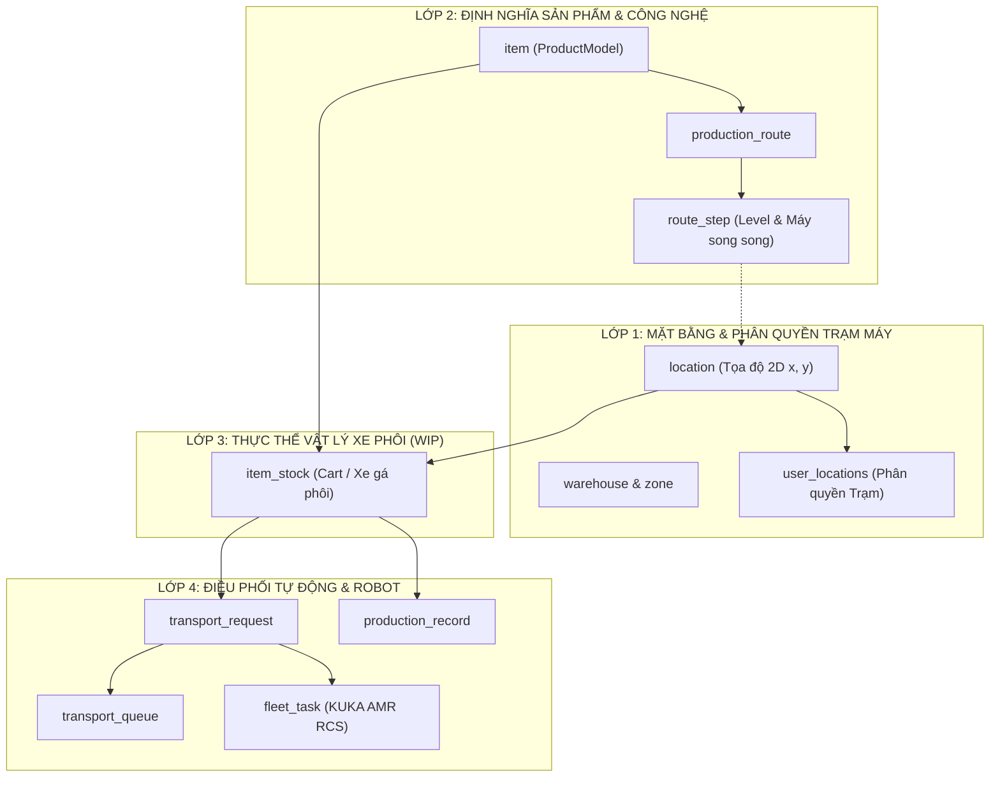

# ĐẶC TẢ THIẾT KẾ KIẾN TRÚC DATABASE CỐT LÕI (CORE DATABASE ARCHITECTURE SPECIFICATION)
## HỆ THỐNG ĐIỀU PHỐI KUKA AMR CHO DÂY CHUYỀN SẢN XUẤT CƠ KHÍ & GIA CÔNG CNC

* **Mã tài liệu**: `DOCS/core_database_architecture_specification.md`
* **Phiên bản**: 3.0 (Thiết kế Chuyên sâu cho Khối Ứng dụng Cốt lõi - Core Engine)
* **Ngày lập**: 16/10/2026
* **Trạng thái**: Đề xuất Kiến trúc Chuyên sâu (Kèm Rationale chi tiết cho từng quyết định)

---

## 1. TỔNG QUAN & PHẠM VI KHỐI CORE (CORE ENGINE SCOPE)

Khối Core của hệ thống điều phối KUKA AMR bao gồm **8 thực thể nền tảng**, được chia thành 4 lớp kiến trúc:



---

## 2. CHI TIẾT THIẾT KẾ TỪNG BẢNG CỐT LÕI & LÝ GIẢI "TẠI SAO" (RATIONALE)

---

### BẢNG 1: `location` — Bản đồ Tọa độ 2D & Điểm Đỗ Trạm Máy Vật lý
Bảng quản lý mọi điểm dừng đỗ trên mặt bằng xưởng (7 vị trí cấp phôi, các vị trí trạm máy CNC, 4 slot tẩy rửa, các slot bãi đệm xe rỗng).

> [!IMPORTANT]
> **QUY TẮC CỐT LÕI ĐÃ KHÓA: 1 MÁY CNC CÓ 2 VỊ TRÍ ĐỖ XE VẬT LÝ ĐỘC LẬP (CẢ 2 ĐỀU VÀO VÀ RA)**
> - Trong thực tế xưởng cơ khí, mỗi máy CNC (ví dụ `CNC-01`) luôn có **2 vị trí đỗ xe vật lý** (`CNC01_POS1` và `CNC01_POS2`), tương ứng với 2 tọa độ `(map_x, map_y)` riêng biệt trên bản đồ.
> - **Cả 2 vị trí đều có chức năng Vào (Infeed) và Ra (Outfeed) độc lập**:
>   + Khi vị trí **TRỐNG**: Công nhân bấm [GỌI PHÔI] $\rightarrow$ AMR chở xe phôi tới hạ vào vị trí này (VÀO).
>   + Công nhân bốc phôi gia công và gắp trả lại xe. Khi xong cả 120 chi tiết $\rightarrow$ Công nhân bấm **[BÁO XONG: CẬP NHẬT LEVEL]** $\rightarrow$ AMR tới cõng xe tại vị trí này đi tiếp công đoạn sau hoặc chuyển sang Tẩy Rửa (RA).
>   + **Ý nghĩa vận hành**: Cơ chế đệm kép (Double-buffering / Zero CNC Starvation). Máy đang chạy xe ở Vị trí 1, công nhân có thể bấm gọi trước 1 xe vào Vị trí 2 để gối đầu liên tục, không bao giờ phải dừng máy chờ phôi.
> - **Quy tắc phân quyền hiển thị trên PDA**:
>   + Công nhân quản lý 1 máy CNC (1 công đoạn) $\rightarrow$ thấy **2 thẻ vị trí** (Vị trí 1 & Vị trí 2).
>   + Công nhân quản lý 2 máy CNC (2 công đoạn) $\rightarrow$ thấy **4 thẻ vị trí** (Máy 1: Vị trí 1, 2 và Máy 2: Vị trí 1, 2).

#### Cấu trúc bảng:
```sql
CREATE TABLE location (
    id SERIAL PRIMARY KEY,
    location_code VARCHAR(50) NOT NULL,            -- Mã điểm trên bản đồ KUKA (ví dụ: 'VT-01'..'VT-07', 'CNC01_POS1', 'CNC01_POS2', 'WASH-01'..'WASH-04', 'BUF-01'..'BUF-04')
    location_name VARCHAR(100) NOT NULL,           -- Tên hiển thị (ví dụ: 'CNC 01 - Vị trí 1', 'CNC 01 - Vị trí 2')
    location_type VARCHAR(30) NOT NULL DEFAULT 'CNC_SLOT', -- 'RAW_MATERIAL', 'CNC_SLOT', 'WASHING_SLOT', 'EMPTY_CART_BUFFER'
    machine_code VARCHAR(50),                      -- Mã máy CNC (ví dụ: 'CNC-01' chung cho cả 2 vị trí POS1 và POS2), NULL nếu là khu khác
    position_index INT,                            -- Vị trí 1 hoặc 2 tại máy CNC (NULL nếu là khu khác)
    warehouse_id INT NOT NULL REFERENCES warehouse(id),
    zone_id INT REFERENCES zone(id),                -- Thuộc Khu vực nào (Nguyên liệu / Line CNC 1 / Tẩy rửa / Bãi đệm)
    map_x INT NOT NULL,                             -- Tọa độ X trên mặt bằng 2D (mm/pixel)
    map_y INT NOT NULL,                             -- Tọa độ Y trên mặt bằng 2D (mm/pixel)
    is_active BOOLEAN NOT NULL DEFAULT TRUE,
    created_at TIMESTAMPTZ NOT NULL DEFAULT NOW(),
    updated_at TIMESTAMPTZ NOT NULL DEFAULT NOW(),
    CONSTRAINT uq_location_warehouse_code UNIQUE (warehouse_id, location_code)
);
CREATE INDEX idx_location_zone ON location(zone_id);
CREATE INDEX idx_location_type ON location(location_type);
CREATE INDEX idx_location_machine ON location(machine_code);
CREATE INDEX idx_location_coords ON location(map_x, map_y);
```

#### 💡 Quyết định thiết kế & Lý giải "TẠI SAO":
1. **Tại sao mỗi máy CNC phải tách thành 2 bản ghi `location` độc lập mà không gộp chung?**
   * *Lý do*: Robot AMR là thiết bị vật lý di chuyển theo tọa độ thực tế `(map_x, map_y)`. Vị trí 1 và Vị trí 2 nằm ở 2 điểm đỗ cách nhau trên sàn xưởng. AMR bắt buộc phải biết chính xác tọa độ của Vị trí 1 hay Vị trí 2 để hạ xe hoặc bốc xe, không thể hạ chung chung tại \"máy CNC\".
2. **Tại sao thêm `machine_code` và `position_index`?**
   * *Lý do*: Giúp hệ thống nhóm 2 vị trí lại dưới cùng một thực thể máy CNC một cách tự nhiên. Khi công nhân chọn hoặc xem danh sách trạm máy, hệ thống dễ dàng gom nhóm mà không cần tạo thêm bảng `machine` cồng kềnh.
3. **Tại sao tọa độ `map_x`, `map_y` bắt buộc kiểu `INT` và phải đánh Index?**
   * *Lý do*: Thuật toán tìm xe gần nhất của hệ thống tính theo khoảng cách **2D Euclidean**: 
     $$\text{Distance} = \sqrt{(x_{\text{máy}} - x_{\text{xe}})^2 + (y_{\text{máy}} - y_{\text{xe}})^2}$$
     Khi có 1 vị trí CNC bấm gọi hàng, hệ thống quét nhanh tọa độ của tất cả các xe thỏa mãn điều kiện để tìm xe có Distance nhỏ nhất.

---

### BẢNG 2: `user_locations` — Phân Quyền Trạm Máy Theo Tài Khoản
Bảng ánh xạ M:N quy định tài khoản công nhân nào được nhìn thấy và thao tác tại những vị trí nào trên PDA.

#### Cấu trúc bảng:
```sql
CREATE TABLE user_locations (
    user_id INT NOT NULL REFERENCES users(id) ON DELETE CASCADE,
    location_id INT NOT NULL REFERENCES location(id) ON DELETE CASCADE,
    created_at TIMESTAMPTZ NOT NULL DEFAULT NOW(),
    PRIMARY KEY (user_id, location_id)
);
CREATE INDEX idx_user_locations_user ON user_locations(user_id);
CREATE INDEX idx_user_locations_loc ON user_locations(location_id);
```

#### 💡 Quyết định thiết kế & Lý giải "TẠI SAO":
1. **Tại sao không lưu trực tiếp `location_id` vào bảng `users`?**
   * *Lý do*: Bạn đã yêu cầu: *"1 tài khoản CNC có thể quản lý 1 công đoạn (2 vị trí) hoặc 2 công đoạn (4 vị trí)"*, và *"Khu nguyên liệu có thể 2 máy 1 tài khoản, khu tẩy rửa 1 tài khoản quản lý cả 4 vị trí"*.
   * Quan hệ ở đây là **1 User quản lý Nhiều Location** (1:N hoặc N:M). Tạo bảng trung gian `user_locations` giúp Admin trên trang Settings tùy ý tích chọn 1, 2, 4 hoặc toàn bộ vị trí cho 1 tài khoản cực kỳ linh hoạt mà không cần sửa schema database.
2. **Tại sao dùng `ON DELETE CASCADE`?**
   * *Lý do*: Khi Admin xóa 1 tài khoản công nhân nghỉ việc, hệ thống tự động dọn sạch các bản ghi gán quyền liên quan, không để lại rác dữ liệu mồ côi.

---

### BẢNG 3: `item` (Tái sử dụng làm `ProductModel`) — Danh Mục Model Chi Tiết
Quản lý 7 Model sản phẩm cơ khí gia công (ví dụ: Trục Rotor, Hộp giảm tốc...).

#### Cấu trúc bảng:
```sql
CREATE TABLE item (
    id SERIAL PRIMARY KEY,
    sku VARCHAR(50) NOT NULL UNIQUE,                -- Mã Model (ví dụ: 'MDL-01', 'MDL-02')
    name VARCHAR(255) NOT NULL,                     -- Tên Model (ví dụ: 'Model 1: Trục Rotor')
    description TEXT,                               -- Mô tả kỹ thuật
    standard_quantity_per_cart INT NOT NULL DEFAULT 1, -- Số lượng chi tiết tiêu chuẩn xếp trên 1 xe gá
    warehouse_id INT NOT NULL REFERENCES warehouse(id),
    is_active BOOLEAN NOT NULL DEFAULT TRUE,
    created_at TIMESTAMPTZ NOT NULL DEFAULT NOW(),
    updated_at TIMESTAMPTZ NOT NULL DEFAULT NOW()
);
CREATE INDEX idx_item_sku ON item(sku);
```

#### 💡 Quyết định thiết kế & Lý giải "TẠI SAO":
1. **Tại sao gỡ bỏ các ràng buộc cũ (`base_unit`, `max_quantity`, `min_quantity`, `supplier`)?**
   * *Lý do*: Đây là các trường đặc thù của kho bán lẻ FMCG Masan (quản lý tồn an toàn min/max để đặt hàng nhà cung cấp). Trong dây chuyền gia công cơ khí, ta chỉ quan tâm Model này tên gì, mã gì, và 1 xe gá chở được bao nhiêu chi tiết (`standard_quantity_per_cart`).

---

### BẢNG 4 & 5: `production_route` & `route_step` — Quy Trình Gia Công & Level Công Đoạn
Trục xương sống định nghĩa đường đi công nghệ cho từng Model chi tiết.

#### Cấu trúc bảng:
```sql
-- 4. Bảng Quy trình Route tổng thể
CREATE TABLE production_route (
    id SERIAL PRIMARY KEY,
    item_id INT NOT NULL REFERENCES item(id) ON DELETE CASCADE,
    route_code VARCHAR(50) NOT NULL UNIQUE,         -- Ví dụ: 'ROUTE-MDL01-STD'
    route_name VARCHAR(100) NOT NULL,
    version INT NOT NULL DEFAULT 1,
    is_active BOOLEAN NOT NULL DEFAULT TRUE,
    created_at TIMESTAMPTZ NOT NULL DEFAULT NOW(),
    updated_at TIMESTAMPTZ NOT NULL DEFAULT NOW()
);
CREATE INDEX idx_route_item ON production_route(item_id);

-- 5. Bảng Từng Bước trong Quy trình
CREATE TABLE route_step (
    id SERIAL PRIMARY KEY,
    route_id INT NOT NULL REFERENCES production_route(id) ON DELETE CASCADE,
    step_number INT NOT NULL,                       -- Thứ tự bước tuần tự: 1, 2, 3, 4
    stage_level INT NOT NULL,                       -- LEVEL ĐƯỢC CHỈ ĐỊNH: 1, 2, 3
    stage_name VARCHAR(100) NOT NULL,               -- 'Phay Thô', 'Phay Tinh', 'Khoan Tappi', 'Tẩy Rửa'
    step_group INT NOT NULL DEFAULT 1,              -- Nhóm máy thay thế song song
    allowed_locations JSONB NOT NULL DEFAULT '[]',  -- Danh sách location_id máy hợp lệ (VD: [201, 202])
    is_final_step BOOLEAN NOT NULL DEFAULT FALSE,   -- TRUE nếu là bước CNC cuối -> Chuyển sang Tẩy Rửa
    created_at TIMESTAMPTZ NOT NULL DEFAULT NOW(),
    CONSTRAINT uq_route_step_number UNIQUE (route_id, step_number)
);
CREATE INDEX idx_route_step_lookup ON route_step(route_id, stage_level);
```

#### 💡 Quyết định thiết kế & Lý giải "TẠI SAO":
1. **Tại sao tách riêng `step_number` và `stage_level`?**
   * *Lý do*: 
     * `step_number` là thứ tự chạy tuần tự (1 $\rightarrow$ 2 $\rightarrow$ 3 $\rightarrow$ 4).
     * `stage_level` là cấp độ kỹ thuật hiển thị trên PDA và xe phôi (Level 1: Phay thô $\rightarrow$ Level 2: Phay tinh).
     * Việc tách riêng giúp hệ thống kiểm tra logic chặt chẽ: Máy thuộc Level 2 chỉ được gọi xe có `last_completed_step_id` đạt đúng Level 1!
2. **Tại sao dùng cột `allowed_locations` kiểu `JSONB`?**
   * *Lý do*: Để hỗ trợ **nhóm máy chạy song song**. Ví dụ: Bước 1 (Phay thô) có thể thực hiện tại `CNC-01` (id 201) HOẶC `CNC-02` (id 202). Lưu mảng `[201, 202]` cho phép câu lệnh SQL kiểm tra quyền của máy cực nhanh:
     `WHERE allowed_locations @> '201'::jsonb`.

---

### BẢNG 6: `item_stock` (Nâng cấp thành `Cart / WIP`) — Xe Gá Phôi & Trạng Thái Vật Lý
Quản lý từng chiếc xe gá phôi vật lý đang lưu thông trên sàn xưởng.

#### Cấu trúc bảng:
```sql
CREATE TABLE item_stock (
    id SERIAL PRIMARY KEY,
    cart_code VARCHAR(50) NOT NULL UNIQUE,          -- Mã QR dán trên xe (VD: 'RCK-1021', quét từ PDA)
    item_id INT NOT NULL REFERENCES item(id),       -- Xe đang chở Model nào
    quantity INT NOT NULL DEFAULT 1,                -- Số lượng phôi trên xe
    location_id INT NOT NULL REFERENCES location(id), -- Đang đỗ ở trạm máy nào hoặc slot nào
    last_completed_step_id INT REFERENCES route_step(id), -- Đã hoàn thành bước nào (Level hiện tại)
    
    -- CƠ CHẾ CHỐNG TRANH CHẤP XE (CONCURRENCY LOCKING)
    is_locked BOOLEAN NOT NULL DEFAULT FALSE,       -- TRUE: Xe đang có nhiệm vụ điều động, cấm máy khác gọi
    locked_by_task_id INT,                          -- FK liên kết với transport_request đang giữ xe
    destination_location_id INT REFERENCES location(id), -- Đang trên đường đi đến đâu
    
    status VARCHAR(30) NOT NULL DEFAULT 'available', -- 'available', 'locked', 'in_transit', 'processing', 'washing', 'completed'
    is_active BOOLEAN NOT NULL DEFAULT TRUE,
    created_at TIMESTAMPTZ NOT NULL DEFAULT NOW(),
    updated_at TIMESTAMPTZ NOT NULL DEFAULT NOW()
);
CREATE INDEX idx_cart_code ON item_stock(cart_code);
CREATE INDEX idx_cart_lookup ON item_stock(item_id, location_id, is_locked, status);
CREATE INDEX idx_cart_step ON item_stock(last_completed_step_id);
```

#### 💡 Quyết định thiết kế & Lý giải "TẠI SAO":
1. **Tại sao thêm `is_locked` và `locked_by_task_id`?**
   * *Lý do*: Trong xưởng có nhiều máy CNC hoạt động đồng thời. Nếu `CNC-03` và `CNC-04` cùng cần Model 1 và cùng quét thấy chiếc xe `RCK-1021` đang rảnh ở `CNC-01`:
     * Ngay khi `CNC-03` được gán xe, hệ thống lập tức khóa `is_locked = TRUE`.
     * `CNC-04` quét sau sẽ thấy xe đã bị khóa $\rightarrow$ Không thể gọi tranh xe, yêu cầu của `CNC-04` sẽ tự động chuyển vào hàng đợi `transport_queue`.
   * *Nếu thiếu*: AMR sẽ nhận 2 lệnh xung đột tới cùng 1 chiếc xe, gây lỗi hệ thống Fleet Manager.
2. **Tại sao gỡ bỏ các cột WMS cũ (`inbound_order_detail_id`, `lot_number_from/to`, `expiry_date`)?**
   * *Lý do*: Phôi kim loại không có hạn sử dụng (expiry date) như thực phẩm mì tôm, và không liên kết với đơn nhập kho logistics. Gỡ bỏ giúp bảng nhẹ hơn 70%, loại bỏ hoàn toàn các ràng buộc khóa ngoại thừa.

---

### BẢNG 7: `transport_request` — Yêu Cầu Gọi Xe Từ PDA Công Nhân
Ghi nhận mỗi lần công nhân tại trạm bấm nút gọi hàng hoặc gửi xe.

#### Cấu trúc bảng:
```sql
CREATE TABLE transport_request (
    id SERIAL PRIMARY KEY,
    request_code VARCHAR(50) NOT NULL UNIQUE,       -- Mã yêu cầu (VD: 'TR-20261016-0001')
    from_location_id INT REFERENCES location(id),   -- Điểm lấy xe (NULL nếu hệ thống tự tìm xe gần nhất)
    to_location_id INT NOT NULL REFERENCES location(id), -- Điểm giao xe (Trạm CNC đang gọi)
    cart_id INT REFERENCES item_stock(id),          -- Chiếc xe được chỉ định sau khi tìm kiếm thành công
    requested_model_id INT NOT NULL REFERENCES item(id), -- Cần model gì
    required_stage_level INT NOT NULL,              -- Yêu cầu phôi phải đạt Level mấy (VD: Level 1)
    
    status VARCHAR(30) NOT NULL DEFAULT 'pending',   -- 'pending', 'assigned', 'dispatched', 'in_progress', 'completed', 'cancelled'
    created_by_user_id INT REFERENCES users(id),    -- Tài khoản PDA nào phát lệnh
    completed_at TIMESTAMPTZ,
    created_at TIMESTAMPTZ NOT NULL DEFAULT NOW(),
    updated_at TIMESTAMPTZ NOT NULL DEFAULT NOW()
);
CREATE INDEX idx_transport_request_status ON transport_request(status);
CREATE INDEX idx_transport_request_dest ON transport_request(to_location_id, status);
```

#### 💡 Quyết định thiết kế & Lý giải "TẠI SAO":
1. **Tại sao `from_location_id` và `cart_id` lại là `NULLABLE` lúc tạo?**
   * *Lý do*: Bạn đã chốt nguyên tắc: *"Công nhân tại trạm CNC chỉ cần chọn Model, không cần biết xe đang ở đâu. Hệ thống tự động quét map tìm xe gần nhất"*.
   * Khi công nhân bấm nút: Yêu cầu sinh ra với `from_location_id = NULL` và `cart_id = NULL`. Thuật toán tìm kiếm xe gần nhất theo Euclidean 2D sẽ chạy trong micro-giây, tìm thấy xe và gán ngược `cart_id` cùng `from_location_id` vào bản ghi.

---

### BẢNG 8: `transport_queue` — Hàng Đợi Điều Phối Tự Động (Automation Engine)
Trái tim giải quyết bài toán: **Chưa có xe sẵn sàng** hoặc **Khu tẩy rửa bị đầy slot**.

#### Cấu trúc bảng:
```sql
CREATE TABLE transport_queue (
    id SERIAL PRIMARY KEY,
    transport_request_id INT NOT NULL REFERENCES transport_request(id) ON DELETE CASCADE,
    queue_type VARCHAR(30) NOT NULL,                -- 'WAITING_CART' (Chờ xe) HOẶC 'WAITING_WASH_SLOT' (Chờ slot tẩy rửa)
    priority INT NOT NULL DEFAULT 10,               -- Độ ưu tiên (số nhỏ hơn ưu tiên trước)
    target_station_id INT NOT NULL REFERENCES location(id),
    model_id INT NOT NULL REFERENCES item(id),
    required_level INT NOT NULL,
    status VARCHAR(20) NOT NULL DEFAULT 'PENDING',  -- 'PENDING', 'PROCESSING', 'RESOLVED', 'CANCELLED'
    resolved_at TIMESTAMPTZ,
    created_at TIMESTAMPTZ NOT NULL DEFAULT NOW()
);
CREATE INDEX idx_transport_queue_active ON transport_queue(queue_type, status, priority);
```

#### 💡 Quyết định thiết kế & Lý giải "TẠI SAO":
1. **Tại sao bắt buộc phải có bảng này?**
   * *Tình huống thực tế*:
     * Máy `CNC-03` cần phôi Level 1, nhưng cả 2 máy `CNC-01` và `CNC-02` đều đang dở việc chưa xong $\rightarrow$ Lúc này **chưa có xe thỏa mãn**.
     * Nếu không có bảng queue: Hệ thống sẽ báo lỗi *"Không tìm thấy xe"*, bắt công nhân phải ngồi canh và bấm lại liên tục.
     * Có bảng queue: Yêu cầu tự động đưa vào `transport_queue` với trạng thái `PENDING`. Background worker liên tục lắng nghe: ngay khi `CNC-01` bấm Báo Xong $\rightarrow$ Queue tự động khớp xe và kích hoạt AMR mang tới `CNC-03` ngay lập tức!
   * *Tình huống Tẩy Rửa đầy slot*:
     * Máy CNC cuối làm xong, nhưng 4 slot tẩy rửa đều có hàng $\rightarrow$ Xe vào queue chờ slot trống. Khi nhân viên tẩy rửa bấm "Đã lấy đi rửa" (giải phóng slot) $\rightarrow$ Queue lập tức kích hoạt AMR lấy xe từ CNC cuối mang vào slot vừa trống.

---

### BẢNG 9: `fleet_task` — Giao Tiếp KUKA Fleet Manager (RCS Adapter)
Theo dõi tác vụ cấp thấp gửi sang điều khiển robot AMR di chuyển.

#### Cấu trúc bảng:
```sql
CREATE TABLE fleet_task (
    id SERIAL PRIMARY KEY,
    transport_request_id INT NOT NULL REFERENCES transport_request(id),
    task_code VARCHAR(50) NOT NULL UNIQUE,          -- Mã task gửi sang KUKA RCS
    robot_id VARCHAR(50),                           -- Mã robot thực hiện (ví dụ: 'AMR-KUKA-01')
    pickup_location_id INT NOT NULL REFERENCES location(id),
    dropoff_location_id INT NOT NULL REFERENCES location(id),
    cart_id INT NOT NULL REFERENCES item_stock(id),
    fleet_state VARCHAR(30) NOT NULL DEFAULT 'created', -- 'created', 'sent', 'accepted', 'executing', 'dropped', 'completed', 'failed'
    error_message TEXT,
    sent_at TIMESTAMPTZ,
    completed_at TIMESTAMPTZ,
    created_at TIMESTAMPTZ NOT NULL DEFAULT NOW(),
    updated_at TIMESTAMPTZ NOT NULL DEFAULT NOW()
);
CREATE INDEX idx_fleet_task_state ON fleet_task(fleet_state);
```

#### 💡 Quyết định thiết kế & Lý giải "TẠI SAO":
1. **Tại sao không gộp chung với `transport_request`?**
   * *Lý do*: Tuân thủ nguyên tắc đã chốt: **3 vòng đời độc lập**.
   * `transport_request` là góc nhìn của con người (Yêu cầu gọi hàng).
   * `fleet_task` là góc nhìn của Robot KUKA (Lệnh vận hành phần cứng: nhấc xe, né vật cản, hạ xe).
   * Một `transport_request` có thể cần thử lại (retry) gửi task mới sang Fleet Manager nếu robot bị kẹt hoặc lỗi kết nối mạng.

---

### BẢNG 10: `production_record` — Nhật Ký Lịch Sử Sản Xuất
Lưu vết mỗi lần công nhân bấm "Báo Xong" cập nhật Level tại trạm máy.

#### Cấu trúc bảng:
```sql
CREATE TABLE production_record (
    id SERIAL PRIMARY KEY,
    cart_id INT NOT NULL REFERENCES item_stock(id),
    model_id INT NOT NULL REFERENCES item(id),
    location_id INT NOT NULL REFERENCES location(id), -- Máy nào gia công
    user_id INT NOT NULL REFERENCES users(id),        -- Công nhân nào bấm
    completed_level INT NOT NULL,                     -- Level vừa đạt được (VD: Level 1)
    stage_name VARCHAR(100) NOT NULL,
    started_at TIMESTAMPTZ,
    completed_at TIMESTAMPTZ NOT NULL DEFAULT NOW()
);
CREATE INDEX idx_prod_rec_cart ON production_record(cart_id);
CREATE INDEX idx_prod_rec_loc ON production_record(location_id, completed_at);
```

#### 💡 Quyết định thiết kế & Lý giải "TẠI SAO":
1. **Tại sao cần bảng này?**
   * *Lý do*: Để tính toán thời gian gia công từng công đoạn (Cycle time), thống kê sản lượng theo từng máy CNC, và truy vết lịch sử chất lượng (nếu chi tiết phôi bị lỗi, xem lại ai là người đã bấm hoàn thành công đoạn đó).

---

## 3. DANH SÁCH 3 CÂU HỎI NGHIỆP VỤ CẦN BẠN XÁC NHẬN

Để bản thiết kế hoàn thiện 100% chuẩn xác trước khi viết file migration SQLAlchemy/Alembic, tôi xin hỏi bạn 3 câu hỏi sau:

1. **Về số lượng chi tiết trên xe gá phôi (`quantity`)**:
   * *Câu hỏi*: Mỗi chiếc xe gá phôi chở số lượng cố định theo Model (ví dụ Model 1 xe chở 10 cái, Model 2 xe chở 4 cái), hay công nhân ở Khu Nguyên Liệu khi cấp phôi có cần gõ số lượng thực tế không?
   * *Đề xuất*: Thiết lập số lượng mặc định theo Model trong bảng `item.standard_quantity_per_cart`. Khi công nhân quét QR Rack ở Nguyên Liệu thì hệ thống tự gán số lượng tiêu chuẩn này, không bắt công nhân gõ phím để giữ đúng nguyên tắc thao tác 1 chạm nhanh.

2. **Về việc Hủy lệnh gọi xe (Cancel Request)**:
   * *Câu hỏi*: Nếu công nhân tại trạm CNC bấm nhầm gọi Model 1 nhưng thực tế muốn gọi Model 2:
     * Khi AMR chưa chạy (đang nằm trong queue hoặc đang tìm xe): Cho phép bấm nút "Hủy gọi" trên PDA?
     * Khi AMR đã cõng xe chạy trên đường: Có cho phép hủy không, hay bắt buộc xe phải đến trạm rồi mới chuyển đi tiếp?

3. **Sau khi Tẩy Rửa xong, xe phôi đi đâu tiếp?**:
   * *Câu hỏi*: Tại Khu Tẩy Rửa, khi nhân viên bấm "Đã lấy đi rửa (Giải phóng Slot)", chiếc xe phôi đó sau khi rửa xong sẽ được:
     * A: Đưa vào khu lưu kho thành phẩm / đóng gói?
     * B: Xe rỗng được công nhân kéo tay hoặc AMR chở quay trở về Khu Nguyên Liệu để nạp phôi mới cho chu trình tiếp theo?

---

Tài liệu này đã bao trọn toàn bộ các ứng dụng core. Bạn xem qua các quyết định thiết kế và cho tôi biết ý kiến về 3 câu hỏi trên nhé!
