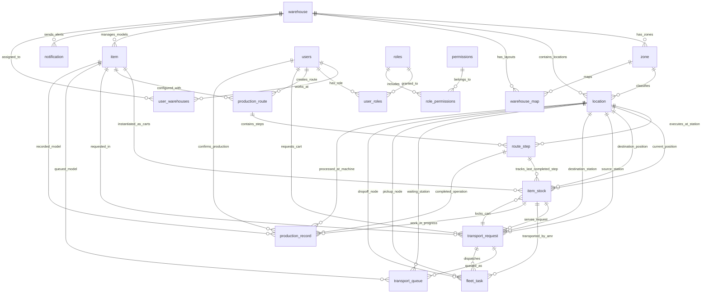
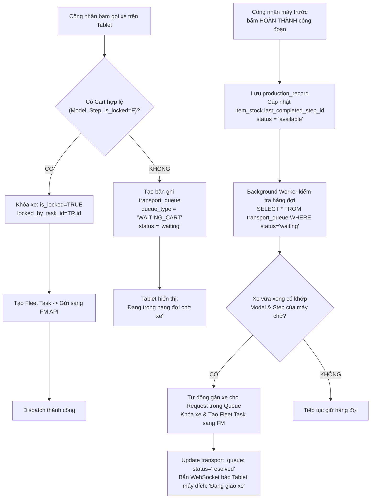

# TÀI LIỆU THIẾT KẾ KIẾN TRÚC CƠ SỞ DỮ LIỆU (DATABASE ARCHITECTURE DESIGN)
## HỆ THỐNG ĐIỀU PHỐI KUKA AMR CHO DÂY CHUYỀN SẢN XUẤT CƠ KHÍ & GIA CÔNG CNC

* **Tên dự án**: KUKA AMR Manufacturing Execution & Mobile Robot Dispatching System
* **Mã tài liệu**: `DOCS/database_architecture_design.md`
* **Phiên bản**: 2.0 (Chuyển đổi hoàn toàn từ WMS FMCG Masan sang AMR Manufacturing Dispatching)
* **Ngày cập nhật**: 15/10/2026
* **Vai trò tác giả**: Database Architect
* **Trạng thái phê duyệt**: Thiết kế Chuẩn hóa (Aligned with Business Context v1.2 & Technical Decisions)

---

## MỤC LỤC

1. [TỔNG QUAN HỆ THỐNG & NGUYÊN TẮC THIẾT KẾ](#1-tổng-quan-hệ-thống--nguyên-tắc-thiết-kế)
   - 1.1 Bối cảnh nghiệp vụ & Bước ngoặt chuyển đổi
   - 1.2 Ba vòng đời trạng thái độc lập (Decoupled State Lifecycles)
   - 1.3 Nguyên tắc thiết kế kiến trúc dữ liệu
2. [PHẦN 1: PHÂN TÍCH DATABASE HIỆN TẠI (WMS CŨ - 30 BẢNG)](#2-phần-1-phân-tích-database-hiện-tại-wms-cũ---30-bảng)
   - 2.1 Tổng quan phân loại 30 bảng hiện tại
   - 2.2 Chi tiết 7 cụm bảng chức năng và quan hệ khóa ngoại
   - 2.3 Sơ đồ thực thể liên kết (Mermaid ERD) của Database Cũ (30 Bảng)
   - 2.4 Phân tích chuyên sâu xung đột kiến trúc: Tại sao WMS cũ không thể dùng cho Dây chuyền Cơ khí
3. [PHẦN 2: THIẾT KẾ DATABASE MỚI CHO DÂY CHUYỀN KUKA AMR](#3-phần-2-thiết-kế-database-mới-cho-dây-chuyền-kuka-amr)
   - 3.1 Chiến lược Tái cấu trúc & Kế thừa Dữ liệu
   - 3.2 Đặc tả Chi tiết 6 Bảng Thiết kế Mới
   - 3.3 Từ điển Dữ liệu Toàn diện (Data Dictionary - Schema Chi tiết từng Cột)
   - 3.4 Sơ đồ Thực thể Liên kết (Mermaid ERD) của Database Mới
   - 3.5 Cơ chế Chống Tranh chấp Xe (Cart Concurrency Locking) & Thuật toán Chọn xe Gần nhất
   - 3.6 Cơ chế Điều phối Tự động qua Hàng Đợi (`transport_queue`)
   - 3.7 Ma trận Đồng bộ Trạng thái giữa 3 Vòng đời
   - 3.8 Kế hoạch Di chuyển Dữ liệu (Migration Roadmap & Alembic Script)

---

## 1. TỔNG QUAN HỆ THỐNG & NGUYÊN TẮC THIẾT KẾ

### 1.1 Bối cảnh nghiệp vụ & Bước ngoặt chuyển đổi
Hệ thống ban đầu được xây dựng như một giải pháp **WMS (Warehouse Management System)** phục vụ quản lý lưu kho ngành hàng tiêu dùng nhanh (FMCG) cho dự án Masan, tập trung vào việc bốc dỡ pallet, quản lý số lô (`lot_number`), hạn sử dụng (`expiry_date`), quy đổi đơn vị thùng/hộp (`unit_conversion`), phân bổ đơn hàng nhập kho (`inbound_order`) và xuất kho (`outbound_order`), kiểm kê (`stocktake`) và tích hợp robot chuyển hàng Hikrobot ICS.

Dự án hiện tại chuyển đổi 100% mục tiêu sang **Điều phối Robot tự hành KUKA AMR phục vụ dây chuyền sản xuất cơ khí & gia công CNC**:
- **Đối tượng trung chuyển vật lý**: Không còn là pallet/thùng hàng trong kho, mà là **Xe gá phôi (Rigid Fixture Cart / WIP Cart)** chở các chi tiết kim loại gia công.
- **Không gian hoạt động**: Mặt bằng xưởng cơ khí gồm:
  1. *Khu nguyên liệu (Raw Material Area)*: Chứa các slot phôi thô theo Model (ví dụ 7 Model tương ứng 7 vị trí).
  2. *Khu gia công sản xuất (Machining Zone)*: Gồm các cụm trạm máy CNC (`CNC-01` đến `CNC-05`), trong đó có các bước gia công song song/thay thế nhau (ví dụ: `CNC-03` HOẶC `CNC-04`).
  3. *Khu tẩy rửa phôi (Washing Area)*: Gồm các slot tiếp nhận xe phôi sau công đoạn gia công cuối cùng.
- **Hành vi người dùng**: Công nhân đứng tại trạm máy CNC thao tác trên Tablet cảm ứng để:
  - Gọi phôi mới (Luồng A: Cấp nguyên liệu trực tiếp tới CNC đầu tiên).
  - Gọi xe bán thành phẩm (Luồng B: Chuyển phôi giữa các công đoạn CNC, hệ thống tự động quét map tìm xe gần nhất).
  - Xác nhận hoàn thành công đoạn gia công (trigger đưa xe vào khu tẩy rửa - Luồng C).
  - Nhân viên khu tẩy rửa lấy xe đi vệ sinh (thao tác thủ công giải phóng slot - Luồng D).

### 1.2 Ba vòng đời trạng thái độc lập (Decoupled State Lifecycles)
Điểm then chốt quyết định sự thành bại của kiến trúc dữ liệu là **tuyệt đối không gộp chung trạng thái vào một cột đơn nhất**. Hệ thống duy trì 3 vòng đời hoàn toàn độc lập:

```
  ┌────────────────────────────────────────────────────────────────────────┐
  │ 1. VÒNG ĐỜI YÊU CẦU VẬN CHUYỂN (Transport Request Lifecycle)           │
  │    pending ──> assigned ──> dispatched ──> in_progress ──> completed   │
  │    (hoặc queued khi trạm chờ xe / xe chờ slot tẩy rửa)                 │
  └────────────────────────────────────────────────────────────────────────┘
                                    │
                                    ▼
  ┌────────────────────────────────────────────────────────────────────────┐
  │ 2. VÒNG ĐỜI XE GÁ PHÔI & TIẾN ĐỘ SẢN XUẤT (Cart & WIP Lifecycle)       │
  │    available ──> locked ──> in_transit ──> processing ──> washing      │
  │    (Được xác nhận bởi công nhân đứng máy CNC bấm trên tablet)          │
  └────────────────────────────────────────────────────────────────────────┘
                                    │
                                    ▼
  ┌────────────────────────────────────────────────────────────────────────┐
  │ 3. VÒNG ĐỜI TÁC VỤ ROBOT AMR (Fleet Manager Task Lifecycle)            │
  │    created ──> sent ──> accepted ──> moving ──> dropped ──> completed  │
  │    (Được phản hồi từ Fleet Manager KUKA/AMR qua Webhook/Polling)       │
  └────────────────────────────────────────────────────────────────────────┘
```

> [!IMPORTANT]
> **Quy tắc bất di bất dịch**:
> 1. Công nhân bấm xác nhận hoàn thành gia công $\neq$ AMR đã vận chuyển xong.
> 2. Hệ thống gửi task thành công $\neq$ Fleet Manager đã điều xe chạy.
> 3. Fleet Manager báo completed (đã hạ cart) $\neq$ Công nhân đã bắt đầu gia công công đoạn kế tiếp.

### 1.3 Nguyên tắc thiết kế kiến trúc dữ liệu
1. **Bảo tồn hạ tầng vị trí**: Giữ nguyên 100% bảng `location` để không làm đứt gãy Canvas 2D xưởng trên Frontend (`WarehouseMapCanvas`) và thuật toán tính khoảng cách Euclidean trên tọa độ `(map_x, map_y)`.
2. **Kế thừa và nới lỏng đúng chỗ**: Tái sử dụng bảng `item` làm danh mục Model sản phẩm, nới lỏng các ràng buộc kho WMS; nâng cấp `item_stock` thành thực thể Cart/WIP với đầy đủ cờ khóa tranh chấp (`is_locked`, `locked_by_task_id`).
3. **Loại bỏ không khoan nhượng (Zero Dead Code)**: Loại bỏ toàn bộ 15 bảng WMS Masan (Inbound, Outbound, Stocktake, FMCG Lot, Unit Conversion) gây rác database, chậm truy vấn và xung đột khóa ngoại.
4. **Hỗ trợ máy song song & Hàng đợi tự động**: Thiết kế schema tường minh cho các máy thay thế nhau (`route_step.step_group`) và hàng đợi bất đồng bộ (`transport_queue`).

---

## 2. PHẦN 1: PHÂN TÍCH DATABASE HIỆN TẠI (WMS CŨ - 30 BẢNG)

### 2.1 Tổng quan phân loại 30 bảng hiện tại
Dựa trên kết quả scan schema toàn diện (`scratch/db_schema_scan.txt`) và phân tích mã nguồn SQLAlchemy trong `backend/app/modules/`, toàn bộ 30 bảng của hệ thống WMS cũ được phân chia thành 7 cụm module:

| STT | Cụm chức năng | Danh sách các bảng | Số lượng | Đánh giá kiến trúc KUKA AMR |
|:---:|:---|:---|:---:|:---|
| **1** | Vị trí, Bản đồ & Layout | `location`, `warehouse`, `zone`, `warehouse_map` | 4 bảng | **GIỮ NGUYÊN 100%**. Xương sống định vị toạ độ. |
| **2** | Sản phẩm & Tồn kho ô kệ | `item`, `item_stock`, `unit`, `item_unit`, `item_stock_relation`, `inventory_daily_snapshot` | 6 bảng | **TÁI SỬ DỤNG 2 BẢNG** (`item`, `item_stock`), **DROP 4 BẢNG RÁC**. |
| **3** | Đơn hàng Nhập / Xuất WMS | `inbound_order`, `inbound_order_detail`, `inbound_order_allocation`, `outbound_order`, `outbound_order_detail`, `outbound_order_allocation`, `transaction`, `history`, `qr_code` | 9 bảng | **LOẠI BỎ TOÀN BỘ (DROP 9 BẢNG)**. Không phù hợp với sản xuất cơ khí. |
| **4** | Kiểm kê kho định kỳ | `stocktake`, `stocktake_item` | 2 bảng | **LOẠI BỎ TOÀN BỘ (DROP 2 BẢNG)**. |
| **5** | Điều khiển Robot cũ (ICS) | `robot_task`, `task_status` | 2 bảng | **REFACTOR THÀNH FLEET ADAPTER** (`fleet_task`). Drop schema cũ. |
| **6** | Xác thực & Phân quyền RBAC | `users`, `roles`, `permissions`, `user_roles`, `user_warehouses`, `role_permissions` | 6 bảng | **GIỮ NGUYÊN 100%**. Phục vụ đăng nhập tablet & phân quyền admin. |
| **7** | Cảnh báo hệ thống | `notification` | 1 bảng | **GIỮ NGUYÊN**. Bắn thông báo real-time qua WebSocket. |
| **TỔNG** | **30 BẢNG** | | **30 BẢNG** | **GIỮ: 11 \| TÁI SỬ DỤNG/NÂNG CẤP: 2 \| DROP: 17** |

---

### 2.2 Chi tiết 7 cụm bảng chức năng và quan hệ khóa ngoại

#### Cụm 1: Quản lý Vị trí & Bản đồ Xưởng (4 Bảng)
- `warehouse`: Quản lý thực thể nhà máy/kho (`id`, `code`, `name`, `description`).
- `zone`: Phân vùng khu vực chức năng thuộc warehouse (`id`, `warehouse_id` $\rightarrow$ `warehouse.id`, `code`, `name`). Hiện tại gồm: Khu lưu trữ nguyên liệu, Khu trạm máy CNC, Khu tẩy rửa.
- `location`: Quản lý từng vị trí tọa độ ô kệ/trạm máy (`id`, `location_code`, `location_name`, `bin_code`, `map_x`, `map_y`, `warehouse_id` $\rightarrow$ `warehouse.id`, `zone_id` $\rightarrow$ `zone.id`, `is_active`). Cột `map_x`, `map_y` lưu tọa độ mặt bằng xưởng (pixels/cm) dùng để vẽ Canvas 2D và tính khoảng cách di chuyển Euclidean.
- `warehouse_map`: Lưu trữ file nguồn và phiên bản layout bản đồ SVG/JSON (`id`, `warehouse_id`, `zone_id`, `source`, `is_active`).

#### Cụm 2: Quản lý Sản phẩm & Tồn kho Ô Kệ (6 Bảng)
- `item`: Danh mục hàng hóa kho (`id`, `sku`, `name`, `base_quantity`, `base_unit` $\rightarrow$ `unit.id`, `warehouse_id` $\rightarrow$ `warehouse.id`, `max_quantity`, `min_quantity`, `supplier`).
- `item_stock`: Chi tiết lượng hàng nằm tại từng vị trí ô kệ (`id`, `stock_code` UUID, `item_id` $\rightarrow$ `item.id`, `location_id` $\rightarrow$ `location.id`, `inbound_order_detail_id` $\rightarrow$ `inbound_order_detail.id`, `unit_id` $\rightarrow$ `unit.id`, `quantity`, `lot_number_from`, `lot_number_to`, `expiry_date`, `status`, `manufacturing_machine`).
- `unit`: Quản lý danh mục đơn vị tính (`id`, `name`, `description`).
- `item_unit`: Bảng quy đổi tỷ lệ giữa đơn vị chuẩn và đơn vị quy đổi (`id`, `item_id`, `unit_id`, `conversion_factor`).
- `item_stock_relation`: Quản lý phả hệ cha-con khi phân tách/gộp pallet tồn kho Masan (`id`, `parent_stock_id` $\rightarrow$ `item_stock.id`, `child_stock_id` $\rightarrow$ `item_stock.id`, `relation_type`).
- `inventory_daily_snapshot`: Bảng chụp số dư tồn kho cuối ngày phục vụ kế toán kho (`id`, `warehouse_id`, `snapshot_date`, `total_quantity`, `total_inventory_value`).

#### Cụm 3: Đơn hàng Nhập / Xuất WMS Masan (9 Bảng)
- `inbound_order`: Đơn hàng nhập kho (`id`, `order_code`, `created_by_id` $\rightarrow$ `users.id`, `warehouse_id` $\rightarrow$ `warehouse.id`, `details` JSON).
- `inbound_order_detail`: Dòng chi tiết mã hàng cần nhập (`id`, `inbound_order_id` $\rightarrow$ `inbound_order.id`, `from_location_id`, `to_location_id`, `status`).
- `inbound_order_allocation`: Phân bổ vị trí hạ hàng và gán tồn kho nhập (`id`, `inbound_order_detail_id`, `item_stock_id`, `unit_id`, `quantity`).
- `outbound_order`: Đơn hàng xuất kho (`id`, `order_code`, `created_by_id`, `warehouse_id`).
- `outbound_order_detail`: Chi tiết hàng xuất (`id`, `outbound_order_id`, `item_id`, `quantity`, `unit`).
- `outbound_order_allocation`: Phân bổ lấy hàng từ ô kệ (`id`, `outbound_order_detail_id`, `item_stock_id`, `from_location_id`, `to_location_id`, `robot_task_id` $\rightarrow$ `robot_task.id`).
- `transaction`: Nhật ký giao dịch dịch chuyển tồn kho nội bộ (`id`, `from_location_id`, `to_location_id`, `item_stock_id`, `quantity`, `created_by_id`).
- `history`: Lịch sử thay đổi trạng thái đơn hàng nhập/xuất (`id`, `inbound_order_id`, `outbound_order_id`, `old_status`, `new_status`, `created_by_id`).
- `qr_code`: Quản lý mã QR dán trên từng thùng hàng Masan (`id`, `code`, `item_id`, `item_stock_id`, `qr_type`).

#### Cụm 4: Kiểm kê Kho Định kỳ (2 Bảng)
- `stocktake`: Phiếu yêu cầu kiểm kê kho (`id`, `warehouse_id`, `created_by_id`, `description`).
- `stocktake_item`: Chi tiết số lượng kiểm đếm thực tế vs lý thuyết (`id`, `stocktake_id` $\rightarrow$ `stocktake.id`, `item_stock_id`, `desired_quantity`, `actual_quantity`, `status`).

#### Cụm 5: Điều khiển Robot Cũ Hikrobot ICS (2 Bảng)
- `robot_task`: Tác vụ gửi sang Hikrobot ICS cũ (`id`, `inbound_order_detail_id` $\rightarrow$ `inbound_order_detail.id`, `order_id`, `quantity`, `process_code`, `system_code`, `task_order_detail`).
- `task_status`: Bảng callback nhận trạng thái từ Hikrobot qua webhook (`id`, `order_id`, `device_code`, `device_num`, `status`, `qr_code`).

#### Cụm 6: Xác thực & Phân quyền RBAC (6 Bảng)
- `users`: Tài khoản đăng nhập hệ thống (`id`, `username`, `email`, `hashed_password`, `is_active`).
- `roles`: Nhóm quyền (`id`, `name`, `description`).
- `permissions`: Quyền chi tiết theo chức năng/module (`id`, `code`, `name`, `module`).
- `user_roles`: Bảng nối người dùng - nhóm quyền (`user_id` $\rightarrow$ `users.id`, `role_id` $\rightarrow$ `roles.id`).
- `user_warehouses`: Phân quyền người dùng theo xưởng (`user_id` $\rightarrow$ `users.id`, `warehouse_id` $\rightarrow$ `warehouse.id`).
- `role_permissions`: Bảng nối nhóm quyền - quyền hạn (`role_id` $\rightarrow$ `roles.id`, `permission_id` $\rightarrow$ `permissions.id`).

#### Cụm 7: Thông báo Hệ thống (1 Bảng)
- `notification`: Quản lý thông báo hiển thị trên giao diện web/tablet (`id`, `warehouse_id`, `title`, `message`, `action`, `notification_type`, `status`).

---

### 2.3 Sơ đồ thực thể liên kết (Mermaid ERD) của Database Cũ (30 Bảng)

Dưới đây là sơ đồ Mermaid ERD mô tả đầy đủ toàn bộ 30 bảng hiện tại và các mối quan hệ khóa ngoại (Foreign Keys) chằng chịt:

```mermaid
erDiagram
    warehouse ||--o{ zone : "has"
    warehouse ||--o{ location : "contains"
    warehouse ||--o{ warehouse_map : "has_maps"
    warehouse ||--o{ item : "manages"
    warehouse ||--o{ inbound_order : "receives"
    warehouse ||--o{ outbound_order : "ships"
    warehouse ||--o{ stocktake : "audits"
    warehouse ||--o{ notification : "broadcasts"
    warehouse ||--o{ inventory_daily_snapshot : "records"
    warehouse ||--o{ user_warehouses : "assigned_to"

    zone ||--o{ location : "zones_location"
    zone ||--o{ warehouse_map : "maps_zone"

    users ||--o{ user_warehouses : "operates"
    users ||--o{ user_roles : "has"
    roles ||--o{ user_roles : "assigned_to"
    roles ||--o{ role_permissions : "contains"
    permissions ||--o{ role_permissions : "granted_to"

    users ||--o{ inbound_order : "creates"
    users ||--o{ outbound_order : "creates"
    users ||--o{ stocktake : "creates"
    users ||--o{ transaction : "logs"
    users ||--o{ history : "records"

    unit ||--o{ item : "base_unit_of"
    unit ||--o{ item_unit : "converted_in"
    item ||--o{ item_unit : "has_units"
    item ||--o{ item_stock : "stocks_of"
    item ||--o{ qr_code : "tagged_with"
    item ||--o{ outbound_order_detail : "ordered_in"

    location ||--o{ item_stock : "holds"
    location ||--o{ inbound_order_detail : "from_to_loc"
    location ||--o{ outbound_order_allocation : "from_to_loc"
    location ||--o{ stocktake_item : "checked_at"
    location ||--o{ transaction : "transfer_between"

    inbound_order ||--o{ inbound_order_detail : "has_items"
    inbound_order ||--o{ history : "traces"
    inbound_order_detail ||--o{ inbound_order_allocation : "allocated_to"
    inbound_order_detail ||--o{ item_stock : "generates"
    inbound_order_detail ||--o{ robot_task : "triggers"

    unit ||--o{ inbound_order_allocation : "unit_of"
    unit ||--o{ item_stock : "measured_in"
    item_stock ||--o{ inbound_order_allocation : "allocated_stock"
    item_stock ||--o{ outbound_order_allocation : "picked_stock"
    item_stock ||--o{ item_stock_relation : "parent_to"
    item_stock ||--o{ item_stock_relation : "child_from"
    item_stock ||--o{ qr_code : "tagged_stock"
    item_stock ||--o{ stocktake_item : "counted_in"
    item_stock ||--o{ transaction : "moved_in"

    outbound_order ||--o{ outbound_order_detail : "has_items"
    outbound_order ||--o{ history : "traces"
    outbound_order_detail ||--o{ outbound_order_allocation : "allocates"

    robot_task ||--o{ outbound_order_allocation : "executes"
    robot_task ||..o{ task_status : "reports_status_via_order_id"

    stocktake ||--o{ stocktake_item : "contains"
```



---

### 2.4 Phân tích chuyên sâu xung đột kiến trúc: Tại sao WMS cũ không thể dùng cho Dây chuyền Cơ khí

Việc cố gắng "chắp vá" logic dây chuyền cơ khí KUKA AMR vào kiến trúc WMS cũ gây ra 5 xung đột trí mạng:

#### 1. Xung đột Khái niệm: Đơn hàng Tĩnh (Static Orders) vs. Dòng chảy Sản xuất Liên tục (Dynamic Routing)
* **WMS Cũ**: Được thiết kế xoay quanh hai sự kiện rời rạc: Nhập hàng từ nhà cung cấp bên ngoài (`inbound_order`) cất vào kệ, và sau đó Xuất hàng bán ra (`outbound_order`). Mọi chuyển động của hàng hóa đều bắt buộc phải gắn với một mã đơn hàng cố định do văn phòng phát lệnh.
* **Thực tế Cơ khí KUKA**: Quá trình sản xuất là một **chuỗi liên hoàn các công đoạn gia công vật lý** (Routing). Phôi di chuyển tuần tự:
  $$\text{Khu phôi thô} \longrightarrow \text{CNC-01} \longrightarrow \text{CNC-03/04 (Song song)} \longrightarrow \text{CNC-05} \longrightarrow \text{Khu tẩy rửa}$$
  Không có khái niệm khách hàng mua hay nhà cung cấp giao. Lệnh di chuyển xe xuất phát tức thời từ nhu cầu của **công nhân đứng máy CNC** thông qua Tablet. Việc bắt buộc phải sinh `inbound_order` hoặc `outbound_order` cho mỗi lần chuyển xe giữa 2 máy CNC gây bùng nổ dữ liệu rác, nghẽn transaction và không thể mô hình hóa được luồng đi.

#### 2. Xung đột Đối tượng: Kiện hàng Phân rã (FMCG Lot/SKU) vs. Xe Gá Phôi Cố định (Rigid Fixture Cart)
* **WMS Cũ**: Quản lý các thùng mì, hộp sữa với hạn sử dụng (`expiry_date`), dải số lô (`lot_number_from` đến `lot_number_to`), và cho phép xé lẻ pallet thành nhiều lô con thông qua bảng `item_stock_relation`.
* **Thực tế Cơ khí KUKA**: Một **Cart (Xe gá phôi)** là một thực thể vật lý cơ khí có cấu trúc cứng (Rigid Fixture) chở một số lượng chi tiết cố định của một **Model sản phẩm nhất định**. Xe không bao giờ bị xé lẻ dọc đường gia công. Bảng `item_stock_relation`, `lot_number_to`, `expiry_date` hoàn toàn vô nghĩa và làm phức tạp hóa câu lệnh truy vấn tìm xe.

#### 3. Xung đột Ràng buộc Khóa ngoại: Khóa chết quy trình tạo tồn kho
* **WMS Cũ**: Cột `item_stock.inbound_order_detail_id` là khóa ngoại ép buộc tồn kho phải xuất phát từ một dòng chi tiết nhập kho WMS. Đồng thời, hàm tính toán tồn kho khả dụng `available_quantity` trên model `ItemStock` bị phụ thuộc cứng vào `OutboundOrderAllocation`:
  ```sql
  available_quantity = quantity - SUM(OutboundOrderAllocation.quantity)
  ```
* **Hệ quả**: Nếu không có đơn xuất kho WMS, toàn bộ cờ khóa xe và trạng thái khả dụng của Cart không thể hoạt động. Khi xóa đơn hàng WMS cũ, toàn bộ bảng `item_stock` bị dính lỗi vi phạm toàn vẹn dữ liệu (Foreign Key Violation).

#### 4. Xung đột Cơ chế Điều khiển Robot: Hikrobot ICS cũ trói chặt vào đơn xuất/nhập
* **WMS Cũ**: Bảng `robot_task` có khóa ngoại `inbound_order_detail_id` và liên kết với `task_status` qua chuỗi `order_id`. Trạng thái của task chỉ xoay quanh việc lấy pallet từ ô kệ ra cửa dock.
* **Thực tế KUKA AMR**: Cần một hệ thống **Fleet Task độc lập**, nhận lệnh từ `transport_request`, xác định rõ tọa độ lấy (`pickup_location_id`) và tọa độ thả (`dropoff_location_id`), lưu mã định danh `fm_task_id` của Fleet Manager KUKA, hỗ trợ lưu trữ payload JSON để đối soát và xử lý mất gói tin / timeout.

#### 5. Bảng rác làm chậm hiệu năng: `unit_conversion`, `stocktake`, `inventory_daily_snapshot`
* Các bảng quy đổi đơn vị phức tạp `item_unit` (hộp sang thùng), bảng kiểm kê kho theo đợt `stocktake`, và snapshot kế toán tồn kho `inventory_daily_snapshot` tiêu tốn tài nguyên I/O của PostgreSQL trong khi không hề phục vụ bất kỳ tính năng nào của dây chuyền CNC thời gian thực.

---

## 3. PHẦN 2: THIẾT KẾ DATABASE MỚI CHO DÂY CHUYỀN KUKA AMR

### 3.1 Chiến lược Tái cấu trúc & Kế thừa Dữ liệu

Tuân thủ chặt chẽ chỉ đạo kiến trúc và các quyết định nghiệp vụ đã được thống nhất:

```
┌─────────────────────────────────────────────────────────────────────────────┐
│                          CHIẾN LƯỢC TÁI CẤU TRÚC                            │
├────────────────────────────────┬────────────────────────────────────────────┤
│ THÀNH PHẦN GIỮ NGUYÊN 100%     │ location, warehouse, zone, warehouse_map,   │
│                                │ users, roles, permissions, notification    │
├────────────────────────────────┼────────────────────────────────────────────┤
│ THÀNH PHẦN TÁI SỬ DỤNG         │ item ───> Danh mục Model Sản phẩm          │
│                                │ item_stock ───> Xe gá phôi (Cart / WIP)    │
├────────────────────────────────┼────────────────────────────────────────────┤
│ THÀNH PHẦN THIẾT KẾ MỚI        │ production_route, route_step,              │
│                                │ transport_request, transport_queue,        │
│                                │ fleet_task, production_record              │
├────────────────────────────────┼────────────────────────────────────────────┤
│ THÀNH PHẦN BỊ LOẠI BỎ (DROP)   │ inbound_order, inbound_order_detail,       │
│                                │ inbound_order_allocation, outbound_order,  │
│                                │ outbound_order_detail,                     │
│                                │ outbound_order_allocation, stocktake,      │
│                                │ stocktake_item, transaction, history,      │
│                                │ qr_code, item_unit, item_stock_relation,   │
│                                │ inventory_daily_snapshot, robot_task,      │
│                                │ task_status                                │
└────────────────────────────────┴────────────────────────────────────────────┘
```

1. **Bảng `location` (Giữ nguyên 100%)**:
   - Được bảo toàn toàn bộ cấu trúc để phục vụ:
     + Quản lý 7 slot phôi thô tại Khu nguyên liệu.
     + Quản lý các trạm máy gia công CNC (`CNC-01` đến `CNC-05`).
     + Quản lý các slot đỗ xe tại Khu tẩy rửa.
     + Tọa độ `map_x`, `map_y` được dùng trực tiếp để Frontend Canvas vẽ xưởng và Backend tính khoảng cách 2D Euclidean:
       $$d = \sqrt{(map\_x_{dest} - map\_x_{cart})^2 + (map\_y_{dest} - map\_y_{cart})^2}$$
   - **Thao tác Backend**: Gỡ bỏ các `column_property` cũ (`occupied_quantity`, `status` correlated subquery với đơn nhập/xuất kho cũ).

2. **Bảng `item` (Tái sử dụng làm Danh mục Model Sản phẩm)**:
   - Cột `sku` $\longrightarrow$ Mã Model (ví dụ: `MODEL_A`, `MODEL_B`).
   - Cột `name` $\longrightarrow$ Tên định danh Model (ví dụ: `Trục khuỷu động cơ Model A`).
   - Nới lỏng: Cho phép `base_unit`, `supplier`, `max_quantity`, `min_quantity` chuyển sang `NULLABLE` hoặc có giá trị mặc định để không bắt buộc người dùng nhập thông tin kho WMS.

3. **Bảng `item_stock` (Tái sử dụng & Nâng cấp làm Bảng Cart / WIP)**:
   - Đại diện cho 1 Xe gá phôi vật lý.
   - Bổ sung cột:
     + `cart_code` VARCHAR(50): Mã định danh xe thực tế dán mã Barcode/RFID (ví dụ `CART-001`).
     + `last_completed_step_id` INT: Khóa ngoại trỏ tới `route_step.id`, ghi nhận bước công đoạn gần nhất mà xe này đã hoàn thành gia công tại trạm trước.
     + `is_locked` BOOLEAN: Cờ khóa xe chống tranh chấp giữa 2 trạm máy gọi cùng lúc.
     + `locked_by_task_id` INT: Trỏ tới `transport_request.id` đang chiếm dụng xe.
     + `destination_location_id` INT: Trạm máy đích mà xe đang được AMR chuyển tới.
   - Gỡ bỏ: Khóa ngoại `inbound_order_detail_id`, `unit_id`, các trường hạn sử dụng `expiry_date`, `lot_number_to`, `item_stock_relation`.

---

### 3.2 Đặc tả Chi tiết 6 Bảng Thiết kế Mới

#### 1. Bảng `production_route` (Quy trình Công nghệ theo Model)
- **Mục đích nghiệp vụ**: Định nghĩa quy trình gia công cơ khí chuẩn cho từng Model sản phẩm (`item_id`). Mỗi Model có thể có nhiều phiên bản route (versioning), nhưng tại một thời điểm chỉ có 1 route có `is_active = TRUE`.
- **Ràng buộc nghiệp vụ**: Quản trị viên chỉ được phép chỉnh sửa Route khi thỏa mãn điều kiện *"Không có xe nào của Model đó đang chạy trên dây chuyền"* (Cart có status $\neq$ `available`).

#### 2. Bảng `route_step` (Các Bước Gia công trong Route - Hỗ trợ Máy Song Song)
- **Mục đích nghiệp vụ**: Chia nhỏ quy trình thành các bước gia công tuần tự hoặc song song.
- **Giải pháp máy song song / thay thế (Alternative CNCs)**:
  - Để hỗ trợ kịch bản: `Model A đi qua CNC-01 -> CNC-03 HOẶC CNC-04 -> CNC-05 -> Tẩy rửa`:
    + Bước 1: `step_order = 1`, `location_id = CNC-01`, `step_group = 'OP10'`
    + Bước 2: `step_order = 2`, `location_id = CNC-03`, `step_group = 'OP20'`
    + Bước 3: `step_order = 2`, `location_id = CNC-04`, `step_group = 'OP20'` *(Cùng step_order và step_group với CNC-03)*
    + Bước 4: `step_order = 3`, `location_id = CNC-05`, `step_group = 'OP30'`
  - Khi xe hoàn thành tại `CNC-01`, `last_completed_step_id` được ghi nhận. Xe đủ điều kiện chuyển tới bất kỳ máy nào có `step_order = 2` (hoặc `CNC-03` hoặc `CNC-04`). Khi một máy gọi xe, xe chỉ cần qua máy đó và được coi là hoàn thành bước 2, sẵn sàng lên bước 3 (`CNC-05`).
- Cột `is_final_step` BOOLEAN: Đánh dấu bước cuối cùng trước khi vào khu tẩy rửa.

#### 3. Bảng `transport_request` (Yêu cầu Vận Chuyển từ Tablet Công Nhân)
- **Mục đích nghiệp vụ**: Tiếp nhận yêu cầu gọi xe của công nhân từ Tablet tại các vị trí máy.
- **Phân loại `request_type`**:
  + `material_feed` (Luồng A): Cấp phôi thô từ Slot nguyên liệu tới máy CNC đầu tiên.
  + `inter_station` (Luồng B): Chuyển phôi giữa các công đoạn CNC (hệ thống tự động tìm xe gần nhất).
  + `to_washing` (Luồng C): Chuyển xe sau công đoạn cuối cùng vào khu tẩy rửa.
- Quản lý trạng thái yêu cầu từ lúc khởi tạo (`pending`), gán xe (`assigned`), gửi lệnh robot (`dispatched`), đang chạy (`in_progress`) đến khi hoàn tất (`completed`) hoặc xếp hàng (`queued`).

#### 4. Bảng `transport_queue` (Hàng Đợi Điều Phối Tự Động)
- **Mục đích nghiệp vụ**: Giải quyết bài toán nghẽn tài nguyên và tranh chấp trong sản xuất tự động:
  + **Loại 1 (`WAITING_CART`)**: Khi 2 máy song song (CNC-03 và CNC-04) cùng gọi Model A, máy gọi trước được cấp xe; máy gọi sau không bị từ chối thẳng thừng mà được đưa vào hàng đợi `WAITING_CART`. Hệ thống chạy background worker (Celery/Redis) quét liên tục; ngay khi một xe Model A hoàn thành công đoạn trước (tại CNC-01), hệ thống tự động giải phóng hàng đợi và dispatch xe tới máy đang chờ.
  + **Loại 2 (`WAITING_WASH_SLOT`)**: Khi công đoạn cuối (CNC-05) hoàn thành nhưng toàn bộ các slot tại Khu tẩy rửa đều đã kín chỗ, xe được giữ an toàn trên bàn máy CNC-05 và yêu cầu được đưa vào hàng đợi `WAITING_WASH_SLOT`. Ngay khi nhân viên tẩy rửa lấy xe ra khỏi một slot (Luồng D), slot đó trống, hệ thống lập tức phát lệnh cho AMR tới CNC-05 gắp xe đưa vào slot tẩy rửa vừa giải phóng.

#### 5. Bảng `fleet_task` (Quản Lý Tác Vụ Gửi Sang Fleet Manager KUKA/AMR)
- **Mục đích nghiệp vụ**: Quản lý giao tiếp hai chiều với hệ thống điều khiển đội xe Fleet Manager KUKA/AMR.
- Lưu trữ điểm lấy phôi (`pickup_location_id`), điểm thả phôi (`dropoff_location_id`), mã task của Fleet Manager (`fm_task_id`), mã định danh Robot (`robot_id`), toàn bộ chuỗi JSON `request_payload` và `response_payload` để phục vụ đối soát, chống mất gói tin và replay khi có sự cố mạng.

#### 6. Bảng `production_record` (Lịch Sử Xác Nhận Hoàn Thành Công Đoạn Sản Xuất)
- **Mục đích nghiệp vụ**: Tách bạch hoàn toàn tiến độ sản xuất khỏi tiến độ vận chuyển. Bảng này ghi nhận nhật ký bất biến (Immutable Audit Log) mỗi khi công nhân đứng máy CNC nhấn nút *"Hoàn thành công đoạn"* trên giao diện Tablet.
- Lưu trữ thông tin: Cart nào (`cart_stock_id`), Model nào (`item_id`), Công đoạn nào (`route_step_id`), Máy CNC nào (`location_id`), Ai thực hiện (`operator_id`), Số lượng đạt (`quantity_processed`), Số lượng lỗi hỏng NG (`quantity_defect`), Thời gian bắt đầu và kết thúc gia công (`started_at`, `completed_at`, `duration_seconds`).

---

### 3.3 Từ điển Dữ liệu Toàn diện (Data Dictionary - Schema Chi tiết từng Cột)

Dưới đây là chi tiết từng trường dữ liệu cho toàn bộ các bảng trong Kiến trúc Database Mới:

#### NHÓM A: BẢNG HẠ TẦNG VỊ TRÍ & KHU VỰC (GIỮ NGUYÊN)

##### 1. Bảng `warehouse` (Nhà máy / Kho xưởng)
| Tên cột | Kiểu dữ liệu | Ràng buộc | Mặc định | Mục đích nghiệp vụ & Quy tắc |
|:---|:---|:---:|:---:|:---|
| `id` | `INTEGER` | PK, Not Null | Auto increment | Khóa chính định danh nhà xưởng. |
| `code` | `VARCHAR(20)` | Not Null, Unique | None | Mã xưởng (ví dụ: `WH-KUKA-01`). |
| `name` | `VARCHAR(100)` | Nullable | None | Tên xưởng sản xuất KUKA AMR. |
| `description` | `TEXT` | Nullable | None | Mô tả bổ sung về mặt bằng xưởng. |

##### 2. Bảng `zone` (Khu vực chức năng xưởng)
| Tên cột | Kiểu dữ liệu | Ràng buộc | Mặc định | Mục đích nghiệp vụ & Quy tắc |
|:---|:---|:---:|:---:|:---|
| `id` | `INTEGER` | PK, Not Null | Auto increment | Khóa chính khu vực. |
| `warehouse_id` | `INTEGER` | FK, Not Null, Index | None | Trỏ tới `warehouse.id`. |
| `code` | `VARCHAR(20)` | Not Null | None | Mã phân vùng (`RAW_MATERIAL`, `CNC_AREA`, `WASH_AREA`). |
| `name` | `VARCHAR(100)` | Nullable | None | Tên khu vực (Khu nguyên liệu, Cụm máy CNC, Khu tẩy rửa). |
| `description` | `TEXT` | Nullable | None | Ghi chú quy định khu vực. |

##### 3. Bảng `location` (Trạm máy CNC / Slot Nguyên liệu / Slot Tẩy rửa)
| Tên cột | Kiểu dữ liệu | Ràng buộc | Mặc định | Mục đích nghiệp vụ & Quy tắc |
|:---|:---|:---:|:---:|:---|
| `id` | `INTEGER` | PK, Not Null | Auto increment | Khóa chính vị trí mặt bằng. |
| `location_code` | `VARCHAR(50)` | Not Null, Index | None | Mã trạm vật lý (`CNC-01`, `RAW-01`, `WASH-01`). |
| `location_name` | `VARCHAR(100)` | Not Null, Index | None | Tên hiển thị trạm máy (Trạm phay CNC 01). |
| `bin_code` | `VARCHAR(50)` | Nullable, Index | None | Mã RFID/Barcode gắn tại trạm vật lý. |
| `row` | `VARCHAR(10)` | Nullable | None | Hàng (dành cho khu slot nguyên liệu). |
| `column` | `VARCHAR(10)` | Nullable | None | Cột (dành cho khu slot nguyên liệu). |
| `level` | `VARCHAR(10)` | Nullable | None | Tầng kệ (mặc định 1 trong xưởng cơ khí). |
| `node_name` | `VARCHAR(50)` | Nullable | None | Tên Node tương ứng trên bản đồ Fleet Manager. |
| `map_x` | `INTEGER` | Nullable | None | **Tọa độ X (cm/pixel)** dùng render UI & tính khoảng cách Euclidean. |
| `map_y` | `INTEGER` | Nullable | None | **Tọa độ Y (cm/pixel)** dùng render UI & tính khoảng cách Euclidean. |
| `warehouse_id` | `INTEGER` | FK, Not Null, Index | None | Trỏ tới `warehouse.id`. |
| `zone_id` | `INTEGER` | FK, Nullable, Index | None | Trỏ tới `zone.id` phân loại khu vực. |
| `is_active` | `BOOLEAN` | Not Null | `TRUE` | Trạng thái trạm đang khả dụng hay tạm đóng. |
| `created_at` | `TIMESTAMPTZ` | Nullable | `NOW()` | Thời điểm tạo. |
| `updated_at` | `TIMESTAMPTZ` | Nullable | `NOW()` | Thời điểm cập nhật tọa độ. |

##### 4. Bảng `warehouse_map` (Bản đồ Layout Xưởng)
| Tên cột | Kiểu dữ liệu | Ràng buộc | Mặc định | Mục đích nghiệp vụ & Quy tắc |
|:---|:---|:---:|:---:|:---|
| `id` | `INTEGER` | PK, Not Null | Auto increment | Khóa chính bản đồ. |
| `warehouse_id` | `INTEGER` | FK, Not Null, Index | None | Trỏ tới `warehouse.id`. |
| `zone_id` | `INTEGER` | FK, Nullable, Index | None | Trỏ tới `zone.id`. |
| `source` | `VARCHAR(255)` | Not Null | None | Đường dẫn lưu file map layout (SVG/JSON). |
| `is_active` | `BOOLEAN` | Not Null | `TRUE` | Bản đồ đang kích hoạt trên Canvas. |
| `created_at` | `TIMESTAMPTZ` | Nullable | `NOW()` | Thời điểm import bản đồ. |

---

#### NHÓM B: BẢNG SẢN PHẨM & XE GÁ PHÔI (TÁI SỬ DỤNG & NÂNG CẤP)

##### 5. Bảng `item` (Danh mục Model Sản phẩm Gia công)
| Tên cột | Kiểu dữ liệu | Ràng buộc | Mặc định | Mục đích nghiệp vụ & Quy tắc |
|:---|:---|:---:|:---:|:---|
| `id` | `INTEGER` | PK, Not Null | Auto increment | Khóa chính Model. |
| `sku` | `VARCHAR(50)` | Not Null, Unique, Index | None | **Mã Model sản phẩm** (ví dụ: `MODEL_A`, `MODEL_B`). |
| `name` | `VARCHAR(255)` | Not Null | None | Tên định danh Model (ví dụ: `Trục khuỷu động cơ A`). |
| `description` | `TEXT` | Nullable | None | Thông số kỹ thuật gia công. |
| `base_quantity` | `BIGINT` | Not Null | `1` | Số chi tiết tiêu chuẩn gá trên 1 xe cart. |
| `base_unit` | `INTEGER` | Nullable | `NULL` | Đơn vị tính (nới lỏng WMS, mặc định là xe/chi tiết). |
| `max_quantity` | `INTEGER` | Nullable | `NULL` | Không bắt buộc trong cơ khí. |
| `min_quantity` | `INTEGER` | Nullable | `NULL` | Không bắt buộc trong cơ khí. |
| `warehouse_id` | `INTEGER` | FK, Not Null, Index | None | Trỏ tới `warehouse.id`. |
| `is_active` | `BOOLEAN` | Not Null | `TRUE` | Trạng thái Model đang sản xuất. |
| `details` | `JSONB` | Not Null | `'{}'::jsonb` | Lưu bản vẽ kỹ thuật, dung sai, ghi chú đặc thù. |
| `supplier` | `VARCHAR(50)` | Nullable | `NULL` | Nhà cung cấp phôi thô (nếu có). |
| `created_at` | `TIMESTAMPTZ` | Nullable | `NOW()` | Thời điểm tạo Model. |
| `updated_at` | `TIMESTAMPTZ` | Nullable | `NOW()` | Thời điểm cập nhật. |

##### 6. Bảng `item_stock` (Xe Gá Phôi / Cart / Bán thành phẩm WIP)
| Tên cột | Kiểu dữ liệu | Ràng buộc | Mặc định | Mục đích nghiệp vụ & Quy tắc |
|:---|:---|:---:|:---:|:---|
| `id` | `INTEGER` | PK, Not Null | Auto increment | Khóa chính Cart trong database. |
| `stock_code` | `UUID` | Not Null, Unique, Index | `gen_random_uuid()` | UUID hệ thống định danh xe. |
| `cart_code` | `VARCHAR(50)` | Not Null, Unique, Index | None | **Mã vật lý dán trên xe** (ví dụ: `CART-001`, `CART-002`). |
| `item_id` | `INTEGER` | FK, Not Null, Index | None | Trỏ tới `item.id`: Model sản phẩm đang chở trên xe. |
| `location_id` | `INTEGER` | FK, Nullable, Index | None | Trỏ tới `location.id`: **Vị trí hiện tại** xe đang đỗ. |
| `destination_location_id` | `INTEGER` | FK, Nullable, Index | `NULL` | Trỏ tới `location.id`: **Vị trí đích** xe đang di chuyển tới. |
| `quantity` | `NUMERIC(12, 3)` | Not Null | `1.000` | Số lượng chi tiết phôi thực tế đang gá trên xe. |
| `last_completed_step_id` | `INTEGER` | FK, Nullable, Index | `NULL` | Trỏ tới `route_step.id`: **Công đoạn gần nhất đã xong**. |
| `status` | `VARCHAR(30)` | Not Null, Index | `'available'` | `available` (sẵn sàng gọi), `in_transit` (AMR đang chở), `processing` (đang gia công), `washing` (đang tẩy rửa), `completed` (hoàn tất). |
| `is_locked` | `BOOLEAN` | Not Null, Index | `FALSE` | **Cờ khóa chống tranh chấp xe** giữa các máy gọi song song. |
| `locked_by_task_id` | `INTEGER` | FK, Nullable, Index | `NULL` | Trỏ tới `transport_request.id` đang khóa giữ xe này. |
| `locked_at` | `TIMESTAMPTZ` | Nullable | `NULL` | Thời điểm khóa xe. |
| `manufacturing_machine` | `VARCHAR(50)` | Nullable | `NULL` | Tên trạm máy CNC vừa gia công xong gần nhất. |
| `manufacturing_user` | `VARCHAR(50)` | Nullable | `NULL` | Tên công nhân vừa thao tác xong trên tablet. |
| `qc_user` | `VARCHAR(50)` | Nullable | `NULL` | KCS kiểm tra (nếu có). |
| `is_active` | `BOOLEAN` | Not Null | `TRUE` | Xe đang hoạt động hay hỏng hóc bảo trì. |
| `created_at` | `TIMESTAMPTZ` | Not Null | `NOW()` | Thời điểm đưa xe vào hệ thống. |
| `updated_at` | `TIMESTAMPTZ` | Nullable | `NOW()` | Thời điểm cập nhật trạng thái xe. |

---

#### NHÓM C: CÁC BẢNG QUẢN LÝ DÂY CHUYỀN SẢN XUẤT MỚI

##### 7. Bảng `production_route` (Quy trình Công nghệ theo Model)
| Tên cột | Kiểu dữ liệu | Ràng buộc | Mặc định | Mục đích nghiệp vụ & Quy tắc |
|:---|:---|:---:|:---:|:---|
| `id` | `INTEGER` | PK, Not Null | Auto increment | Khóa chính quy trình. |
| `item_id` | `INTEGER` | FK, Not Null, Index | None | Trỏ tới `item.id`: Model sản phẩm áp dụng quy trình. |
| `route_code` | `VARCHAR(50)` | Not Null, Unique, Index | None | Mã quy trình (ví dụ: `ROUTE-MODEL-A-V1`). |
| `route_name` | `VARCHAR(255)` | Not Null | None | Tên quy trình gia công. |
| `version` | `INTEGER` | Not Null | `1` | Phiên bản quy trình (1, 2, 3...). |
| `is_active` | `BOOLEAN` | Not Null, Index | `TRUE` | Trạng thái hiệu lực (chỉ 1 route active / model). |
| `description` | `TEXT` | Nullable | None | Mô tả kỹ thuật và ghi chú phiên bản. |
| `created_by_id` | `INTEGER` | FK, Not Null | None | Trỏ tới `users.id`: Kỹ sư tạo quy trình. |
| `created_at` | `TIMESTAMPTZ` | Nullable | `NOW()` | Thời điểm tạo quy trình. |
| `updated_at` | `TIMESTAMPTZ` | Nullable | `NOW()` | Thời điểm cập nhật quy trình. |

##### 8. Bảng `route_step` (Các Bước Gia công trong Route - Hỗ trợ Máy Song Song)
| Tên cột | Kiểu dữ liệu | Ràng buộc | Mặc định | Mục đích nghiệp vụ & Quy tắc |
|:---|:---|:---:|:---:|:---|
| `id` | `INTEGER` | PK, Not Null | Auto increment | Khóa chính bước gia công. |
| `route_id` | `INTEGER` | FK, Not Null, Index | None | Trỏ tới `production_route.id`. |
| `step_order` | `INTEGER` | Not Null, Index | None | **Thứ tự bước trong chuỗi** (1, 2, 3...). |
| `step_name` | `VARCHAR(100)` | Not Null | None | Tên công đoạn (Phay thô OP10, Tiện tinh OP20). |
| `location_id` | `INTEGER` | FK, Not Null, Index | None | Trỏ tới `location.id`: Trạm máy CNC đảm nhiệm bước này. |
| `step_group` | `VARCHAR(50)` | Nullable, Index | `NULL` | **Mã nhóm máy song song** (ví dụ `OP20_GROUP` cho cả CNC-03 và CNC-04). |
| `standard_cycle_time_seconds`| `INTEGER` | Nullable | `NULL` | Thời gian gia công tiêu chuẩn (giây). |
| `is_final_step` | `BOOLEAN` | Not Null | `FALSE` | Đánh dấu bước CNC cuối cùng trước khi sang tẩy rửa. |
| `created_at` | `TIMESTAMPTZ` | Nullable | `NOW()` | Thời điểm tạo bước. |
| `updated_at` | `TIMESTAMPTZ` | Nullable | `NOW()` | Thời điểm cập nhật. |

> [!NOTE]
> Ràng buộc Unique tổng hợp: `UNIQUE(route_id, step_order, location_id)` đảm bảo không bị gán trùng 1 máy cho cùng 1 thứ tự bước trong 1 route.

##### 9. Bảng `transport_request` (Yêu cầu Gọi Xe từ Tablet Công Nhân)
| Tên cột | Kiểu dữ liệu | Ràng buộc | Mặc định | Mục đích nghiệp vụ & Quy tắc |
|:---|:---|:---:|:---:|:---|
| `id` | `INTEGER` | PK, Not Null | Auto increment | Khóa chính yêu cầu vận chuyển. |
| `request_code` | `VARCHAR(50)` | Not Null, Unique, Index | None | Mã yêu cầu (dạng `TR-YYYYMMDD-XXXXX`). |
| `request_type` | `VARCHAR(30)` | Not Null, Index | None | `material_feed` (Luồng A), `inter_station` (Luồng B), `to_washing` (Luồng C). |
| `item_id` | `INTEGER` | FK, Not Null, Index | None | Trỏ tới `item.id`: Model sản phẩm yêu cầu vận chuyển. |
| `source_location_id` | `INTEGER` | FK, Nullable, Index | None | Trỏ tới `location.id`: Điểm lấy xe (được xác định sau khi tìm xe gần nhất). |
| `destination_location_id` | `INTEGER` | FK, Not Null, Index | None | Trỏ tới `location.id`: Trạm máy đang gọi phôi / Slot tẩy rửa. |
| `cart_stock_id` | `INTEGER` | FK, Nullable, Index | `NULL` | Trỏ tới `item_stock.id`: Xe gá phôi được gán phục vụ yêu cầu này. |
| `created_by_id` | `INTEGER` | FK, Not Null, Index | None | Trỏ tới `users.id`: Công nhân bấm gọi xe trên tablet. |
| `status` | `VARCHAR(30)` | Not Null, Index | `'pending'` | `pending`, `assigned`, `dispatched`, `in_progress`, `completed`, `queued`, `cancelled`, `failed`. |
| `priority` | `INTEGER` | Not Null | `1` | Độ ưu tiên vận chuyển (1: bình thường, 2: gấp). |
| `failure_reason` | `TEXT` | Nullable | `NULL` | Ghi chú lý do thất bại hoặc từ chối task. |
| `created_at` | `TIMESTAMPTZ` | Nullable | `NOW()` | Thời điểm công nhân bấm tạo yêu cầu. |
| `updated_at` | `TIMESTAMPTZ` | Nullable | `NOW()` | Thời điểm cập nhật trạng thái yêu cầu. |

##### 10. Bảng `transport_queue` (Hàng Đợi Điều Phối Tự Động)
| Tên cột | Kiểu dữ liệu | Ràng buộc | Mặc định | Mục đích nghiệp vụ & Quy tắc |
|:---|:---|:---:|:---:|:---|
| `id` | `INTEGER` | PK, Not Null | Auto increment | Khóa chính hàng đợi. |
| `queue_type` | `VARCHAR(50)` | Not Null, Index | None | `WAITING_CART` (máy chờ xe sẵn sàng), `WAITING_WASH_SLOT` (xe chờ slot tẩy rửa trống). |
| `transport_request_id` | `INTEGER` | FK, Not Null, Unique, Index | None | Trỏ tới `transport_request.id` đang phải xếp hàng. |
| `item_id` | `INTEGER` | FK, Not Null, Index | None | Trỏ tới `item.id`: Model phôi cần tìm. |
| `calling_location_id` | `INTEGER` | FK, Not Null, Index | None | Trỏ tới `location.id`: Trạm máy đang xếp hàng đợi. |
| `status` | `VARCHAR(30)` | Not Null, Index | `'waiting'` | `waiting` (đang chờ), `processing` (đang gán xe), `resolved` (đã giải phóng), `cancelled`, `timeout`. |
| `retry_count` | `INTEGER` | Not Null | `0` | Số chu kỳ background job đã quét qua. |
| `last_checked_at` | `TIMESTAMPTZ` | Nullable | `NULL` | Lần quét kiểm tra gần nhất của Celery worker. |
| `resolved_at` | `TIMESTAMPTZ` | Nullable | `NULL` | Thời điểm tìm thấy xe/slot và giải phóng queue. |
| `created_at` | `TIMESTAMPTZ` | Nullable | `NOW()` | Thời điểm đưa vào hàng đợi. |

##### 11. Bảng `fleet_task` (Quản Lý Tác Vụ Gửi Sang Fleet Manager KUKA/AMR)
| Tên cột | Kiểu dữ liệu | Ràng buộc | Mặc định | Mục đích nghiệp vụ & Quy tắc |
|:---|:---|:---:|:---:|:---|
| `id` | `INTEGER` | PK, Not Null | Auto increment | Khóa chính tác vụ robot. |
| `task_code` | `VARCHAR(50)` | Not Null, Unique, Index | None | Mã task nội bộ (dạng `FT-YYYYMMDD-XXXXX`). |
| `transport_request_id` | `INTEGER` | FK, Not Null, Index | None | Trỏ tới `transport_request.id`. |
| `cart_stock_id` | `INTEGER` | FK, Not Null, Index | None | Trỏ tới `item_stock.id`: Xe được vận chuyển. |
| `pickup_location_id` | `INTEGER` | FK, Not Null, Index | None | Trỏ tới `location.id`: Vị trí AMR tới lấy xe. |
| `dropoff_location_id` | `INTEGER` | FK, Not Null, Index | None | Trỏ tới `location.id`: Vị trí AMR tới hạ xe. |
| `fm_task_id` | `VARCHAR(100)` | Nullable, Index | `NULL` | **Mã Task ID từ Fleet Manager** cấp khi Accept. |
| `robot_id` | `VARCHAR(50)` | Nullable, Index | `NULL` | Mã Robot AMR thực hiện (ví dụ `AMR-KUKA-01`). |
| `status` | `VARCHAR(30)` | Not Null, Index | `'created'` | `created`, `sending`, `accepted`, `rejected`, `moving_to_pickup`, `picked_up`, `moving_to_dropoff`, `dropping_off`, `completed`, `failed`, `cancelled`. |
| `request_payload` | `JSONB` | Nullable | `NULL` | Chuỗi JSON nguyên bản gửi sang Fleet Manager API. |
| `response_payload` | `JSONB` | Nullable | `NULL` | Chuỗi JSON nguyên bản nhận về từ Fleet Manager API. |
| `error_message` | `TEXT` | Nullable | `NULL` | Ghi chú lỗi chi tiết khi bị từ chối / timeout. |
| `dispatched_at` | `TIMESTAMPTZ` | Nullable | `NULL` | Thời điểm FM chấp thuận lệnh (`accepted`). |
| `completed_at` | `TIMESTAMPTZ` | Nullable | `NULL` | Thời điểm FM báo hoàn tất nhả xe (`completed`). |
| `created_at` | `TIMESTAMPTZ` | Nullable | `NOW()` | Thời điểm tạo task nội bộ. |
| `updated_at` | `TIMESTAMPTZ` | Nullable | `NOW()` | Thời điểm cập nhật trạng thái từ webhook. |

##### 12. Bảng `production_record` (Lịch Sử Xác Nhận Hoàn Thành Công Đoạn Sản Xuất)
| Tên cột | Kiểu dữ liệu | Ràng buộc | Mặc định | Mục đích nghiệp vụ & Quy tắc |
|:---|:---|:---:|:---:|:---|
| `id` | `INTEGER` | PK, Not Null | Auto increment | Khóa chính bản ghi gia công. |
| `cart_stock_id` | `INTEGER` | FK, Not Null, Index | None | Trỏ tới `item_stock.id`: Xe gá phôi được gia công. |
| `item_id` | `INTEGER` | FK, Not Null, Index | None | Trỏ tới `item.id`: Model sản phẩm. |
| `route_step_id` | `INTEGER` | FK, Not Null, Index | None | Trỏ tới `route_step.id`: Bước công đoạn vừa hoàn tất. |
| `location_id` | `INTEGER` | FK, Not Null, Index | None | Trỏ tới `location.id`: Trạm máy CNC nơi gia công. |
| `operator_id` | `INTEGER` | FK, Not Null, Index | None | Trỏ tới `users.id`: Công nhân bấm nút trên tablet. |
| `quantity_processed` | `NUMERIC(12, 3)` | Not Null | `1.000` | Số lượng phôi đạt chuẩn sau gia công. |
| `quantity_defect` | `NUMERIC(12, 3)` | Not Null | `0.000` | Số lượng phôi lỗi (NG) phát hiện tại trạm. |
| `started_at` | `TIMESTAMPTZ` | Nullable | `NULL` | Thời điểm bắt đầu gá phôi lên máy. |
| `completed_at` | `TIMESTAMPTZ` | Not Null | `NOW()` | Thời điểm công nhân bấm hoàn thành trên tablet. |
| `duration_seconds` | `INTEGER` | Nullable | `NULL` | Thời gian thực tế gia công (giây). |
| `notes` | `TEXT` | Nullable | `NULL` | Ghi chú chất lượng, dao cụ mòn, lỗi kỹ thuật. |
| `created_at` | `TIMESTAMPTZ` | Nullable | `NOW()` | Thời điểm ghi log vào hệ thống. |

---

#### NHÓM D: BẢNG HỆ THỐNG XÁC THỰC, PHÂN QUYỀN & THÔNG BÁO (GIỮ NGUYÊN)

##### 13. Bảng `users`: `id` [PK], `username`, `email`, `hashed_password`, `is_active`, `created_at`, `updated_at`.
##### 14. Bảng `roles`: `id` [PK], `name`, `description`, `created_at`, `updated_at`.
##### 15. Bảng `permissions`: `id` [PK], `code`, `name`, `module`, `description`, `created_at`, `updated_at`.
##### 16. Bảng `user_roles`: `user_id` [PK, FK $\rightarrow$ users.id], `role_id` [PK, FK $\rightarrow$ roles.id].
##### 17. Bảng `user_warehouses`: `user_id` [PK, FK $\rightarrow$ users.id], `warehouse_id` [PK, FK $\rightarrow$ warehouse.id].
##### 18. Bảng `role_permissions`: `role_id` [PK, FK $\rightarrow$ roles.id], `permission_id` [PK, FK $\rightarrow$ permissions.id].
##### 19. Bảng `notification`: `id` [PK], `warehouse_id` [FK $\rightarrow$ warehouse.id], `title`, `message`, `action`, `notification_type`, `status`, `created_at`, `updated_at`.

---

### 3.4 Sơ đồ Thực thể Liên kết (Mermaid ERD) của Database Mới

Dưới đây là sơ đồ Mermaid ERD chuẩn hóa cho toàn bộ hệ thống cơ sở dữ liệu KUKA AMR mới:



---

### 3.5 Cơ chế Chống Tranh chấp Xe (Cart Concurrency Locking) & Thuật toán Chọn xe Gần nhất

#### 1. Bài toán Tranh chấp Xe giữa 2 Máy Song song (Race Condition)
Trong mô hình sản xuất thực tế, `CNC-03` và `CNC-04` là 2 máy song song phụ trách cùng công đoạn `OP20` của `Model A`. Tại một thời điểm, chỉ có 1 xe `Cart-01` vừa hoàn thành xong `OP10` tại `CNC-01` và đang rảnh (`status = 'available'`). Nếu cả hai công nhân tại `CNC-03` và `CNC-04` cùng nhấn nút gọi xe trên tablet gần như đồng thời:
- Nếu không có cơ chế khóa, cả 2 request sẽ cùng tìm thấy `Cart-01`, dẫn đến việc phát 2 lệnh điều AMR tới cùng 1 xe, gây xung đột và treo robot.

#### 2. Giải pháp: Bi quan Khóa (Pessimistic Locking với `SELECT FOR UPDATE`)
Hệ thống sử dụng cơ chế khóa mức hàng của PostgreSQL trong một Database Transaction duy nhất:

```sql
-- 1. Tìm và khóa xe hợp lệ gần nhất trong 1 câu truy vấn nguyên tử
BEGIN;

WITH eligible_carts AS (
    SELECT 
        s.id AS cart_id,
        s.cart_code,
        s.location_id,
        l.map_x,
        l.map_y,
        -- Tính khoảng cách 2D Euclidean tới trạm CNC đích (:dest_x, :dest_y)
        SQRT(POWER(l.map_x - :dest_x, 2) + POWER(l.map_y - :dest_y, 2)) AS distance
    FROM item_stock s
    JOIN location l ON s.location_id = l.id
    WHERE s.item_id = :model_id
      AND s.status = 'available'
      AND s.is_locked = FALSE
      AND s.last_completed_step_id = :required_step_id
    ORDER BY distance ASC
    LIMIT 1
    FOR UPDATE OF s SKIP LOCKED -- Khóa ngay dòng xe tìm thấy, bỏ qua nếu tiến trình khác đang khóa
)
UPDATE item_stock
SET 
    is_locked = TRUE,
    locked_by_task_id = :new_request_id,
    locked_at = NOW(),
    destination_location_id = :dest_location_id,
    status = 'in_transit'
FROM eligible_carts
WHERE item_stock.id = eligible_carts.cart_id
RETURNING item_stock.id, item_stock.cart_code, eligible_carts.location_id;

COMMIT;
```

* **Kết quả**:
  - Máy nào transaction commit trước sẽ nhận được `cart_id` và khóa cờ `is_locked = TRUE`.
  - Máy gọi sau khi chạy query sẽ thấy không còn xe nào thỏa mãn điều kiện `is_locked = FALSE`. Hệ thống ngay lập tức đưa yêu cầu của máy sau vào bảng `transport_queue`.

---

### 3.6 Cơ chế Điều phối Tự động qua Hàng Đợi (`transport_queue`)

Hệ thống xử lý bất đồng bộ thông qua Celery Background Task và Redis Event:



#### Xử lý tương tự cho Khu Tẩy Rửa Đầy (`WAITING_WASH_SLOT`):
1. Khi máy CNC cuối hoàn thành, kiểm tra toàn bộ các `location` thuộc Zone `WASH_AREA`.
2. Nếu mọi slot đều có `ItemStock` đang đỗ:
   - Giữ nguyên xe tại bàn máy CNC cuối (`location_id = CNC-05`).
   - Tạo bản ghi `transport_queue` với `queue_type = 'WAITING_WASH_SLOT'`.
3. Khi nhân viên khu tẩy rửa lấy xe ra khỏi slot đi rửa (Luồng D), nhân viên bấm cập nhật trên giao diện $\rightarrow$ Slot tẩy rửa trở thành trống (`location.stocks` rỗng).
4. Hệ thống trigger worker: Tìm thấy request đang đợi trong `transport_queue`, lập tức tạo `fleet_task` điều AMR đến CNC-05 gắp xe đưa vào slot tẩy rửa vừa trống.

---

### 3.7 Ma trận Đồng bộ Trạng thái giữa 3 Vòng đời

| Sự kiện nghiệp vụ thực tế | `transport_request.status` | `item_stock.status` & `is_locked` | `fleet_task.status` | Hành động UI / Tablet / Hệ thống |
|:---|:---:|:---:|:---:|:---|
| **1. Công nhân bấm gọi xe (tìm thấy cart gần nhất)** | `assigned` | `status = 'available'`, `is_locked = TRUE` | Chưa tạo | Khóa xe, gán đích, chuẩn bị dispatch. |
| **2. Không tìm thấy xe sẵn sàng** | `queued` | Không đổi | Không có | Thêm vào `transport_queue`, hiển thị thông báo chờ trên tablet. |
| **3. Gửi lệnh sang Fleet Manager thành công** | `dispatched` | `status = 'in_transit'`, `is_locked = TRUE` | `accepted` | Tablet hiển thị: "AMR đang di chuyển tới lấy xe". |
| **4. FM từ chối task (robot bận/lỗi map)** | `pending` | `is_locked = FALSE` (mở khóa) | `rejected` | Mở khóa xe, ghi log lỗi, thử lại hoặc báo giám sát. |
| **5. AMR kẹp và nâng xe tại nguồn** | `in_progress` | `status = 'in_transit'` | `picked_up` | Bản đồ canvas hiển thị AMR mang xe di chuyển. |
| **6. AMR hạ xe xuống trạm máy đích thành công** | `completed` | `status = 'processing'`, `is_locked = FALSE`, `location_id = đích` | `completed` | Mở khóa xe, cập nhật vị trí xe về trạm máy đích. Hoàn tất yêu cầu vận chuyển! |
| **7. Công nhân bắt đầu gia công phôi** | Không đổi (đã xong) | `status = 'processing'` | Đã đóng | Công nhân gá phôi lên đồ gá máy CNC. |
| **8. Công nhân bấm "Hoàn thành công đoạn" trên Tablet** | Tạo mới `to_washing` (nếu là bước cuối) | `last_completed_step_id = vừa xong`, `status = 'available'` | Khởi tạo task mới | Ghi bản ghi `production_record`. Kích hoạt kiểm tra slot tẩy rửa hoặc chờ máy sau gọi. |
| **9. Nhân viên lấy xe ra khỏi khu tẩy rửa** | Không có | `status = 'completed'`, `location_id = NULL` | Không có | Giải phóng slot tẩy rửa, kích hoạt queue cho máy CNC cuối nếu đang đợi. |

---

### 3.8 Kế hoạch Di chuyển Dữ liệu (Migration Roadmap & Alembic Script)

Quá trình di chuyển cơ sở dữ liệu được thiết kế thành **6 bước tuần tự nghiêm ngặt** nhằm đảm bảo toàn vẹn dữ liệu, không gây lock toàn bảng và dễ dàng rollback:

```
[BƯỚC 1: Drop bảng rác] 
   └──> Xóa 15 bảng WMS Masan cũ (bảo đảm thứ tự drop theo FK con trước, cha sau).

[BƯỚC 2: Refactor bảng item]
   └──> Chuyển base_unit, max_quantity, min_quantity, supplier sang Nullable.

[BƯỚC 3: Refactor bảng item_stock]
   └──> Gỡ bỏ FK inbound_order_detail_id, unit_id.
   └──> Thêm cart_code, last_completed_step_id, is_locked, locked_by_task_id, destination_location_id.

[BƯỚC 4: Tạo 6 bảng mới]
   └──> CREATE TABLE production_route, route_step, transport_request, transport_queue, fleet_task, production_record.

[BƯỚC 5: Thiết lập Chỉ mục & Ràng buộc]
   └──> Thêm B-Tree Index cho các trường lọc thường xuyên: item_id, location_id, status, is_locked, step_order.

[BƯỚC 6: Seed Dữ liệu Mẫu Khởi tạo]
   └──> Seed Model A, Route gia công Model A (CNC-01 -> CNC-03/04 -> CNC-05), 10 Cart mẫu, 7 Slot nguyên liệu.
```

#### Mã DDL Migration minh họa (PostgreSQL / Alembic):

```sql
-- ============================================================================
-- BƯỚC 1: DROP CÁC BẢNG WMS VÀ ROBOT CŨ (Thứ tự từ bảng lá tới bảng gốc)
-- ============================================================================
DROP TABLE IF EXISTS inventory_daily_snapshot CASCADE;
DROP TABLE IF EXISTS history CASCADE;
DROP TABLE IF EXISTS transaction CASCADE;
DROP TABLE IF EXISTS qr_code CASCADE;
DROP TABLE IF EXISTS stocktake_item CASCADE;
DROP TABLE IF EXISTS stocktake CASCADE;
DROP TABLE IF EXISTS outbound_order_allocation CASCADE;
DROP TABLE IF EXISTS outbound_order_detail CASCADE;
DROP TABLE IF EXISTS outbound_order CASCADE;
DROP TABLE IF EXISTS inbound_order_allocation CASCADE;
DROP TABLE IF EXISTS item_stock_relation CASCADE;
DROP TABLE IF EXISTS item_unit CASCADE;
DROP TABLE IF EXISTS task_status CASCADE;
DROP TABLE IF EXISTS robot_task CASCADE;
DROP TABLE IF EXISTS inbound_order_detail CASCADE;
DROP TABLE IF EXISTS inbound_order CASCADE;

-- ============================================================================
-- BƯỚC 2: REFACTOR BẢNG item (Model Sản Phẩm)
-- ============================================================================
ALTER TABLE item ALTER COLUMN base_unit DROP NOT NULL;
ALTER TABLE item ALTER COLUMN max_quantity DROP NOT NULL;
ALTER TABLE item ALTER COLUMN min_quantity DROP NOT NULL;
ALTER TABLE item ALTER COLUMN supplier DROP NOT NULL;
ALTER TABLE item ALTER COLUMN base_quantity SET DEFAULT 1;

-- ============================================================================
-- BƯỚC 3: REFACTOR BẢNG item_stock (Cart / Xe Gá Phôi)
-- ============================================================================
-- Gỡ bỏ các cột rác WMS
ALTER TABLE item_stock DROP COLUMN IF EXISTS inbound_order_detail_id CASCADE;
ALTER TABLE item_stock DROP COLUMN IF EXISTS unit_id CASCADE;
ALTER TABLE item_stock DROP COLUMN IF EXISTS lot_number_from CASCADE;
ALTER TABLE item_stock DROP COLUMN IF EXISTS lot_number_to CASCADE;
ALTER TABLE item_stock DROP COLUMN IF EXISTS expiry_date CASCADE;
ALTER TABLE item_stock DROP COLUMN IF EXISTS cavity_number CASCADE;
ALTER TABLE item_stock DROP COLUMN IF EXISTS stock_level CASCADE;
ALTER TABLE item_stock DROP COLUMN IF EXISTS packing_user CASCADE;

-- Bổ sung các cột mới phục vụ điều phối KUKA AMR
ALTER TABLE item_stock ADD COLUMN IF NOT EXISTS cart_code VARCHAR(50);
ALTER TABLE item_stock ADD COLUMN IF NOT EXISTS destination_location_id INTEGER REFERENCES location(id) ON DELETE SET NULL;
ALTER TABLE item_stock ADD COLUMN IF NOT EXISTS last_completed_step_id INTEGER; -- FK add sau khi tạo route_step
ALTER TABLE item_stock ADD COLUMN IF NOT EXISTS is_locked BOOLEAN NOT NULL DEFAULT FALSE;
ALTER TABLE item_stock ADD COLUMN IF NOT EXISTS locked_by_task_id INTEGER;
ALTER TABLE item_stock ADD COLUMN IF NOT EXISTS locked_at TIMESTAMPTZ;

-- Cập nhật mã cart mặc định và đánh Unique
UPDATE item_stock SET cart_code = 'CART-' || id WHERE cart_code IS NULL;
ALTER TABLE item_stock ALTER COLUMN cart_code SET NOT NULL;
CREATE UNIQUE INDEX IF NOT EXISTS uq_item_stock_cart_code ON item_stock(cart_code);
CREATE INDEX IF NOT EXISTS ix_item_stock_is_locked ON item_stock(is_locked);
CREATE INDEX IF NOT EXISTS ix_item_stock_destination_location_id ON item_stock(destination_location_id);

-- ============================================================================
-- BƯỚC 4: TẠO CÁC BẢNG MỚI
-- ============================================================================

-- 1. Bảng Quy trình Công nghệ
CREATE TABLE IF NOT EXISTS production_route (
    id SERIAL PRIMARY KEY,
    item_id INTEGER NOT NULL REFERENCES item(id) ON DELETE RESTRICT,
    route_code VARCHAR(50) NOT NULL UNIQUE,
    route_name VARCHAR(255) NOT NULL,
    version INTEGER NOT NULL DEFAULT 1,
    is_active BOOLEAN NOT NULL DEFAULT TRUE,
    description TEXT,
    created_by_id INTEGER NOT NULL REFERENCES users(id) ON DELETE RESTRICT,
    created_at TIMESTAMPTZ DEFAULT NOW(),
    updated_at TIMESTAMPTZ DEFAULT NOW()
);
CREATE INDEX IF NOT EXISTS ix_production_route_item_id ON production_route(item_id);
CREATE INDEX IF NOT EXISTS ix_production_route_is_active ON production_route(is_active);

-- 2. Bảng Các Bước Gia Công (Hỗ trợ máy song song)
CREATE TABLE IF NOT EXISTS route_step (
    id SERIAL PRIMARY KEY,
    route_id INTEGER NOT NULL REFERENCES production_route(id) ON DELETE CASCADE,
    step_order INTEGER NOT NULL,
    step_name VARCHAR(100) NOT NULL,
    location_id INTEGER NOT NULL REFERENCES location(id) ON DELETE RESTRICT,
    step_group VARCHAR(50),
    standard_cycle_time_seconds INTEGER,
    is_final_step BOOLEAN NOT NULL DEFAULT FALSE,
    created_at TIMESTAMPTZ DEFAULT NOW(),
    updated_at TIMESTAMPTZ DEFAULT NOW(),
    CONSTRAINT uq_route_step_order_loc UNIQUE (route_id, step_order, location_id)
);
CREATE INDEX IF NOT EXISTS ix_route_step_route_id ON route_step(route_id);
CREATE INDEX IF NOT EXISTS ix_route_step_step_order ON route_step(step_order);
CREATE INDEX IF NOT EXISTS ix_route_step_location_id ON route_step(location_id);
CREATE INDEX IF NOT EXISTS ix_route_step_step_group ON route_step(step_group);

-- Gắn FK last_completed_step_id cho item_stock
ALTER TABLE item_stock 
    ADD CONSTRAINT fk_item_stock_last_step 
    FOREIGN KEY (last_completed_step_id) REFERENCES route_step(id) ON DELETE SET NULL;
CREATE INDEX IF NOT EXISTS ix_item_stock_last_step ON item_stock(last_completed_step_id);

-- 3. Bảng Yêu cầu Vận chuyển từ Tablet
CREATE TABLE IF NOT EXISTS transport_request (
    id SERIAL PRIMARY KEY,
    request_code VARCHAR(50) NOT NULL UNIQUE,
    request_type VARCHAR(30) NOT NULL, -- material_feed, inter_station, to_washing
    item_id INTEGER NOT NULL REFERENCES item(id) ON DELETE RESTRICT,
    source_location_id INTEGER REFERENCES location(id) ON DELETE RESTRICT,
    destination_location_id INTEGER NOT NULL REFERENCES location(id) ON DELETE RESTRICT,
    cart_stock_id INTEGER REFERENCES item_stock(id) ON DELETE SET NULL,
    created_by_id INTEGER NOT NULL REFERENCES users(id) ON DELETE RESTRICT,
    status VARCHAR(30) NOT NULL DEFAULT 'pending',
    priority INTEGER NOT NULL DEFAULT 1,
    failure_reason TEXT,
    created_at TIMESTAMPTZ DEFAULT NOW(),
    updated_at TIMESTAMPTZ DEFAULT NOW()
);
CREATE INDEX IF NOT EXISTS ix_transport_request_status ON transport_request(status);
CREATE INDEX IF NOT EXISTS ix_transport_request_item_id ON transport_request(item_id);
CREATE INDEX IF NOT EXISTS ix_transport_request_dest_loc ON transport_request(destination_location_id);
CREATE INDEX IF NOT EXISTS ix_transport_request_cart_id ON transport_request(cart_stock_id);

-- Gắn FK locked_by_task_id cho item_stock trỏ tới transport_request
ALTER TABLE item_stock 
    ADD CONSTRAINT fk_item_stock_locked_task 
    FOREIGN KEY (locked_by_task_id) REFERENCES transport_request(id) ON DELETE SET NULL;
CREATE INDEX IF NOT EXISTS ix_item_stock_locked_task ON item_stock(locked_by_task_id);

-- 4. Bảng Hàng đợi Tự động
CREATE TABLE IF NOT EXISTS transport_queue (
    id SERIAL PRIMARY KEY,
    queue_type VARCHAR(50) NOT NULL, -- WAITING_CART, WAITING_WASH_SLOT
    transport_request_id INTEGER NOT NULL UNIQUE REFERENCES transport_request(id) ON DELETE CASCADE,
    item_id INTEGER NOT NULL REFERENCES item(id) ON DELETE RESTRICT,
    calling_location_id INTEGER NOT NULL REFERENCES location(id) ON DELETE RESTRICT,
    status VARCHAR(30) NOT NULL DEFAULT 'waiting',
    retry_count INTEGER NOT NULL DEFAULT 0,
    last_checked_at TIMESTAMPTZ,
    resolved_at TIMESTAMPTZ,
    created_at TIMESTAMPTZ DEFAULT NOW()
);
CREATE INDEX IF NOT EXISTS ix_transport_queue_type ON transport_queue(queue_type);
CREATE INDEX IF NOT EXISTS ix_transport_queue_status ON transport_queue(status);
CREATE INDEX IF NOT EXISTS ix_transport_queue_calling_loc ON transport_queue(calling_location_id);

-- 5. Bảng Fleet Task (AMR Task)
CREATE TABLE IF NOT EXISTS fleet_task (
    id SERIAL PRIMARY KEY,
    task_code VARCHAR(50) NOT NULL UNIQUE,
    transport_request_id INTEGER NOT NULL REFERENCES transport_request(id) ON DELETE RESTRICT,
    cart_stock_id INTEGER NOT NULL REFERENCES item_stock(id) ON DELETE RESTRICT,
    pickup_location_id INTEGER NOT NULL REFERENCES location(id) ON DELETE RESTRICT,
    dropoff_location_id INTEGER NOT NULL REFERENCES location(id) ON DELETE RESTRICT,
    fm_task_id VARCHAR(100),
    robot_id VARCHAR(50),
    status VARCHAR(30) NOT NULL DEFAULT 'created',
    request_payload JSONB,
    response_payload JSONB,
    error_message TEXT,
    dispatched_at TIMESTAMPTZ,
    completed_at TIMESTAMPTZ,
    created_at TIMESTAMPTZ DEFAULT NOW(),
    updated_at TIMESTAMPTZ DEFAULT NOW()
);
CREATE INDEX IF NOT EXISTS ix_fleet_task_fm_task_id ON fleet_task(fm_task_id);
CREATE INDEX IF NOT EXISTS ix_fleet_task_status ON fleet_task(status);
CREATE INDEX IF NOT EXISTS ix_fleet_task_transport_request_id ON fleet_task(transport_request_id);

-- 6. Bảng Lịch sử Xác nhận Sản xuất
CREATE TABLE IF NOT EXISTS production_record (
    id SERIAL PRIMARY KEY,
    cart_stock_id INTEGER NOT NULL REFERENCES item_stock(id) ON DELETE RESTRICT,
    item_id INTEGER NOT NULL REFERENCES item(id) ON DELETE RESTRICT,
    route_step_id INTEGER NOT NULL REFERENCES route_step(id) ON DELETE RESTRICT,
    location_id INTEGER NOT NULL REFERENCES location(id) ON DELETE RESTRICT,
    operator_id INTEGER NOT NULL REFERENCES users(id) ON DELETE RESTRICT,
    quantity_processed NUMERIC(12, 3) NOT NULL DEFAULT 1.000,
    quantity_defect NUMERIC(12, 3) NOT NULL DEFAULT 0.000,
    started_at TIMESTAMPTZ,
    completed_at TIMESTAMPTZ NOT NULL DEFAULT NOW(),
    duration_seconds INTEGER,
    notes TEXT,
    created_at TIMESTAMPTZ DEFAULT NOW()
);
CREATE INDEX IF NOT EXISTS ix_production_record_cart_id ON production_record(cart_stock_id);
CREATE INDEX IF NOT EXISTS ix_production_record_item_id ON production_record(item_id);
CREATE INDEX IF NOT EXISTS ix_production_record_step_id ON production_record(route_step_id);
CREATE INDEX IF NOT EXISTS ix_production_record_completed_at ON production_record(completed_at);
```

---

## TỔNG KẾT VÀ BÀN GIAO TIẾP THEO

Tài liệu thiết kế kiến trúc cơ sở dữ liệu trên đã giải quyết trọn vẹn toàn bộ các yêu cầu nghiệp vụ và kỹ thuật:
1. **Phân tích minh bạch 30 bảng cũ**: Vẽ ERD chi tiết, chỉ rõ 5 lý do xung đột sâu sắc với quy trình sản xuất cơ khí.
2. **Kế thừa hoàn hảo**: Giữ nguyên 100% bảng `location` để bảo toàn Canvas 2D và tọa độ `(map_x, map_y)` phục vụ công thức tính khoảng cách 2D Euclidean; Tái sử dụng `item` làm Model sản phẩm; Nâng cấp `item_stock` thành xe gá phôi Cart/WIP với cơ chế cờ khóa chống tranh chấp `is_locked`.
3. **Đặc tả 6 bảng mới chuyên sâu**: `production_route`, `route_step` (giải quyết triệt để máy song song qua `step_group`), `transport_request`, `transport_queue` (tự động điều phối chờ cart và chờ slot tẩy rửa), `fleet_task`, `production_record`.
4. **Chuẩn bị sẵn sàng cho Phase 1**: Kế hoạch migration 6 bước kèm script SQL chuẩn PostgreSQL đã sẵn sàng để đội ngũ Backend chuyển hóa thành migration Alembic và bắt đầu triển khai code API.
