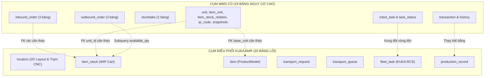

# BÁO CÁO KIỂM TOÁN CƠ SỞ DỮ LIỆU & MÃ NGUỒN (DATABASE & CODEBASE PRUNING AUDIT)
## HỆ THỐNG ĐIỀU PHỐI KUKA AMR CHO DÂY CHUYỀN SẢN XUẤT CƠ KHÍ & GIA CÔNG CNC

* **Dự án**: KUKA AMR Manufacturing Execution & Mobile Robot Dispatching System
* **Tài liệu**: `DOCS/database_pruning_and_cleanup_audit.md`
* **Ngày kiểm toán**: 16/10/2026
* **Phạm vi kiểm toán**: Toàn bộ 39 bảng cơ sở dữ liệu hiện có trong PostgreSQL, toàn bộ backend (`backend/app/`, `backend/alembic/`) và frontend (`frontend/src/`).
* **Mục tiêu**: Đánh giá chi tiết sự phụ thuộc (dependency check), phân loại chính xác các bảng thừa từ hệ thống WMS cũ (FMCG Masan), và đề xuất phương án tinh lọc CSDL tối giản, an toàn tuyệt đối cho hệ thống điều phối CNC KUKA AMR.

---

## 1. TỔNG QUAN HIỆN TRẠNG 39 BẢNG TRONG CƠ SỞ DỮ LIỆU

Kết quả truy vấn thực tế từ metadata PostgreSQL và SQLAlchemy Inspector (`inspect(engine).get_table_names()`) ghi nhận hệ thống hiện có **39 bảng vật lý**.

Toàn bộ 39 bảng được phân loại thành **3 nhóm chiến lược**:
1. **Core Active (Bắt buộc giữ)**: 18 bảng nền tảng phục vụ phân quyền RBAC, bản đồ xưởng 2D, thông báo WebSocket và khối lõi điều phối KUKA AMR CNC vừa xây dựng.
2. **Core Refactoring (Giữ & Tinh chỉnh Schema)**: 2 bảng (`item`, `item_stock`) — Kế thừa làm danh mục Model chi tiết và Xe gá phôi WIP Cart, loại bỏ các ràng buộc khóa ngoại và cột đặc thù FMCG.
3. **Dead / Redundant (Nên loại bỏ - DROP)**: 19 bảng — Di tích của hệ thống WMS kho lưu trữ hàng tiêu dùng Masan (Inbound, Outbound, Kiểm kê, Robot cũ Hikrobot ICS, Unit conversion, Transaction/History cũ).

### BẢNG TỔNG HỢP PHÂN LOẠI TOÀN BỘ 39 BẢNG

| STT | Tên bảng CSDL | Cụm chức năng | Mục đích ban đầu | Số dòng thực tế | Trạng thái đề xuất |
|:---:|:---|:---|:---|:---:|:---:|
| 1 | `alembic_version` | Migration Meta | Theo dõi phiên bản Alembic migrations | 1 | **CORE ACTIVE (GIỮ)** |
| 2 | `users` | Auth / RBAC | Tài khoản đăng nhập (Admin, Operator, PDA) | 1 | **CORE ACTIVE (GIỮ)** |
| 3 | `roles` | Auth / RBAC | Nhóm quyền người dùng (admin, operator...) | 2 | **CORE ACTIVE (GIỮ)** |
| 4 | `user_roles` | Auth / RBAC | Liên kết M:N giữa Users và Roles | 1 | **CORE ACTIVE (GIỮ)** |
| 5 | `permissions` | Auth / RBAC | Danh mục quyền chi tiết hệ thống | 0 | **CORE ACTIVE (GIỮ)** |
| 6 | `role_permissions` | Auth / RBAC | Phân quyền chi tiết cho từng nhóm Role | 0 | **CORE ACTIVE (GIỮ)** |
| 7 | `user_warehouses` | Auth / RBAC | Gán phân quyền quản lý nhà máy/phân xưởng | 0 | **CORE ACTIVE (GIỮ)** |
| 8 | `warehouse` | Master Layout | Thực thể nhà máy / phân xưởng cơ khí | 0 | **CORE ACTIVE (GIỮ)** |
| 9 | `zone` | Master Layout | Phân vùng khu vực (Nguyên liệu, CNC, Tẩy rửa, Buffer) | 0 | **CORE ACTIVE (GIỮ)** |
| 10 | `warehouse_map` | Master Layout | Lưu file SVG / JSON layout bản đồ Canvas | 0 | **CORE ACTIVE (GIỮ)** |
| 11 | `location` | Master Layout | Tọa độ 2D (map_x, map_y), mã máy CNC, vị trí 1-2 | 0 | **CORE ACTIVE (GIỮ)** |
| 12 | `user_locations` | CNC AMR Core | Phân quyền trạm máy / vị trí thao tác cho PDA | 0 | **CORE ACTIVE (GIỮ)** |
| 13 | `production_route` | CNC AMR Core | Quy trình công nghệ định nghĩa cho từng Model chi tiết | 0 | **CORE ACTIVE (GIỮ)** |
| 14 | `route_step` | CNC AMR Core | Các bước gia công, stage level, nhóm máy song song | 0 | **CORE ACTIVE (GIỮ)** |
| 15 | `transport_request` | CNC AMR Core | Yêu cầu gọi phôi/chuyển cart từ PDA công nhân | 0 | **CORE ACTIVE (GIỮ)** |
| 16 | `transport_queue` | CNC AMR Core | Hàng đợi điều phối tự động (chờ cart / chờ slot rửa) | 0 | **CORE ACTIVE (GIỮ)** |
| 17 | `fleet_task` | CNC AMR Core | Lệnh điều động robot AMR gửi sang KUKA RCS | 0 | **CORE ACTIVE (GIỮ)** |
| 18 | `production_record` | CNC AMR Core | Nhật ký hoàn thành công đoạn, cycle time, operator | 0 | **CORE ACTIVE (GIỮ)** |
| 19 | `notification` | Hệ thống | Thông báo đẩy real-time qua WebSocket | 0 | **CORE ACTIVE (GIỮ)** |
| 20 | `item` | Sản phẩm | Tái sử dụng làm `ProductModel` (7 Model chi tiết CNC) | 0 | **REFACTOR (GIỮ & SỬA)** |
| 21 | `item_stock` | WIP Cart | Tái sử dụng làm `Cart / Xe gá phôi` (Khóa cờ tranh chấp) | 0 | **REFACTOR (GIỮ & SỬA)** |
| 22 | `inbound_order` | WMS Inbound | Đơn hàng nhập kho FMCG Masan | 0 | **DEAD / LOẠI BỎ (DROP)** |
| 23 | `inbound_order_detail`| WMS Inbound | Chi tiết dòng hàng nhập kho | 0 | **DEAD / LOẠI BỎ (DROP)** |
| 24 | `inbound_order_allocation` | WMS Inbound | Phân bổ pallet vào ô kệ kho | 0 | **DEAD / LOẠI BỎ (DROP)** |
| 25 | `outbound_order` | WMS Outbound | Đơn hàng xuất kho FMCG | 0 | **DEAD / LOẠI BỎ (DROP)** |
| 26 | `outbound_order_detail`| WMS Outbound | Chi tiết dòng hàng xuất kho | 0 | **DEAD / LOẠI BỎ (DROP)** |
| 27 | `outbound_order_allocation` | WMS Outbound | Phân bổ xuất hàng và gán nhiệm vụ lấy hàng | 0 | **DEAD / LOẠI BỎ (DROP)** |
| 28 | `stocktake` | WMS Kiểm kê | Phiếu yêu cầu kiểm kê kho định kỳ | 0 | **DEAD / LOẠI BỎ (DROP)** |
| 29 | `stocktake_item` | WMS Kiểm kê | Chi tiết số lượng kiểm đếm thực tế vs lý thuyết | 0 | **DEAD / LOẠI BỎ (DROP)** |
| 30 | `inventory_daily_snapshot` | WMS Báo cáo | Chụp số dư tồn kho cuối ngày cho kế toán | 0 | **DEAD / LOẠI BỎ (DROP)** |
| 31 | `item_import_staging`| WMS Import | Bảng Unlogged trung gian import CSV tồn kho Masan | 0 | **DEAD / LOẠI BỎ (DROP)** |
| 32 | `robot_task` | Robot cũ ICS | Tác vụ điều khiển Hikrobot ICS chở pallet | 0 | **DEAD / LOẠI BỎ (DROP)** |
| 33 | `task_status` | Robot cũ ICS | Callback webhook nhận trạng thái từ Hikrobot ICS | 0 | **DEAD / LOẠI BỎ (DROP)** |
| 34 | `transaction` | Lịch sử WMS | Ghi nhận dịch chuyển tồn kho ô kệ FMCG | 0 | **DEAD / LOẠI BỎ (DROP)** |
| 35 | `history` | Lịch sử WMS | Lưu vết đổi trạng thái đơn nhập/xuất kho | 0 | **DEAD / LOẠI BỎ (DROP)** |
| 36 | `unit` | Đơn vị FMCG | Danh mục đơn vị tính (thùng, hộp, gói, pallet) | 1 | **DEAD / LOẠI BỎ (DROP)** |
| 37 | `item_unit` | Đơn vị FMCG | Bảng ma trận tỷ lệ quy đổi đơn vị hàng hóa | 0 | **DEAD / LOẠI BỎ (DROP)** |
| 38 | `item_stock_relation`| Tồn kho FMCG | Phân tách / gộp pallet cha-con | 0 | **DEAD / LOẠI BỎ (DROP)** |
| 39 | `qr_code` | Mã vạch WMS | Quản lý mã QR dán trên từng thùng hàng tiêu dùng | 0 | **DEAD / LOẠI BỎ (DROP)** |

> [!NOTE]
> **Tỷ lệ tinh gọn**: Loại bỏ **19/39 bảng** (chiếm **48.7%** tổng số bảng). Sau khi tinh lọc, cơ sở dữ liệu sẽ co gọn còn đúng **20 bảng** sạch sẽ, hướng 100% vào nghiệp vụ điều phối sản xuất và robot KUKA AMR.

---

## 2. ĐÁNH GIÁ MỨC ĐỘ SỬ DỤNG & SỰ PHỤ THUỘC (DEPENDENCY CHECK)

Dưới đây là kết quả rà soát chi tiết từng dòng code trong `backend/app/` và `frontend/src/` để làm rõ mức độ phụ thuộc và tác động đến luồng cấp phôi/WIP/CNC/AMR mới:



---

### 2.1 Cụm Inbound (`inbound_order`, `inbound_order_detail`, `inbound_order_allocation`)

* **Backend**:
  - `backend/app/modules/warehouse/inbound_order/`: Module đầy đủ gồm `inbound_order_api.py`, `inbound_order_service.py`, `inbound_order_model.py`, `inbound_celery_task.py`, `qr_code_module.py`.
  - `backend/app/main.py`: Include `inbound_order_router` với tiền tố `/api/v1`.
  - Khóa ngoại ràng buộc chéo:
    + `item_stock.inbound_order_detail_id` $\rightarrow$ `inbound_order_detail.id` (FK nullable).
    + `location_service.py` (`LOCATION_FK_COLUMNS`): Rà soát `InboundOrderDetail.from_location_id` và `to_location_id` trước khi map lại tọa độ.
    + `history_model.py`: `History.inbound_order_id` $\rightarrow$ `inbound_order.id`.
    + `robot_model.py`: `RobotTask.inbound_order_detail_id` $\rightarrow$ `inbound_order_detail.id`.
* **Frontend**:
  - `frontend/src/pages/ImportPage.tsx` và `ImportDetailPage.tsx`: Giao diện lập và duyệt đơn nhập kho FMCG.
  - `frontend/src/hooks/useInbound.tsx`, `useMasanInbound.ts`.
  - `frontend/src/components/layout/Sidebar.tsx`: Mục menu [Nhập kho].
* **Ảnh hưởng tới luồng CNC KUKA AMR**:
  - **HOÀN TOÀN KHÔNG ẢNH HƯỞNG**. Trong xưởng CNC, phôi thô được cấp tại 7 vị trí nguyên liệu (`VT-01` .. `VT-07`). Khi công nhân nạp phôi lên xe gá, PDA trực tiếp đăng ký Cart (`item_stock`) và gán vị trí xuất phát, sau đó tạo `transport_request`. Không có quy trình "Đơn mua hàng / Nhập kho NCC" kiểu logistics.

---

### 2.2 Cụm Outbound (`outbound_order`, `outbound_order_detail`, `outbound_order_allocation`)

* **Backend**:
  - `backend/app/modules/warehouse/outbound_order/`: Gồm API, Service, Model, Schema, Celery tasks xuất kho FMCG.
  - `backend/app/main.py`: Include `outbound_order_router`.
  - **Điểm nghẽn rủi ro cao trong `ItemStock`**:
    Trong `backend/app/modules/warehouse/item_stock/item_stock_model.py`:
    ```python
    available_quantity = column_property(
        quantity - select(func.coalesce(func.sum(countable_allocation_quantity()), 0))
        .where(OutboundOrderAllocation.item_stock_id == id)
        .correlate_except(OutboundOrderAllocation)
        .scalar_subquery()
    )
    ```
    Nếu xóa bảng `outbound_order_allocation` mà không xóa bỏ `column_property(available_quantity)`, mọi truy vấn `ItemStock` sẽ lập tức crash!
* **Frontend**:
  - `frontend/src/pages/OutboundPage.tsx`, `OutboundDetailPage.tsx`, `useOutbound.ts`.
  - `Sidebar.tsx`: Mục menu [Xuất kho].
* **Ảnh hưởng tới luồng CNC KUKA AMR**:
  - **HOÀN TOÀN KHÔNG ẢNH HƯỞNG**. Phôi sau khi qua công đoạn CNC cuối cùng sẽ chuyển thẳng sang Khu Tẩy Rửa (Washing Slot) và bãi đệm xe rỗng (Buffer). Không có nghiệp vụ nhặt hàng theo đơn (SO / Picking wave).

---

### 2.3 Cụm Kiểm kê (`stocktake`, `stocktake_item`)

* **Backend**:
  - `backend/app/modules/warehouse/stocktake/`: Module kiểm kê tồn kho theo chu kỳ.
  - Khóa ngoại: `stocktake_item` trỏ tới `item_stock.id` và `location.id`.
  - `location_service.py`: `LOCATION_FK_COLUMNS` chứa `(StocktakeItemStock, "location_id")`.
* **Frontend**:
  - `frontend/src/pages/StocktakePage.tsx`, `StocktakeDetailPage.tsx`, modal `CreateStocktakeModal.tsx`, hook `useStocktake.ts`.
* **Ảnh hưởng tới luồng CNC KUKA AMR**:
  - **HOÀN TOÀN KHÔNG ẢNH HƯỞNG**. Vị trí và trạng thái xe phôi trên sàn xưởng được theo dõi thời gian thực (Real-time IoT/WIP Tracking). Mỗi trạm máy CNC chỉ chứa tối đa 2 xe (`CNC01_POS1`, `CNC01_POS2`). Không cần và không thể dùng tính năng kiểm kê thùng hàng kiểu Masan.

---

### 2.4 Cụm Báo cáo Snapshot & Import Staging (`inventory_daily_snapshot`, `item_import_staging`)

* **Backend**:
  - `inventory_daily_snapshot`: Chỉ được dùng trong `dashboard_snapshot_service.py` để tính giá trị tồn kho theo ngày cho kế toán.
  - `backend/app/core/celery_app.py`: Celery beat định kỳ lúc 23:59:
    ```python
    "snapshot-inventory-daily": {
        "task": "dashboard.snapshot_inventory_daily",
        "schedule": crontab(hour=11, minute=59),
    }
    ```
    *(Nếu drop bảng mà không gỡ cronjob trong Celery thì Celery worker sẽ quăng Exception lỗi mỗi đêm).*
  - `item_import_staging`: Bảng Unlogged tạo tạm để chạy lệnh PostgreSQL `COPY` khi import hàng vạn SKU từ Excel. Hoàn toàn không có model SQLAlchemy.
* **Frontend**: Không hề có trang nào gọi đến `inventory_daily_snapshot` (chỉ có file mock tĩnh `snapshotConfig.ts` ở client).
* **Ảnh hưởng tới luồng CNC KUKA AMR**: Cả hai bảng này đều là rác thuần túy, không có giá trị trong điều phối sản xuất.

---

### 2.5 Cụm Robot cũ Hikrobot ICS (`robot_task`, `task_status`) vs Cụm KUKA AMR mới (`fleet_task`, `transport_request`, `transport_queue`)

Đây là điểm chuyển đổi cốt lõi nhất giữa hai thế hệ hệ thống:

| Tiêu chí | Cụm Robot cũ (`robot_task`, `task_status`) | Cụm KUKA AMR mới (`fleet_task`, `transport_request`) |
|:---|:---|:---|
| **Giao thức điều khiển**| Hikrobot ICS (Pallet Shuttle / QR Grid) | KUKA Fleet Manager / RCS (Autonomous Mobile Robot) |
| **Đối tượng chuyên chở**| Kệ hàng kho (`shelf_number`), Pallet gác chân | Xe gá phôi vật lý (`item_stock.cart_code` RCK-xxxx) |
| **Độ độc lập trạng thái**| Trộn lẫn trạng thái robot với đơn nhập `inbound_order_detail_id` | **3 vòng đời độc lập tuyệt đối**: Request $\rightarrow$ Cart WIP $\rightarrow$ Fleet Task |
| **Điều hướng & Điểm đỗ**| Quản lý bằng mã quy trình `process_code`, `system_code` | Tọa độ thực 2D `(map_x, map_y)`, `pickup_location_id` $\rightarrow$ `dropoff_location_id` |
| **Xử lý tắc nghẽn** | Bị kẹt khi trạm đích bận, không có bộ đệm | Hàng đợi tự động `transport_queue` (chờ xe rảnh, chờ giải phóng slot tẩy rửa) |

* **Đánh giá**: `robot_task` và `task_status` đã lỗi thời 100%. Giữ lại chỉ gây nhầm lẫn tên gọi giữa task cũ và task mới trong cơ sở dữ liệu.

---

### 2.6 Cụm Lịch sử cũ (`transaction`, `history`) vs Cụm Nhật ký sản xuất mới (`production_record`)

* **Hệ thống cũ**:
  - `history`: Gắn chặt với `inbound_order_id` và `outbound_order_id` (nếu xóa 2 bảng đơn hàng thì `history` gãy khóa ngoại).
  - `transaction`: Ghi lại dịch chuyển tồn kho chung chung (`from_location_id` $\rightarrow$ `to_location_id`), phục vụ hiển thị trên `BacklogPage.tsx`.
* **Hệ thống CNC KUKA AMR mới**:
  - `production_record`: Lưu chính xác thời điểm hoàn thành công đoạn, model sản phẩm, vị trí máy CNC, người vận hành (operator), cấp độ level đạt được (`stage_level = 1, 2, 3`) để tính Cycle time và KPI máy.
  - `transport_request` và `fleet_task`: Lưu chi tiết toàn bộ lịch sử di chuyển cơ học của robot AMR (thời gian gửi, thời gian nhận, thời gian hoàn thành).
* **Đánh giá**: Có thể loại bỏ `history` và `transaction`. Trang Backlog trên frontend nên được định hướng lại để đọc dữ liệu từ `production_record` và `fleet_task`.

---

### 2.7 Cụm Bảng phụ (`qr_code`, `item_stock_relation`, `unit`, `item_unit`)

1. **`qr_code`**:
   - Trong WMS Masan: Dùng để in hàng triệu tem QR dán lên từng thùng carton mì tôm, nước mắm (`qr_type = 'item'`).
   - Trong KUKA AMR: Chỉ có khoảng vài chục chiếc xe gá phôi cố định trên xưởng. Mã QR đã được dán cố định trên khung xe và lưu trực tiếp vào cột `item_stock.cart_code` (ví dụ `RCK-1021`). Bảng `qr_code` là hoàn toàn thừa thãi.
2. **`item_stock_relation`**:
   - Dùng để theo dõi việc tách 1 pallet to thành nhiều thùng lẻ (quan hệ cha - con `parent_stock_id` $\rightarrow$ `child_stock_id`). Trong xưởng cơ khí, xe gá phôi là thực thể nguyên khối, không bao giờ có nghiệp vụ tách/gộp xe.
3. **`unit` và `item_unit`**:
   - Dùng cho ma trận quy đổi: 1 Pallet = 40 Thùng = 960 Gói.
   - Gia công CNC đếm theo chiếc chi tiết kim loại trên 1 xe gá (`item.standard_quantity_per_cart = 120`). Không có đơn vị quy đổi phức tạp.
   - **Rào cản**: Cột `item.base_unit` và `item_stock.unit_id` hiện đang đặt `NOT NULL REFERENCES unit(id)`. Phải tháo bỏ khóa ngoại này trước khi xóa `unit`.

---

## 3. PHÂN LOẠI CHI TIẾT & BẢNG ĐỐI SOÁNH NGUYÊN NHÂN (RETENTION & PRUNING MATRIX)

### NHÓM 1: BẢNG BẮT BUỘC GIỮ (CORE ACTIVE - 18 BẢNG)

| Tên bảng | Lý do bắt buộc giữ |
|:---|:---|
| `alembic_version` | Quản lý schema migrations của cơ sở dữ liệu. |
| `users` | Tài khoản xác thực cho công nhân vận hành PDA và Admin nhà máy. |
| `roles`, `user_roles` | Phân quyền truy cập theo vai trò (Admin, Operator Cấp phôi, Operator CNC, Operator Tẩy rửa). |
| `permissions`, `role_permissions` | Kiểm soát bảo mật chi tiết cấp API endpoint. |
| `user_warehouses` | Phân quyền quản lý theo nhà máy / xưởng sản xuất. |
| `warehouse` | Đại diện cho phân xưởng cơ khí KUKA AMR. |
| `zone` | Phân vùng các khu chức năng: Nguyên liệu, Line CNC 1, Line CNC 2, Khu Tẩy Rửa, Bãi đệm Cart rỗng. |
| `warehouse_map` | Lưu layout đồ họa mặt bằng xưởng phục vụ dựng Canvas 2D. |
| `location` | Điểm dừng đỗ vật lý của AMR: Tọa độ `map_x`, `map_y`, mã máy `machine_code`, vị trí In/Out `position_index`. |
| `user_locations` | Bảng phân quyền trạm: Quy định tài khoản PDA nào được điều khiển máy CNC / khu vực nào. |
| `production_route` | Định nghĩa quy trình công nghệ cho từng Model chi tiết gia công. |
| `route_step` | Định nghĩa các bước tuần tự, stage level, danh sách máy CNC được phép gia công song song (`allowed_machines`). |
| `transport_request` | Thực thể yêu cầu vận chuyển: Lưu vết lệnh gọi phôi từ công nhân tại các trạm máy. |
| `transport_queue` | Hàng đợi tự động giải quyết bài toán thiếu xe hoặc đầy slot tẩy rửa (Zero CNC Starvation). |
| `fleet_task` | Tác vụ điều phối gửi trực tiếp sang KUKA Fleet Manager / RCS. |
| `production_record` | Nhật ký ghi nhận hoàn thành từng công đoạn gia công tại máy CNC (tính Cycle time & sản lượng). |
| `notification` | Kênh bắn cảnh báo lỗi, kẹt xe, sự cố trạm máy real-time qua WebSocket lên giao diện. |

---

### NHÓM 2: BẢNG GIỮ LẠI ĐỂ TÁI CẤU TRÚC (REFACTORING - 2 BẢNG)

| Tên bảng | Hiện trạng WMS cũ | Phương án Tái cấu trúc cho KUKA AMR |
|:---|:---|:---|
| **`item`** | Lưu hàng hóa FMCG với các cột: `supplier`, `max_quantity`, `min_quantity`, `base_unit` FK $\rightarrow$ `unit.id`. | **Chuyển thành danh mục Model sản phẩm**: Giữ `sku`, `name`, `description`, `standard_quantity_per_cart` (120 pcs). Drop hoặc cho phép `NULL` các cột `base_unit`, `supplier`, `max_quantity`, `min_quantity`. |
| **`item_stock`** | Lưu tồn kho ô kệ với các cột: `unit_id`, `inbound_order_detail_id`, `lot_number`, `expiry_date`, `cavity_number`... | **Chuyển thành thực thể Xe gá phôi (WIP Cart)**: Giữ `cart_code` (RCK-xxxx), `item_id`, `location_id`, `quantity`, `current_stage_level`, `is_locked`, `locked_by_task_id`, `destination_location_id`. Drop toàn bộ khóa ngoại trỏ tới `inbound_order_detail` và `unit`. Xóa `column_property(available_quantity)`. |

---

### NHÓM 3: BẢNG ĐỀ XUẤT LOẠI BỎ TRIỆT ĐỂ (PRUNING / DROP - 19 BẢNG)

| Tên bảng | Lý do loại bỏ (Dead / Redundant) | Rủi ro nếu giữ lại |
|:---|:---|:---|
| `inbound_order` | Không có đơn nhập hàng nhà cung cấp trong dây chuyền CNC. | Chiếm dung lượng, tạo ràng buộc khóa ngoại chéo. |
| `inbound_order_detail` | Không dùng chi tiết đơn nhập. | Khóa ngoại trói buộc vào `item_stock`. |
| `inbound_order_allocation` | Cơ chế phân bổ ô kệ của WMS kho hàng, không dùng cho xe phôi. | Làm nặng schema, rác truy vấn. |
| `outbound_order` | Dây chuyền sản xuất không dùng đơn xuất bán hàng. | Gây nhầm lẫn trong nghiệp vụ điều phối. |
| `outbound_order_detail` | Không có chi tiết xuất hàng. | Tồn tại code thừa trong backend. |
| `outbound_order_allocation` | Gán pallet xuất kho, chứa subquery làm chậm `item_stock`. | Làm chậm truy vấn xe gá phôi do `available_quantity`. |
| `stocktake` | Không có nghiệp vụ kiểm kê đếm thủ công từng kiện hàng. | Code thừa, API không dùng. |
| `stocktake_item` | Chi tiết kiểm kê thừa. | Khóa ngoại trỏ vào `location` và `item_stock`. |
| `inventory_daily_snapshot` | Không cần chốt sổ kế toán kho cuối ngày. | Celery beat chạy nền vô ích mỗi đêm. |
| `item_import_staging` | Bảng tạm import Excel hàng loạt từ Masan. | Bảng rác unlogged trong CSDL. |
| `robot_task` | Cấu trúc chuyên biệt cho Hikrobot ICS cũ (chở kệ). | Xung đột khái niệm với `fleet_task` KUKA AMR. |
| `task_status` | Callback nhận tín hiệu từ Hikrobot ICS cũ. | Dữ liệu rác không còn thiết bị gửi tin. |
| `transaction` | Nhật ký di chuyển kho cũ của WMS Masan. | Đã được thay thế hoàn toàn bởi `transport_request` & `fleet_task`. |
| `history` | Lịch sử trạng thái đơn hàng nhập/xuất cũ. | Chứa khóa ngoại chết trỏ vào `inbound_order`/`outbound_order`. |
| `unit` | Đơn vị tính FMCG (thùng/hộp/bịch). | Ràng buộc `NOT NULL` vô lý bắt buộc phải nhập đơn vị tính. |
| `item_unit` | Tỷ lệ quy đổi đơn vị hàng hóa. | Không dùng trong gia công cơ khí. |
| `item_stock_relation` | Ghép/tách pallet cha-con. | Bảng mồ côi không hề được gọi trong bất kỳ service nào. |
| `qr_code` | Tem QR dán trên từng thùng hàng tiêu dùng. | Bị thay thế bởi mã QR tĩnh gắn cứng trên xe (`item_stock.cart_code`). |

---

## 4. PHÂN TÍCH RỦI RO & CÁC ĐIỂM NGHẼN KHI THÁO GỠ (RISK & COUPLING AUDIT)

Để đảm bảo việc xóa bỏ 19 bảng không gây sập hệ thống (Crash on startup), nhóm kỹ thuật bắt buộc phải nhận diện và xử lý **4 điểm nghẽn phụ thuộc (Coupling Bottlenecks)** sau đây:

### 4.1 Điểm nghẽn 1: Ràng buộc Khóa ngoại (Foreign Key Constraints) trên PostgreSQL
* **Hiện tượng**: Lệnh `DROP TABLE inbound_order_detail` hoặc `DROP TABLE unit` sẽ bị PostgreSQL từ chối với lỗi:
  `ERROR: cannot drop table ... because other objects depend on it`.
* **Nguyên nhân**:
  - `item_stock.inbound_order_detail_id` $\rightarrow$ `inbound_order_detail.id`
  - `item_stock.unit_id` $\rightarrow$ `unit.id` (Đang là `NOT NULL`!)
  - `item.base_unit` $\rightarrow$ `unit.id` (Đang là `NOT NULL`!)
* **Giải pháp tháo gỡ**:
  Trước khi drop bảng, bắt buộc phải chạy Alembic migration để:
  1. `ALTER TABLE item_stock DROP CONSTRAINT ...` (Xóa FK tới `inbound_order_detail` và `unit`).
  2. `ALTER TABLE item_stock ALTER COLUMN unit_id DROP NOT NULL`.
  3. `ALTER TABLE item DROP CONSTRAINT ...` (Xóa FK tới `unit`).
  4. `ALTER TABLE item ALTER COLUMN base_unit DROP NOT NULL`.

### 4.2 Điểm nghẽn 2: Subquery Tính toán trong Model SQLAlchemy
* **Hiện tượng**: `ItemStock.available_quantity` được định nghĩa bằng một subquery correlate tới `OutboundOrderAllocation`:
  ```python
  # file: backend/app/modules/warehouse/item_stock/item_stock_model.py (Dòng 108)
  available_quantity = column_property(
      quantity - select(func.coalesce(func.sum(countable_allocation_quantity()), 0))
      .where(OutboundOrderAllocation.item_stock_id == id)
      .correlate_except(OutboundOrderAllocation)
      .scalar_subquery()
  )
  ```
  Nếu bảng `outbound_order_allocation` bị xóa hoặc file model bị gỡ, mọi câu query `db.query(ItemStock)` trong `dispatch_service.py` sẽ chết ngay lập tức vì lỗi biên dịch mapper SQLAlchemy.
* **Giải pháp tháo gỡ**: Xóa bỏ thuộc tính `available_quantity` trên `ItemStock`, hoặc chuyển nó thành một property đơn giản `return self.quantity`.

### 4.3 Điểm nghẽn 3: Danh sách kiểm tra Khóa ngoại trong `location_service.py`
* **Hiện tượng**: Tại dòng 69 file `backend/app/modules/warehouse/location_map/location_service.py`:
  ```python
  LOCATION_FK_COLUMNS: tuple[tuple[type, str], ...] = (
      (ItemStock, "location_id"),
      (StocktakeItemStock, "location_id"),
      (Transaction, "from_location_id"),
      (Transaction, "to_location_id"),
      (InboundOrderDetail, "from_location_id"),
      (InboundOrderDetail, "to_location_id"),
      (OutboundOrderAllocation, "from_location_id"),
      (OutboundOrderAllocation, "to_location_id"),
  )
  ```
  Hàm này được dùng để kiểm tra xem một vị trí trên bản đồ có đang bị ràng buộc bởi dữ liệu lịch sử hay không trước khi cập nhật.
* **Giải pháp tháo gỡ**: Cập nhật lại tuple này, loại bỏ 4 model cũ và thay thế bằng các model KUKA AMR mới:
  ```python
  LOCATION_FK_COLUMNS = (
      (ItemStock, "location_id"),
      (ItemStock, "destination_location_id"),
      (TransportRequest, "source_location_id"),
      (TransportRequest, "destination_location_id"),
      (FleetTask, "pickup_location_id"),
      (FleetTask, "dropoff_location_id"),
      (ProductionRecord, "location_id"),
  )
  ```

### 4.4 Điểm nghẽn 4: Lịch trình chạy ngầm Celery Beat trong `celery_app.py`
* **Hiện tượng**: Tại dòng 68-76 file `backend/app/core/celery_app.py`, hệ thống đang kích hoạt cronjob hàng đêm:
  ```python
  "snapshot-inventory-daily": {
      "task": "dashboard.snapshot_inventory_daily",
      "schedule": crontab(hour=11, minute=59),
  }
  ```
* **Giải pháp tháo gỡ**: Xóa bỏ mục `snapshot-inventory-daily` trong `beat_schedule`, xóa `inbound.*`, `outbound.*`, `robot.*` trong `task_routes`.

### 4.5 Điểm nghẽn 5: Khởi động ứng dụng FastAPI (`backend/app/main.py`)
* **Hiện tượng**: `main.py` đang nạp đồng loạt các router cũ:
  ```python
  app.include_router(inbound_order_router, prefix="/api/v1")
  app.include_router(outbound_order_router, prefix="/api/v1")
  app.include_router(stocktake_router, prefix="/api/v1")
  app.include_router(unit_router, prefix="/api/v1")
  app.include_router(robot_router, prefix="/api/v1")
  ```
* **Giải pháp tháo gỡ**: Comment hoặc gỡ bỏ các router này khi deprecate, đồng thời đăng ký router mới cho Khối Điều phối Sản xuất: `app.include_router(production_router, prefix="/api/v1")`.

---

## 5. LỘ TRÌNH TINH LỌC AN TOÀN 4 GIAI ĐOẠN (SAFE PRUNING ROADMAP)

Để đảm bảo an toàn 100%, không làm gián đoạn hệ thống và có thể rollback bất kỳ lúc nào, quy trình tinh lọc được chia thành 4 giai đoạn tuần tự:


### GIAI ĐOẠN 1: Tháo gỡ Ràng buộc & Khóa ngoại (Non-Breaking Migration)
* **Mục tiêu**: Làm cho các bảng lõi (`item`, `item_stock`, `location`) hoàn toàn độc lập, không còn bị níu giữ bởi các bảng WMS cũ.
* **Hành động cụ thể**:
  1. Viết migration Alembic:
     - Drop Foreign Keys từ `item_stock` trỏ tới `inbound_order_detail` và `unit`.
     - Chuyển `item_stock.unit_id` sang `nullable=True`.
     - Drop Foreign Key từ `item` trỏ tới `unit`.
     - Chuyển `item.base_unit` sang `nullable=True`.
     - Cho phép `NULL` các cột `supplier`, `max_quantity`, `min_quantity` trên bảng `item`.
  2. Sửa code backend:
     - Gỡ bỏ `available_quantity` subquery trong `item_stock_model.py`.
     - Cập nhật `LOCATION_FK_COLUMNS` trong `location_service.py`.

### GIAI ĐOẠN 2: Cách ly Router & Tắt Tác vụ Nền Cũ
* **Mục tiêu**: Chặn mọi luồng ghi dữ liệu vào các bảng cũ, đưa chúng về trạng thái Read-Only hoàn toàn.
* **Hành động cụ thể**:
  1. Trong `backend/app/main.py`: Tạm đóng (comment) các dòng `include_router` của `inbound_order_router`, `outbound_order_router`, `stocktake_router`, `unit_router`, `robot_router`.
  2. Đăng ký router chính thức cho KUKA AMR: `production_router` (chứa các API gọi xe, chuyển công đoạn, báo xong, giải phóng slot rửa).
  3. Trong `backend/app/core/celery_app.py`: Gỡ bỏ cronjob `snapshot-inventory-daily` và các route cũ.

### GIAI ĐOẠN 3: Tinh chỉnh Giao diện Người Dùng (Frontend Decoupling)
* **Mục tiêu**: Giữ cho UI sạch đẹp, loại bỏ các menu gây nhầm lẫn cho công nhân và quản lý xưởng.
* **Hành động cụ thể**:
  1. `frontend/src/components/layout/Sidebar.tsx`:
     - Ẩn/xóa các mục menu: "Nhập kho", "Xuất kho", "Kiểm kê", "Đơn vị".
     - Thêm các mục menu mới cho dây chuyền KUKA AMR: "Điều phối Xe Phôi" (`/dispatch`), "Giám sát Fleet Robot" (`/fleet`), "Lịch sử Sản xuất & Cycle Time" (`/production-history`).
  2. Đảm bảo các trang PDA (`/pda/raw-material`, `/pda/cnc`, `/pda/washing`) hoạt động trơn tru 100% không còn dính dáng tới các hook của WMS cũ (`useInbound`, `useOutbound`, `sendCallerAddTasks`).

### GIAI ĐOẠN 4: Thực thi DROP TABLES & Dọn dẹp Codebase Triệt để (Zero Dead Code)
* **Mục tiêu**: Xóa sạch 19 bảng khỏi PostgreSQL và xóa các thư mục mã nguồn không còn dùng.
* **Hành động cụ thể**:
  1. **Sao lưu an toàn**: Chạy lệnh sao lưu cấu trúc và dữ liệu:
     ```bash
     pg_dump -U postgres -d wms_db -F c -b -v -f "backup_before_pruning_20261016.dump"
     ```
  2. **Tạo Alembic Migration `drop_legacy_wms_tables.py`**:
     Thực hiện lệnh DROP TABLE có thứ tự (drop bảng con trước, bảng cha sau):
     - Bước 4.1: Drop các bảng liên kết & chi tiết: `item_stock_relation`, `item_unit`, `qr_code`, `inbound_order_allocation`, `outbound_order_allocation`, `stocktake_item`, `task_status`.
     - Bước 4.2: Drop các bảng nghiệp vụ: `inbound_order_detail`, `outbound_order_detail`, `robot_task`, `history`, `transaction`.
     - Bước 4.3: Drop các bảng cha: `inbound_order`, `outbound_order`, `stocktake`, `inventory_daily_snapshot`, `item_import_staging`, `unit`.
  3. **Dọn dẹp thư mục mã nguồn**:
     - Xóa `backend/app/modules/warehouse/inbound_order/`
     - Xóa `backend/app/modules/warehouse/outbound_order/`
     - Xóa `backend/app/modules/warehouse/stocktake/`
     - Xóa `backend/app/modules/warehouse/unit/`
     - Xóa `backend/app/modules/robot/` (thay bằng `production/fleet_adapter`)
     - Xóa các trang FE tương ứng trong `frontend/src/pages/` (`ImportPage`, `OutboundPage`, `StocktakePage`, `UnitSettingPage`).

---

## 6. KẾT LUẬN & ĐỀ XUẤT HÀNH ĐỘNG TIẾP THEO

Việc kiểm toán cho thấy cơ sở dữ liệu hiện tại đang phải gánh tải **19 bảng rác không còn bất kỳ giá trị thực tế nào** cho dây chuyền sản xuất cơ khí KUKA AMR. Việc duy trì các bảng này không chỉ gây lãng phí tài nguyên mà còn tạo ra các bẫy lỗi tiềm tàng (khóa ngoại bắt buộc đơn vị tính `unit_id`, subquery tính tồn khả dụng `available_quantity` làm chậm truy vấn).

### 3 Đề xuất hành động tức thì:
1. **Phê duyệt Báo cáo Kiểm toán**: Trình báo cáo này cho Trưởng dự án / Solution Architect để chốt danh sách 19 bảng loại bỏ.
2. **Triển khai Giai đoạn 1 ngay lập tức**: Viết file migration Alembic để tháo gỡ toàn bộ các ràng buộc khóa ngoại `unit_id`, `base_unit` và `inbound_order_detail_id`, giúp việc vận hành của `dispatch_service.py` và `seed_production_core.py` hoàn toàn thông suốt mà không cần dùng đến các dữ liệu giả lập (dummy data).
3. **Hoàn thiện API Router cho module `production`**: Đăng ký router chính thức vào `main.py` để kết nối hoàn chỉnh giữa Backend và 3 màn hình PDA trên Frontend.
