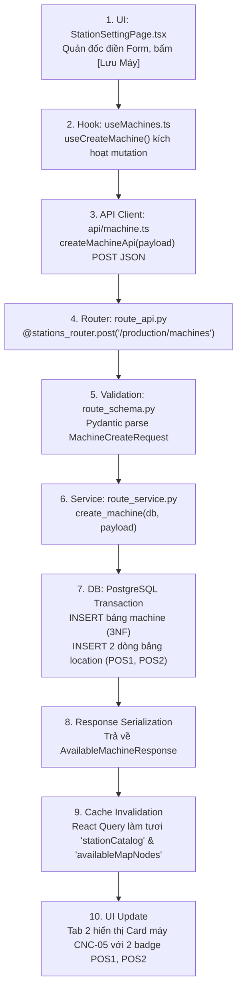
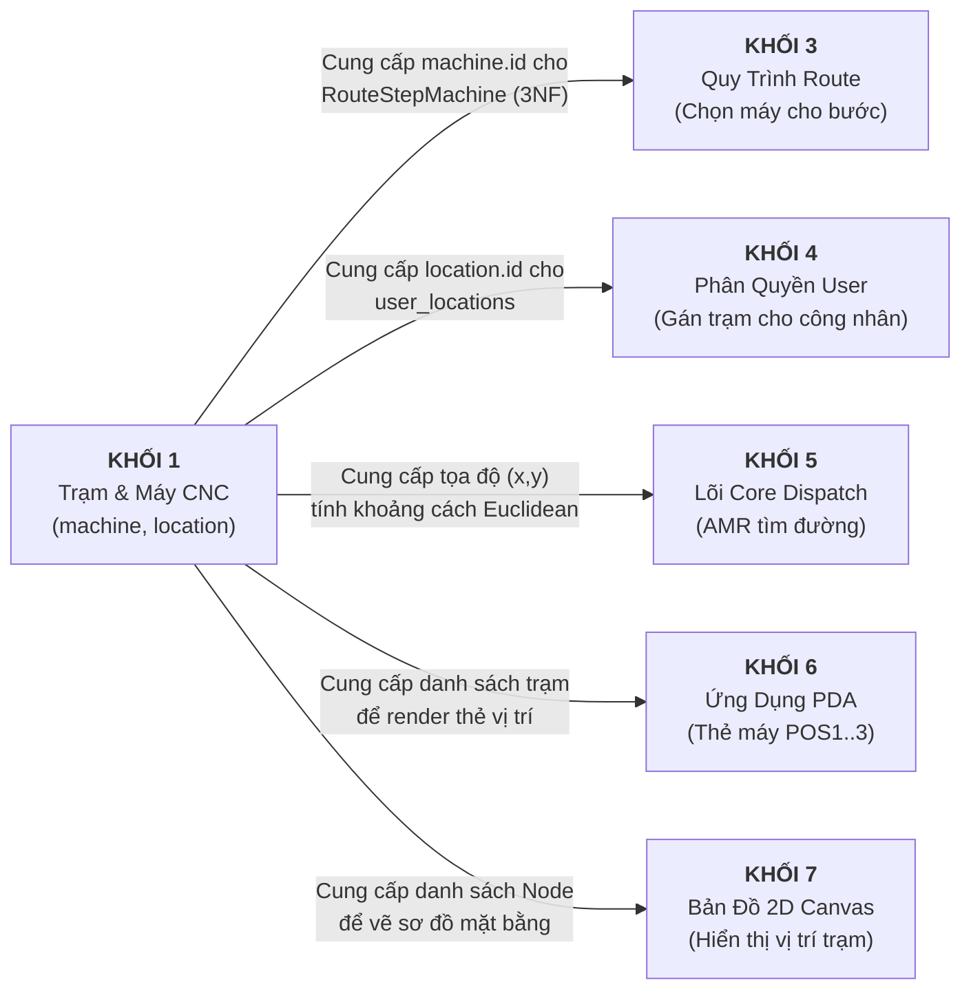

# BẢN ĐỒ ĐỊNH HƯỚNG & THẤU HIỂU CODE KHỐI 1: TRẠM MÁY CNC & PHÂN KHU XƯỞNG
*(Áp dụng Protocol "Understand Code Fast" từ SKILLS/understand_code.md)*

Tài liệu này được thiết kế theo đúng giao thức **Understand Code Protocol**: Xây dựng mô hình tư duy (mental model) hoàn chỉnh về **Khối 1: Trạm Máy & Phân Khu Xưởng** thông qua 4 trụ cột: **Mục đích & Kiến trúc $\rightarrow$ Bản đồ cây thư mục $\rightarrow$ Lần vết 1 luồng đại diện từ đầu đến cuối $\rightarrow$ 4 Câu hỏi định hướng thay đổi code**.

---

## 1. MỤC ĐÍCH, KIẾN TRÚC, STACK VÀ ĐIỂM BẮT ĐẦU (PURPOSE & ENTRY POINTS)

* **Purpose (Làm gì và cho ai?)**:
  - **Chức năng**: Định nghĩa toàn bộ không gian vật lý của nhà xưởng thành 4 phân khu chức năng (Khu Cấp Phôi, Khu Máy CNC, Khu Tẩy Rửa, Khu Bãi Đệm Xe Rỗng) và gắn kết từng điểm đỗ vật lý với Node tọa độ thực tế trên bản đồ robot KUKA.
  - **Đối tượng sử dụng**: **Quản đốc phân xưởng (Admin / Workshop Manager)** thiết lập mặt bằng trước khi dây chuyền đi vào vận hành.
* **Architecture (Mô hình kiến trúc)**:
  - Kiến trúc Client - Server đa tầng (Multi-tier Fullstack):
    - **UI Layer**: React Single Page Application (SPA), Component-based, Ant Design 5.
    - **State & Server Cache**: TanStack React Query v5 (đồng bộ cache theo key: `['stationCatalog']`, `['availableMapNodes']`, `['machines']`).
    - **API Gateway / Router**: FastAPI APIRouter phân tách theo tag `Production - Stations & Machines`.
    - **Boundary Validation**: Pydantic v2 schemas kiểm soát chặt chẽ dữ liệu đầu vào/ra.
    - **Service & Domain Layer**: Python module `route_service.py` xử lý nghiệp vụ, quản lý transaction.
    - **Data Persistence**: PostgreSQL 16 quản lý quan hệ 1-N chuẩn hóa 3NF (`machine` $\rightarrow$ 1..3 `location` con).
* **Stack & Versions**:
  - **Frontend**: React 19, TypeScript 5.8, Vite 8, Ant Design 5.24, Axios, TailwindCSS.
  - **Backend**: Python 3.12, FastAPI 0.115, SQLAlchemy 2.0 ORM, Pydantic 2.10.
  - **Database**: PostgreSQL 16 (Port 5433, Database: `kuka`).
  - **Map Ground Truth**: File bản đồ xưởng KUKA `map_CNC001_CNC001_28s.json` (493 nodes, trích xuất 23 functional rack nodes).
* **Entry Points (Điểm bắt đầu thực thi)**:
  - **Frontend Entry**: URL `/production/stations` đăng ký tại `frontend/src/routes/index.tsx`, kích hoạt component `StationSettingPage.tsx`.
  - **Backend Entry**: APIRouter `stations_router` đăng ký trong `backend/app/modules/production/route_api.py`, được `app/main.py` nạp vào `/api/v1/production/...`.
  - **Data Seed Entry**: File `backend/scripts/seed_production_core.py` hoặc thao tác import bản đồ JSON.

---

## 2. BẢN ĐỒ CÂY THƯ MỤC CỦA KHỐI 1 (DIRECTORY MAP)

Dưới đây là cây thư mục cô đọng chỉ chứa các file tham gia trực tiếp vào Khối 1:

```text
D:\KuKA\KUKA_WMS
├── map_CNC001_CNC001_28s.json                     # [Map Ground Truth] File bản đồ 493 nodes KUKA
│
├── frontend/src/
│   ├── pages/production/
│   │   └── StationSettingPage.tsx                 # [UI Root] Màn hình 3 Tab cấu hình trạm
│   ├── hooks/
│   │   └── useMachines.ts                         # [State/Cache] React Query hooks cho máy & trạm
│   ├── api/
│   │   └── machine.ts                             # [HTTP Client] Gọi Axios endpoints
│   ├── types/
│   │   └── machine.ts                             # [Frontend Contracts] TypeScript interfaces
│   └── routes/
│       └── index.tsx                              # [Routing] Đăng ký URL /production/stations
│
└── backend/app/
    ├── modules/production/
    │   ├── route_api.py                           # [API Router] stations_router endpoints
    │   ├── route_schema.py                        # [Schemas] Pydantic Request/Response models
    │   ├── route_service.py                       # [Service Logic] Business logic trạm & máy CNC
    │   └── production_models.py                   # [DB Model] Thực thể Machine (3NF)
    └── modules/warehouse/location_map/
        └── location_model.py                      # [DB Model] Thực thể Location (Điểm đỗ AMR)
```

---

## 3. LẦN VẾT 1 LUỒNG ĐẠI DIỆN TỪ ĐẦU ĐẾN CUỐI (END-TO-END TRACE)

> **Luồng đại diện**: *Quản đốc bấm nút **[+ Thêm Máy CNC]**, đặt mã `CNC-05`, tên `Máy Phay CNC 05`, cấu hình 2 vị trí đỗ `POS1` (gắn Node 216) và `POS2` (gắn Node 249), sau đó bấm [Lưu Máy].*

Hãy theo dõi hành trình của request qua từng dòng code và từng file:



### Chi tiết hành trình qua từng tầng:
1. **Tại UI (`StationSettingPage.tsx:84-120`)**:
   - Quản đốc bấm `[+ Thêm Máy CNC]`, mở modal `isCncCreateOpen`. State `createSlots` chứa 2 slot mặc định.
   - Khi bấm **[Lưu Máy]**, form submit hàm `handleCncCreateSubmit()`:
     ```typescript
     const payload: MachineCreateInput = {
       machine_code: values.machine_code.trim(),
       machine_name: values.machine_name?.trim(),
       slots: createSlots.map(s => ({
         position_index: s.position_index,
         node_label: s.node_label,
         map_x: s.map_x,
         map_y: s.map_y
       }))
     };
     createMachineMutation.mutate(payload);
     ```
2. **Tại Hook (`useMachines.ts:30-40`)**:
   - `useCreateMachine()` kích hoạt `createMachineApi(data)`.
3. **Tại API Client (`api/machine.ts:39-42`)**:
   - Axios gửi HTTP request: `POST /api/v1/production/machines` kèm token Bearer JWT qua `axiosInstance`.
4. **Tại API Router (`route_api.py:84-99`)**:
   - Endpoint `@stations_router.post("/production/machines", response_model=AvailableMachineResponse)` tiếp nhận request.
   - Pydantic kiểm tra `payload: MachineCreateRequest` (mã máy tối thiểu 1 ký tự, slots hợp lệ 1..3).
5. **Tại Service Logic (`route_service.py:375-445`)**:
   - `create_machine(db, payload)` kiểm tra tính duy nhất:
     ```python
     if db.query(Machine).filter(Machine.machine_code == code).first():
         raise ValueError(f"Mã máy '{code}' đã tồn tại trong hệ thống")
     ```
   - Tạo đối tượng cha `Machine`:
     ```python
     machine = Machine(machine_code=code, machine_name=payload.machine_name, is_active=True)
     db.add(machine)
     db.flush() # Lấy machine.id ngay lập tức
     ```
   - Duyệt từng slot trong mảng `slots`:
     ```python
     for slot in payload.slots:
         loc = Location(
             location_code=f"{code}-POS{slot.position_index}",
             location_name=f"{machine.machine_name or code} - Vị trí {slot.position_index}",
             location_type="CNC_SLOT",
             machine_id=machine.id,
             machine_code=machine.machine_code,
             position_index=slot.position_index,
             node_label=slot.node_label,
             map_x=slot.map_x,
             map_y=slot.map_y,
             is_active=True,
         )
         db.add(loc)
     db.commit()
     ```
6. **Tại Database (PostgreSQL)**:
   - 1 bản ghi được ghi vào bảng `machine` (ID: 5, `machine_code`: `'CNC-05'`).
   - 2 bản ghi được ghi vào bảng `location` (ID: 416 mã `'CNC-05-POS1'` có `machine_id=5`, `position_index=1`; ID: 417 mã `'CNC-05-POS2'` có `machine_id=5`, `position_index=2`).
7. **Phản hồi & Cập nhật UI**:
   - Backend trả về HTTP 201 cùng JSON `AvailableMachineResponse`.
   - Hook `useCreateMachine` kích hoạt `onSuccess`:
     ```typescript
     queryClient.invalidateQueries({ queryKey: ['machines'] });
     queryClient.invalidateQueries({ queryKey: ['stationCatalog'] });
     queryClient.invalidateQueries({ queryKey: ['availableMapNodes'] });
     ```
   - Giao diện tự động re-render tức thì: Card Máy `CNC-05` xuất hiện trên Tab 2 với 2 Badge xanh `POS1 (Node 216)` và `POS2 (Node 249)`.

---

## 4. BỐN CÂU HỎI ĐỊNH HƯỚNG SỬA ĐỔI CODE (THE 4 ORIENTATION QUESTIONS)

### ❓ Câu hỏi 1: Làm thế nào để thêm một tính năng mới thuộc Khối 1?
*(Ví dụ: Muốn mở rộng cho phép máy CNC có tới 4 vị trí đỗ `POS4` hoặc thêm một phân khu mới là "Khu Kiểm Tra Chất Lượng CMM")*

* **Nếu thêm vị trí đỗ POS4**:
  1. Trong [route_schema.py](file:///D:/KuKA/KUKA_WMS/backend/app/modules/production/route_schema.py#L88): Sửa validator `position_index: int = Field(..., ge=1, le=4)`.
  2. Trong [StationSettingPage.tsx](file:///D:/KuKA/KUKA_WMS/frontend/src/pages/production/StationSettingPage.tsx): Tăng điều kiện giới hạn nút bấm `createSlots.length < 4`.
  3. Trong [route_service.py](file:///D:/KuKA/KUKA_WMS/backend/app/modules/production/route_service.py): Service đã viết động theo vòng lặp `for slot in payload.slots:`, tự động tương thích 100% không cần sửa logic.
* **Nếu thêm phân khu mới (Ví dụ: `QC_INSPECTION_STATION`)**:
  1. Thêm giá trị enum vào `Location.location_type` trong `location_model.py`.
  2. Mở rộng `StationCatalogResponse` trong `route_schema.py` thêm trường `qc_stations: list[StationCatalogItem]`.
  3. Cập nhật `route_service.get_station_catalog()` để lọc `location_type == 'QC_INSPECTION_STATION'`.
  4. Thêm Tab thứ 4 trên giao diện `StationSettingPage.tsx`.

---

### ❓ Câu hỏi 2: Tôi cần nhìn vào đâu khi xảy ra lỗi (Bug Fixing)?
*(Ví dụ thực tế và vị trí file cần kiểm tra ngay lập tức)*

| Hiện Tượng Lỗi | Nguyên Nhân Tiềm Tàng | File & Vị Trí Cần Soi |
| :--- | :--- | :--- |
| **Dropdown Node Bản Đồ bị trống không có dữ liệu** | File map chưa được nạp hoặc chưa trích xuất các node chức năng. | Soi hàm `get_available_map_nodes()` trong [route_service.py:789](file:///D:/KuKA/KUKA_WMS/backend/app/modules/production/route_service.py#L789) và kiểm tra cột `node_label` trong bảng `location`. |
| **Báo lỗi khi bấm Lưu Máy CNC: "Mã máy đã tồn tại"** | Trùng `machine_code` trong bảng `machine`. | Soi [route_service.py:384](file:///D:/KuKA/KUKA_WMS/backend/app/modules/production/route_service.py#L384). |
| **Xóa máy CNC nhưng các vị trí đỗ POS con vẫn còn** | Ràng buộc khóa ngoại hoặc thiếu logic giải phóng slot. | Soi hàm `delete_machine()` trong [route_service.py:540](file:///D:/KuKA/KUKA_WMS/backend/app/modules/production/route_service.py#L540) và kiểm tra `cascade` trên relationship `Machine.locations`. |
| **Máy CNC tạo xong nhưng sang trang Route không thấy máy để chọn** | API `/production/machines` lọc máy không kích hoạt hoặc lỗi schema. | Soi hàm `list_available_machines()` trong [route_service.py:294](file:///D:/KuKA/KUKA_WMS/backend/app/modules/production/route_service.py#L294). |

---

### ❓ Câu hỏi 3: Điều gì xảy ra khi Sự Kiện Xảy Ra (Event Scenarios)?

1. **Khi Quản đốc sửa máy CNC từ 3 slots giảm xuống 2 slots (`POS3` bị xóa)**:
   - Trong `update_machine()`: Hệ thống nhận diện slot có `position_index = 3` không còn trong payload gửi lên.
   - Bản ghi `Location` tương ứng không bị xóa mất dữ liệu mà được chuyển `location_type = 'UNASSIGNED'`, `machine_id = None`, `machine_code = None`. Tọa độ Node bản đồ được giải phóng để trạm khác có thể tái sử dụng.
2. **Khi Quản đốc bấm chuyển trạng thái máy `is_active = False`**:
   - Bảng `machine` cập nhật `is_active = False`.
   - Toàn bộ các vị trí đỗ con (`Location`) của máy đó đồng loạt được đặt `is_active = False`.
   - Kết quả: Khi công nhân mở ứng dụng PDA hoặc trang điều phối Route, máy này sẽ tự động ẩn đi, robot AMR sẽ không bao giờ điều hàng tới một máy đang tắt.

---

### ❓ Câu hỏi 4: Khối 1 tương tác với các Khối khác như thế nào? (Inter-module Interactions)



1. **Tương tác với Khối 3 (Quy Trình Route)**:
   - Khi tạo bước gia công `RouteStep` trong trang Route, hệ thống gọi API `GET /production/machines`. Danh sách máy từ Khối 1 chính là dữ liệu nguồn để gán vào bảng cầu nối `route_step_machine`.
2. **Tương tác với Khối 4 (Phân Quyền User)**:
   - Khi Admin mở modal phân quyền trạm, hệ thống lấy `catalog.machines` từ Khối 1. Nếu Admin tích chọn máy `CNC-01`, hệ thống tự động quét tất cả các `location_id` thuộc máy đó (`POS1`, `POS2`) để gán vào bảng `user_locations`.
3. **Tương tác với Khối 5 (Lõi Core Dispatch)**:
   - Khi máy CNC bấm [GỌI HÀNG], Dispatch Engine đọc trường `Location.map_x` và `Location.map_y` của slot POS đích để tính khoảng cách Euclidean với các xe phôi trên xưởng.
4. **Tương tác với Khối 6 (Ứng Dụng PDA)**:
   - API `/production/pda/cnc-stations` query trực tiếp các `Location` có `location_type = 'CNC_SLOT'` do Khối 1 quản lý để hiển thị các nút bấm [GỌI HÀNG] và [BÁO XONG].

---

## 💡 TỔNG KẾT MENTAL MODEL CHO KHỐI 1

* **Nguyên tắc bất biến 1**: **Máy CNC là Phương Tiện Gia Công (3NF)**, không phải Vị Trí Đỗ. Một máy có thể có từ 1 đến 3 vị trí đỗ vật lý (`position_index: 1 | 2 | 3`).
* **Nguyên tắc bất biến 2**: **Không có `default_stage_level` ở Khối 1**. Máy CNC có thể gia công Level mấy là việc của Quy trình Route (Khối 3).
* **Nguyên tắc bất biến 3**: **Tọa độ vật lý gắn chặt với Node Bản Đồ KUKA**. Mỗi vị trí đỗ bắt buộc phải liên kết với 1 Node có tọa độ $(x, y)$ cụ thể để robot AMR có thể định vị và di chuyển chính xác ngoài đời thực.
