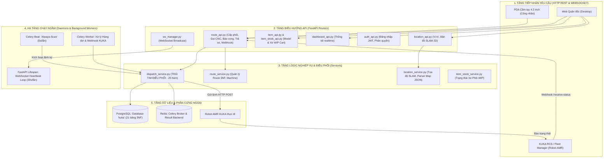
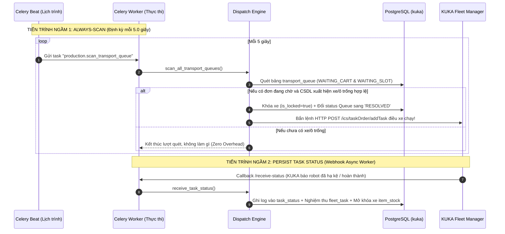
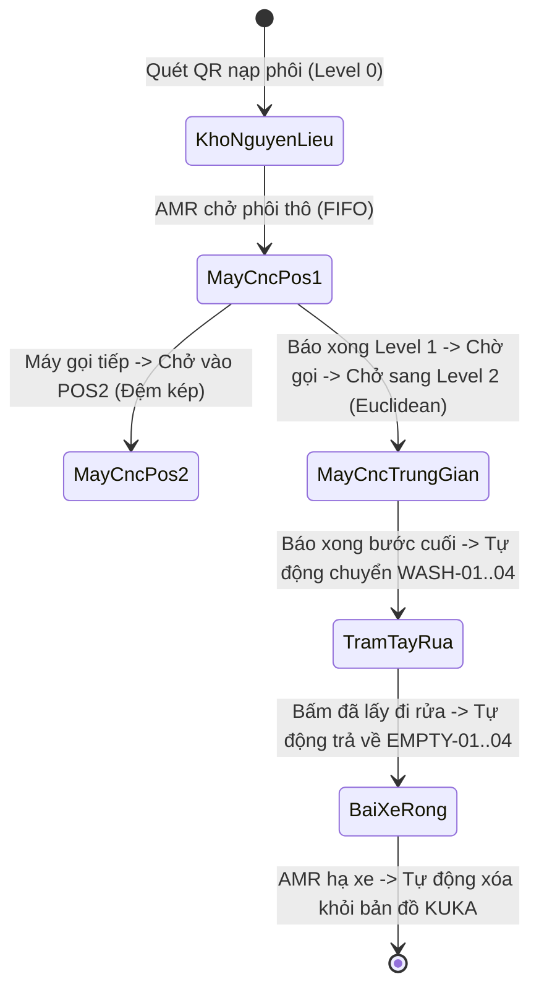
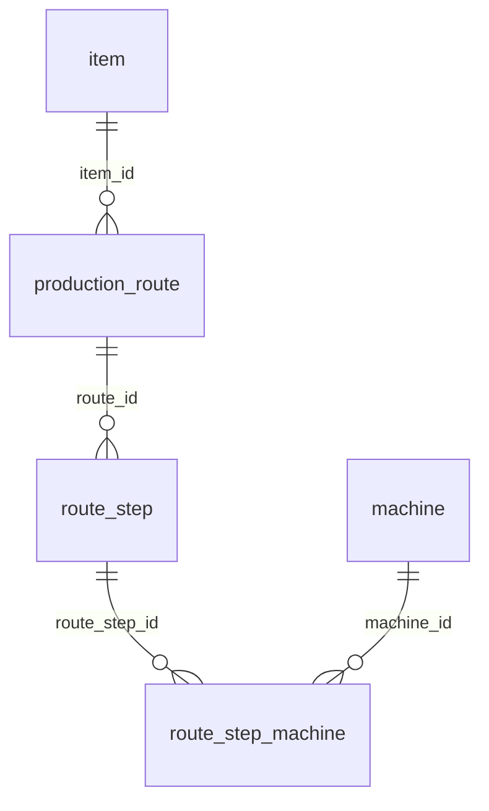

# CẨM NANG GIẢI PHẪU TOÀN DIỆN KIẾN TRÚC BACKEND & CƠ CHẾ VẬN HÀNH KUKA AMR

> [!IMPORTANT]
> Tài liệu này được biên soạn độc quyền cho hệ thống điều phối sản xuất KUKA AMR WMS (`backend/app/`), giải thích cặn kẽ **từng file, từng hàm, từng cơ chế chạy ngầm và nguyên lý toán học/CSDL** đang vận hành trực tiếp trên cơ sở dữ liệu `kuka` (PostgreSQL 21 bảng nghiệp vụ 3NF).

---

## PHẦN 1: TỔNG QUAN KIẾN TRÚC & BỐ CỤC THƯ MỤC (`backend/app/`)

### 1.1. Sơ đồ phân tầng kiến trúc (Layered Architecture)



---

### 1.2. Danh mục phân loại các thư mục và tập tin backend

| Thư mục / Tập tin | Vai trò kiến trúc | Tác dụng nghiệp vụ |
| :--- | :--- | :--- |
| **`app/main.py`** | Điểm khởi chạy ứng dụng (Entrypoint) | Khởi tạo FastAPI app, cấu hình CORS, tích hợp Prometheus Metrics, gắn kết toàn bộ các API Router và quản lý vòng đời ứng dụng (**Lifespan**). |
| **`app/core/`** | Hạ tầng kỹ thuật nền tảng | Chứa cấu hình môi trường ([`config.py`](file:///D:/KuKA/KUKA_WMS/backend/app/core/config.py)), kết nối SQLAlchemy PostgreSQL ([`database.py`](file:///D:/KuKA/KUKA_WMS/backend/app/core/database.py)), cấu hình Celery ([`celery_app.py`](file:///D:/KuKA/KUKA_WMS/backend/app/core/celery_app.py)), Redis cache ([`cache.py`](file:///D:/KuKA/KUKA_WMS/backend/app/core/cache.py)), phân quyền bảo mật ([`dependencies.py`](file:///D:/KuKA/KUKA_WMS/backend/app/core/dependencies.py)), hệ thống ghi log xoay vòng ([`logger.py`](file:///D:/KuKA/KUKA_WMS/backend/app/core/logger.py)). |
| **`app/socket/`** | Kết nối thời gian thực | Quản lý kết nối WebSocket hai chiều ([`ws_manager.py`](file:///D:/KuKA/KUKA_WMS/backend/app/socket/ws_manager.py)), đẩy thông báo tức thì lên màn hình PDA công nhân và màn hình Quản đốc. |
| **`app/modules/production/`** | **Khối sản xuất & điều phối lõi** | Trái tim của toàn bộ dự án KUKA AMR. Chứa CSDL sản xuất 3NF ([`production_models.py`](file:///D:/KuKA/KUKA_WMS/backend/app/modules/production/production_models.py)), Động cơ điều phối xe ([`dispatch_service.py`](file:///D:/KuKA/KUKA_WMS/backend/app/modules/production/dispatch_service.py)), Quản lý quy trình route ([`route_service.py`](file:///D:/KuKA/KUKA_WMS/backend/app/modules/production/route_service.py)), Worker chạy ngầm ([`production_celery_task.py`](file:///D:/KuKA/KUKA_WMS/backend/app/modules/production/production_celery_task.py)), API endpoints ([`route_api.py`](file:///D:/KuKA/KUKA_WMS/backend/app/modules/production/route_api.py)). |
| **`app/modules/warehouse/`** | Quản lý mặt bằng & tài sản | Quản lý danh mục Model sản phẩm ([`item/`](file:///D:/KuKA/KUKA_WMS/backend/app/modules/warehouse/item/)), Quản lý Xe gá phôi WIP Cart ([`item_stock/`](file:///D:/KuKA/KUKA_WMS/backend/app/modules/warehouse/item_stock/)), Quản lý điểm đỗ & Bản đồ SLAM ([`location_map/`](file:///D:/KuKA/KUKA_WMS/backend/app/modules/warehouse/location_map/)), Thông tin nhà máy ([`warehouse_zone/`](file:///D:/KuKA/KUKA_WMS/backend/app/modules/warehouse/warehouse_zone/)), Thống kê bảng điều khiển ([`dashboard/`](file:///D:/KuKA/KUKA_WMS/backend/app/modules/warehouse/dashboard/)). |
| **`app/modules/auth/`** | Quản lý truy cập & người dùng | Đăng nhập tài khoản, mã hóa mật khẩu bcrypt, phát hành JWT token, phân quyền vai trò RBAC (`users`, `roles`, `permissions`). |
| **`alembic/`** | Kiểm soát phiên bản CSDL | Quản lý toàn bộ các bản migration schema vật lý của PostgreSQL, bảo đảm đồng bộ 100% giữa code model và database thật. |

---

## PHẦN 2: CÁC TIẾN TRÌNH CHẠY NGẦM (DAEMONS & BACKGROUND WORKERS)

Trong hệ thống backend, có **3 tiến trình chạy ngầm độc lập** đóng vai trò tự động hóa hoàn toàn mà không cần con người can thiệp:



### 2.1. Tiến trình ngầm 1: Celery Beat "Always-Scan" (`scan_transport_queue`)
* **File định nghĩa**: [`backend/app/core/celery_app.py`](file:///D:/KuKA/KUKA_WMS/backend/app/core/celery_app.py#L59-L65) & [`production_celery_task.py`](file:///D:/KuKA/KUKA_WMS/backend/app/modules/production/production_celery_task.py#L40-L54).
* **Cơ chế hoạt động**:
  - `celery_app.py` cấu hình `beat_schedule`:
    ```python
    "always-scan-transport-queue": {
        "task": "production.scan_transport_queue",
        "schedule": 5.0,  # Chạy đều đặn 5 giây một lần
    }
    ```
  - Cứ mỗi 5 giây, Celery Beat đẩy một message vào hàng đợi `QUEUE_LOGIC` của Redis.
  - Celery Worker nhặt message và kích hoạt hàm [`dispatch_service.scan_all_transport_queues(db)`](file:///D:/KuKA/KUKA_WMS/backend/app/modules/production/dispatch_service.py#L1373).
* **Ý nghĩa thực tế**:
  - Khi máy CNC bấm gọi phôi nhưng kho hết xe, đơn gọi không bị hủy mà được lưu trong bảng [`transport_queue`](file:///D:/KuKA/KUKA_WMS/backend/app/modules/production/production_models.py#L90-L109) với trạng thái `PENDING`.
  - Nhờ tiến trình ngầm Always-Scan, ngay khi có xe ở kho Nguyên liệu vừa được nạp hoặc máy bước trước vừa gia công xong, tiến trình này sẽ **tự động phát hiện, khóa xe và điều AMR chở đến máy đang chờ ngay lập tức**. Công nhân không bao giờ phải bấm gọi lại!

### 2.2. Tiến trình ngầm 2: Tiếp nhận Webhook KUKA bất đồng bộ (`persist_task_status`)
* **File định nghĩa**: [`production_celery_task.py`](file:///D:/KuKA/KUKA_WMS/backend/app/modules/production/production_celery_task.py#L13-L38).
* **Cơ chế hoạt động**:
  - Khi Robot AMR di chuyển ngoài sàn xưởng (nâng kệ, đến điểm chuyển hướng, hạ kệ), KUKA RCS liên tục bắn gói tin JSON về Webhook `/receive-status`.
  - API nhận được gói tin sẽ đẩy ngay vào Celery task `robot.persist_task_status` trên queue `QUEUE_STATUS` và trả về HTTP `{"code": 1000}` cho KUKA trong vòng **vài mili-giây** (tránh KUKA bị timeout mạng).
  - Celery Worker ngầm phía sau sẽ thực thi `dispatch_service.receive_task_status(db, payload)`. Nếu gặp lỗi tạm thời (database deadlock hoặc mạng nghẽn), Celery tự động **Retry tối đa 3 lần** với cơ chế Exponential Backoff (`5 * (2 ** retries)` giây).

### 2.3. Tiến trình ngầm 3: WebSocket Heartbeat & Connection Keeper
* **File định nghĩa**: [`backend/app/socket/ws_manager.py`](file:///D:/KuKA/KUKA_WMS/backend/app/socket/ws_manager.py#L31-L50) & [`backend/app/main.py`](file:///D:/KuKA/KUKA_WMS/backend/app/main.py#L27-L50).
* **Cơ chế hoạt động**:
  - Khi FastAPI khởi động (`lifespan`), hàm `ws_manager.start()` tạo một `asyncio.Task` chạy vòng lặp vĩnh cửu `_consumer_loop()`.
  - Cứ mỗi **30 giây**, tiến trình gửi một tin nhắn `{"type": "heartbeat", "timestamp": ...}` tới toàn bộ các kết nối WebSocket của tablet công nhân.
  - Nếu tablet nào bị mất wifi, tắt nguồn hoặc thoát trình duyệt, tiến trình ngầm sẽ tự động phát hiện lỗi và dọn dẹp kết nối chết (`self.active_connections.discard(connection)`), chống rò rỉ bộ nhớ RAM server.

---

## PHẦN 3: GIẢI PHẪU CHI TIẾT ĐỘNG CƠ ĐIỀU PHỐI (`dispatch_service.py` - 25 HÀM)

File [`dispatch_service.py`](file:///D:/KuKA/KUKA_WMS/backend/app/modules/production/dispatch_service.py) là trung tâm điều khiển toàn bộ dây chuyền sản xuất. Dưới đây là phân tích chi tiết của toàn bộ **25 hàm nghiệp vụ**:

### Nhóm A: Kết nối & Phát lệnh sang KUKA Fleet Manager (RCS/ICS)

#### 1. `_ics_configured() -> bool`
* **Tác dụng**: Kiểm tra xem file cấu hình `.env` đã điền URL thật của server KUKA RCS chưa (`settings.kuka_base_url`).
* **Cơ chế**: Nếu URL rỗng hoặc mang giá trị mặc định `"Your RCS Server path"`, hàm trả về `False` để hệ thống tự động kích hoạt **chế độ Giả lập an toàn (Dev/Simulation Mode)** mà không gây crash phần mềm.

#### 2. `add_task(payload, endpoint_path) -> dict`
* **Tác dụng**: Cổng giao tiếp HTTP POST cấp thấp nhất gửi sang KUKA Fleet Manager (cổng 7000).
* **Cơ chế**: Dùng thư viện `httpx.Client` với timeout 5 giây. Nếu KUKA trả về mã lỗi 5xx thì đánh dấu lỗi `retryable=True` để có thể thử lại; nếu đang ở chế độ dev thì trả về JSON giả lập `{"code": 1000, "simulated": True}`.

#### 3. `fleet_insert_rack(location_code, cart_code) -> dict`
* **Tác dụng**: [LỆNH KUKA 1 - GẮN KỆ VÀO VỊ TRÍ]. Báo cho KUKA Fleet biết có một chiếc kệ phôi (`cart_code`) đã được đặt vật lý tại ô đỗ (`location_code`).
* **Cơ chế**: Gửi payload `{"action": "INSERT_RACK", "locationCode": ..., "shelfNumber": cart_code}`. Bắt buộc phải gọi trước khi điều xe đến bốc kệ.

#### 4. `fleet_move_material(task_code, pickup_code, dropoff_code, cart_code, ...) -> dict`
* **Tác dụng**: [LỆNH KUKA 2 - ĐIỀU XE CẤP PHÔI / TRUNG CHUYỂN]. Ra lệnh cho robot AMR tới trạm xuất phát nâng kệ và chở đến trạm máy CNC đích.
* **Cơ chế**: Đóng gói payload chuẩn KUKA RCS: `orderId` = `task_code`, `sourcePosition` = `pickup_code`, `targetPosition` = `dropoff_code`, `shelfNumber` = `cart_code`.

#### 5. `fleet_move_to_wash(task_code, pickup_code, dropoff_code, cart_code, ...) -> dict`
* **Tác dụng**: [LỆNH KUKA 3 - ĐẨY SANG TRẠM RỬA]. Chở xe phôi đã hoàn thành công đoạn CNC cuối cùng sang một trong 4 ô của Khu Tẩy Rửa (`WASH-01..04`).
* **Cơ chế**: Tương tự `fleet_move_material` nhưng gán cờ nhận diện vận chuyển thành phẩm tẩy rửa.

#### 6. `fleet_move_empty_rack(task_code, pickup_code, dropoff_code, cart_code, ...) -> dict`
* **Tác dụng**: [LỆNH KUKA 4 - TRẢ XE RỖNG]. Điều AMR chở chiếc xe rỗng (đã lấy hết chi tiết mang đi rửa) về Bãi đệm xe rỗng (`EMPTY-01..04`).

#### 7. `fleet_remove_rack(location_code, cart_code) -> dict`
* **Tác dụng**: [LỆNH KUKA 5 - XÓA KỆ KHỎI BẢN ĐỒ KUKA]. Xóa thông tin kệ ra khỏi ô đỗ trên bản đồ KUKA.
* **Cơ chế**: Kích hoạt ngay khi xe rỗng vừa được AMR hạ xuống bãi đệm `EMPTY-01..04`. Báo cho KUKA biết ô này không còn bị kệ chiếm chỗ, sẵn sàng cho công nhân rút xe rỗng đẩy về kho nguyên liệu.

#### 8. `fleet_cancel_task(task_code) -> dict`
* **Tác dụng**: [LỆNH KUKA 6 - HỦY LỆNH ĐANG CHẠY]. Gửi lệnh hủy task sang KUKA nếu phát hiện sự cố khẩn cấp hoặc quản đốc bấm hủy đơn.

---

### Nhóm B: Phân quyền & Quản lý Điểm đỗ

#### 9. `assign_locations_to_user(db, user_id, location_ids) -> list[UserLocation]`
* **Tác dụng**: Gán danh sách vị trí trạm máy cho tài khoản công nhân.
* **Cơ chế**: **Không giới hạn số lượng vị trí**. Hàm dùng transaction: xóa các bản ghi cũ của `user_id` trong bảng `user_locations` và ghi đè danh sách `location_id` mới. Công nhân đăng nhập vào PDA sẽ chỉ nhìn thấy các trạm máy thuộc quyền quản lý của mình.

#### 10. `calculate_distance(loc1, loc2) -> float`
* **Tác dụng**: Đo khoảng cách hình học 2D giữa 2 vị trí trên mặt bằng nhà máy.
* **Cơ chế**: Sử dụng công thức khoảng cách Euclid (Euclidean Distance):
  $$\text{Distance} = \sqrt{(x_2 - x_1)^2 + (y_2 - y_1)^2}$$
  Tọa độ $x, y$ được lấy từ cột `map_x, map_y` (đơn vị milimét) của bảng [`location`](file:///D:/KuKA/KUKA_WMS/backend/app/modules/warehouse/location_map/location_model.py).

#### 11. `get_stage_info_for_machine(db, location, item_id) -> tuple[int, int, bool]`
* **Tác dụng**: Suy luận tự động công đoạn gia công mà máy CNC cần thực hiện đối với một Model sản phẩm.
* **Cơ chế**: 
  - Truy vấn bảng nối 3NF [`route_step_machine`](file:///D:/KuKA/KUKA_WMS/backend/app/modules/production/production_models.py#L35-L45) kết hợp [`route_step`](file:///D:/KuKA/KUKA_WMS/backend/app/modules/production/production_models.py#L25-L34) và [`production_route`](file:///D:/KuKA/KUKA_WMS/backend/app/modules/production/production_models.py#L15-L24).
  - Trả về tuple 3 giá trị: `(required_input_level, target_stage_level, is_final_cnc_step)`.
  - **Ví dụ**: Máy `CNC-03` thuộc Bước 2 của Model A. Hàm tự suy ra: máy cần xe phôi đầu vào có `current_stage_level = 1` (kết quả của bước 1), sau khi gia công xong sẽ đạt `target_stage_level = 2`, và đây chưa phải bước cuối (`is_final_cnc_step = False`). Công nhân chỉ cần bấm "Gọi hàng" là hệ thống tự biết phải tìm xe nào!

#### 12. `_is_location_free(db, location_id) -> bool`
* **Tác dụng**: Kiểm tra xem một vị trí đỗ có hoàn toàn rảnh rỗi hay không.
* **Cơ chế**: Một vị trí chỉ được coi là "TRỐNG" (`True`) khi thỏa mãn đồng thời 2 điều kiện:
  1. Không có chiếc xe nào đang đỗ tại đó (`item_stock.location_id == location_id` và `is_active = True`).
  2. Không có chiếc xe nào đang trên đường di chuyển đến đó (`item_stock.destination_location_id == location_id` và `is_locked = True`).
  $\rightarrow$ Chống triệt để việc 2 xe AMR đâm đầu vào cùng 1 ô đỗ (Anti Double-Booking).

#### 13. `find_available_slot_to_wash(db) -> Optional[Location]`
* **Tác dụng**: Quét tìm ô trống đầu tiên tại Khu Tẩy Rửa (`Location.location_type == 'WASHING_SLOT'`: `WASH-01..04`).
* **Cơ chế**: Dùng duy nhất khi máy CNC bước cuối bấm Hoàn thành (`is_final_cnc_step = True`) để điều AMR bốc xe thành phẩm sang trạm rửa.

#### 14. `find_next_empty_buffer_slot(db) -> Optional[Location]`
* **Tác dụng**: Tìm ô bãi đệm xe rỗng theo thuật toán **Xoay Vòng Tuần Hoàn (Round-Robin 1 $\rightarrow$ 2 $\rightarrow$ 3 $\rightarrow$ 4 $\rightarrow$ 1)**.
* **Cơ chế**: Dùng duy nhất khi công nhân Khu Tẩy Rửa bấm `[ĐÃ LẤY ĐI RỬA]`. Hàm truy vấn lịch sử các lệnh trả xe rỗng gần nhất (`transport_request` kiểu `RETURN_EMPTY_CART`), xác định vị trí vừa dùng (ví dụ `EMPTY-02`), sau đó chọn vị trí tiếp theo (`EMPTY-03`). Giúp xe rỗng được dàn đều trên 4 ô đệm, không bị dồn cục vào 1 góc.

---

### Nhóm C: Thuật toán Chọn xe & Khóa xe nguyên tử (Concurrency Safety)

#### 15. `find_fifo_available_cart(db, item_id, stage_level, target_location) -> Optional[ItemStock]`
* **Tác dụng**: Thuật toán tìm kiếm chiếc xe phôi phù hợp nhất để điều chuyển.
* **Cơ chế toán học & CSDL**:
  1. **Khóa chống tranh chấp (Row-level Locking)**:
     Sử dụng cú pháp SQLAlchemy:
     ```python
     query.with_for_update(of=ItemStock, skip_locked=True)
     ```
     Nếu 2 máy CNC cùng bấm gọi phôi cùng 1 phần nghìn giây, PostgreSQL sẽ cấp xe cho máy đầu tiên và tự động bỏ qua xe đã bị khóa (`skip_locked`), tuyệt đối không bao giờ xảy ra tình trạng "cướp xe" (Race Condition).
  2. **Chiến lược chọn xe theo Công đoạn**:
     - **Nếu `stage_level == 0` (Cấp phôi thô từ kho Nguyên liệu)**: Áp dụng **FIFO (First-In, First-Out)**: Xe nào được công nhân nạp vào trước (`ORDER BY created_at ASC`) sẽ được điều đi trước.
     - **Nếu `stage_level > 0` (Trung chuyển giữa các máy CNC)**: Áp dụng **Khoảng cách Euclid 2D gần nhất**: Quét tất cả các xe đạt Level yêu cầu đang đứng chờ trên sàn, tính khoảng cách từ vị trí xe tới máy CNC đích và chọn chiếc xe ở gần nhất để tối ưu hóa thời gian chạy của AMR.

#### 16. `_lock_cart_and_dispatch_fleet_task(db, req, cart, pickup_loc, dropoff_loc, ...) -> FleetTask`
* **Tác dụng**: Thực hiện đồng thời (nguyên tử - Atomic): Khóa xe phôi + Tạo bản ghi `fleet_task` + Bắn lệnh sang KUKA RCS.
* **Cơ chế**:
  - Đổi cờ trên xe: `cart.is_locked = True`, `cart.destination_location_id = dropoff_loc.id`, `cart.locked_by_task_id = task_code`.
  - Tạo bản ghi trong bảng [`fleet_task`](file:///D:/KuKA/KUKA_WMS/backend/app/modules/production/production_models.py#L111-L135).
  - Gửi lệnh HTTP `fleet_move_material` sang KUKA Fleet.

---

### Nhóm D: Thao tác Vận hành Trực tiếp từ Giao diện PDA



#### 17. `register_rack_at_raw_material(db, location_id, item_id, cart_code, quantity, ...) -> RackRegistrationResponse`
* **Vận hành**: Công nhân tại Khu Nguyên Liệu chọn vị trí (`VT-01..07`), chọn Model, quét mã QR trên xe phôi (`cart_code`) và bấm Xác nhận.
* **Xử lý bên trong**:
  1. Bắn lệnh `fleet_insert_rack` sang KUKA Fleet để cập nhật vị trí vật lý của kệ.
  2. Upsert bản ghi vào bảng [`item_stock`](file:///D:/KuKA/KUKA_WMS/backend/app/modules/warehouse/item_stock/item_stock_model.py): Đặt `current_stage_level = 0`, `quantity = 120`, `is_active = True`, `is_locked = False`, `status = 'available'`. (Hỗ trợ tái sử dụng mã `cart_code` sau khi xe rỗng quay vòng).
  3. Gọi ngay `try_resolve_waiting_cart_queue(db, stage_level=0)`: Nếu có bất kỳ máy CNC nào đang chờ phôi Model này trong hàng đợi, AMR lập tức được điều đến bốc xe đi ngay!

#### 18. `call_material_to_cnc(db, destination_location_id, item_id, required_stage_level, ...) -> TransportRequest`
* **Vận hành**: Công nhân tại trạm máy CNC chạm chọn **Vị trí cụ thể còn trống** (ví dụ `CNC01_POS1` hoặc `CNC01_POS2`), chạm chọn **Model sản phẩm** cần gia công, và bấm nút to bản **[GỌI HÀNG]** (Mô hình Kéo - Pull).
* **Xử lý bên trong**:
  1. **Khóa chặt vị trí chỉ định**: Backend kiểm tra vị trí `destination_location_id` mà công nhân chọn. Nếu vị trí này đang bận (có xe đỗ hoặc có AMR đang tới), hệ thống báo lỗi rõ ràng yêu cầu công nhân chọn vị trí trống (tuyệt đối không tự ý đổi sang vị trí khác).
  2. Tra cứu quy trình 3NF để suy luận `required_stage_level` của Model tại máy đó.
  3. Chạy thuật toán `find_fifo_available_cart` tìm xe phôi phù hợp (FIFO cho Level 0; Euclid 2D gần nhất cho Level > 0).
  4. **Nhánh 1 (Tìm thấy xe)**: Khóa xe ngay lập tức (`is_locked = True`), tạo `TransportRequest` (trạng thái `in_progress`), tạo `FleetTask` và phát lệnh cho AMR chở thẳng vào đúng vị trí công nhân đã chọn.
  5. **Nhánh 2 (Chưa có xe sẵn sàng)**: Tạo `TransportRequest` (trạng thái `queued_for_cart`) và đẩy bản ghi vào bảng [`transport_queue`](file:///D:/KuKA/KUKA_WMS/backend/app/modules/production/production_models.py#L90-L109) với `queue_type = 'WAITING_CART'`. Hệ thống Always-Scan sẽ tự động điều xe đến ngay khi có hàng hoàn thành.

#### 19. `complete_machining_stage(db, cart_code, location_id, operator_id, ...) -> dict`
* **Vận hành**: Công nhân gia công xong 120 chi tiết trên xe, bấm nút **[BÁO XONG -> UPDATE LEVEL]**.
* **Xử lý bên trong**:
  1. Ghi lại nhật ký sản xuất vào bảng [`production_record`](file:///D:/KuKA/KUKA_WMS/backend/app/modules/production/production_models.py#L148-L162) (lưu ai làm, tại máy nào, xe nào, công đoạn mấy, thời điểm nào).
  2. Nâng cấp độ của xe: `cart.current_stage_level = target_level`.
  3. **Nếu là bước CNC trung gian (`is_final_cnc_step = False`)**:
     - Mở khóa xe: `is_locked = False`, `status = 'available'`. Xe đứng yên tại bàn máy chờ công đoạn tiếp theo gọi (Mô hình Kéo - Pull).
     - Kích hoạt hàm `try_resolve_waiting_cart_queue(db, stage_level=target_level)`: Nếu máy bước sau đã bấm gọi từ trước và đang xếp hàng chờ, xe sẽ được kéo đi ngay lập tức!
  4. **Nếu là bước CNC cuối cùng (`is_final_cnc_step = True`)**:
     - Hệ thống **tự động** chuyển sang chế độ Đẩy (Push): Quét tìm 1 ô trống tại Khu Tẩy Rửa qua hàm `find_available_slot_to_wash(db)` (`WASH-01..04`).
     - Nếu có ô trống: Khóa xe và điều AMR chở thẳng sang trạm rửa.
     - Nếu cả 4 ô rửa đều đầy: Đưa xe vào hàng đợi `transport_queue` (`queue_type = 'WAITING_SLOT'`). Xe nằm chờ tại bàn máy, khi nào có ô rửa trống sẽ tự động được bốc đi.

#### 20. `complete_washing_and_return_empty_cart(db, cart_code, operator_id) -> TransportRequest`
* **Vận hành**: Công nhân tại Khu Tẩy Rửa rút các chi tiết trên xe mang vào bể rửa, xe trở thành **XE RỖNG**. Công nhân chạm nút **[ĐÃ LẤY ĐI RỬA]**.
* **Xử lý bên trong**:
  1. Cập nhật xe phôi: `quantity = 0`, `status = 'empty'`, `current_stage_level = 0`.
  2. Chọn ô bãi đệm rỗng theo cơ chế xoay vòng `find_next_empty_buffer_slot` (`EMPTY-01..04`).
  3. Giải phóng ô rửa hiện tại (ô rửa chuyển về `TRỐNG` để đón xe mới từ các máy CNC).
  4. Điều AMR cõng xe rỗng về ô bãi đệm đã chọn.
  5. Kích hoạt quét hàng đợi `try_resolve_waiting_slot_queue`: Nếu có xe ở CNC cuối đang phải nằm chờ vì kẹt trạm rửa, xe đó lập tức được cấp phép đưa vào ô rửa vừa giải phóng!
*(Lưu ý: Máy CNC không bao giờ trả xe rỗng; chỉ có duy nhất sau khi tẩy rửa mới phát sinh xe rỗng).*

---

### Nhóm E: Nghiệm thu Webhook KUKA Callback (`/receive-status`)

#### 21. `receive_task_status(db, payload) -> Optional[TaskStatus]`
* **Tác dụng**: Điểm tiếp nhận dữ liệu callback từ KUKA Fleet Manager khi Robot thực hiện nhiệm vụ.
* **Cơ chế**:
  - Lưu toàn bộ payload JSON thô vào bảng [`task_status`](file:///D:/KuKA/KUKA_WMS/backend/app/modules/production/production_models.py#L137-L146) để làm bằng chứng đối soát kỹ thuật.
  - Phân tích mã trạng thái `status`:
    - `status = "6"`: AMR đang di chuyển trên đường.
    - `status = "7"`: AMR báo lỗi (vật cản, pin yếu, lệch tọa độ) $\rightarrow$ Đổi trạng thái `fleet_task` thành `'failed'`.
    - `status = "3"`: Task bị hủy $\rightarrow$ Đổi trạng thái `fleet_task` thành `'cancelled'`.
    - **`status = "8"` hoặc `"9"` (HẠ KỆ HOÀN TẤT)** $\rightarrow$ Gọi hàm `complete_fleet_task` để tiến hành nghiệm thu CSDL!

#### 22. `complete_fleet_task(db, task_code) -> FleetTask`
* **Tác dụng**: Nghiệm thu và chốt sổ dữ liệu sau khi AMR đã đặt xe xuống trạm thành công.
* **Cơ chế**:
  1. Cập nhật `fleet_task.status = 'completed'` và `transport_request.status = 'completed'`.
  2. Cập nhật vị trí mới cho xe phôi: `cart.location_id = dropoff_location_id`.
  3. Xóa ô đích dự phòng: `cart.destination_location_id = None`.
  4. Mở khóa xe: `cart.is_locked = False`.
  5. **ĐẶC BIỆT KHI HẠ XE RỖNG TẠI BÃI ĐỆM (`EMPTY-01..04`)**:
     - Tự động gọi `fleet_remove_rack` xóa kệ khỏi bản đồ KUKA.
     - Cập nhật bản ghi `item_stock`: `location_id = None`, `is_active = False` (xóa xe khỏi bản đồ nhà máy để giải phóng ô bãi đệm ngay lập tức, sẵn sàng cho công nhân rút xe rỗng đẩy về kho nguyên liệu nạp lại chu kỳ mới).

---

### Nhóm F: Quét & Giải phóng Hàng đợi Tự động (Queue Resolution Engine)

#### 23. `try_resolve_waiting_cart_queue(db, stage_level=None) -> int`
* **Tác dụng**: Giải phóng các đơn máy CNC đang chờ xe (`WAITING_CART`).
* **Cơ chế**: Quét danh sách các đơn trong `transport_queue` có `status = 'PENDING'` và `queue_type = 'WAITING_CART'` (sắp xếp theo `priority ASC, created_at ASC`). Với từng đơn, thử tìm xe bằng `find_fifo_available_cart`. Nếu bắt được xe, lập tức chuyển trạng thái Queue sang `'RESOLVED'` và phát lệnh AMR chở xe đến máy CNC.

#### 24. `try_resolve_waiting_slot_queue(db) -> int`
* **Tác dụng**: Giải phóng các xe đang kẹt tại máy CNC cuối chờ ô rửa (`WAITING_SLOT`).
* **Cơ chế**: Quét tìm ô trống tại `WASHING_SLOT` qua hàm `find_available_slot_to_wash(db)`. Nếu có ô trống, lập tức chuyển đơn chờ sang `'RESOLVED'` và điều AMR bốc xe từ máy CNC chuyển sang trạm rửa.

#### 25. `scan_all_transport_queues(db) -> dict[str, int]`
* **Tác dụng**: Hàm tổng hợp được gọi bởi tiến trình ngầm **Celery Beat (5 giây/lần)**.
* **Cơ chế**: Kích hoạt lần lượt cả `try_resolve_waiting_cart_queue()` và `try_resolve_waiting_slot_queue()`. Đảm bảo toàn bộ dây chuyền sản xuất tự động vận hành trơn tru 24/7 mà không bao giờ bị tắc nghẽn.

---

## PHẦN 4: CÁC ENDPOINT THỰC THI CHO PDA 4.2" CẦM TAY (`route_api.py`)

Để phục vụ màn hình PDA 4.2 inch của công nhân tại xưởng (1 chạm, thời gian phản hồi mili-giây, chống kẹt mạng), backend cung cấp cụm API chuyên dụng:

| Endpoint | Method | Vai trò trên giao diện PDA |
| :--- | :---: | :--- |
| `/api/v1/production/pda/models` | `GET` | Cung cấp danh sách các Model phôi khả dụng cho Step 2 (Wizard Nguyên Liệu) và Sheet chọn Model khi máy CNC bấm Gọi hàng. |
| `/api/v1/production/pda/raw-materials` | `GET` | Hiển thị realtime 7 vị trí cấp phôi (`RAW-01..07`), nhận biết vị trí nào đã có rack đỗ, mã rack là gì, Model nào. |
| `/api/v1/production/pda/cnc-stations` | `GET` | Hiển thị các thẻ trạm máy CNC (POS1 & POS2) kèm trạng thái realtime: `EMPTY` (Trống), `CALLING` (AMR đang tới), `OCCUPIED` (Đang gia công). Tự động lọc theo phân quyền `user_locations` của công nhân đăng nhập. |
| `/api/v1/production/pda/washing-slots` | `GET` | Hiển thị realtime 4 slot tiếp nhận tại Khu Tẩy Rửa (`WASH-01..04`). Tự động giải phóng về `EMPTY` ngay khi công nhân bấm lấy chi tiết đi rửa. |
| `/api/v1/production/pda/fast-arrive` | `POST` | Công cụ giả lập AMR cập bến 1-chạm (phát webhook `status='8'` nội bộ) giúp kiểm thử nhanh toàn bộ luồng cấp phôi/hạ kệ trên PDA. |
| `/api/v1/production/users/{user_id}/locations` | `GET/PUT` | Quản trị viên phân quyền các trạm máy phụ trách cho tài khoản công nhân (không giới hạn số lượng vị trí). |

---

## PHẦN 5: MODULE QUY TRÌNH SẢN XUẤT 3NF (`route_service.py`)

Module [`route_service.py`](file:///D:/KuKA/KUKA_WMS/backend/app/modules/production/route_service.py) phụ trách quản trị danh mục công nghệ gia công cơ khí:



* **`list_routes(db, item_id, is_active)`**: Lấy danh sách quy trình, hỗ trợ lọc theo Model chi tiết và trạng thái hiệu lực.
* **`get_route_detail(db, route_id)`**: Lấy chi tiết toàn bộ các bước công đoạn (`RouteStep`), danh sách các máy CNC được phép chạy của từng bước (`RouteStepMachine`) và máy vật lý (`Machine`).
* **`create_route(db, payload)`**: Tạo mới một quy trình sản xuất. Tự động kiểm tra và đồng bộ danh mục máy chuẩn 3NF.
* **`update_route(db, route_id, payload)`**: Cập nhật tên quy trình, số phiên bản, thêm/bớt các bước công nghệ hoặc thay đổi máy CNC thực thi.
* **`activate_route(db, route_id)`**: Kích hoạt quy trình làm quy trình chuẩn cho Model. Tự động chuyển các quy trình khác của cùng `item_id` về `is_active = False` (được bảo vệ tuyệt đối ở mức PostgreSQL bằng index `uq_production_route_active_per_item`).
* **`delete_route(db, route_id)`**: Xóa quy trình (tự động xóa cascade các bước và liên kết máy).
* **`list_available_machines(db)`**: Lấy danh mục toàn bộ các máy CNC vật lý có trong phân xưởng từ bảng `machine`.

---

## PHẦN 6: CÁC MODULE VỆ TINH TRONG HỆ THỐNG (`warehouse/` & `auth/`)

1. **Module Điểm đỗ & Bản đồ (`app/modules/warehouse/location_map/`)**:
   - [`location_model.py`](file:///D:/KuKA/KUKA_WMS/backend/app/modules/warehouse/location_map/location_model.py): Định nghĩa bảng `location` (tọa độ `map_x, map_y`, phân loại `location_type`, liên kết `machine_id`) và `warehouse_map` (lưu file JSON SLAM).
   - [`location_service.py`](file:///D:/KuKA/KUKA_WMS/backend/app/modules/warehouse/location_map/location_service.py): CRUD vị trí trạm máy, đọc và phân tích cấu trúc file bản đồ SLAM KUKA V2 ([`map_CNC001_CNC001_28s.json`](file:///D:/KuKA/KUKA_WMS/map_CNC001_CNC001_28s.json)), tự động trích xuất các node và cạnh (edges) để vẽ lên Canvas.
2. **Module Xe gá phôi WIP Cart (`app/modules/warehouse/item_stock/`)**:
   - Quản lý thực thể xe gá phôi vật lý trong xưởng: mã thẻ QR (`cart_code`), số lượng chi tiết (`quantity = 120`), công đoạn hiện tại (`current_stage_level`), cờ khóa nguyên tử (`is_locked`), mã lệnh khóa (`locked_by_task_id`).
3. **Module Model Sản phẩm (`app/modules/warehouse/item/`)**:
   - Quản lý danh mục các chi tiết cơ khí cần gia công (`sku = 'MODEL-A'`, `standard_quantity_per_cart = 120`).
4. **Module Thống kê Điều phối (`app/modules/warehouse/dashboard/`)**:
   - [`dashboard_service.py`](file:///D:/KuKA/KUKA_WMS/backend/app/modules/warehouse/dashboard/dashboard_service.py): Tính toán tổng hợp số lượng xe đang chạy, số lượng phôi tồn tại từng công đoạn, số đơn đang xếp hàng chờ AMR để hiển thị lên Dashboard của Quản đốc.
5. **Module Xác thực & Bảo mật (`app/modules/auth/`)**:
   - Bảo mật theo tiêu chuẩn công nghiệp: mật khẩu mã hóa một chiều qua thuật toán Bcrypt, xác thực phiên làm việc qua JWT Bearer Token, kiểm tra quyền truy cập chi tiết qua dependency `require_permission()`.

---

## PHẦN 7: LUỒNG VẬN HÀNH DỮ LIỆU ĐẦU-CUỐI (END-TO-END FLOW)

Dưới đây là sơ đồ chi tiết từng mili-giây diễn biến trong Database khi công nhân thao tác trên dây chuyền:

```mermaid
sequenceDiagram
    autonumber
    actor CN as Công nhân (PDA 4.2")
    participant API as FastAPI Router (/production/dispatch)
    participant DS as Dispatch Engine (dispatch_service.py)
    participant DB as PostgreSQL (kuka 21 bảng)
    participant KUKA as KUKA Fleet Manager (RCS)
    participant Celery as Background Celery Worker

    Note over CN,KUKA: 1. THAO TÁC GỌI HÀNG TẠI MÁY CNC
    CN->>API: POST /production/dispatch/call-material (CNC-01-POS1, MODEL-A)
    API->>DS: call_material_to_cnc()
    DS->>DB: get_stage_info_for_machine() -> Cần phôi Level 0
    DS->>DB: SELECT item_stock FOR UPDATE SKIP LOCKED (Level=0, FIFO created_at ASC)
    alt Có xe phôi thô tại RAW-01
        DS->>DB: UPDATE item_stock (is_locked=true, dest=CNC-01-POS1)
        DS->>DB: INSERT transport_request ('in_progress') + INSERT fleet_task ('sent')
        DS->>KUKA: HTTP POST /ics/taskOrder/addTask (RAW-01 -> CNC-01-POS1)
        API-->>CN: Phản hồi 200: "AMR đang chuyển phôi đến trạm"
    else Hết phôi thô tại kho
        DS->>DB: INSERT transport_request ('queued_for_cart')
        DS->>DB: INSERT transport_queue (queue_type='WAITING_CART', status='PENDING')
        API-->>CN: Phản hồi 200: "Đã vào hàng đợi, hệ thống sẽ tự cấp khi có phôi"
    end

    Note over KUKA,Celery: 2. ROBOT AMR CHẠY & BÁO HOÀN TẤT QUA WEBHOOK
    KUKA->>API: POST /receive-status (orderId='TASK-xxx', status='8' Completed)
    API->>Celery: Async delay task "robot.persist_task_status"
    API-->>KUKA: Phản hồi {"code": 1000} (trong 5ms)
    Celery->>DS: receive_task_status()
    DS->>DB: INSERT task_status (Lưu log callback)
    DS->>DS: complete_fleet_task()
    DS->>DB: UPDATE item_stock SET location_id=CNC-01-POS1, dest=NULL, is_locked=false
    DS->>DB: UPDATE fleet_task & transport_request SET status='completed'

    Note over CN,Celery: 3. GIA CÔNG XONG & BÁO UPDATE LEVEL
    CN->>API: POST /production/dispatch/complete-stage (cart='CART-001', CNC-01)
    API->>DS: complete_machining_stage()
    DS->>DB: INSERT production_record (Ghi nhận sản lượng Level 1)
    DS->>DB: UPDATE item_stock SET current_stage_level=1, is_locked=false
    DS->>DS: try_resolve_waiting_cart_queue(stage_level=1)
    Note over DB: Nếu máy CNC Bước 2 đang chờ thì kéo đi ngay; nếu chưa thì xe đứng chờ tại trạm (Mô hình Kéo Pull)!
```

---

## TỔNG KẾT

1. **Kiến trúc Tối Giản & Sạch Sẽ**: Toàn bộ hệ thống tập trung duy nhất vào cơ sở dữ liệu **`kuka`** với **21 bảng nghiệp vụ chuẩn 3NF**, loại bỏ hoàn toàn các bảng rác FMCG cũ.
2. **Nguyên lý Điều phối Thông minh**:
   - Cấp phôi thô Level 0: **FIFO**.
   - Trung chuyển giữa các CNC: **Khoảng cách Euclid 2D gần nhất** kết hợp FIFO.
   - Vị trí máy CNC: **Đệm kép (Double Buffering POS1 & POS2)** chống đói máy.
   - Bãi xe rỗng: **Xoay vòng Round-Robin 1..4** & tự động xóa khỏi bản đồ khi hạ xe.
3. **Tiến trình Ngầm Tự Động**: **Always-Scan (5s/lần)** và **Webhook Async Worker** bảo đảm tính thời gian thực, chống nghẽn và giải quyết race-condition bằng khóa dòng `FOR UPDATE SKIP LOCKED`.
