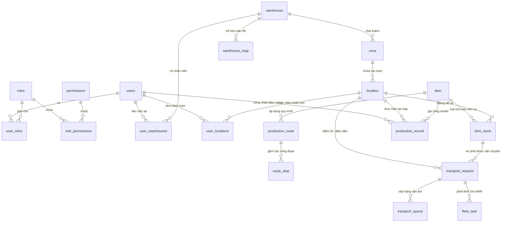

# BẢN THIẾT KẾ & ĐỐI SOÁT CƠ SỞ DỮ LIỆU KUKA AMR (21 BẢNG CỐT LÕI)

> **Mục tiêu tài liệu:** Giúp bạn nhìn thấu 100% cấu trúc cơ sở dữ liệu, hiểu rõ từng trường (cột) dùng để lưu cái gì, và đối soát xem cấu trúc này đã giải quyết trọn vẹn các yêu cầu thực tế trong xưởng cơ khí KUKA AMR hay chưa.

---

## PHẦN 1: SƠ ĐỒ QUAN HỆ TRỰC QUAN (MERMAID ERD)

Dưới đây là sơ đồ tổng thể thể hiện cách 21 bảng liên kết với nhau, chia làm **4 nhóm nghiệp vụ chính**:

---

## PHẦN 2: CHI TIẾT TỪNG BẢNG & TỪNG TRƯỜNG DÙNG ĐỂ LÀM GÌ

### NHÓM A: SẢN PHẨM & XE GÁ PHÔI (TRỌNG TÂM SẢN XUẤT)

#### 1. Bảng `item` (Model Sản phẩm)
*Mỗi dòng là một Model chi tiết cơ khí cần gia công (ví dụ: Model 1, Model 2...).*
* `id` (INT, PK): Mã định danh duy nhất.
* `sku` (VARCHAR): Mã model sản phẩm (ví dụ: `MDL-01`, `MDL-02`).
* `name` (VARCHAR): Tên chi tiết (ví dụ: "Trục Rotor", "Bích Gá Động Cơ").
* `standard_quantity_per_cart` (INT, Default 120): **Số lượng phôi tiêu chuẩn xếp trên 1 xe gá phôi** (thường là 120 hoặc 180 chi tiết).
* `warehouse_id` (INT, FK): Thuộc phân xưởng nào.
* `is_active` (BOOL): Trạng thái model còn đang sản xuất hay không.

#### 2. Bảng `item_stock` (Xe gá phôi WIP / Cart / Rack)
*Mỗi dòng đại diện cho **1 chiếc xe gá phôi cụ thể** đang nằm trong nhà máy.*
* `id` (INT, PK): Mã định danh bản ghi.
* `cart_code` (VARCHAR, UNIQUE): **Mã định danh của xe/rack** (ví dụ: `CART-001`, `RACK-A12` - quét từ mã QR dán trên thân xe).
* `item_id` (INT, FK): Xe này đang chở phôi của Model nào.
* `quantity` (INT, Default 120): Số lượng phôi thực tế đang có trên xe.
* `current_stage_level` (INT): **Công đoạn hiện tại của xe phôi**:
  * `0`: Phôi thô mới nhập tại Khu Nguyên Liệu (chưa qua máy CNC nào).
  * `1`: Đã xong bước 1 (OP10).
  * `2`: Đã xong bước 2 (OP20).
  * `3`: Đã xong bước CNC cuối cùng, sẵn sàng đi rửa.
* `location_id` (INT, FK): **Vị trí hiện tại xe đang đỗ vật lý** (ví dụ: đang đỗ tại `CNC01_POS1`).
* `destination_location_id` (INT, FK): Vị trí đích mà robot AMR đang chở xe tới.
* `is_locked` (BOOL): **Cờ khóa xe chống cướp xe**. Khi đã có lệnh điều xe tới bốc hoặc robot đang chở đi, cờ này bật `TRUE` để trạm khác không gọi nhầm xe này.
* `locked_by_task_id` (VARCHAR): Mã lệnh điều phối đang giữ chiếc xe này.

---

### NHÓM B: QUY TRÌNH ROUTE GIA CÔNG (CẤU HÌNH DÂY CHUYỀN)

#### 3. Bảng `production_route` (Quy trình Route của Model)
*Mỗi Model sẽ có 1 quy trình Route gia công chuẩn.*
* `id` (INT, PK): Mã Route.
* `route_code` (VARCHAR): Mã quy trình (ví dụ: `RT-MDL01`).
* `route_name` (VARCHAR): Tên quy trình (ví dụ: "Quy trình gia công Trục Rotor").
* `item_id` (INT, FK): Áp dụng cho Model sản phẩm nào.
* `version` (INT): Phiên bản quy trình (v1, v2).
* `is_active` (BOOL): Quy trình đang được áp dụng.

#### 4. Bảng `route_step` (Từng bước / Nguyên công trong Route)
*Định nghĩa thứ tự các bước gia công.*
* `id` (INT, PK): Mã bước.
* `route_id` (INT, FK): Thuộc Route nào.
* `step_number` (INT): Số thứ tự bước (1, 2, 3...).
* `stage_level` (INT): Level đạt được sau khi làm xong bước này (Level 1, Level 2...).
* `operation_code` (VARCHAR): Mã nguyên công cơ khí (`OP10`, `OP20`, `OP30`...).
* `step_name` (VARCHAR): Tên bước (ví dụ: "Phay thô", "Tiện tinh").
* `allowed_machines` (JSONB): **Danh sách máy CNC cho phép làm bước này** (ví dụ: `["CNC-01", "CNC-02"]` -> AMR có thể chở tới bất kỳ máy nào trong nhóm này).
* `machine_type` (VARCHAR): Loại máy (`CNC_MILLING` - Phay, `CNC_LATHE` - Tiện).
* `cycle_time_minutes` (INT): Thời gian chu kỳ gia công ước tính (phút).
* `is_final_cnc_step` (BOOL): **Cờ đánh dấu bước CNC cuối cùng**. Nếu `TRUE`, sau khi công nhân bấm xong, AMR sẽ tự động chuyển xe sang Khu Tẩy Rửa.

---

### NHÓM C: MẶT BẰNG, TRẠM MÁY & BẢN ĐỒ SLAM V2

#### 5. Bảng `location` (Tọa độ vị trí đỗ vật lý)
*Mỗi dòng là 1 điểm đỗ thực tế có tọa độ trên bản đồ xưởng.*
* `id` (INT, PK): Mã vị trí.
* `code` (VARCHAR): Ký hiệu vị trí (ví dụ: `CNC01_POS1`, `CNC01_POS2`, `VT-01`, `WASH-01`).
* `location_type` (VARCHAR): Loại vị trí:
  * `RAW_MATERIAL`: Điểm nạp phôi thô.
  * `CNC_SLOT`: Điểm đỗ tại trạm máy CNC.
  * `WASHING_SLOT`: Điểm đỗ tại bồn rửa.
  * `EMPTY_CART_BUFFER`: Bãi tập kết xe rỗng.
* `machine_code` (VARCHAR): **Gom vị trí theo máy** (ví dụ `CNC-01` chứa cả POS1 và POS2).
* `position_index` (INT): Vị trí số 1 hay số 2 của máy (1 hoặc 2).
* `map_x`, `map_y` (FLOAT): **Tọa độ vật lý 2D (tính bằng milimet hoặc mét)** lấy trực tiếp từ bản đồ SLAM của KUKA để tính khoảng cách di chuyển.
* `warehouse_id` (INT, FK): Thuộc phân xưởng nào.

#### 6. Bảng `warehouse_map` (Bản đồ số SLAM V2)
*Lưu trữ file map KUKA RCS (.json/zip).*
* `id` (INT, PK): Mã bản đồ.
* `warehouse_id` (INT, FK): Bản đồ của xưởng nào.
* `map_name` (VARCHAR): Tên bản đồ (ví dụ: `map_CNC001_CNC001_28s`).
* `file_path` (VARCHAR): Đường dẫn lưu file map gốc.
* `is_active` (BOOL): Bản đồ đang kích hoạt.

---

### NHÓM D: ĐIỀU PHỐI XE TỰ HÀNH AMR & HÀNG ĐỢI (ĐIỀU HÀNH THỜI GIAN THỰC)

#### 7. Bảng `transport_request` (Yêu cầu vận chuyển từ công nhân)
*Mỗi lần công nhân bấm "Gọi xe" hoặc "Báo xong" trên PDA, 1 đơn yêu cầu sẽ sinh ra ở đây.*
* `id` (INT, PK): Mã yêu cầu.
* `request_code` (VARCHAR): Mã lệnh (ví dụ: `TR-20261016-001`).
* `request_type` (VARCHAR): 
  * `FEED_RAW`: Cấp phôi thô từ kho nguyên liệu.
  * `INTER_CNC`: Chuyển phôi giữa các máy CNC.
  * `TO_WASH`: Chuyển sang khu tẩy rửa.
  * `RETURN_EMPTY`: Đưa xe rỗng về bãi đệm.
* `source_location_id` (INT, FK): Điểm lấy hàng.
* `destination_location_id` (INT, FK): Điểm trả hàng.
* `cart_id` (INT, FK): Xe phôi nào đang được vận chuyển.
* `status` (VARCHAR): Trạng thái đơn (`pending`, `assigned`, `in_progress`, `completed`, `cancelled`).
* `created_by` (INT, FK): Ai bấm gọi xe.

#### 8. Bảng `transport_queue` (Hàng đợi điều phối tự động)
*Nếu máy CNC gọi xe nhưng **chưa có xe nào sẵn sàng**, hoặc **khu tẩy rửa đang đầy 4 slot**, yêu cầu sẽ vào đây nằm chờ.*
* `id` (INT, PK): Mã hàng đợi.
* `request_id` (INT, FK): Thuộc yêu cầu vận chuyển nào.
* `queue_type` (VARCHAR): `WAIT_FOR_CART` (chờ có xe xong bước trước) hoặc `WAIT_FOR_WASH_SLOT` (chờ bồn rửa trống).
* `target_stage_level` (INT): Cần tìm xe đạt Level mấy.
* `status` (VARCHAR): `pending` (đang chờ) hoặc `resolved` (đã giải phóng xe thành công).
* `retry_count` (INT): Số lần quét tìm xe.

#### 9. Bảng `fleet_task` (Lệnh gửi sang Robot KUKA / Fleet Manager)
*Cầu nối điều khiển trực tiếp phần cứng xe tự hành AMR.*
* `id` (INT, PK): Mã task.
* `task_code` (VARCHAR): Mã task KUKA (ví dụ: `TASK-KUKA-9921`).
* `request_id` (INT, FK): Thuộc yêu cầu vận chuyển nào ở trên.
* `amr_code` (VARCHAR): Robot nào được chỉ định (AMR-01, AMR-02).
* `pickup_location_id` (INT, FK): Điểm AMR đến gắp xe.
* `dropoff_location_id` (INT, FK): Điểm AMR hạ xe xuống.
* `status` (VARCHAR): Trạng thái robot (`dispatched`, `navigating`, `picking_up`, `dropping_off`, `completed`, `failed`).
* `error_message` (TEXT): Báo lỗi nếu robot kẹt vật cản hoặc mất sóng.

#### 10. Bảng `production_record` (Nhật ký chốt sản lượng)
*Mỗi khi công nhân gia công xong 120 chi tiết và bấm "Báo xong", hệ thống ghi vết lại.*
* `id` (INT, PK): Mã bản ghi.
* `cart_code` (VARCHAR): Mã xe gá phôi.
* `item_id` (INT, FK): Mã model chi tiết.
* `machine_code` (VARCHAR): Gia công tại máy CNC nào.
* `stage_level` (INT): Đã hoàn thành xong công đoạn mấy.
* `operator_id` (INT, FK): Công nhân nào bấm máy.
* `completed_at` (DATETIME): Thời điểm hoàn thành chính xác.

---

### NHÓM E: PHÂN QUYỀN & HỆ THỐNG
11. `users`: Tài khoản đăng nhập.
12. `roles`: Nhóm quyền (Admin, Quản đốc, Công nhân).
13. `permissions`: Danh mục các quyền thao tác.
14. `user_roles`: Ánh xạ User - Role.
15. `role_permissions`: Ánh xạ Role - Permission.
16. `user_warehouses`: Ánh xạ User thuộc xưởng nào.
17. `user_locations`: **Phân quyền công nhân theo trạm máy** (Công nhân đăng nhập PDA chỉ thấy trạm mình được gán).
18. `warehouse`: Phân xưởng cơ khí.
19. `zone`: Cụm khu vực / Cụm máy.
20. `notification`: Thông báo chuông cảnh báo trên hệ thống.
21. `alembic_version`: Lưu version schema của database.

---

## PHẦN 3: LÀM SAO ĐỂ BIẾT BẢNG NÀY ĐÃ ĐÁP ỨNG ĐÚNG YÊU CẦU CỦA BẠN?

Hãy đối soát thiết kế này với **5 kịch bản xương sống trong xưởng của bạn**:

| Kịch bản thực tế của bạn | Bảng & Trường nào giải quyết? | Cơ chế vận hành thực tế |
| :--- | :--- | :--- |
| **1. Cấp phôi thô từ kho nguyên liệu (Luồng A)** | `item_stock.current_stage_level = 0` `route_step.step_number = 1` | Công nhân chọn Model -> Hệ thống lọc trong kho xe nào có Model đó và `current_stage_level = 0` (theo FIFO: xe vào trước lấy trước) -> Điều AMR chở tới máy làm bước 1. |
| **2. Cơ chế đệm kép 2 vị trí / máy CNC (Zero CNC Starvation)** | `location.machine_code` `location.position_index` (1 & 2) | Mỗi máy CNC có 2 vị trí độc lập. Vị trí 1 đang gia công, vị trí 2 trống thì công nhân bấm gọi xe gối đầu sẵn. Cả 2 vị trí đều có nút gọi và báo xong độc lập. |
| **3. Trung chuyển giữa các CNC tìm xe gần nhất (Luồng B)** | `location.map_x, map_y` `item_stock.location_id` `item_stock.current_stage_level` | Khi máy CNC-X gọi phôi: Hệ thống quét các xe đã xong công đoạn trước (`current_stage_level`), chưa bị khóa (`is_locked = False`). Dùng công thức Euclidean $\sqrt{(x_2-x_1)^2 + (y_2-y_1)^2}$ từ tọa độ map để chọn xe gần nhất. |
| **4. Xếp hàng tự động khi chưa có xe hoặc đầy bồn rửa (Queue)** | `transport_queue.status = 'pending'` `transport_queue.queue_type` | Nếu chưa có xe phù hợp hoặc 4 slot tẩy rửa bị đầy: Hệ thống không báo lỗi, mà lưu vào `transport_queue`. Background worker canh chừng, ngay khi có xe/slot trống sẽ tự kích hoạt AMR bốc hàng. |
| **5. Chống cướp xe & Robot tự hạ xe không cần xác nhận** | `item_stock.is_locked = True` `fleet_task.status = 'completed'` | Khi có lệnh điều xe: Xe lập tức bật `is_locked = True` để máy khác không cướp được. Robot hạ xe xuống trạm (Fleet báo completed) là hệ thống tự cập nhật vị trí mới, công nhân không cần thao tác xác nhận rườm rà. |
