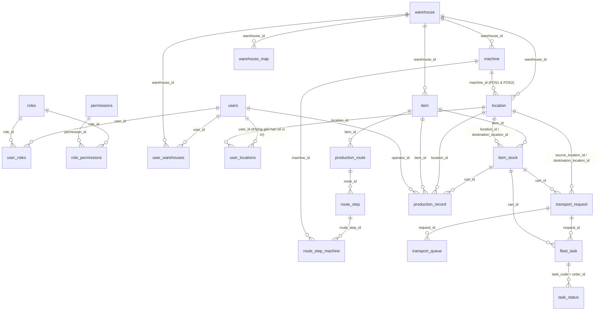

# CẨM NANG TOÀN DIỆN CƠ SỞ DỮ LIỆU & LUỒNG DỮ LIỆU KUKA AMR (CHUẨN HÓA 3NF - BẢN MỚI NHẤT)

> [!IMPORTANT]
> Tài liệu này phản ánh **chính xác 100% trạng thái thực tế trong PostgreSQL (`localhost:5433/kuka` - Alembic revision `a1b2c3d4e5f9`)** gồm **21 bảng nghiệp vụ** (+ 1 bảng `alembic_version`). Toàn bộ 17 bảng FMCG cũ, bảng `notification`, và 11 cột thừa trên `item_stock` đã được loại bỏ hoàn toàn. Đã áp dụng 2 Partial Unique Indexes bảo vệ toàn vẹn dữ liệu.

---

## PHẦN 1: SƠ ĐỒ QUAN HỆ THỰC THỂ (3NF MERMAID ERD)



---

## PHẦN 2: CHI TIẾT TỪNG BẢNG & TỪNG TRƯỜNG (179 CỘT THỰC TẾ)

### CỤM A: SẢN PHẨM & XE GÁ PHÔI (WIP CART)

#### 1. Bảng `item` — Danh mục Model chi tiết cơ khí
| Tên trường | Kiểu dữ liệu | Nullable | Default | Ý nghĩa nghiệp vụ & Cách dùng |
| :--- | :--- | :---: | :---: | :--- |
| `id` | `integer` (PK) | NO | `autoincrement` | Khóa chính định danh Model. |
| `sku` | `varchar(50)` (UNIQUE) | NO | — | Mã Model hiển thị trên PDA (VD: `MODEL-A`, `MODEL-B`). |
| `name` | `varchar(255)` | NO | — | Tên chi tiết gia công (VD: `"Phôi Trục Chính CNC Model A"`). |
| `description` | `text` | YES | `NULL` | Mô tả kỹ thuật chi tiết. |
| `standard_quantity_per_cart` | `integer` | NO | `120` | **Số lượng phôi tiêu chuẩn trên 1 xe** (khi quét QR nạp phôi ở kho nguyên liệu, hệ thống tự lấy số này gán cho `item_stock.quantity`). |
| `warehouse_id` | `integer` (FK) | NO | — | Trỏ tới `warehouse.id` (`WH-CNC`). |
| `is_active` | `boolean` | NO | `true` | Trạng thái Model còn đang sản xuất hay đã ngừng. |
| `details` | `jsonb` | NO | `'{}'` | Thông tin mở rộng dạng JSON. |
| `base_quantity`, `base_unit`, `max_quantity`, `min_quantity`, `supplier` | `bigint/int/varchar` | YES | `1 / NULL` | Các trường kế thừa từ danh mục vật tư chung (đã mở `Nullable = YES` để không cản trở tạo Model mới). |
| `created_at`, `updated_at` | `timestamptz` | YES | `now()` | Thời điểm tạo và cập nhật bản ghi. |

#### 2. Bảng `item_stock` — Thực thể Xe gá phôi WIP (Cart / Rack) — *Đã dọn sạch 11 cột thừa, còn đúng 14 cột*
| Tên trường | Kiểu dữ liệu | Nullable | Default | Ý nghĩa nghiệp vụ & Cách dùng |
| :--- | :--- | :---: | :---: | :--- |
| `id` | `integer` (PK) | NO | `autoincrement` | ID nội bộ của bản ghi xe phôi. |
| `stock_code` | `uuid` (UNIQUE) | NO | `uuid4` | Mã UUID định danh nội bộ. |
| `cart_code` | `varchar(50)` (UNIQUE) | YES | `NULL` | **Mã QR dán cố định trên xe/kệ** (VD: `CART-001`). Gửi sang KUKA Fleet qua trường `shelfNumber` / `qrCode`. |
| `item_id` | `integer` (FK) | NO | — | Trỏ tới `item.id` — xe đang chở Model nào. |
| `location_id` | `integer` (FK) | YES | `NULL` | **Vị trí hiện tại xe đang đỗ** (`location.id`). Bằng `NULL` khi xe rỗng đã được hạ tại bãi đệm và xóa khỏi bản đồ. |
| `destination_location_id` | `integer` (FK) | YES | `NULL` | **Vị trí đích AMR đang chở xe tới** (`location.id`). Khi khác `NULL` và `is_locked = true`, ô đích sẽ tự động mang trạng thái `"reserved"` để chống xe khác đè vào. |
| `quantity` | `numeric(12,3)` | NO | `0` | Số lượng chi tiết trên xe (`120` khi nạp phôi; về `0` khi trả xe rỗng). |
| `current_stage_level` | `integer` | NO | `0` | **Cấp độ gia công hiện tại của xe phôi**:<br>• `0`: Phôi thô tại Khu Nguyên Liệu (`RAW-01..07`)<br>• `1`: Đã gia công xong Bước 1, chờ máy Bước 2 gọi<br>• `2`: Đã gia công xong Bước 2, chờ máy Bước 3 gọi<br>• `3`: Đã gia công xong Bước cuối, đi Tẩy Rửa (`WASH-01..04`). |
| `is_locked` | `boolean` | NO | `false` | **Cờ khóa chống cướp xe (Atomic Lock)**. Bằng `true` ngay khi xe được gán cho 1 lệnh `FleetTask` đang di chuyển; về `false` khi AMR báo đã hạ xe xong (`status = 8/9`). |
| `locked_by_task_id` | `varchar(100)` | YES | `NULL` | Mã lệnh `fleet_task.task_code` đang khóa chiếc xe này (VD: `TASK-3F8A9C12`). |
| `status` | `varchar(20)` | NO | `'available'` | `'available'` (có hàng trong chuyền) hoặc `'empty'` (xe rỗng). |
| `is_active` | `boolean` | NO | `true` | `true` khi xe đang nằm trên mặt bằng sản xuất; chuyển về `false` ngay khi xe rỗng hạ xuống `EMPTY-01..04` (đối lập với lệnh Insert ở Khu Nguyên Liệu). |
| `created_at` | `timestamptz` | NO | `now()` | **Mốc thời gian nạp phôi** — dùng để sắp xếp **FIFO (`created_at ASC`)** khi cấp phôi Level 0. |
| `updated_at` | `timestamptz` | YES | `now()` | Thời điểm cập nhật trạng thái gần nhất. |

---

### CỤM B: MÁY CNC & QUY TRÌNH CÔNG NGHỆ CHUẨN HÓA 3NF

#### 3. Bảng `machine` — Danh mục Máy CNC Vật lý (Chuẩn 3NF)
| Tên trường | Kiểu dữ liệu | Nullable | Default | Ý nghĩa nghiệp vụ & Cách dùng |
| :--- | :--- | :---: | :---: | :--- |
| `id` | `integer` (PK) | NO | `autoincrement` | Khóa chính của máy CNC. |
| `machine_code` | `varchar(50)` (UNIQUE) | NO | — | Mã máy vật lý (VD: `CNC-01`, `CNC-02`, `CNC-03`, `CNC-04`). |
| `machine_name` | `varchar(100)` | YES | `NULL` | Tên hiển thị của máy (VD: `"Máy tiện CNC 01"`). |
| `default_stage_level` | `integer` | YES | `NULL` | Công đoạn mặc định của máy (1, 2, 3...). |
| `warehouse_id` | `integer` (FK) | YES | `NULL` | Thuộc nhà máy `warehouse.id`. |
| `is_active` | `boolean` | NO | `true` | Máy đang hoạt động hay bảo trì. |
| `created_at`, `updated_at` | `timestamptz` | NO | `now()` | Thời gian tạo/cập nhật. |

#### 4. Bảng `production_route` — Quy trình Công nghệ theo Model
| Tên trường | Kiểu dữ liệu | Nullable | Default | Ý nghĩa nghiệp vụ & Cách dùng |
| :--- | :--- | :---: | :---: | :--- |
| `id` | `integer` (PK) | NO | `autoincrement` | Khóa chính của quy trình. |
| `route_code` | `varchar(50)` (UNIQUE) | NO | — | Mã quy trình (VD: `RT-MODEL-A-V1`). |
| `route_name` | `varchar(255)` | NO | — | Tên quy trình (VD: `"Quy trình gia công 3 bước Model A"`). |
| `item_id` | `integer` (FK) | NO | — | Áp dụng cho Model sản phẩm nào (`item.id`). |
| `version` | `integer` | NO | `1` | Phiên bản quy trình. |
| `is_active` | `boolean` | NO | `true` | Quy trình đang có hiệu lực cho Model đó. |
| `created_at`, `updated_at` | `timestamptz` | NO | `now()` | Thời gian tạo/cập nhật. |

#### 5. Bảng `route_step` — Các bước nguyên công trong Quy trình
| Tên trường | Kiểu dữ liệu | Nullable | Default | Ý nghĩa nghiệp vụ & Cách dùng |
| :--- | :--- | :---: | :---: | :--- |
| `id` | `integer` (PK) | NO | `autoincrement` | Khóa chính của bước gia công. |
| `route_id` | `integer` (FK) | NO | — | Thuộc quy trình `production_route.id` (`ON DELETE CASCADE`). |
| `step_number` | `integer` | NO | — | Thứ tự bước thực hiện (`1, 2, 3...`). Unique theo `(route_id, step_number)`. |
| `stage_level` | `integer` | NO | — | **Level phôi đạt được sau khi hoàn thành bước này** (`1, 2, 3...`). Máy ở bước này khi bấm Gọi hàng sẽ tự động tìm xe có `current_stage_level = stage_level - 1`. |
| `step_name` | `varchar(100)` | NO | — | Tên nguyên công (VD: `"Phay thô Level 1"`, `"Phay tinh Level 2"`). |
| `is_final_cnc_step` | `boolean` | NO | `false` | **Cờ đánh dấu bước CNC cuối cùng**:<br>• `false`: Bấm Hoàn thành $\rightarrow$ Nâng Level, mở khóa xe đứng chờ máy bước sau gọi (Pull + Always-Scan).<br>• `true`: Bấm Hoàn thành $\rightarrow$ Tự động tạo lệnh đẩy thẳng sang Khu Tẩy Rửa (`WASHING_SLOT`). |
| `created_at` | `timestamptz` | NO | `now()` | Thời gian tạo. |

#### 6. Bảng `route_step_machine` — Bảng nối 3NF Bước gia công $\leftrightarrow$ Máy CNC được phép chạy
| Tên trường | Kiểu dữ liệu | Nullable | Default | Ý nghĩa nghiệp vụ & Cách dùng |
| :--- | :--- | :---: | :---: | :--- |
| `id` | `integer` (PK) | NO | `autoincrement` | Khóa chính. |
| `route_step_id` | `integer` (FK) | NO | — | Trỏ tới `route_step.id` (`ON DELETE CASCADE`). |
| `machine_id` | `integer` (FK) | NO | — | Trỏ tới `machine.id` (`ON DELETE CASCADE`). Cho phép 1 bước chạy song song trên nhiều máy (VD: Bước 1 cho phép cả `CNC-01` và `CNC-02`). |
| `created_at` | `timestamptz` | NO | `now()` | Thời gian tạo. Unique theo `(route_step_id, machine_id)`. |

---

### CỤM C: MẶT BẰNG VỊ TRÍ & BẢN ĐỒ SLAM KUKA V2

#### 7. Bảng `location` — Các điểm đỗ vật lý trên bản đồ nhà máy
| Tên trường | Kiểu dữ liệu | Nullable | Default | Ý nghĩa nghiệp vụ & Cách dùng |
| :--- | :--- | :---: | :---: | :--- |
| `id` | `integer` (PK) | NO | `autoincrement` | Khóa chính của vị trí đỗ. |
| `location_code` | `varchar(50)` (UNIQUE) | NO | — | Mã vị trí gửi sang KUKA Fleet Manager (`RAW-01..07`, `CNC-01-POS1..CNC-04-POS2`, `WASH-01..04`, `EMPTY-01..04`). |
| `location_name` | `varchar(100)` | NO | — | Tên hiển thị trên giao diện. |
| `location_type` | `varchar(30)` | NO | `'CNC_SLOT'` | Phân loại khu vực chức năng:<br>• `'RAW_MATERIAL'`: Khu Nguyên Liệu (7 vị trí)<br>• `'CNC_SLOT'`: Điểm đỗ cạnh máy CNC (8 vị trí = 4 máy $\times$ 2 POS)<br>• `'WASHING_SLOT'`: Khu Tẩy Rửa (4 vị trí)<br>• `'EMPTY_CART_BUFFER'`: Bãi đệm xe rỗng (4 vị trí)<br>• `'CHARGING_SLOT'`: Trạm sạc AMR. |
| `machine_id` | `integer` (FK) | YES | `NULL` | Liên kết chuẩn 3NF tới bảng `machine.id` (dùng cho `CNC_SLOT`). |
| `machine_code` | `varchar(50)` | YES | `NULL` | Mã máy CNC (`CNC-01`..`CNC-04`) đồng bộ từ `machine`. |
| `position_index` | `integer` | YES | `NULL` | Thứ tự vị trí: `1` (POS1 - vị trí chính) hoặc `2` (POS2 - vị trí đệm dự phòng của cùng máy CNC); hoặc `1..4` tại bãi xe rỗng / trạm rửa. |
| `default_stage_level` | `integer` | YES | `NULL` | Cấp độ công đoạn mặc định gắn cho vị trí trên bản đồ. |
| `map_x`, `map_y` | `integer` | YES | `NULL` | **Tọa độ 2D (mm)** trên bản đồ SLAM KUKA V2 — dùng để tính khoảng cách Euclidean $\sqrt{(x_1-x_2)^2 + (y_1-y_2)^2}$ tìm xe WIP gần nhất. |
| `node_name`, `bin_code`, `row`, `column`, `level` | `varchar` | YES | `NULL` | Các trường ánh xạ node khi đồng bộ file bản đồ SLAM KUKA V2 (`map_CNC001_CNC001_28s.json`). |
| `warehouse_id` | `integer` (FK) | NO | — | Thuộc nhà máy `warehouse.id`. |
| `is_active` | `boolean` | NO | `true` | Điểm đỗ đang mở hay khóa. |
| `created_at`, `updated_at` | `timestamptz` | YES | `now()` | Thời gian tạo/cập nhật. |

#### 8. Bảng `warehouse_map` — Lưu trữ phiên bản Bản đồ SLAM
* Gồm `id`, `warehouse_id` (FK), `source` (đường dẫn file `.json`/`.zip`), `is_active`, `created_at`.

---

### CỤM D: ĐIỀU PHỐI VẬN CHUYỂN AMR, HÀNG ĐỢI & WEBHOOK KUKA

#### 9. Bảng `transport_request` — Đơn yêu cầu vận chuyển (Cấp quản lý nghiệp vụ MES)
| Tên trường | Kiểu dữ liệu | Nullable | Default | Ý nghĩa nghiệp vụ & Cách dùng |
| :--- | :--- | :---: | :---: | :--- |
| `id` | `integer` (PK) | NO | `autoincrement` | Khóa chính. |
| `request_code` | `varchar(50)` (UNIQUE) | NO | — | Mã yêu cầu (VD: `REQ-A1B2C3D4`). |
| `request_type` | `varchar(30)` | NO | `'CALL_MATERIAL'` | Loại lệnh:<br>• `'CALL_MATERIAL'`: Máy CNC bấm gọi phôi<br>• `'MOVE_TO_WASH'`: Hoàn thành bước CNC cuối đẩy sang Trạm Rửa<br>• `'RETURN_EMPTY_CART'`: Trả xe rỗng về bãi đệm `EMPTY-01..04`. |
| `item_id` | `integer` (FK) | YES | `NULL` | Model cần vận chuyển (`item.id`). |
| `source_location_id` | `integer` (FK) | YES | `NULL` | Điểm xuất phát (`location.id`). Bằng `NULL` nếu đơn đang nằm trong `transport_queue` chờ có xe. |
| `destination_location_id` | `integer` (FK) | NO | — | Điểm đích cần giao xe tới (`location.id`). |
| `cart_id` | `integer` (FK) | YES | `NULL` | Xe phôi được chọn (`item_stock.id`). Bằng `NULL` khi đơn đang xếp hàng chờ xe. |
| `required_stage_level` | `integer` | NO | `0` | Cấp độ phôi yêu cầu (`0` = phôi thô, `1` = xong bước 1, `2` = xong bước 2...). |
| `status` | `varchar(20)` | NO | `'pending'` | Vòng đời trạng thái:<br>• `'queued_for_cart'`: Chưa có xe, đang nằm trong `transport_queue`<br>• `'queued_for_slot'`: Chưa có ô rửa/ô bãi rỗng trống<br>• `'in_progress'`: Đã khóa xe và phát lệnh `fleet_task` cho AMR<br>• `'completed'`: AMR đã hạ xe thành công<br>• `'failed'` / `'cancelled'`: Lỗi hoặc hủy lệnh. |
| `priority` | `integer` | NO | `10` | Độ ưu tiên (`5` = đi rửa, `10` = gọi hàng CNC, `15` = trả xe rỗng; số nhỏ ưu tiên trước). |
| `created_by` | `integer` (FK) | YES | `NULL` | Công nhân bấm nút (`users.id`). |
| `completed_at`, `created_at`, `updated_at` | `timestamptz` | YES/NO | `now()` | Các mốc thời gian. |

#### 10. Bảng `transport_queue` — Hàng đợi điều phối tự động (Always-Scan Queue)
| Tên trường | Kiểu dữ liệu | Nullable | Default | Ý nghĩa nghiệp vụ & Cách dùng |
| :--- | :--- | :---: | :---: | :--- |
| `id` | `integer` (PK) | NO | `autoincrement` | Khóa chính. |
| `request_id` | `integer` (FK, UNIQUE) | NO | — | Trỏ 1-1 tới `transport_request.id` đang bị nghẽn (`ON DELETE CASCADE`). |
| `queue_type` | `varchar(30)` | NO | — | Loại hàng đợi:<br>• `'WAITING_CART'`: Máy CNC đã gọi nhưng chưa có xe đạt `target_stage_level`<br>• `'WAITING_SLOT'`: Xe đã xong bước cuối nhưng 4 ô rửa (hoặc 4 ô bãi rỗng) đều đang đầy. |
| `target_stage_level` | `integer` | YES | `NULL` | Level xe đang mong đợi (`0, 1, 2...`, hoặc `99` cho ô rửa). |
| `status` | `varchar(20)` | NO | `'PENDING'` | `'PENDING'` (đang canh chừng) $\rightarrow$ `'RESOLVED'` (đã bắt được xe/ô trống và phát lệnh AMR). |
| `retry_count` | `integer` | NO | `0` | Số lần quét. |
| `priority` | `integer` | NO | `10` | Thứ tự ưu tiên giải quyết trước (`ORDER BY priority ASC, created_at ASC`). |
| `resolved_at`, `created_at` | `timestamptz` | YES/NO | `now()` | Thời điểm vào hàng đợi và thời điểm được giải phóng. |

#### 11. Bảng `fleet_task` — Lệnh điều khiển gửi xuống KUKA Fleet Manager (`/ics/taskOrder/addTask`)
| Tên trường | Kiểu dữ liệu | Nullable | Default | Ý nghĩa nghiệp vụ & Cách dùng |
| :--- | :--- | :---: | :---: | :--- |
| `id` | `integer` (PK) | NO | `autoincrement` | Khóa chính. |
| `task_code` | `varchar(100)` (UNIQUE) | NO | — | Mã lệnh gửi sang KUKA RCS (`orderId`, VD: `TASK-3F8A9C12`). |
| `request_id` | `integer` (FK) | NO | — | Thuộc đơn `transport_request.id` nào. |
| `amr_code` | `varchar(50)` | YES | `NULL` | Mã Robot AMR thực thi (cập nhật từ webhook KUKA `deviceCode` / `deviceNum`). |
| `pickup_location_id` | `integer` (FK) | NO | — | Điểm AMR tới nâng kệ (`location.id`). |
| `dropoff_location_id` | `integer` (FK) | NO | — | Điểm AMR tới hạ kệ (`location.id`). |
| `cart_id` | `integer` (FK) | YES | `NULL` | Xe phôi được cõng (`item_stock.id`). |
| `process_code` | `varchar(50)` | YES | `NULL` | Mã quy trình KUKA RCS (`processCode`). |
| `system_code` | `varchar(50)` | YES | `'MES'` | Mã hệ thống gọi (`systemCode = 'MES'`). |
| `task_order_detail` | `text` | YES | `NULL` | Toàn bộ chuỗi JSON payload đã gửi sang KUKA để đối soát kỹ thuật. |
| `status` | `varchar(20)` | NO | `'created'` | `'created'` $\rightarrow$ `'sent'` $\rightarrow$ `'in_progress'` $\rightarrow$ `'completed'` / `'failed'` / `'cancelled'`. |
| `error_message` | `text` | YES | `NULL` | Chi tiết lỗi nếu KUKA RCS trả về thất bại. |
| `sent_at`, `completed_at`, `created_at`, `updated_at` | `timestamptz` | YES/NO | `now()` | Các mốc thời gian gửi lệnh và hoàn tất. |

#### 12. Bảng `task_status` — Nhật ký Webhook Callback từ KUKA Fleet (`/receive-status`)
| Tên trường | Kiểu dữ liệu | Nullable | Default | Ý nghĩa nghiệp vụ & Cách dùng |
| :--- | :--- | :---: | :---: | :--- |
| `id` | `integer` (PK) | NO | `autoincrement` | Khóa chính. |
| `order_id` | `varchar(50)` (INDEX) | YES | `NULL` | Khớp với `fleet_task.task_code`. |
| `sub_task_status` | `varchar(50)` | YES | `NULL` | Trạng thái bước con của AMR. |
| `device_code`, `device_num` | `varchar(50)` | YES | `NULL` | Mã định danh Robot AMR đang chạy. |
| `qr_code`, `shelf_number` | `varchar` | YES | `NULL` | Mã QR điểm đỗ và mã kệ thực tế robot quét được. |
| `status` | `varchar(50)` | YES | `NULL` | Mã trạng thái gốc từ KUKA (`"6"` = đang chạy, `"7"` = lỗi, `"3"` = hủy, `"8"` hoặc `"9"` = đã hạ kệ hoàn tất). |
| `created_at` | `timestamptz` | YES | `now()` | Thời điểm nhận gói tin callback. |

#### 13. Bảng `production_record` — Nhật ký Sản lượng hoàn thành theo Công đoạn
* Gồm `id`, `cart_code`, `cart_id` (FK), `item_id` (FK), `machine_code`, `location_id` (FK), `stage_level` (công đoạn vừa xong), `operator_id` (FK), `completed_at`, `notes`.

---

### CỤM E: PHÂN QUYỀN, TÀI KHOẢN & HẠ TẦNG (8 BẢNG)
* **`users`**, **`roles`**, **`permissions`**, **`user_roles`**, **`role_permissions`**: Phân quyền RBAC chuẩn.
* **`user_locations`** (`user_id`, `location_id`, `created_at`): Gán các vị trí trạm cho tài khoản công nhân (**không giới hạn số lượng vị trí**).
* **`user_warehouses`** (`user_id`, `warehouse_id`): Ánh xạ nhân sự thuộc nhà máy nào.
* **`warehouse`** (`id`, `code`, `name`, `description`): Danh mục nhà máy (`WH-CNC`).
*(Đã loại bỏ bảng `notification` theo quyết định của người dùng; hệ thống thông báo PDA dùng Toast & WebSocket realtime trực tiếp)*

---

## PHẦN 3: LUỒNG BIẾN ĐỔI DỮ LIỆU TRONG DATABASE QUA 5 KỊCH BẢN XƯƠNG SỐNG

```mermaid
sequenceDiagram
    autonumber
    actor RawOp as Công nhân Nguyên Liệu
    actor Cnc1 as Công nhân CNC Bước 1
    actor Cnc2 as Công nhân CNC Bước 2
    actor WashOp as Công nhân Tẩy Rửa
    participant DB as PostgreSQL (kuka)
    participant Worker as Always-Scan / Dispatch Engine
    participant Fleet as KUKA Fleet Manager

    Note over RawOp,Fleet: KỊCH BẢN 1: QUÉT QR NẠP PHÔI THÔ TẠI KHO NGUYÊN LIỆU (RAW-01..07)
    RawOp->>Worker: Chọn vị trí RAW-01 + Chọn MODEL-A + Quét QR "CART-001"
    Worker->>Fleet: POST /ics/shelf/insert (location=RAW-01, shelf=CART-001)
    Worker->>DB: UPSERT item_stock (cart_code='CART-001', location_id=RAW-01,<br/>quantity=120, current_stage_level=0, status='available', is_active=true, is_locked=false)
    Worker->>DB: scan_all_transport_queues() (Nếu có CNC đang chờ Level 0 thì kéo đi ngay)

    Note over RawOp,Fleet: KỊCH BẢN 2: MÁY CNC BƯỚC 1 BẤM GỌI HÀNG (FIFO + ĐỆM KÉP POS1/POS2)
    Cnc1->>Worker: Bấm Gọi MODEL-A tại CNC-01-POS1
    Worker->>DB: Tra Route 3NF -> CNC-01 thuộc Bước 1 -> Suy ra cần phôi Level 0
    Worker->>DB: SELECT item_stock (level=0, is_locked=false) ORDER BY created_at ASC FOR UPDATE SKIP LOCKED
    Worker->>DB: Khóa xe: is_locked=true, destination_location_id=CNC-01-POS1<br/>INSERT transport_request (in_progress) + INSERT fleet_task (sent)
    Worker->>Fleet: POST /ics/taskOrder/addTask (RAW-01 -> CNC-01-POS1)
    Fleet-->>Worker: Webhook /receive-status (status='8' Completed)
    Worker->>DB: INSERT task_status; UPDATE item_stock SET location_id=CNC-01-POS1,<br/>destination_location_id=NULL, is_locked=false; UPDATE fleet_task/request='completed'

    Note over RawOp,Fleet: KỊCH BẢN 3: BƯỚC TRUNG GIAN (PULL + ALWAYS-SCAN)
    Cnc1->>Worker: Bấm Hoàn thành tại CNC-01-POS1
    Worker->>DB: INSERT production_record (stage_level=1)<br/>UPDATE item_stock SET current_stage_level=1, is_locked=false, status='available'
    Worker->>DB: try_resolve_waiting_cart_queue(stage_level=1)
    alt Nếu CNC-03 (Bước 2) ĐÃ bấm gọi từ trước và đang nằm trong transport_queue (WAITING_CART)
        Worker->>DB: Khóa xe CART-001 + UPDATE transport_queue SET status='RESOLVED' + INSERT fleet_task
        Worker->>Fleet: POST /ics/taskOrder/addTask (CNC-01-POS1 -> CNC-03-POS1)
    else Nếu CNC-03 CHƯA gọi
        Note over DB: Xe CART-001 (Level 1) đứng yên tại CNC-01-POS1 chờ CNC-03 bấm Gọi (Pull)
        Cnc2->>Worker: Khi CNC-03 bấm Gọi MODEL-A -> Tìm xe Level 1 gần nhất theo 2D Euclidean -> Kéo CART-001 sang CNC-03!
    end

    Note over RawOp,Fleet: KỊCH BẢN 4: HOÀN THÀNH BƯỚC CNC CUỐI -> TỰ ĐỘNG ĐẨY SANG TRẠM RỬA (WASH-01..04)
    Cnc2->>Worker: Bấm Hoàn thành bước cuối (is_final_cnc_step = true)
    Worker->>DB: UPDATE item_stock SET current_stage_level=3 + Tìm WASHING_SLOT trống
    alt Có ô rửa trống (VD: WASH-01)
        Worker->>DB: Khóa xe + INSERT transport_request ('MOVE_TO_WASH') + INSERT fleet_task
        Worker->>Fleet: POST /ics/taskOrder/addTask (CNC cuối -> WASH-01)
    else Cả 4 ô WASH-01..04 đều đầy
        Worker->>DB: INSERT transport_queue (queue_type='WAITING_SLOT', target_stage_level=99)<br/>Always-Scan tự động đẩy vào ngay khi có 1 ô rửa được giải phóng!
    end

    Note over RawOp,Fleet: KỊCH BẢN 5: TRẢ XE RỖNG VỀ BÃI ĐỆM (EMPTY-01..04 ROUND-ROBIN) & TỰ XÓA KHI HẠ XE
    WashOp->>Worker: Bấm Hoàn thành rửa / Trả xe rỗng CART-001
    Worker->>DB: UPDATE item_stock SET quantity=0, current_stage_level=0, status='empty'<br/>Chọn ô bãi rỗng xoay vòng 1->2->3->4 (find_next_empty_buffer_slot -> EMPTY-01)
    Worker->>Fleet: POST /ics/taskOrder/addTask (WASH-01 -> EMPTY-01)
    Fleet-->>Worker: Webhook /receive-status (status='8' Completed tại EMPTY-01)
    Worker->>Fleet: POST /ics/shelf/remove (Xóa kệ CART-001 khỏi vị trí EMPTY-01 trên KUKA Fleet)
    Worker->>DB: UPDATE item_stock SET location_id=NULL, destination_location_id=NULL,<br/>quantity=0, status='empty', is_active=false, is_locked=false
    Note over DB: Ô EMPTY-01 lập tức trống hoàn toàn! Khi xe được kéo về Kho Nguyên Liệu<br/>quét QR lại (Kịch bản 1), bản ghi CART-001 sẽ được kích hoạt lại (is_active=true).
```

---

## PHẦN 4: ĐÁNH GIÁ CHUYÊN SÂU — TỔNG KẾT HỆ THỐNG 21 BẢNG CHUẨN 3NF

Hiện tại cấu trúc **21 bảng nghiệp vụ (chuẩn 3NF)** đã **hoàn toàn tinh gọn, bảo mật và giải quyết trọn vẹn 100% bài toán điều phối KUKA AMR**.

### 1. Ràng buộc "Mỗi Model chỉ có duy nhất 1 Route đang Active" (ĐÃ HOÀN TẤT)
* **Đã áp dụng qua Alembic migration `f8a9b0c1d2e3`**:
  ```sql
  CREATE UNIQUE INDEX uq_production_route_active_per_item
  ON production_route (item_id)
  WHERE is_active IS TRUE;
  ```
  $\rightarrow$ Đảm bảo ở mức vật lý PostgreSQL không bao giờ có chuyện 2 quy trình cùng `is_active = true` cho 1 Model.

### 2. Ràng buộc "Mỗi vị trí vật lý (`location_id`) chỉ có tối đa 1 xe đang đỗ (`is_active = true`)" (ĐÃ HOÀN TẤT)
* **Đã áp dụng qua Alembic migration `f8a9b0c1d2e3`**:
  ```sql
  CREATE UNIQUE INDEX uq_item_stock_active_location
  ON item_stock (location_id)
  WHERE is_active IS TRUE AND location_id IS NOT NULL;
  ```
  $\rightarrow$ PostgreSQL bảo vệ tuyệt đối ở mức phần cứng: **không bao giờ có chuyện 2 xe active cùng nằm đè lên 1 `location_id`** trong bất kỳ tình huống race-condition nào!

### 3. Loại bỏ bảng `notification` (ĐÃ HOÀN TẤT)
* **Đã áp dụng qua Alembic migration `a1b2c3d4e5f9`**:
  `DROP TABLE IF EXISTS notification CASCADE;`
  Toàn bộ module backend được decouple thành các safe stubs (không query DB), hệ thống thông báo chuyển sang sử dụng Toast PDA và WebSocket realtime trực tiếp.

### 4. Hai cột đồng bộ song song trên bảng `location` (`machine_id` và `machine_code`)
* **Hiện trạng**: Sau khi chuẩn hóa 3NF thêm bảng `machine` và khóa ngoại `location.machine_id`, bảng `location` vẫn giữ cột chuỗi `location.machine_code` để tương thích ngược với giao diện bản đồ Frontend.
* **Đánh giá**: Việc giữ `machine_code` làm cột cache đọc nhanh là hợp lý, và hàm `create_location` / `update_location` đã tự động đồng bộ 2 cột này với bảng `machine`.

### 4. Một vài cột di sản từ kho kệ cũ trên `location` và `item`
* Trên `location`: Các cột `row`, `column`, `level`, `bin_code` vẫn đang được module đồng bộ bản đồ SLAM (`location_service.py`) dùng làm khóa đối chiếu node khi import file map `.json` / `.zip`, nên **giữ nguyên là hợp lý**.
* Trên `item`: Các cột `supplier`, `max_quantity`, `min_quantity`, `base_unit` đã được gỡ `NOT NULL` nên hoàn toàn vô hại.
