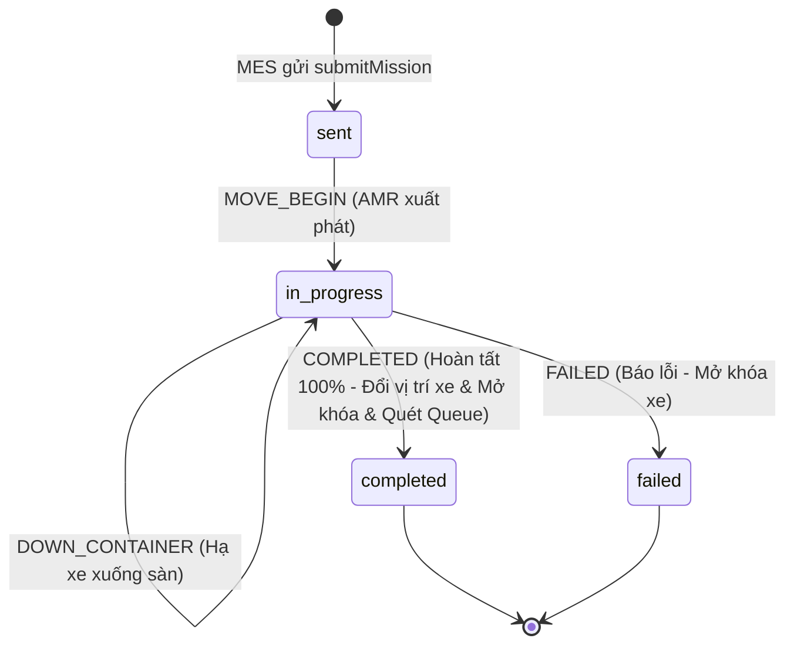

# ĐẶC TẢ TÍCH HỢP GIAO THỨC THỰC TẾ KUKA FLEET MANAGER (100% CHUẨN MỚI)
> **Tài liệu Kỹ thuật & Kiến trúc Điều phối MES - AMR**  
> **Phiên bản:** 2.1 (Chuẩn hóa toàn diện tên trường 1:1, Outbound API `submitMission`, `containerIn` & Inbound Callback)  
> **Ngày cập nhật:** 21/10/2026  
> **Môi trường thực tế:** Fleet Manager `http://192.168.1.71:10870/interfaces/api/` | MES Backend `192.168.1.26:8001`

---

## 1. NGUYÊN TẮC CỐT LÕI: ĐỒNG NHẤT DANH PHÁP 1:1

Để tránh nhầm lẫn, không phải "suy luận đau đầu" khi đọc code hay merge nhánh:
1. **Loại bỏ 100% các thuật ngữ RCS cũ**: Xóa hoàn toàn `orderId`, `deviceCode`, `deviceNum`, `shelfNumber`, status số (`"6"`, `"8"`), `modelProcessCode`, `taskOrderDetail`.
2. **Chuẩn hóa danh pháp trực diện (1:1 với KUKA Fleet)**:
   - Thay vì `task_code` $\rightarrow$ Đổi thành **`mission_code`** (khớp với `missionCode` của Fleet).
   - Thay vì `amr_code` / `device_code` $\rightarrow$ Đổi thành **`robot_id`** (khớp với `robotId` của Fleet).
   - Thay vì `shelf_number` $\rightarrow$ Đổi thành **`container_code`** (khớp với `containerCode` của Fleet).
   - Thay vì `order_id` trong audit log $\rightarrow$ Đổi thành **`mission_code`**.
   - Bổ sung **`org_id`**, **`request_id`**, **`container_location_code`**, **`current_position`**, **`robot_x`**, **`robot_y`**.
3. **Xác thực API (Authorization Access Token)**:
   - Theo chuẩn tài liệu KUKA AMR Fleet 2.14 / 2.16 (mục 4.7 & 6.1): Khi Fleet bật bảo mật Open API, mọi request gửi tới `:10870/interfaces/api/amr/*` cần kèm header HTTP:
     `Authorization: ${kuka_access_token}`
   - Token này được sinh trực tiếp trong giao diện KUKA Fleet Web (Menu *Authentication* $\rightarrow$ Nút *Generate an Access Token*).
   - Hệ thống MES hỗ trợ cấu hình qua file `.env` hoặc biến môi trường `KUKA_ACCESS_TOKEN`, cấu hình trong `backend/app/core/config.py` (`kuka_access_token`).
4. **Quy tắc trạng thái duy nhất**:
   - `DOWN_CONTAINER` **KHÔNG PHẢI** là `completed`. Đó là hành động AMR đang đặt thùng xuống đất (vẫn thuộc `in_progress`).
   - **CHỈ DUY NHẤT** sự kiện **`COMPLETED`** mới đánh dấu nhiệm vụ hoàn tất 100%!

---

## 2. CHI TIẾT CÁC API CHIỀU GỬI ĐI TỪ MES SANG FLEET (OUTBOUND APIS)

Base URL: `http://192.168.1.71:10870/interfaces/api`

### 2.1. API Điều phối di chuyển xe phôi (`submitMission`)
- **Endpoint:** `POST /interfaces/api/amr/submitMission`
- **Mục đích:** MES phát lệnh điều AMR tới trạm lấy xe phôi (Pick Up) và chở tới trạm đích (Put Down). Dùng cho cả 3 nghiệp vụ:
  1. Cấp phôi: Từ Ô Nguyên Liệu (`VT-01..07`) $\rightarrow$ Máy CNC.
  2. Trung chuyển CNC: Từ CNC công đoạn N $\rightarrow$ CNC công đoạn N+1.
  3. Sau CNC cuối: Từ CNC cuối $\rightarrow$ Trạm Tẩy Rửa (`WASH-01..04`) hoặc Bãi đệm xe rỗng.

#### Request Body Mẫu từ MES:
```json
{
  "orgId": "KUKA011021",
  "requestId": "REQ_20261021_145300_001",
  "missionCode": "KK2026171099191821",
  "missionType": "RACK_MOVE",
  "viewBoardType": "",
  "robotModels": [],
  "robotIds": [],
  "robotType": "LIFT",
  "priority": 1,
  "containerModelCode": "1001",
  "templateCode": "",
  "lockRobotAfterFinish": false,
  "unlockRobotId": "",
  "unlockMissionCode": "",
  "idleNode": "",
  "missionData": [
    {
      "sequence": 1,
      "position": "CNC001-CNC001-17",
      "type": "NODE_POINT",
      "putDown": false,
      "passStrategy": "AUTO",
      "waitingMillis": 0
    },
    {
      "sequence": 2,
      "position": "CNC001-CNC001-18",
      "type": "NODE_POINT",
      "putDown": true,
      "passStrategy": "AUTO",
      "waitingMillis": 0
    }
  ]
}
```

#### Giải thích chi tiết các trường dữ liệu do MES sinh ra:

| Trường | Kiểu dữ liệu | Giá trị MES truyền | Ý nghĩa |
|---|---|---|---|
| `orgId` | `String` | `"KUKA011021"` | Mã định danh tổ chức do xưởng KUKA cấu hình. Lấy từ `settings.kuka_org_id`. |
| `requestId` | `String` | `REQ_YYYYMMDD_HHMMSS_xxx` | Mã định danh duy nhất của lượt gọi API từ MES để chống trùng lặp (Idempotency). |
| `missionCode` | `String` | `KK...` (Lấy từ `FleetTask.mission_code`) | Mã nhiệm vụ điều phối duy nhất. Fleet sẽ dùng mã này trong suốt 7 callback. |
| `missionType` | `String` | `"RACK_MOVE"` | Loại nhiệm vụ: chuyển giá phôi/rack hàng. |
| `robotType` | `String` | `"LIFT"` | Loại robot: robot kích nâng nâng gầm. |
| `priority` | `Integer` | `1` (hoặc lấy từ `TransportRequest.priority`) | Mức ưu tiên nhiệm vụ (số càng nhỏ ưu tiên càng cao). |
| `containerModelCode` | `String` | `"1001"` | Mã kiểu loại thùng/kệ gá phôi (khớp cấu hình bản đồ xưởng KUKA). |
| `robotModels` / `robotIds` | `Array` | `[]` | Để trống `[]` để Fleet KUKA tự tính toán chọn AMR rảnh gần nhất; hoặc truyền `["1515"]` nếu chỉ định đích danh. |
| `lockRobotAfterFinish` | `Boolean` | `false` | `false` để sau khi xong nhiệm vụ AMR tự động sẵn sàng nhận việc tiếp theo. |
| **`missionData`** | `Array` | **2 chặng đường đi tuần tự:** |  |
| ↳ Chặng 1 (`sequence: 1`) | `Object` | `putDown: false`, `position: pickup_node` | Robot tới Node lấy hàng (vd `CNC001-CNC001-17`), chui gầm và nâng rack lên. |
| ↳ Chặng 2 (`sequence: 2`) | `Object` | `putDown: true`, `position: dropoff_node` | Robot chở rack tới Node trả hàng (vd `CNC001-CNC001-18`), hạ rack xuống sàn. |

---

### 2.2. API Đăng ký xe phôi vào vị trí (`containerIn`)
- **Endpoint:** `POST /interfaces/api/amr/containerIn`
- **Mục đích:** Đăng ký sự hiện diện của một giá phôi (`containerCode`) tại một vị trí ô (`position`) trong hệ thống Fleet.
- **Thời điểm gọi:** Khi công nhân tại Khu Nguyên Liệu dùng PDA quét mã QR gắn xe phôi vào ô cấp phôi (`VT-01..07`).

#### Request Body Mẫu từ MES:
```json
{
  "containerCode": "123123",
  "enterOrientation": "",
  "isNew": false,
  "position": "CNC001-CNC001-17",
  "requestId": "REQ_IN_20261021_145300_002"
}
```

#### Giải thích chi tiết các trường:
- `containerCode`: Mã xe gá phôi (mã QR dán trên xe, ví dụ `"123123"`).
- `position`: Mã Node bản đồ của vị trí ô phôi (ví dụ `"CNC001-CNC001-17"`).
- `isNew`: `false` (xe phôi tái sử dụng trong xưởng).
- `enterOrientation`: `""` (để Fleet tự điều chỉnh góc quay robot).
- `requestId`: Mã request ID định danh lượt gọi.

---

## 3. CHI TIẾT API CHIỀU FLEET GỬI VỀ MES (INBOUND CALLBACK)

Endpoint tiếp nhận trên MES: `POST http://192.168.1.26:8001/api/v1/receive-status`

### 3.1. Cấu trúc Payload thực tế Fleet gửi về
```json
{
  "orgId": "KUKA011021",
  "missionCode": "KK2026171099191821",
  "viewBoardType": "",
  "containerCode": "123123",
  "containerLocationCode": "CNC001-CNC001-18",
  "containerOrientation": "-90.0",
  "currentPosition": "CNC001-CNC001-18",
  "slotCode": "",
  "missionStatus": "COMPLETED",
  "robotId": "1515",
  "robotX": "178.513",
  "robotY": "83.8",
  "message": "lang.wcs.common.ok",
  "mapCode": "CNC001",
  "floorNumber": "CNC001",
  "missionData": null
}
```

### 3.2. Bảng phân tích 7 sự kiện vòng đời & Trạng thái MES chính xác

| Bước | `missionStatus` | Ý nghĩa thực tế của AMR | Trạng thái MES (`FleetTask.status`) | Thao tác trên Dữ liệu MES |
|:---:|---|---|:---:|---|
| **1** | `MOVE_BEGIN` | AMR `1515` nhận lệnh, bắt đầu chạy tới điểm lấy hàng (`currentPosition: "-1"`). | `in_progress` | Gán `robot_id = 1515`. Bắn WebSocket AMR đang tới. |
| **2** | `ARRIVED` | AMR `1515` đã đến điểm lấy hàng (`CNC001-CNC001-17`). | `in_progress` | Cập nhật vị trí `current_position`. |
| **3** | `UP_CONTAINER` | AMR chui gầm, kích nâng nâng rack `123123` lên. | `in_progress` | Khóa chặt xe: `is_locked = True`, `locked_by_task_id = missionCode`. |
| **4** | `MOVE_BEGIN` | AMR cõng rack bắt đầu chạy sang điểm trả. | `in_progress` | Cập nhật lộ trình di chuyển. |
| **5** | `ARRIVED` | AMR cõng rack đã tới điểm trả (`CNC001-CNC001-18`). | `in_progress` | Chuẩn bị hạ rack. |
| **6** | `DOWN_CONTAINER` | AMR kích hạ, đặt rack `123123` xuống sàn. | **`in_progress`** *(Chưa kết thúc nhiệm vụ)* | Ghi nhận hạ rack an toàn. Robot đang rút gầm. |
| **7** | **`COMPLETED`** | **Nhiệm vụ hoàn tất 100%**. Robot thoát gầm thành công. | **`completed`** | 1. `FleetTask.status = "completed"`<br>2. `TransportRequest.status = "completed"`<br>3. Chuyển vị trí xe phôi: `ItemStock.location_id = dropoff_loc_id`<br>4. Mở khóa xe: `is_locked = False`<br>5. **Tự động quét hàng đợi `transport_queue`** giải phóng điểm lấy hàng cho xe sau! |
| **--** | `FAILED` / `CANCELLED` | Nhiệm vụ bị lỗi hoặc bị hủy. | `failed` / `cancelled` | Mở khóa xe phôi để điều phối viên có thể gọi lại. Ghi log lỗi `message`. |



---

## 4. BẢNG THAY ĐỔI CƠ SỞ DỮ LIỆU (DATABASE SCHEMA ALIGNMENT)

Để các trường trong Database nhìn vào nhận diện ngay, không cần suy luận:

### 4.1. Bảng `fleet_task`
| Cột cũ (Gây nhầm) | Cột mới (Chuẩn KUKA 1:1) | Kiểu dữ liệu | Mô tả |
|---|---|---|---|
| `task_code` | **`mission_code`** | `VARCHAR(50) UNIQUE` | Mã nhiệm vụ KUKA Fleet (vd `KK2026171099191821`) |
| `amr_code` | **`robot_id`** | `VARCHAR(50)` | Mã robot AMR thực hiện (vd `1515`) |
| *(Mới)* | **`container_code`** | `VARCHAR(50)` | Mã xe phôi vận chuyển (vd `123123`) |
| *(Mới)* | **`request_id_code`** | `VARCHAR(50)` | Mã request ID gửi sang Fleet (vd `REQ_...`) |
| `process_code` | *(Bỏ hoặc để null)* | - | Fleet mới không dùng `modelProcessCode` |
| `task_order_detail` | **`mission_data`** | `JSONB` / `TEXT` | Lưu mảng JSON `missionData` 2 chặng đường đi |
| `status` | `status` | `VARCHAR(30)` | `created` $\rightarrow$ `sent` $\rightarrow$ `in_progress` $\rightarrow$ `completed` / `failed` |

### 4.2. Bảng `task_status` (Lịch sử Audit Log Callback)
| Cột cũ (RCS) | Cột mới (Chuẩn KUKA 1:1) | Kiểu dữ liệu | Mô tả |
|---|---|---|---|
| `order_id` | **`mission_code`** | `VARCHAR(50) INDEX` | Khớp trực tiếp `FleetTask.mission_code` |
| `status` | **`mission_status`** | `VARCHAR(50)` | `MOVE_BEGIN`, `ARRIVED`, `UP_CONTAINER`, `DOWN_CONTAINER`, `COMPLETED` |
| `device_code` / `device_num` | **`robot_id`** | `VARCHAR(50)` | Mã robot (vd `1515`) |
| `shelf_number` / `qr_code` | **`container_code`** | `VARCHAR(50)` | Mã xe phôi (vd `123123`) |
| *(Mới)* | **`container_location_code`** | `VARCHAR(50)` | Node vị trí xe phôi (vd `CNC001-CNC001-18`) |
| *(Mới)* | **`current_position`** | `VARCHAR(50)` | Vị trí hiện tại của xe/AMR |
| *(Mới)* | **`robot_x`**, **`robot_y`** | `VARCHAR(30)` | Tọa độ mét thực tế của AMR trên bản đồ |
| *(Mới)* | **`org_id`** | `VARCHAR(50)` | Tổ chức `KUKA011021` |
| *(Mới)* | **`message`** | `VARCHAR(255)` | Thông báo từ Fleet (vd `lang.wcs.common.ok`) |

### 4.3. Bảng `item_stock` (Xe gá phôi WIP)
- Cột `cart_code` $\rightarrow$ Đổi và thay thế hoàn toàn bằng **`container_code`** (xóa bỏ triệt để `cart_code`).
- `is_locked`: `BOOLEAN` (khóa xe khi đang di chuyển).
- `locked_by_task_id`: Lưu chính xác `mission_code`.

---

## 5. KẾ HOẠCH HÀNH ĐỘNG CHI TIẾT (ACTION PLAN)

### Bước 1: CSDL & Migration (Alembic)
- Viết migration:
  - Cập nhật bảng `fleet_task`: đổi `task_code` $\rightarrow$ `mission_code`, `amr_code` $\rightarrow$ `robot_id`, thêm `container_code`.
  - Cập nhật bảng `task_status`: chuyển hoàn toàn sang các cột KUKA Fleet (`mission_code`, `mission_status`, `robot_id`, `container_code`, `container_location_code`, `current_position`, `robot_x`, `robot_y`, `org_id`, `message`).
- Chạy `alembic upgrade head`.

### Bước 2: Nâng cấp Outbound Dispatch Service (`dispatch_service.py`)
- Thay thế hàm cũ bằng 2 hàm chuẩn mới:
  1. `submit_mission(task, pickup_code, dropoff_code, container_code)`: Gọi `POST /interfaces/api/amr/submitMission` với body 2 sequence (`putDown: false` và `putDown: true`).
  2. `container_in(position_code, container_code)`: Gọi `POST /interfaces/api/amr/containerIn` khi công nhân quét phôi vào trạm.

### Bước 3: Nâng cấp Inbound Callback Webhook
- Tại `route_api.py` và `dispatch_service.receive_task_status`:
  - Đọc trực tiếp `missionCode`, `missionStatus`, `robotId`, `containerCode`, `containerLocationCode`, `robotX`, `robotY`.
  - Khớp với `FleetTask` bằng `mission_code == missionCode`.
  - Xử lý đúng quy tắc: `DOWN_CONTAINER` giữ `in_progress`, chỉ `COMPLETED` mới chốt `completed` và chuyển vị trí xe phôi, mở khóa và kích hoạt quét Queue.

### Bước 4: Kiểm thử tự động (Unit Test Replay)
- Viết script `test_fleet_kuka_full_lifecycle.py`:
  - Tạo 1 xe phôi tại `CNC001-CNC001-17`.
  - Phát lệnh `submit_mission` sang `CNC001-CNC001-18`.
  - Replay tuần tự 7 gói tin thật từ `all_signals.jsonl`.
  - Kiểm tra kết quả: `ItemStock` chuyển vị trí sang trạm 18, mở khóa, `FleetTask` hoàn tất 100%.
