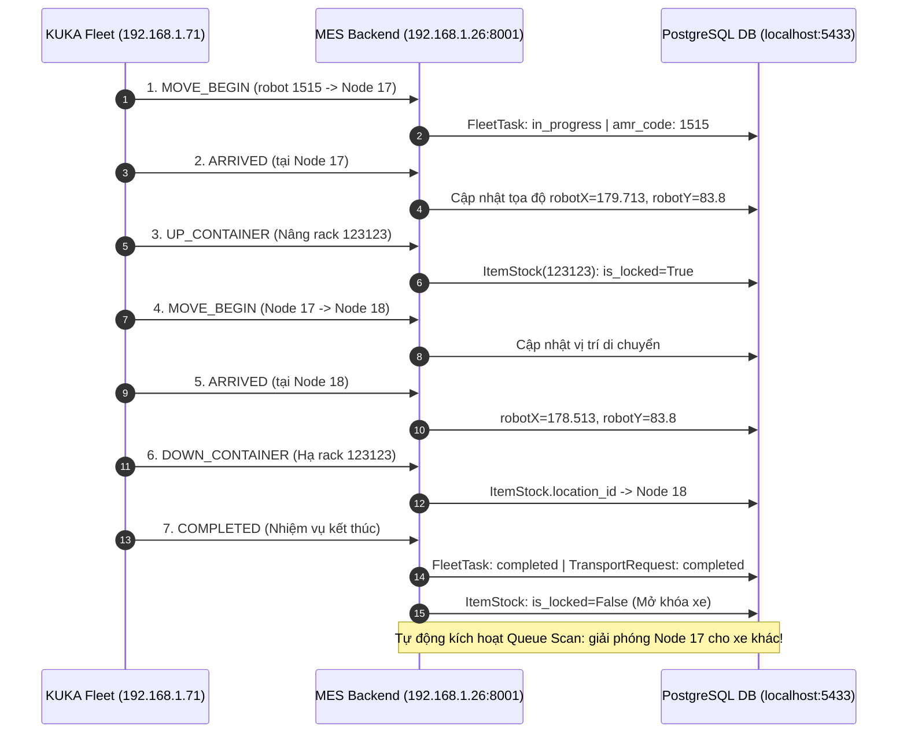
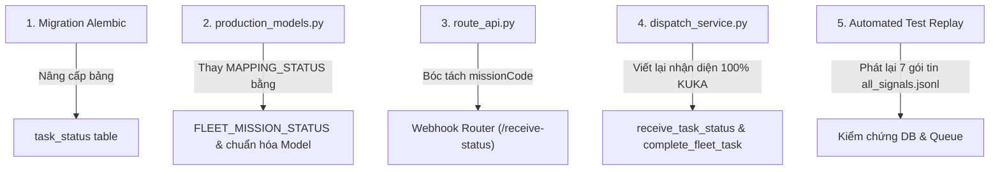

# ĐẶC TẢ TÍCH HỢP GIAO THỨC THỰC TẾ KUKA FLEET MANAGER (100% CHUẨN MỚI)
> **Tài liệu Kỹ thuật & Kiến trúc Điều phối MES - AMR**  
> **Phiên bản:** 2.0 (Chuẩn hóa toàn diện theo tín hiệu bắt thực tế từ KUKA Fleet Manager)  
> **Ngày cập nhật:** 21/10/2026  
> **Môi trường thực tế:** Fleet Manager `http://192.168.1.71:10870/interfaces/api/` | MES Backend `192.168.1.26:8001`

---

## 1. TỔNG QUAN & NGUYÊN TẮC CỐT LÕI

### 1.1. Loại bỏ 100% định dạng RCS giả định cũ
Trong giai đoạn thiết kế ban đầu, hệ thống dựa trên tài liệu mô phỏng RCS cũ với các trường số học như `orderId`, `status: "6" | "8" | "9"`, `shelfNumber`, `deviceCode`. 

Sau khi kết nối và bắt tín hiệu thực tế từ máy chủ KUKA Fleet (`192.168.1.71`) vào ngày 21/10/2026, **chúng ta chính thức loại bỏ 100% định dạng RCS cũ**. Hệ thống Backend MES/WMS sẽ chuyển dịch hoàn toàn sang chuẩn giao tiếp thực tế của KUKA Fleet Manager hiện đại.

### 1.2. Môi trường mạng & Cấu hình kết nối
- **KUKA Fleet Manager (ICS/RCS):** `http://192.168.1.71:10870/interfaces/api`
  - Gửi lệnh điều phối: `POST /interfaces/api/ics/taskOrder/addTask`
  - Đăng ký/Gắn rack vào ô: `POST /interfaces/api/ics/shelf/insert`
  - Gỡ rack khỏi ô: `POST /interfaces/api/ics/shelf/remove`
  - Hủy nhiệm vụ: `POST /interfaces/api/ics/taskOrder/cancelTask`
- **MES Backend Receiver (Webhook Callback):**
  - Endpoint tiếp nhận: `POST http://192.168.1.26:8001/api/v1/receive-status` (hoặc alias `/api/v1/production/fleet/receive-status`)
  - User-Agent của Fleet gửi tới: `Java/1.8.0_212`

---

## 2. DỮ LIỆU THỰC TẾ ĐÃ THU THẬP TỪ KUKA FLEET

Toàn bộ 7 gói tin callback thực tế được trích xuất từ file log [`all_signals.jsonl`](file:///D:/KuKA/KUKA_WMS/backend/logs/fleet_signals/all_signals.jsonl).

### 2.1. Cấu trúc JSON chuẩn KUKA Fleet
```json
{
  "orgId": "KUKA011021",
  "missionCode": "KK2026171099191821",
  "viewBoardType": "",
  "containerCode": "123123",
  "containerLocationCode": "CNC001-CNC001-18",
  "containerOrientation": "-90.0",
  "currentPosition": "CNC001-CNC001-18",
  "slotCode": "",
  "missionStatus": "COMPLETED",
  "robotId": "1515",
  "robotX": "178.513",
  "robotY": "83.8",
  "message": "lang.wcs.common.ok",
  "mapCode": "CNC001",
  "floorNumber": "CNC001",
  "missionData": null
}
```

### 2.2. Bảng phân tích chi tiết 7 sự kiện vòng đời (Timeline)

| STT | Timestamp | `missionStatus` | `currentPosition` | `robotX`, `robotY` | Ý nghĩa vận hành thực tế |
|:---:|:---:|:---:|:---:|:---:|---|
| **1** | `11:07:31.702` | `MOVE_BEGIN` | `-1` (đang di chuyển) | `(173.265, 77.367)` | AMR `1515` nhận lệnh, bắt đầu di chuyển từ vị trí chờ tới điểm lấy phôi `CNC001-CNC001-17`. |
| **2** | `11:07:53.783` | `ARRIVED` | `CNC001-CNC001-17` | `(179.713, 83.800)` | AMR `1515` đã đến chính xác Node 17 (tọa độ khớp 100% bản đồ xưởng). |
| **3** | `11:07:55.835` | `UP_CONTAINER` | `CNC001-CNC001-17` | *(đang kích nâng kệ)* | Cơ cấu kích nâng của AMR kích hoạt, nâng giá phôi mã `123123` lên khỏi mặt sàn. |
| **4** | `11:07:56.810` | `MOVE_BEGIN` | `CNC001-CNC001-17` | `(179.713, 83.800)` | AMR cõng giá phôi bắt đầu chạy sang điểm trả hàng `CNC001-CNC001-18`. |
| **5** | `11:08:11.844` | `ARRIVED` | `CNC001-CNC001-18` | `(178.513, 83.800)` | AMR cùng giá phôi đã tới chính xác trạm trả Node 18. |
| **6** | `11:08:13.882` | `DOWN_CONTAINER` | `CNC001-CNC001-18` | *(đang hạ kệ)* | Kích nâng hạ giá phôi `123123` an toàn xuống mặt sàn tại Node 18. |
| **7** | `11:08:13.920` | `COMPLETED` | `CNC001-CNC001-18` | `(178.513, 83.800)` | Nhiệm vụ hoàn tất 100%. AMR sẵn sàng nhận nhiệm vụ mới hoặc về bãi sạc. |



---

## 3. TỪ ĐIỂN CÁC TRƯỜNG DỮ LIỆU (FIELD DICTIONARY)

| Trường KUKA Fleet | Kiểu dữ liệu | Ý nghĩa | Ánh xạ trong MES / DB |
|---|---|---|---|
| **`missionCode`** | `String` | Mã duy nhất của nhiệm vụ Fleet (vd `KK2026171099191821`) | `FleetTask.task_code` / `task_status.mission_code` |
| **`missionStatus`** | `String` | Trạng thái vòng đời của nhiệm vụ | `task_status.mission_status` / ánh xạ vào `FleetTask.status` |
| **`containerCode`** | `String` | Mã xe gá phôi / kệ hàng (vd `123123`) | `ItemStock.cart_code` / `task_status.container_code` |
| **`containerLocationCode`** | `String` | Mã Node điểm đỗ của kệ (vd `CNC001-CNC001-18`) | Khớp với `Location.location_code` (hoặc `Location.node_uuid`) |
| **`currentPosition`** | `String` | Vị trí hiện tại của xe (`-1` khi đang đi trên đường, hoặc mã node khi dừng) | `task_status.current_position` |
| **`robotId`** | `String` | Mã định danh robot AMR (vd `1515`) | `FleetTask.amr_code` / `task_status.robot_id` |
| **`robotX`, `robotY`** | `String` (Float) | Tọa độ mét thực tế của Robot trên bản đồ (vd `178.513`, `83.8`) | Cập nhật realtime lên 2D Canvas Monitor |
| **`mapCode`** | `String` | Mã bản đồ xưởng (`CNC001`) | Liên kết với `warehouse_map.map_code` |
| **`containerOrientation`** | `String` | Góc quay của xe phôi (vd `-90.0`) | Render hướng xe trên bản đồ 2D |
| **`message`** | `String` | Thông điệp kết quả từ Fleet (vd `lang.wcs.common.ok`) | `task_status.message` |

---

## 4. QUY TẮC MAPPING TRẠNG THÁI VÀO CƠ SỞ DỮ LIỆU (STATE MACHINE)

### 4.1. Enum trạng thái chuẩn
```python
FLEET_MISSION_STATUS = {
    # Nhóm đang di chuyển / thao tác
    "MOVE_BEGIN": "in_progress",
    "ARRIVED": "in_progress",
    "UP_CONTAINER": "in_progress",
    
    # Nhóm kết thúc hoàn thành
    "DOWN_CONTAINER": "completed",
    "COMPLETED": "completed",
    
    # Nhóm lỗi & hủy
    "FAILED": "failed",
    "CANCELLED": "cancelled",
    "CANCEL": "cancelled",
}
```

### 4.2. Xử lý nghiệp vụ theo từng trạng thái

#### A. Khi nhận `MOVE_BEGIN` hoặc `ARRIVED`:
1. Ghi 1 bản ghi lịch sử vào bảng `task_status`.
2. Tìm `FleetTask` theo `task_code == missionCode`.
3. Cập nhật `FleetTask.status = "in_progress"`, gán `FleetTask.amr_code = robotId`.
4. Nếu có liên kết với `TransportRequest`: cập nhật `TransportRequest.status = "in_progress"`.
5. Bắn sự kiện WebSocket thông báo tới màn hình Quản đốc và PDA công nhân: *Robot [1515] đang di chuyển/đã đến trạm*.

#### B. Khi nhận `UP_CONTAINER`:
1. AMR đã nâng kệ phôi khỏi mặt sàn.
2. Tìm xe phôi theo `cart_code == containerCode`:
   - Xác nhận `cart.is_locked = True`.
   - `cart.locked_by_task_id = missionCode`.
   - Đảm bảo xe phôi không bị trạm khác chọn nhầm trong lúc đang được vận chuyển.

#### C. Khi nhận `DOWN_CONTAINER` hoặc `COMPLETED`:
1. AMR đã đặt kệ xuống trạm đích an toàn.
2. Cập nhật `FleetTask.status = "completed"`, `FleetTask.completed_at = now()`.
3. Cập nhật `TransportRequest.status = "completed"`, `TransportRequest.completed_at = now()`.
4. **Cập nhật xe phôi (`ItemStock`)**:
   - Chuyển trạm: tìm `Location` đích theo `containerLocationCode` $\rightarrow$ gán `cart.location_id = dropoff_location.id`.
   - Mở khóa: `cart.is_locked = False`, `cart.locked_by_task_id = None`.
   - Xóa điểm đích tạm: `cart.destination_location_id = None`.
5. **Kích hoạt tự động quét hàng đợi (`scan_all_transport_queues`)**:
   - Trạm xuất phát (`pickup_location_id`) vừa được giải phóng hoàn toàn!
   - Nếu trước đó có máy CNC hoặc ô phôi nào đang bị kẹt không thể đưa hàng ra vì trạm bận, hệ thống sẽ tự động quét và kích hoạt nhiệm vụ mới ngay lập tức.

#### D. Khi nhận `FAILED` hoặc `CANCELLED`:
1. Cập nhật `FleetTask.status = "failed"` (hoặc `"cancelled"`).
2. Lưu lý do lỗi `FleetTask.error_message = payload.get("message")`.
3. Mở khóa xe phôi `ItemStock.is_locked = False` để công nhân hoặc điều phối viên có thể bấm gọi lại mà không bị treo xe vĩnh viễn.

---

## 5. KẾ HOẠCH TRIỂN KHAI VÀ DANH MỤC THAY ĐỔI



### Chi tiết các file sẽ sửa đổi:
1. **`backend/alembic/versions/xxxx_upgrade_task_status_kuka_fleet.py`**:
   - Thêm các cột chuẩn KUKA: `mission_code`, `mission_status`, `robot_id`, `container_code`, `container_location_code`, `current_position`, `robot_x`, `robot_y`, `message`.
2. **`backend/app/modules/production/production_models.py`**:
   - Xóa hoàn toàn `MAPPING_STATUS` cũ.
   - Thêm `FLEET_MISSION_STATUS`.
   - Cập nhật class `TaskStatus`.
3. **`backend/app/modules/production/route_api.py`**:
   - Nhận diện trực tiếp payload KUKA qua trường `missionCode`.
   - Gọi `dispatch_service.receive_task_status(db, payload)`.
4. **`backend/app/modules/production/dispatch_service.py`**:
   - Triển khai logic tiếp nhận và chuyển đổi trạng thái 7 bước như đã đặc tả ở Mục 4.
5. **`backend/scripts/test_fleet_kuka_replay.py`**:
   - Script replay 7 gói tin mẫu từ file `all_signals.jsonl` để kiểm tra độ tin cậy.
