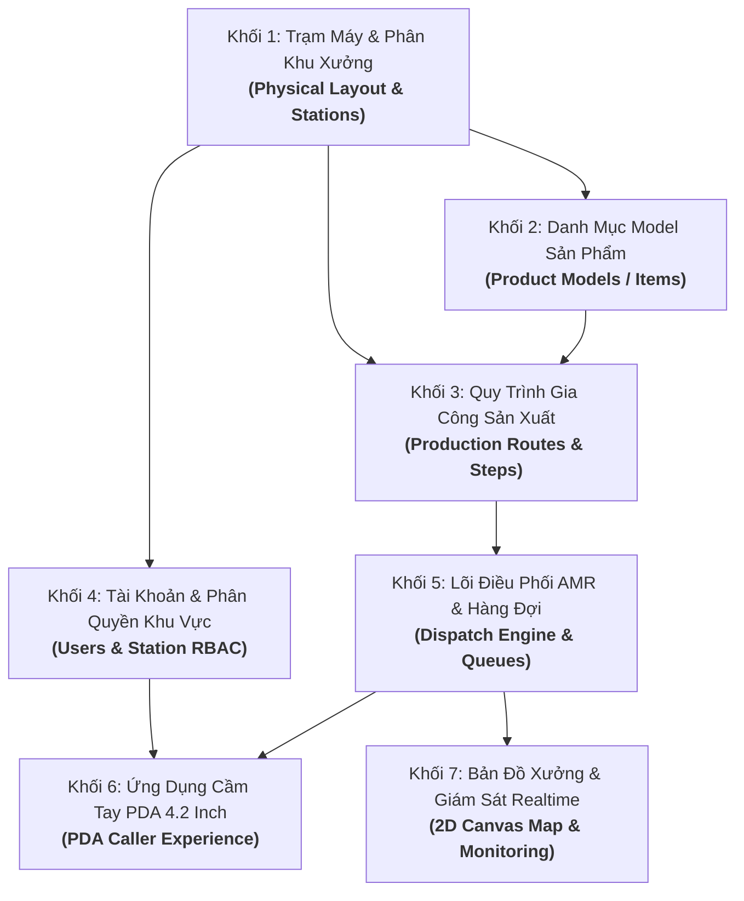

# Kế Hoạch Review Toàn Diện Hệ Thống KUKA AMR & WMS

Tài liệu này vạch ra lộ trình đánh giá và review chất lượng code (Code Review & Quality Gate) cho toàn bộ hệ thống KUKA AMR WMS. 

Hệ thống được chia thành **7 Khối Kiến Trúc & Vận Hành** theo đúng chuỗi phụ thuộc một chiều (*Dependency Chain*) từ **Hạ tầng Vật lý $\rightarrow$ Dữ liệu Danh mục $\rightarrow$ Quy trình Công nghệ $\rightarrow$ Phân quyền Người dùng $\rightarrow$ Lõi Điều phối AMR $\rightarrow$ Ứng dụng PDA $\rightarrow$ Giám sát Bản đồ Realtime**.

---

## 🗺️ Bản Đồ Lộ Trình 7 Khối Review

---

## CHI TIẾT 7 KHỐI REVIEW TOÀN DIỆN

### 1️⃣ Khối 1: Trạm Máy & Phân Khu Xưởng (Stations & Physical Shop Layout)
* **Ý nghĩa**: Nền tảng vật lý của toàn bộ nhà xưởng. Quy định 4 phân khu chức năng và chuẩn hóa máy CNC sang mô hình 3NF.
* **Tầng Database Models**:
  - Bảng `machine`: Lưu thực thể máy CNC (`id`, `machine_code`, `machine_name`, `status`, `is_active`).
  - Bảng `location`: Lưu từng điểm đỗ vật lý (`location_type`: `RAW_MATERIAL`, `CNC_SLOT`, `WASHING_SLOT`, `EMPTY_CART_BUFFER`; `machine_id`, `machine_code`, `position_index: 1 | 2 | 3`, tọa độ map `x`, `y`).
  - **Tiêu chuẩn kiểm tra**: Đã loại bỏ triệt để `default_stage_level`. Mỗi máy CNC có thể linh hoạt từ 1 đến 3 vị trí đỗ POS.
* **Tầng API & Schemas** (`Production - Stations & Machines`):
  - `GET /api/v1/production/stations/catalog`: Danh mục hợp nhất 4 phân khu.
  - `GET /api/v1/production/map/available-nodes`: Lấy các Node điểm đỗ từ bản đồ gốc (`map_CNC001_...json`).
  - `CRUD /api/v1/production/machines`: Quản lý máy CNC kèm cấu hình 1..3 slots POS.
  - `CRUD /api/v1/production/stations/locations`: Quản lý các ô cấp phôi, slot rửa, bãi đệm.
* **Tầng Giao Diện Web Admin**:
  - `frontend/src/pages/production/StationSettingPage.tsx`: Trang hợp nhất gồm 3 Tab chuyên biệt (Tab Cấp Phôi, Tab Máy CNC linh hoạt 1-3 slots, Tab Tẩy Rửa & Buffer).

---

### 2️⃣ Khối 2: Danh Mục Model Sản Phẩm (Product Models / Items)
* **Ý nghĩa**: Định nghĩa các chủng loại phôi/chi tiết cơ khí được gia công trong nhà xưởng (thay thế hàng hóa bán lẻ FMCG cũ).
* **Tầng Database Models**:
  - Bảng `item`: Tái sử dụng làm bảng Model sản phẩm (`sku` = mã model, `name` = tên chi tiết/model, `standard_quantity_per_cart` = 120 pcs).
  - Ràng buộc: Xóa bỏ các thuộc tính tồn kho bán lẻ không dùng như đơn vị phụ, giá tiền, hạn sử dụng.
* **Tầng API & Schemas** (`Item`):
  - `GET/POST/PUT/DELETE /api/v1/warehouse/item`: Quản lý danh mục Model.
  - Schemas Pydantic kiểm tra tính hợp lệ của mã SKU và quy cách tiêu chuẩn trên xe gá.
* **Tầng Giao Diện Web Admin**:
  - `frontend/src/pages/ItemSettingPage.tsx`: Đã loại bỏ hoàn toàn trường `base_unit`.
  - `frontend/src/pages/ItemPage.tsx`: Đã loại bỏ các cột số lượng tồn kho FMCG, tổng giá trị tiền và các thẻ KPI tồn kho không phù hợp.

---

### 3️⃣ Khối 3: Quy Trình Gia Công Sản Xuất (Production Routes & Steps)
* **Ý nghĩa**: Linh hồn công nghệ của xưởng cơ khí – quy định đường đi của từng Model qua các máy CNC (Level 1 $\rightarrow$ Level 2 $\rightarrow$ Level 3 $\rightarrow$ Rửa).
* **Tầng Database Models**:
  - Bảng `production_route`: Quy trình cho từng Model (`route_code`, `route_name`, `item_id`, `is_active`).
  - Bảng `route_step`: Từng công đoạn gia công (`step_number`, `stage_level`, `step_name`, `is_final_cnc_step`).
  - Bảng `route_step_machine`: Cầu nối 3NF cho phép gán nhiều máy CNC chạy song song thay thế cho cùng 1 bước (ví dụ: Level 1 có thể làm ở CNC-01 HOẶC CNC-02).
* **Tầng API & Schemas** (`Production - Routes`):
  - `CRUD /api/v1/production/routes`: Tạo, sửa, xóa quy trình và chi tiết các bước.
  - `PATCH /api/v1/production/routes/{route_id}/activate`: Kích hoạt quy trình làm chuẩn duy nhất cho Model.
* **Tầng Giao Diện Web Admin**:
  - `frontend/src/pages/production/RouteSettingPage.tsx`: Bảng quản lý Route, Drawer tạo/sửa bước gia công, chọn nhiều máy song song và đánh dấu cờ `is_final_cnc_step`.

---

### 4️⃣ Khối 4: Tài Khoản & Phân Quyền Khu Vực (Users & Station RBAC)
* **Ý nghĩa**: Bảo mật và phân định trách nhiệm vận hành: mỗi công nhân chỉ được phân quyền quản lý đúng 1 khu vực, loại bỏ role chung chung.
* **Tầng Database Models**:
  - Bảng `users`, `roles`, `user_roles`.
  - Bảng `user_locations`: Ràng buộc công nhân với danh sách các vị trí đỗ cụ thể.
* **Tầng API & Schemas** (`Production - User Locations` & `Auth`):
  - 4 Role chuẩn hóa: `admin`, `operator_raw`, `operator_cnc`, `operator_washing`.
  - `GET /api/v1/production/users/{user_id}/locations`: Lấy danh sách vị trí đã gán.
  - `PUT /api/v1/production/users/{user_id}/locations`: Gán trạm mới và tự động thu hồi trạm ở khu vực khác.
* **Tầng Giao Diện Web Admin**:
  - `frontend/src/pages/system/UserSettingPage.tsx`: Đơn giản hóa modal tạo user thành 1 bước trực tiếp với 4 role.
  - `frontend/src/pages/components/StationAssignmentModal.tsx`: Modal phân quyền 2 tầng (Tầng 1: Chọn 1 Khu vực duy nhất $\rightarrow$ Tầng 2: Checkbox các trạm/máy trong khu vực đó).

---

### 5️⃣ Khối 5: Lõi Thuật Toán Điều Phối AMR & Hàng Đợi Tự Động (Core Dispatch Engine & Queue Worker)
* **Ý nghĩa**: **Trọng tâm kỹ thuật & bộ não tính toán thông minh nhất của hệ thống** – không chỉ là API trung chuyển mà chứa toàn bộ thuật toán ra quyết định điều xe, tối ưu đường đi, khóa trạm chống tranh chấp và bộ máy background worker xử lý hàng đợi.
* **Tầng Database Models & Lưu Vết (Audit Trail)**:
  - Bảng `item_stock`: Xe gá phôi WIP (`container_code`, `location_id`, `current_stage_level`, `is_locked`, `destination_location_id`, `status`). Đã loại bỏ hoàn toàn `cart_id`.
  - Bảng `transport_request`: Yêu cầu vận chuyển (`request_code`, `request_type`, `required_stage_level`, `status`, `priority`).
  - Bảng `transport_queue`: Hàng đợi tự động (`WAITING_CART`, `WAITING_SLOT`, `retry_count`, `priority`).
  - Bảng `fleet_task`: Nhiệm vụ điều phối robot AMR (`mission_code`, `robot_id`, `pickup_location_id`, `dropoff_location_id`, `status`).
  - Bảng `production_record`: Lịch sử bấm hoàn thành công đoạn của từng công nhân tại từng máy.
* **Chi Tiết Các Thuật Toán Cốt Lõi (`dispatch_service.py`)**:
  1. **Thuật toán Chọn Xe Đa Chế Độ (Hybrid Cart Selection Algorithm)**:
     - **Cấp phôi thô (Level 0 $\rightarrow$ Level 1)**: Áp dụng **FIFO (First-In, First-Out)** theo thời gian nạp `created_at ASC` để đảm bảo lô phôi vào kho trước được gia công trước.
     - **Chuyển tiếp giữa các máy CNC (Level 1 $\rightarrow$ 2 $\rightarrow$ 3)**: Áp dụng thuật toán **Tối Thiểu Hóa Khoảng Cách Euclidean 2D**:
       $$\text{Distance} = \sqrt{(x_{\text{dest}} - x_{\text{cart}})^2 + (y_{\text{dest}} - y_{\text{cart}})^2}$$
       Hệ thống quét tọa độ thực tế của tất cả các xe đạt Level yêu cầu trên bản đồ và chọn xe gần máy CNC đích nhất để tối ưu thời gian AMR di chuyển.
  2. **Cơ Chế Khóa Tránh Đụng Độ & Tranh Chấp (Pessimistic Locking & Slot Guarding)**:
     - Dùng `with_for_update()` của PostgreSQL khóa bản ghi xe ngay tại thời điểm điều phối.
     - Đặt ngay lập tức `is_locked = True`, gán `destination_location_id = dest_loc.id` để chặn tất cả các máy CNC khác tranh cướp cùng một xe.
     - **Bảo vệ Đệm Kép POS1/POS2/POS3**: Kiểm tra chặt chẽ vị trí đỗ đích; nếu một vị trí POS đang có xe đỗ hoặc đang có lệnh AMR điều tới (`is_reserved`) thì lập tức chặn lại hoặc tự động chuyển hướng sang vị trí POS còn trống của cùng máy.
  3. **Bộ Máy Quản Lý Hàng Đợi Bất Đồng Bộ (Async Queue Resolver - `resolve_pending_queues`)**:
     - **Hàng đợi `WAITING_CART`**: Khi máy CNC bấm gọi phôi nhưng công đoạn trước chưa có xe nào gia công xong $\rightarrow$ Đưa yêu cầu vào `transport_queue`. Background worker quét liên tục; ngay khi máy công đoạn trước bấm hoàn thành $\rightarrow$ Hệ thống tự động khớp và điều AMR bốc xe sang ngay lập tức.
     - **Hàng đợi `WAITING_SLOT` (Khu Rửa)**: Khi máy CNC cuối gia công xong nhưng cả 4 slot Tẩy Rửa đều đang đầy $\rightarrow$ Xe chờ tại bàn máy CNC và đưa vào queue. Ngay khi công nhân khu rửa bấm [ĐÃ LẤY ĐI RỬA] giải phóng 1 slot $\rightarrow$ Tự động kích hoạt xe từ CNC cuối sang slot rửa vừa giải phóng.
  4. **Adapter Tích Hợp KUKA Fleet Manager (RCS / ICS Integration)**:
     - Sinh mã nhiệm vụ chuẩn `mission_code`.
     - Tiếp nhận Webhook callback `/receive-status`: Khi AMR hoàn thành hạ kệ (trạng thái `8` hoặc `COMPLETED`) $\rightarrow$ Tự động chuyển vị trí xe `location_id = dropoff_location_id`, mở khóa xe `is_locked = False`, cập nhật trạng thái trạm.
  5. **Tách Biệt 3 Vòng Đời Trạng Thái Độc Lập**:
     - Vòng đời Yêu cầu vận chuyển (`TransportRequest.status`): `pending` $\rightarrow$ `in_progress` $\rightarrow$ `completed`.
     - Vòng đời Tiến trình gia công (`ItemStock.current_stage_level`): `Level 0` $\rightarrow$ `Level 1` $\rightarrow$ `Level 2` $\rightarrow$ `Wash`.
     - Vòng đời Nhiệm vụ Robot KUKA (`FleetTask.status`): `created` $\rightarrow$ `sent` $\rightarrow$ `dispatched` $\rightarrow$ `completed`.
* **Tầng API & Schemas** (`Production - Dispatch Engine` & `Production - Fleet Webhook`):
  - `POST /api/v1/production/racks/register-raw-material`
  - `POST /api/v1/production/dispatch/call-material`
  - `POST /api/v1/production/dispatch/complete-stage`
  - `POST /api/v1/production/dispatch/return-empty-cart-from-washing`
  - `POST /api/v1/receive-status` (Webhook KUKA Fleet)

---

### 6️⃣ Khối 6: Thiết Bị Cầm Tay PDA 4.2 Inch (PDA Caller App)
* **Ý nghĩa**: Ứng dụng công nghiệp hiện trường cho công nhân, phong cách 1-chạm (One-touch), không popup, nút to dễ bấm trên màn hình nhỏ.
* **Tầng Giao Diện Người Dùng (PDA Components)**:
  - `frontend/src/pages/pda/PdaCallerPage.tsx`: Khung màn hình độc lập không thanh desktop, hỗ trợ chuyển khu vực nhanh.
  - `RawMaterialWizard.tsx`: Wizard 3 bước cấp phôi (Chọn ô $\rightarrow$ Chọn Model $\rightarrow$ Quét mã Container).
  - `CncLineModal.tsx`: Thao tác tại máy CNC:
    * Thẻ trạm trống: Nút **[GỌI HÀNG]** (tự suy luận Model & Level theo Route).
    * Thẻ trạm có hàng: Nút **[BÁO XONG -> NÂNG LEVEL]**.
    * Hỗ trợ hiển thị linh hoạt 1, 2 hoặc 3 vị trí đỗ (`P1`, `P2`, `P3`).
  - `WashingStationModal.tsx`: Khu tẩy rửa 4 slot, nút **[ĐÃ LẤY ĐI RỬA]** giải phóng slot và kích hoạt AMR chở xe rỗng về bãi đệm.
* **Tầng Quản Lý Trạng Thái (Zustand)**:
  - `frontend/src/store/usePdaStore.ts`: Đồng bộ state realtime theo danh sách vị trí phân quyền của tài khoản đăng nhập.

---

### 7️⃣ Khối 7: Bản Đồ Xưởng & Giám Sát Realtime (Live 2D Map & Monitoring)
* **Ý nghĩa**: Bức tranh toàn cảnh xưởng sản xuất phục vụ quản đốc theo dõi trạng thái di chuyển của AMR và vị trí xe phôi.
* **Tầng Parser & Dữ Liệu Tọa Độ**:
  - Parser đọc file bản đồ xưởng thực tế `map_CNC001_CNC001_28s.json` (493 nodes, 704 edges, chuyển đổi tọa độ mét $\rightarrow$ mm).
* **Tầng Canvas & Hiển Thị Trực Quan**:
  - `frontend/src/components/map/WarehouseMapCanvas.tsx`: Vẽ sơ đồ mạng lưới xưởng bằng HTML5 Canvas.
  - Hiển thị trực quan 3 trạng thái của trạm:
    * Màu đỏ: Đang có xe phôi đỗ.
    * Viền đứt nét màu cam (`⏳ GIỮ CHỖ`): Điểm đến đã được AMR đặt chỗ trước.
    * Viền màu xanh dương (`🚚 ĐANG CHUYỂN`): Xe phôi đang được AMR bốc chuyển đi.

---

## 📋 Tiêu Chí Kiểm Soát Chất Lượng Cho Từng Khối (Quality Checklist)

Mỗi khối khi review sẽ được chấm điểm dựa trên 5 trục tiêu chuẩn:
1. **Tính đúng đắn (Correctness)**: Hoạt động chính xác theo quy trình thực tế của bạn, xử lý đầy đủ các trường hợp ngoại lệ.
2. **Độ đơn giản & Tối giản (Readability & Simplicity)**: Code ngắn gọn, dễ đọc, không còn biến/thuộc tính thừa hay đoạn mã FMCG cũ.
3. **Kiến trúc (Architecture)**: Chuẩn 3NF, không alias thụt lùi, ranh giới rõ ràng giữa UI $\leftrightarrow$ API $\leftrightarrow$ Service $\leftrightarrow$ DB.
4. **Bảo mật (Security)**: Phân quyền token JWT, chặn truy cập ngoài phân khu, kiểm soát chặt chẽ đầu vào.
5. **Hiệu năng (Performance)**: Truy vấn tối ưu, indexing khóa ngoại đầy đủ, xử lý đồng thời không nghẽn khóa hàng đợi.
