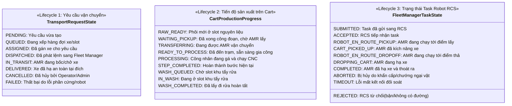
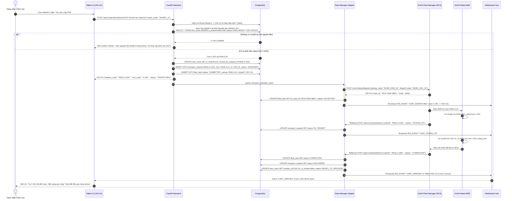
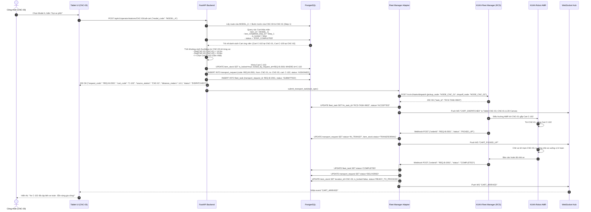
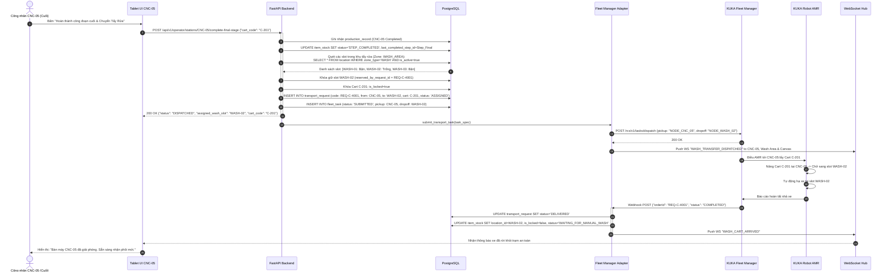
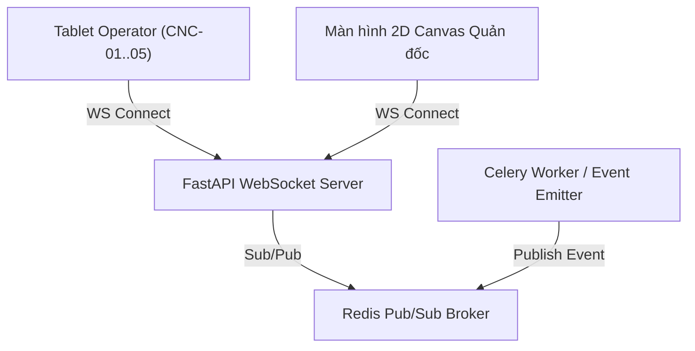
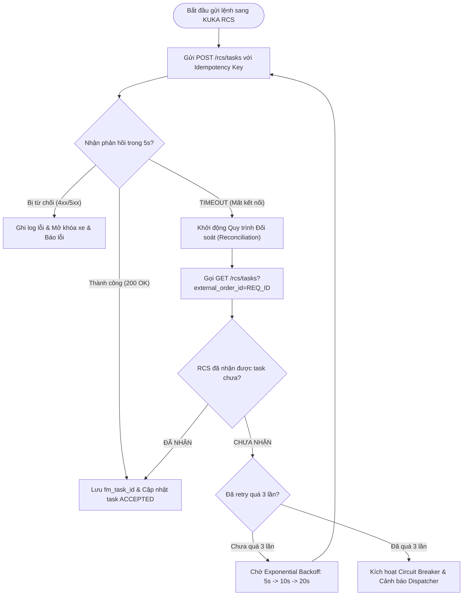

# ĐẶC TẢ VẬN HÀNH NGHIỆP VỤ & THIẾT KẾ GIAO TIẾP TÍCH HỢP HỆ THỐNG KUKA AMR
*(Operational Workflow, State Machine, RESTful API & WebSocket Specification)*

- **Dự án**: KUKA AMR Manufacturing Coordination & WIP Transfer System
- **Tài liệu**: `DOCS/operational_workflow_and_api_design.md`
- **Phiên bản**: v1.0 (Production Blueprint)
- **Ngày lập**: 15/10/2026
- **Trạng thái**: Đã khóa kiến trúc (Architecture Locked)

---

## MỤC LỤC
1. [TỔNG QUAN KIẾN TRÚC VẬN HÀNH & NGUYÊN TẮC CỐT LÕI](#1-tổng-quan-kiến-trúc-vận-hành--nguyên-tắc-cốt-lõi)
   - 1.1 Ba vòng đời trạng thái độc lập (Decoupled Lifecycles)
   - 1.2 Công thức tính khoảng cách xe gần nhất 2D Euclidean
   - 1.3 Quy tắc chống tranh chấp xe (Concurrency Control)
2. [SƠ ĐỒ TUẦN TỰ NGHIỆP VỤ (MERMAID SEQUENCE DIAGRAMS)](#2-sơ-đồ-tuần-tự-nghiệp-vụ-mermaid-sequence-diagrams)
   - 2.1 Luồng A: Cấp nguyên liệu (Raw Material Feeding -> CNC đầu tiên)
   - 2.2 Luồng B1: Chuyển giữa các CNC - Gọi xe thành công (Có xe sẵn sàng gần nhất)
   - 2.3 Luồng B2: Chuyển giữa các CNC - Hàng đợi tự động (Chưa có xe sẵn sàng)
   - 2.4 Luồng C1: Sau công đoạn cuối -> Khu tẩy rửa thành công (Còn slot trống)
   - 2.5 Luồng C2: Sau công đoạn cuối -> Hàng đợi tẩy rửa (Tất cả slot đầy)
3. [ĐẶC TẢ CHI TIẾT RESTful API](#3-đặc-tả-chi-tiết-restful-api)
   - 3.1 Nhóm API Tablet Operator tại Trạm máy (CNC & Raw Material)
   - 3.2 Nhóm API Nhân viên Khu tẩy rửa (Wash Area Station)
   - 3.3 Nhóm API Quản trị & Điều phối Admin (Dispatcher & Production Supervisor)
4. [WEBSOCKET REALTIME SPECIFICATION](#4-websocket-realtime-specification)
   - 4.1 Kiến trúc kết nối WebSocket & Quản lý Room/Channel
   - 4.2 Đặc tả WebSocket Events dành cho Tablet Operator
   - 4.3 Đặc tả WebSocket Events dành cho Màn hình giám sát 2D Canvas (Floor Supervisor)
5. [FLEET MANAGER ADAPTER INTEGRATION (KUKA RCS)](#5-fleet-manager-adapter-integration-kuka-rcs)
   - 5.1 Kiến trúc Port & Adapter (Hexagonal Architecture)
   - 5.2 Mapping Station ID nội bộ sang Fleet Manager Map Node ID
   - 5.3 Cơ chế Idempotency, Đối soát Task (Task Reconciliation) & Timeout
   - 5.4 Xử lý Tín hiệu Hoàn tất Tự động (Autonomous Drop-off Handling)
6. [CƠ CHẾ ENGINE HÀNG ĐỢI TỰ ĐỘNG (QUEUE PROCESSOR ENGINE)](#6-cơ-chế-engine-hàng-đợi-tự-động-queue-processor-engine)
   - 6.1 Cơ chế hàng đợi trạm CNC chờ xe (`transport_queue` - Type: `CNC_WAITING_CART`)
   - 6.2 Cơ chế hàng đợi khu tẩy rửa (`transport_queue` - Type: `WASH_SLOT_WAITING`)
   - 6.3 Thuật toán giải phóng hàng đợi & Tránh hiện tượng Starvation

---

## 1. TỔNG QUAN KIẾN TRÚC VẬN HÀNH & NGUYÊN TẮC CỐT LÕI

Hệ thống KUKA AMR Coordination chịu trách nhiệm điều phối dòng di chuyển của xe gá phôi (Cart/WIP) giữa khu cấp phôi, các trạm gia công CNC và khu tẩy rửa công nghiệp. Hệ thống hoạt động theo mô hình điều phối tự động kết hợp hỗ trợ công nhân vận hành tablet tại từng trạm máy.

```
+---------------------------------------------------------------------------------------------------------+
|                                           KUKA AMR COORDINATION SYSTEM                                  |
|                                                                                                         |
|  +-----------------------+     +-------------------------------+     +-------------------------------+  |
|  |  Tablet Operator UI   |     |   Admin Dispatcher Canvas     |     |    Wash Area Station UI       |  |
|  +-----------+-----------+     +---------------+---------------+     +---------------+---------------+  |
|              | HTTP/WS                         | HTTP/WS                             | HTTP/WS          |
|              +---------------------------------+-------------------------------------+                  |
|                                                |                                                        |
|                                 +--------------v---------------+                                        |
|                                 |   FastAPI Application Core   |                                        |
|                                 +--------------+---------------+                                        |
|                                                |                                                        |
|             +----------------------------------+----------------------------------+                     |
|             |                                  |                                  |                     |
|  +----------v----------+            +----------v----------+            +----------v----------+          |
|  | PostgreSQL Database |            | Redis Queue & Cache |            | Celery Background   |          |
|  | (State & Geography) |            | (PubSub Realtime)   |            | Workers (Queue Eng) |          |
|  +---------------------+            +---------------------+            +----------+----------+          |
|                                                                                   |                     |
|                                                                        +----------v----------+          |
|                                                                        | Fleet Adapter (RCS) |          |
|                                                                        +----------+----------+          |
|                                                                                   | REST/Webhook        |
+-----------------------------------------------------------------------------------|---------------------+
                                                                                    v
                                                                        +-----------------------+
                                                                        |   KUKA Fleet Manager  |
                                                                        |      (KUKA RCS)       |
                                                                        +-----------+-----------+
                                                                                    | Wi-Fi Industrial
                                                                                    v
                                                                        +-----------------------+
                                                                        |    AMR Robot Fleet    |
                                                                        +-----------------------+
```

### 1.1 Ba vòng đời trạng thái độc lập (Decoupled Lifecycles)
> [!IMPORTANT]
> Tuyệt đối **không được gộp** 3 vòng đời trạng thái này vào cùng một cột enum. Mỗi vòng đời mô tả một góc nhìn thực thể hoàn toàn độc lập và có điều kiện chuyển đổi riêng biệt.



#### Ma trận phân định ranh giới sự kiện
| Sự kiện thực tế | Yêu cầu vận chuyển (`transport_request`) | Tiến độ Cart (`item_stock`) | Task Fleet Robot (`fleet_task`) |
| :--- | :--- | :--- | :--- |
| **Công nhân bấm gọi xe** | Tạo mới `PENDING` (hoặc `QUEUED`) | Giữ nguyên trạng thái hiện tại | Chưa tồn tại (`None`) |
| **Hệ thống tìm thấy xe gần nhất** | Chuyển sang `ASSIGNED` | Cập nhật `is_locked=True` | Khởi tạo `SUBMITTED` |
| **RCS xác nhận tiếp nhận task** | Chuyển sang `DISPATCHED` | Giữ nguyên `is_locked=True` | Chuyển sang `ACCEPTED` |
| **AMR nâng xe tại trạm nguồn** | Chuyển sang `IN_TRANSIT` | Chuyển sang `TRANSFERRING` | Chuyển sang `CART_PICKED_UP` |
| **AMR tự động hạ xe tại trạm đích** | Chuyển sang `DELIVERED` | Đổi `location_id`, `READY_TO_PROCESS`, `is_locked=False` | Chuyển sang `COMPLETED` |
| **Công nhân bấm bắt đầu gá phôi** | Không thay đổi (`DELIVERED`) | Chuyển sang `PROCESSING` | Không thay đổi |
| **Công nhân bấm hoàn thành gia công**| Không thay đổi | Chuyển sang `STEP_COMPLETED`, ghi nhận `production_record` | Không thay đổi |

---

### 1.2 Công thức tính khoảng cách xe gần nhất 2D Euclidean
Để tối ưu quãng đường di chuyển và thời gian chờ của dây chuyền, hệ thống tính toán khoảng cách giữa vị trí hiện tại của các xe ứng viên và vị trí trạm CNC đích bằng công thức **2D Euclidean Distance**:

$$\text{Distance}(P_{dest}, P_{cart}) = \sqrt{(map\_x_{dest} - map\_x_{cart})^2 + (map\_y_{dest} - map\_y_{cart})^2}$$

Trong đó:
- $(map\_x_{dest}, map\_y_{dest})$: Tọa độ xưởng của trạm máy gọi xe (`location` đích).
- $(map\_x_{cart}, map\_y_{cart})$: Tọa độ của trạm nơi xe đang đỗ (`location` nguồn của `item_stock`).

#### Bộ lọc Cart hợp lệ (Eligibility Predicate)
Một cart $C$ chỉ được đưa vào tập ứng viên tính khoảng cách khi và chỉ khi thỏa mãn đồng thời 4 điều kiện:
1. **Model Match**: $C.item\_id = Model_{requested}$
2. **Step Prerequisite**:
   - Nếu là Luồng B: $C.last\_completed\_step\_id = Step_{previous}$ của Route quy định cho Model đó.
   - Nếu là Luồng A: $C$ đang đỗ tại `RAW_MATERIAL_SLOT` tương ứng với Model và có trạng thái `RAW_READY`.
3. **Route Destination Validity**: Trạm CNC đích phải là một bước kế tiếp hợp lệ trong bảng `route_step` (hỗ trợ cả trạm đơn hoặc máy thay thế song song, ví dụ CNC-03 OR CNC-04).
4. **Lock & Availability Check**: $C.is\_locked = \text{False}$ và $C.status \in \{\text{'available'}, \text{'STEP_COMPLETED'}, \text{'RAW_READY'}\}$.

*Thuật toán chọn lựa*:
- Nếu tập ứng viên rỗng $\rightarrow$ Đưa yêu cầu vào hàng đợi tự động `transport_queue`.
- Nếu tập ứng viên có $\ge 1$ xe $\rightarrow$ Chọn xe có khoảng cách Euclidean nhỏ nhất. Trường hợp có $\ge 2$ xe có khoảng cách bằng nhau, xe nào bấm hoàn thành công đoạn trước (FIFO theo `completed_at`) sẽ được ưu tiên.

---

### 1.3 Quy tắc chống tranh chấp xe (Concurrency Control)
Khi có 2 trạm máy song song cùng gọi một Model (ví dụ: CNC-03 và CNC-04 cùng cần phôi của Model A từ CNC-01):
1. **Row-level Lock Pessimistic**: Sử dụng cơ chế khóa hàng của PostgreSQL `SELECT ... FOR UPDATE SKIP LOCKED` trong giao dịch điều phối.
2. Máy gửi request tới API trước sẽ chiếm được khóa Cart, thiết lập $C.is\_locked = \text{True}$ và $C.locked\_by_request\_id = REQ\_ID$.
3. Máy gửi request sau vài mili-giây không thấy xe khả dụng sẽ lập tức nhận kết quả xếp hàng và được đưa vào bảng `transport_queue` với trạng thái `WAITING_FOR_CART`.

---

## 2. SƠ ĐỒ TUẦN TỰ NGHIỆP VỤ (MERMAID SEQUENCE DIAGRAMS)

### 2.1 Luồng A: Cấp nguyên liệu (Raw Material Feeding -> CNC đầu tiên)
*Bối cảnh*: Công nhân tại CNC đầu tiên (hoặc tablet đầu chuyền) chọn Model A. AMR lấy xe từ slot nguyên liệu chở thẳng tới trạm CNC đầu tiên của Model A. AMR tự động hạ xe (autonomous drop-off), không yêu cầu công nhân bấm xác nhận nhận xe.



---

### 2.2 Luồng B1: Chuyển giữa các CNC - Gọi xe thành công (Có xe sẵn sàng gần nhất)
*Bối cảnh*: Công nhân tại CNC-03 chọn Model A. Hệ thống quét toàn map xưởng, tìm thấy Cart C-102 tại CNC-01 đã hoàn thành gia công công đoạn 1. Hệ thống tính khoảng cách Euclidean, khóa cart và điều AMR chuyển sang CNC-03.



---

### 2.3 Luồng B2: Chuyển giữa các CNC - Hàng đợi tự động (Chưa có xe sẵn sàng)
*Bối cảnh*: Công nhân tại CNC-03 gọi Model A, nhưng Cart tại CNC-01 chưa gia công xong. Hệ thống không báo lỗi cụt ngủn mà tự động đưa vào hàng đợi `transport_queue`. Khi công nhân tại CNC-01 bấm hoàn thành, Background Worker lập tức khớp lệnh và điều AMR tới CNC-03.

```mermaid
sequenceDiagram
    autonumber
    actor Worker3 as Công nhân CNC-03
    participant Tab3 as Tablet UI CNC-03
    participant API as FastAPI Backend
    participant DB as PostgreSQL
    participant WorkerQueue as Celery Background Worker
    actor Worker1 as Công nhân CNC-01
    participant Tab1 as Tablet UI CNC-01
    participant Adapter as Fleet Manager Adapter
    participant RCS as KUKA Fleet Manager

    Worker3->>Tab3: Chọn Model A, bấm "Gọi xe phôi"
    Tab3->>API: POST /api/v1/operator/stations/CNC-03/call-cart {"model_code": "MODEL_A"}
    activate API
    API->>DB: Quét tìm Cart Model A đã hoàn thành công đoạn trước (Step 1)
    DB-->>API: 0 Cart available (Xe đang chạy hoặc chưa xong)
    
    API->>DB: INSERT INTO transport_queue (queue_type: 'CNC_WAITING_CART', destination_location_id: CNC-03, item_id: MODEL_A, status: 'WAITING')
    DB-->>API: Created Queue Item Q-501 (Vị trí 1 trong hàng đợi)
    API-->>Tab3: 202 Accepted {"status": "QUEUED", "queue_id": "Q-501", "queue_position": 1, "message": "Chưa có xe sẵn sàng. Đã vào hàng đợi tự động."}
    deactivate API
    Tab3-->>Worker3: Hiển thị trạng thái: "Đang xếp hàng chờ xe công đoạn trước..."

    Note over Worker1,Tab1: Thời gian sau: CNC-01 gia công xong mẻ phôi Model A trên Cart C-101
    Worker1->>Tab1: Bấm "Hoàn thành công đoạn CNC-01"
    Tab1->>API: POST /api/v1/operator/stations/CNC-01/complete-stage {"cart_code": "C-101"}
    activate API
    API->>DB: UPDATE item_stock SET last_completed_step_id=Step_1, status='STEP_COMPLETED' WHERE cart_code="C-101"
    API->>DB: INSERT INTO production_record (cart: C-101, station: CNC-01, operator_id: OP-01, completed_at: NOW)
    API-->>Tab1: 200 OK {"message": "Đã ghi nhận hoàn thành công đoạn"}
    
    API->>WorkerQueue: trigger_async_task: evaluate_transport_queue(model_id=MODEL_A)
    deactivate API

    activate WorkerQueue
    WorkerQueue->>DB: SELECT * FROM transport_queue WHERE status='WAITING' AND item_id=MODEL_A ORDER BY created_at ASC FOR UPDATE SKIP LOCKED
    DB-->>WorkerQueue: Trả về Q-501 (Đang chờ cho CNC-03)
    WorkerQueue->>DB: SELECT * FROM item_stock WHERE cart_code='C-101' AND is_locked=false FOR UPDATE
    DB-->>WorkerQueue: Cart C-101 thỏa mãn
    
    WorkerQueue->>DB: UPDATE transport_queue SET status='PROCESSING', matched_cart_id=C-101 WHERE id='Q-501'
    WorkerQueue->>DB: UPDATE item_stock SET is_locked=true, locked_by_request_id=REQ-B-3001
    WorkerQueue->>DB: INSERT INTO transport_request (code: REQ-B-3001, from: CNC-01, to: CNC-03, cart: C-101, status: 'ASSIGNED')
    WorkerQueue->>DB: INSERT INTO fleet_task (transport_request_id: REQ-B-3001, status: 'SUBMITTED')
    
    WorkerQueue->>Adapter: submit_transport_task(REQ-B-3001)
    deactivate WorkerQueue
    
    Adapter->>RCS: POST /rcs/v1/tasks/dispatch {pickup: "NODE_CNC_01", dropoff: "NODE_CNC_03"}
    RCS-->>Adapter: 200 OK
    Adapter->>API: Push WebSocket to CNC-03: "CART_MATCHED_AND_DISPATCHED"
    API-->>Tab3: Cập nhật giao diện: "Đã có xe C-101 từ CNC-01 đang được AMR chuyển tới!"
```



---

### 2.4 Luồng C1: Sau công đoạn cuối -> Khu tẩy rửa thành công (Còn slot trống)
*Bối cảnh*: Công nhân tại CNC cuối (ví dụ CNC-05) hoàn thành gia công. Hệ thống kiểm tra khu tẩy rửa còn slot trống (ví dụ WASH-02 trống). Hệ thống lập tức giữ slot WASH-02 và điều AMR chuyển xe sang khu tẩy rửa.



---

### 2.5 Luồng C2: Sau công đoạn cuối -> Hàng đợi tẩy rửa (Tất cả slot đầy)
*Bối cảnh*: Công nhân tại CNC-05 bấm hoàn thành công đoạn cuối, nhưng toàn bộ slot khu tẩy rửa đều đang có xe chờ. Xe tạm thời nằm chờ tại bàn máy CNC-05 và vào `transport_queue` (Type: `WASH_SLOT_WAITING`). Khi nhân viên khu tẩy rửa lấy 1 xe đi rửa và bấm giải phóng slot, Background Task tự động kích hoạt AMR lấy xe tại CNC-05 đưa sang.

```mermaid
sequenceDiagram
    autonumber
    actor WorkerCNC as Công nhân CNC-05
    participant TabCNC as Tablet UI CNC-05
    participant API as FastAPI Backend
    participant DB as PostgreSQL
    participant WorkerQueue as Celery Background Worker
    actor WorkerWash as Nhân viên Khu Tẩy Rửa
    participant TabWash as Terminal Khu Tẩy Rửa
    participant Adapter as Fleet Manager Adapter
    participant RCS as KUKA Fleet Manager

    WorkerCNC->>TabCNC: Bấm "Hoàn thành công đoạn cuối & Chuyển Tẩy Rửa"
    TabCNC->>API: POST /api/v1/operator/stations/CNC-05/complete-final-stage {"cart_code": "C-205"}
    activate API
    API->>DB: Quét toàn bộ slot khu tẩy rửa (WASH-01, WASH-02, WASH-03)
    DB-->>API: 0 slot trống (Tất cả 3/3 slot đều đang bận)
    
    API->>DB: UPDATE item_stock SET status='WASH_QUEUED', last_completed_step_id=Step_Final WHERE cart_code="C-205"
    API->>DB: INSERT INTO transport_queue (queue_type: 'WASH_SLOT_WAITING', source_location_id: CNC-05, cart_stock_id: C-205, status: 'WAITING')
    DB-->>API: Queue Item WQ-701 created
    API-->>TabCNC: 202 Accepted {"status": "WASH_QUEUED", "queue_id": "WQ-701", "message": "Khu tẩy rửa hiện đầy. Xe chờ tại bàn máy và đã vào hàng đợi tự động."}
    deactivate API
    TabCNC-->>WorkerCNC: Hiển thị: "Khu tẩy rửa đầy. Cart C-205 đang chờ tại trạm, hệ thống sẽ tự động gọi AMR ngay khi có chỗ!"

    Note over WorkerWash,TabWash: Sau đó: Nhân viên khu tẩy rửa lấy xe tại WASH-01 đưa vào bồn rửa cơ khí
    WorkerWash->>TabWash: Bấm "Giải phóng slot WASH-01" (Đã lấy xe đi rửa)
    TabWash->>API: POST /api/v1/wash/slots/WASH-01/release
    activate API
    API->>DB: Cập nhật vị trí xe cũ rời slot: UPDATE item_stock SET location_id=NULL, status='IN_MANUAL_WASH'
    API->>DB: Đánh dấu slot WASH-01 TRỐNG
    API-->>TabWash: 200 OK {"slot_code": "WASH-01", "status": "AVAILABLE"}
    
    API->>WorkerQueue: trigger_async_task: evaluate_wash_queue(freed_slot_id=WASH-01)
    deactivate API

    activate WorkerQueue
    WorkerQueue->>DB: Lấy yêu cầu chờ tẩy rửa lâu nhất (FIFO):<br/>SELECT * FROM transport_queue WHERE queue_type='WASH_SLOT_WAITING' AND status='WAITING' ORDER BY created_at ASC FOR UPDATE SKIP LOCKED
    DB-->>WorkerQueue: Tìm thấy WQ-701 (Cart C-205 tại CNC-05)
    
    WorkerQueue->>DB: Khóa slot WASH-01 & Khóa Cart C-205 (is_locked=true)
    WorkerQueue->>DB: UPDATE transport_queue SET status='PROCESSING', assigned_destination_id=WASH-01 WHERE id='WQ-701'
    WorkerQueue->>DB: INSERT INTO transport_request (code: REQ-C-5001, from: CNC-05, to: WASH-01, cart: C-205, status: 'ASSIGNED')
    WorkerQueue->>DB: INSERT INTO fleet_task (status: 'SUBMITTED', pickup: CNC-05, dropoff: WASH-01)
    
    WorkerQueue->>Adapter: submit_transport_task(REQ-C-5001)
    deactivate WorkerQueue
    
    Adapter->>RCS: POST /rcs/v1/tasks/dispatch {pickup: "NODE_CNC_05", dropoff: "NODE_WASH_01"}
    RCS-->>Adapter: 200 OK
    Adapter->>API: Push WebSocket to CNC-05: "WASH_QUEUE_TRIGGERED"
    API-->>TabCNC: Hiển thị: "Đã có slot trống WASH-01! Robot AMR đang tới giải phóng bàn máy."
```



---

## 3. ĐẶC TẢ CHI TIẾT RESTful API

Tất cả các API tuân theo chuẩn RESTful JSON, sử dụng HTTP Status Codes tiêu chuẩn và xác thực qua Bearer JWT Token (`Authorization: Bearer <token>`). Các endpoint dành cho Tablet Operator được tối ưu thời gian phản hồi (< 100ms) và tối giản trường nhập liệu.

### 3.1 Nhóm API Tablet Operator tại Trạm máy (CNC & Raw Material)

#### 3.1.1 Lấy danh sách Model khả dụng tại trạm máy
- **Endpoint**: `GET /api/v1/operator/stations/{location_code}/available-models`
- **Mô tả**: Tablet gọi khi mở ứng dụng để render danh sách các Model mà trạm máy này được phép gia công theo `production_route`, kèm theo số lượng xe phôi sẵn sàng ở công đoạn trước.
- **Path Parameters**: `location_code` (string, ví dụ: `CNC-01`, `CNC-03`)
- **Response 200 OK**:
```json
{
  "station_code": "CNC-03",
  "station_name": "Trạm phay CNC 03",
  "zone_name": "Khu vực gia công cơ",
  "models": [
    {
      "model_id": 1,
      "model_code": "MODEL_A",
      "model_name": "Trục khuỷu Model A",
      "step_order": 2,
      "step_name": "Phay tinh mặt đầu",
      "is_raw_feeding_station": false,
      "ready_carts_count": 2,
      "waiting_in_queue_count": 0
    },
    {
      "model_id": 2,
      "model_code": "MODEL_B",
      "model_name": "Vỏ hộp số Model B",
      "step_order": 1,
      "step_name": "Phay thô",
      "is_raw_feeding_station": false,
      "ready_carts_count": 0,
      "waiting_in_queue_count": 1
    }
  ]
}
```

---

#### 3.1.2 Gọi xe chuyển giữa các CNC (Luồng B)
- **Endpoint**: `POST /api/v1/operator/stations/{location_code}/call-cart`
- **Mô tả**: Công nhân chỉ cần chọn Model. Hệ thống tự động quét map tìm cart gần nhất theo Euclidean 2D. Nếu không có xe, tự động đưa vào hàng đợi `transport_queue`.
- **Request Body**:
```json
{
  "model_code": "MODEL_A"
}
```

- **Response 200 OK** *(Trường hợp tìm thấy xe gần nhất và phát lệnh)*:
```json
{
  "status": "DISPATCHED",
  "request_code": "REQ-20261015-0012",
  "matched_cart": {
    "cart_code": "CART-A-102",
    "source_station_code": "CNC-01",
    "source_station_name": "Trạm tiện CNC 01",
    "distance_meters": 14.21,
    "last_completed_step": "Tiện thô mặt ngoài"
  },
  "destination_station_code": "CNC-03",
  "estimated_arrival_seconds": 45,
  "message": "Đã tìm thấy xe gần nhất CART-A-102 tại CNC-01 (cách 14.2m). AMR đang di chuyển lấy xe!"
}
```

- **Response 202 Accepted** *(Trường hợp chưa có xe sẵn sàng $\rightarrow$ Vào hàng đợi)*:
```json
{
  "status": "QUEUED",
  "queue_id": "QUEUE-20261015-0005",
  "queue_position": 1,
  "model_code": "MODEL_A",
  "destination_station_code": "CNC-03",
  "created_at": "2026-10-15T04:45:10Z",
  "message": "Hiện chưa có xe Model A hoàn thành công đoạn trước. Yêu cầu đã được lưu vào hàng đợi tự động. Robot sẽ tự điều xe ngay khi có mẻ hoàn thành."
}
```

- **Response 409 Conflict** *(Trường hợp trạm máy đang có xe đỗ hoặc đang có lệnh gọi chưa hoàn tất)*:
```json
{
  "detail": "Trạm CNC-03 hiện đang có xe CART-A-099 đang gia công. Vui lòng hoàn thành công đoạn trước khi gọi xe mới!"
}
```

---

#### 3.1.3 Cấp nguyên liệu tới CNC đầu tiên (Luồng A)
- **Endpoint**: `POST /api/v1/operator/stations/{location_code}/call-raw-material`
- **Mô tả**: Yêu cầu AMR lấy xe từ slot nguyên liệu chở thẳng tới CNC đầu tiên của Model.
- **Request Body**:
```json
{
  "model_code": "MODEL_A"
}
```
- **Response 200 OK**:
```json
{
  "status": "DISPATCHED",
  "request_code": "REQ-RAW-20261015-0003",
  "matched_cart": {
    "cart_code": "CART-RAW-004",
    "source_slot_code": "RAW-A-01",
    "source_slot_name": "Khu cấp phôi Model A - Slot 1"
  },
  "destination_station_code": "CNC-01",
  "message": "Đã điều AMR tới slot RAW-A-01 để lấy xe phôi CART-RAW-004 chuyển về CNC-01."
}
```

---

#### 3.1.4 Hủy yêu cầu chờ xe trong hàng đợi
- **Endpoint**: `DELETE /api/v1/operator/stations/{location_code}/queue/{queue_id}`
- **Mô tả**: Cho phép công nhân hủy yêu cầu đang nằm trong hàng đợi nếu trạm thay đổi kế hoạch sản xuất (chỉ áp dụng khi yêu cầu vẫn ở trạng thái `WAITING`).
- **Response 200 OK**:
```json
{
  "queue_id": "QUEUE-20261015-0005",
  "status": "CANCELLED",
  "message": "Đã hủy yêu cầu chờ xe thành công."
}
```

---

#### 3.1.5 Bấm hoàn thành công đoạn gia công hiện tại
- **Endpoint**: `POST /api/v1/operator/stations/{location_code}/complete-stage`
- **Mô tả**: Công nhân bấm xác nhận hoàn thành công đoạn gia công trên cart đang ở trạm. Ghi nhận `production_record` và kích hoạt giải phóng hàng đợi ngầm.
- **Request Body**:
```json
{
  "cart_code": "CART-A-102",
  "quantity_good": 10,
  "quantity_defect": 0,
  "operator_notes": "Gia công chuẩn kích thước"
}
```
- **Response 200 OK**:
```json
{
  "status": "SUCCESS",
  "cart_code": "CART-A-102",
  "completed_step_name": "Tiện thô mặt ngoài",
  "completed_at": "2026-10-15T05:10:22Z",
  "is_final_step": false,
  "next_valid_stations": ["CNC-03", "CNC-04"],
  "message": "Đã ghi nhận hoàn thành công đoạn. Xe đã sẵn sàng cho công đoạn tiếp theo."
}
```

---

#### 3.1.6 Bấm hoàn thành công đoạn cuối & Kích hoạt chuyển Tẩy Rửa (Luồng C)
- **Endpoint**: `POST /api/v1/operator/stations/{location_code}/complete-final-stage`
- **Mô tả**: Bấm hoàn thành tại CNC cuối. Hệ thống kiểm tra slot tẩy rửa: nếu còn slot $\rightarrow$ điều AMR chuyển đi; nếu hết slot $\rightarrow$ đưa vào Wash Queue và xe chờ tại bàn máy.
- **Request Body**:
```json
{
  "cart_code": "CART-A-102",
  "quantity_good": 10,
  "quantity_defect": 0
}
```

- **Response 200 OK** *(Khu tẩy rửa còn slot trống)*:
```json
{
  "status": "DISPATCHED_TO_WASH",
  "request_code": "REQ-WASH-20261015-0008",
  "cart_code": "CART-A-102",
  "assigned_wash_slot": "WASH-02",
  "message": "Hoàn thành công đoạn cuối. Đã chỉ định slot tẩy rửa WASH-02. Robot AMR đang tới lấy xe."
}
```

- **Response 202 Accepted** *(Khu tẩy rửa đầy slot $\rightarrow$ Vào Wash Queue)*:
```json
{
  "status": "WASH_QUEUED",
  "queue_id": "WASH-QUEUE-20261015-0002",
  "cart_code": "CART-A-102",
  "station_code": "CNC-05",
  "queue_position": 1,
  "message": "Hoàn thành công đoạn cuối. Hiện tại tất cả 3 slot khu tẩy rửa đều đầy. Xe tạm đỗ tại CNC-05 và đã vào hàng đợi tự động."
}
```

---

#### 3.1.7 Lấy trạng thái hiện tại của trạm máy
- **Endpoint**: `GET /api/v1/operator/stations/{location_code}/current-status`
- **Mô tả**: Trả về tình trạng hiện tại của trạm máy (cart đang đỗ, cart đang trên đường tới, trạng thái queue).
- **Response 200 OK**:
```json
{
  "station_code": "CNC-03",
  "current_state": "WAITING_FOR_CART",
  "docked_cart": null,
  "incoming_cart": {
    "cart_code": "CART-A-102",
    "request_code": "REQ-20261015-0012",
    "amr_id": "KUKA-AMR-02",
    "amr_status": "ROBOT_EN_ROUTE_DROPOFF",
    "estimated_seconds_left": 18
  },
  "active_queue": null
}
```

---

### 3.2 Nhóm API Nhân viên Khu tẩy rửa (Wash Area Station)

#### 3.2.1 Danh sách trạng thái các Slot Tẩy Rửa
- **Endpoint**: `GET /api/v1/wash/slots`
- **Response 200 OK**:
```json
{
  "total_slots": 3,
  "occupied_slots": 2,
  "available_slots": 1,
  "slots": [
    {
      "slot_code": "WASH-01",
      "slot_name": "Bàn chờ tẩy rửa 01",
      "is_occupied": true,
      "cart_code": "CART-A-088",
      "model_code": "MODEL_A",
      "arrived_at": "2026-10-15T04:20:00Z"
    },
    {
      "slot_code": "WASH-02",
      "slot_name": "Bàn chờ tẩy rửa 02",
      "is_occupied": false,
      "cart_code": null,
      "model_code": null,
      "arrived_at": null
    },
    {
      "slot_code": "WASH-03",
      "slot_name": "Bàn chờ tẩy rửa 03",
      "is_occupied": true,
      "cart_code": "CART-B-041",
      "model_code": "MODEL_B",
      "arrived_at": "2026-10-15T04:35:10Z"
    }
  ]
}
```

#### 3.2.2 Xác nhận lấy xe ra khỏi slot đi rửa (Giải phóng Slot)
- **Endpoint**: `POST /api/v1/wash/slots/{slot_code}/release`
- **Mô tả**: Nhân viên tẩy rửa bấm xác nhận khi kéo xe từ slot chờ vào bồn rửa cơ khí. Hệ thống giải phóng slot và lập tức quét Wash Queue để kích hoạt AMR kéo xe từ CNC cuối vào.
- **Request Body**:
```json
{
  "cart_code": "CART-A-088",
  "notes": "Chuyển vào bồn siêu âm"
}
```
- **Response 200 OK**:
```json
{
  "slot_code": "WASH-01",
  "is_occupied": false,
  "auto_dispatched_queue": {
    "has_dispatched": true,
    "queue_id": "WASH-QUEUE-20261015-0002",
    "dispatched_cart_code": "CART-A-102",
    "pickup_station": "CNC-05",
    "message": "Đã giải phóng slot. Hệ thống tự động kích hoạt AMR lấy xe CART-A-102 từ CNC-05 sang slot WASH-01!"
  }
}
```

---

### 3.3 Nhóm API Quản trị & Điều phối Admin (Dispatcher & Production Supervisor)

#### 3.3.1 Danh sách Route sản xuất theo Model
- **Endpoint**: `GET /api/v1/admin/routes`
- **Response 200 OK**:
```json
[
  {
    "route_id": 1,
    "model_id": 1,
    "model_code": "MODEL_A",
    "model_name": "Trục khuỷu Model A",
    "route_name": "Dây chuyền chuẩn Trục khuỷu A",
    "version": 1,
    "is_active": true,
    "steps": [
      {
        "step_order": 1,
        "step_name": "Tiện thô mặt ngoài",
        "station_code": "CNC-01",
        "station_name": "Trạm tiện CNC 01",
        "is_parallel_group": false
      },
      {
        "step_order": 2,
        "step_name": "Phay tinh mặt đầu",
        "station_code": "CNC-03",
        "station_name": "Trạm phay CNC 03",
        "is_parallel_group": true,
        "parallel_group_code": "GRP_PHAY_01"
      },
      {
        "step_order": 2,
        "step_name": "Phay tinh mặt đầu (Dự phòng)",
        "station_code": "CNC-04",
        "station_name": "Trạm phay CNC 04",
        "is_parallel_group": true,
        "parallel_group_code": "GRP_PHAY_01"
      },
      {
        "step_order": 3,
        "step_name": "Mài bóng trục",
        "station_code": "CNC-05",
        "station_name": "Trạm mài CNC 05",
        "is_parallel_group": false
      }
    ]
  }
]
```

#### 3.3.2 Cập nhật Route sản xuất (Có điều kiện khóa xe đang chạy)
- **Endpoint**: `PUT /api/v1/admin/routes/{route_id}`
- **Quy tắc nghiệp vụ**: Chỉ cho phép chỉnh sửa khi không có bất kỳ cart nào của Model này đang ở trạng thái `TRANSFERRING` hoặc `PROCESSING`.
- **Response 409 Conflict** *(Nếu vi phạm)*:
```json
{
  "detail": "Không thể cập nhật Route: Hiện có 2 xe Model A đang trong tiến trình gia công/vận chuyển (CART-A-102 tại CNC-01, CART-A-099 tại CNC-03). Vui lòng hoàn thành toàn bộ mẻ trước khi đổi Route!"
}
```

#### 3.3.3 Xem danh sách toàn bộ Cart Realtime trên Layout xưởng
- **Endpoint**: `GET /api/v1/admin/carts/realtime`
- **Response 200 OK**:
```json
[
  {
    "cart_code": "CART-A-102",
    "model_code": "MODEL_A",
    "status": "PROCESSING",
    "is_locked": false,
    "current_location": {
      "location_code": "CNC-03",
      "location_name": "Trạm phay CNC 03",
      "map_x": 450,
      "map_y": 280,
      "zone_name": "Khu sản xuất"
    },
    "current_step": {
      "step_order": 2,
      "step_name": "Phay tinh mặt đầu"
    },
    "active_transport_request": null
  }
]
```

#### 3.3.4 Xem toàn bộ hàng đợi vận chuyển (Transport & Wash Queue)
- **Endpoint**: `GET /api/v1/admin/queues`
- **Response 200 OK**:
```json
{
  "transport_queues": [
    {
      "queue_id": "QUEUE-20261015-0005",
      "queue_type": "CNC_WAITING_CART",
      "model_code": "MODEL_B",
      "destination_station": "CNC-02",
      "status": "WAITING",
      "priority_weight": 10,
      "waiting_seconds": 185
    }
  ],
  "wash_queues": [
    {
      "queue_id": "WASH-QUEUE-20261015-0002",
      "queue_type": "WASH_SLOT_WAITING",
      "cart_code": "CART-A-105",
      "source_station": "CNC-05",
      "status": "WAITING",
      "priority_weight": 20,
      "waiting_seconds": 320
    }
  ]
}
```

---

## 4. WEBSOCKET REALTIME SPECIFICATION

### 4.1 Kiến trúc kết nối WebSocket & Quản lý Room/Channel
Hệ thống sử dụng FastAPI WebSocket kết hợp Redis PubSub để hỗ trợ Scale ngang (multi-instance):
- Kênh Tablet Trạm: `/ws/v1/operator/{location_code}`
- Kênh Giám sát Canvas 2D Floor Supervisor: `/ws/v1/monitor/floor-canvas`
- Cơ chế Heartbeat: Ping/Pong mỗi 30 giây; sau 60 giây không phản hồi sẽ tự động ngắt kết nối và giải phóng resource.



---

### 4.2 Đặc tả WebSocket Events dành cho Tablet Operator

Cấu trúc message JSON chuẩn:
```json
{
  "event": "EVENT_NAME",
  "timestamp": "2026-10-15T04:45:12.450Z",
  "station_code": "CNC-03",
  "data": { ... }
}
```

#### 1. Sự kiện `CART_ASSIGNED` (Đã tìm thấy xe và gán cho trạm)
```json
{
  "event": "CART_ASSIGNED",
  "timestamp": "2026-10-15T04:45:12.450Z",
  "station_code": "CNC-03",
  "data": {
    "request_code": "REQ-20261015-0012",
    "cart_code": "CART-A-102",
    "model_code": "MODEL_A",
    "source_station_code": "CNC-01",
    "distance_meters": 14.21,
    "status": "ASSIGNED"
  }
}
```

#### 2. Sự kiện `CART_PICKED_UP` (AMR đã nâng xe tại nguồn, đang trên đường tới)
```json
{
  "event": "CART_PICKED_UP",
  "timestamp": "2026-10-15T04:45:30.120Z",
  "station_code": "CNC-03",
  "data": {
    "request_code": "REQ-20261015-0012",
    "cart_code": "CART-A-102",
    "amr_id": "KUKA-AMR-01",
    "status": "IN_TRANSIT",
    "estimated_arrival_seconds": 25
  }
}
```

#### 3. Sự kiện `CART_ARRIVED` (AMR đã hạ xe an toàn tại trạm)
```json
{
  "event": "CART_ARRIVED",
  "timestamp": "2026-10-15T04:45:55.800Z",
  "station_code": "CNC-03",
  "data": {
    "request_code": "REQ-20261015-0012",
    "cart_code": "CART-A-102",
    "model_code": "MODEL_A",
    "step_name": "Phay tinh mặt đầu",
    "status": "READY_TO_PROCESS",
    "message": "Xe đã hạ thành công. Công nhân có thể bắt đầu gá phôi gia công!"
  }
}
```

#### 4. Sự kiện `QUEUE_ENTERED` (Yêu cầu được đưa vào hàng đợi)
```json
{
  "event": "QUEUE_ENTERED",
  "timestamp": "2026-10-15T04:46:00.000Z",
  "station_code": "CNC-03",
  "data": {
    "queue_id": "QUEUE-20261015-0005",
    "queue_position": 1,
    "model_code": "MODEL_A",
    "message": "Đang xếp hàng chờ xe công đoạn trước hoàn thành..."
  }
}
```

#### 5. Sự kiện `WASH_QUEUE_TRIGGERED` (Slot tẩy rửa trống, AMR đang tới giải phóng bàn máy)
```json
{
  "event": "WASH_QUEUE_TRIGGERED",
  "timestamp": "2026-10-15T04:50:15.000Z",
  "station_code": "CNC-05",
  "data": {
    "cart_code": "CART-A-105",
    "assigned_wash_slot": "WASH-01",
    "message": "Khu tẩy rửa đã có chỗ trống! AMR đang tới đưa xe đi."
  }
}
```

---

### 4.3 Đặc tả WebSocket Events dành cho Màn hình giám sát 2D Canvas (Floor Supervisor)

#### 1. Sự kiện `AMR_COORDINATE_UPDATED` (Tọa độ AMR realtime)
Tần suất phát: 500ms / lần từ KUKA RCS.
```json
{
  "event": "AMR_COORDINATE_UPDATED",
  "timestamp": "2026-10-15T04:45:32.500Z",
  "data": {
    "amr_id": "KUKA-AMR-01",
    "pos_x": 412.5,
    "pos_y": 275.0,
    "angle_degree": 90.0,
    "battery_percent": 87,
    "current_speed_mps": 0.8,
    "state": "NAVIGATING",
    "carrying_cart_code": "CART-A-102"
  }
}
```

#### 2. Sự kiện `CART_LOCATION_MOVED` (Vị trí Cart trên layout đổi chỗ)
```json
{
  "event": "CART_LOCATION_MOVED",
  "timestamp": "2026-10-15T04:45:55.820Z",
  "data": {
    "cart_code": "CART-A-102",
    "from_location_code": "CNC-01",
    "to_location_code": "CNC-03",
    "map_x": 450,
    "map_y": 280,
    "status": "READY_TO_PROCESS"
  }
}
```

#### 3. Sự kiện `STATION_STATUS_CHANGED` (Trạng thái trạm máy đổi màu trên Canvas)
```json
{
  "event": "STATION_STATUS_CHANGED",
  "timestamp": "2026-10-15T04:45:55.850Z",
  "data": {
    "station_code": "CNC-03",
    "operational_state": "OCCUPIED_WAITING_WORKER",
    "color_code": "#FFB800",
    "docked_cart_code": "CART-A-102"
  }
}
```

---

## 5. FLEET MANAGER ADAPTER INTEGRATION (KUKA RCS)

### 5.1 Kiến trúc Port & Adapter (Hexagonal Architecture)
Để cô lập nghiệp vụ xưởng khỏi các thay đổi đặc thù của giao thức nhà cung cấp KUKA RCS, hệ thống sử dụng kiến trúc Port & Adapter chuẩn mực:

```python
# app/modules/fleet_adapter/ports.py
from abc import ABC, abstractmethod
from pydantic import BaseModel
from typing import Optional

class FleetTaskSpec(BaseModel):
    task_order_id: str             # Request code nội bộ (e.g., REQ-B-2001)
    pickup_node_id: str            # Node ID của trạm nguồn trên map RCS
    dropoff_node_id: str           # Node ID của trạm đích trên map RCS
    cart_code: str                 # Mã Cart vật lý
    priority: int = 5              # 1 (Thấp) -> 10 (Cao)

class FleetTaskResponse(BaseModel):
    is_success: bool
    fm_task_id: Optional[str] = None
    error_code: Optional[int] = None
    error_message: Optional[str] = None

class IFleetManagerAdapter(ABC):
    @abstractmethod
    async def submit_transport_task(self, spec: FleetTaskSpec) -> FleetTaskResponse:
        """Gửi lệnh vận chuyển sang KUKA RCS."""
        pass

    @abstractmethod
    async def query_task_status(self, fm_task_id: str) -> dict:
        """Đối soát trạng thái task từ KUKA RCS."""
        pass

    @abstractmethod
    async def abort_task(self, fm_task_id: str, reason: str) -> bool:
        """Hủy task khẩn cấp."""
        pass
```

---

### 5.2 Mapping Station ID nội bộ sang Fleet Manager Map Node ID
Bảng ánh xạ giữa mã `location_code` quản lý trong xưởng và `node_id` vật lý trên bản đồ dẫn đường của KUKA Fleet Manager:

| Vị trí nội bộ (`location_code`) | Tên trạm thực tế | Tọa độ Map Xưởng (`map_x`, `map_y`) | RCS Map Node ID (`node_name`) | Ghi chú |
| :--- | :--- | :--- | :--- | :--- |
| `RAW-A-01` | Slot Cấp phôi Model A | (100, 100) | `NODE_1001` | Trạm lấy phôi đầu chuyền |
| `RAW-B-01` | Slot Cấp phôi Model B | (100, 200) | `NODE_1002` | Trạm lấy phôi đầu chuyền |
| `CNC-01` | Máy tiện CNC 01 | (250, 150) | `NODE_2001` | Máy bước 1 |
| `CNC-02` | Máy tiện CNC 02 | (250, 250) | `NODE_2002` | Máy bước 1 |
| `CNC-03` | Máy phay CNC 03 | (450, 150) | `NODE_3001` | Máy bước 2 (Song song) |
| `CNC-04` | Máy phay CNC 04 | (450, 250) | `NODE_3002` | Máy bước 2 (Song song) |
| `CNC-05` | Máy mài CNC 05 | (650, 200) | `NODE_4001` | Máy công đoạn cuối |
| `WASH-01` | Slot Chờ Tẩy Rửa 01 | (850, 120) | `NODE_5001` | Khu tẩy rửa |
| `WASH-02` | Slot Chờ Tẩy Rửa 02 | (850, 200) | `NODE_5002` | Khu tẩy rửa |
| `WASH-03` | Slot Chờ Tẩy Rửa 03 | (850, 280) | `NODE_5003` | Khu tẩy rửa |

---

### 5.3 Cơ chế Idempotency, Đối soát Task (Task Reconciliation) & Timeout

> [!WARNING]
> Mạng công nghiệp Wi-Fi trong nhà xưởng cơ khí có nguy cơ suy hao và rớt gói tin. Tuyệt đối không tự động gửi lại lệnh `submit_task` khi gặp HTTP Timeout mà chưa đối soát, để tránh tạo task trùng lặp cho robot.



#### Quy tắc Idempotency:
- Trường `orderId` gửi sang KUKA RCS luôn bằng chính `transport_request.request_code` nội bộ.
- Phía KUKA RCS cam kết nếu nhận lại cùng một `orderId` sẽ trả về `fm_task_id` cũ chứ không sinh thêm lệnh điều xe mới.

---

### 5.4 Xử lý Tín hiệu Hoàn tất Tự động (Autonomous Drop-off Handling)
- Khi AMR vận chuyển xe tới trạm đích và hạ tải xuống mặt bằng:
  1. Cảm biến tải trọng / chân chống trên AMR xác nhận xe đã rời bàn nâng.
  2. KUKA RCS phát tín hiệu Webhook Callback sang API: `POST /api/v1/robot/webhook` với body:
     ```json
     {
       "orderId": "REQ-20261015-0012",
       "deviceCode": "KUKA-AMR-01",
       "status": "COMPLETED",
       "subTaskStatus": "DROPOFF_SUCCESS",
       "timestamp": "2026-10-15T04:45:55Z"
     }
     ```
  3. Hệ thống Backend xử lý **ngay lập tức trong cùng 1 Database Transaction**:
     - `UPDATE transport_request SET status = 'DELIVERED', updated_at = NOW()`
     - `UPDATE fleet_task SET status = 'COMPLETED', updated_at = NOW()`
     - `UPDATE item_stock SET location_id = target_location_id, is_locked = false, status = 'READY_TO_PROCESS', updated_at = NOW()`
  4. Hệ thống **không yêu cầu công nhân phải bấm xác nhận nhận xe trên Tablet**. Trạng thái sẵn sàng gia công được tự động kích hoạt ngay khi AMR hoàn thành thao tác thả xe vật lý.

---

## 6. CƠ CHẾ ENGINE HÀNG ĐỢI TỰ ĐỘNG (QUEUE PROCESSOR ENGINE)

### 6.1 Cơ chế hàng đợi trạm CNC chờ xe (`transport_queue` - Type: `CNC_WAITING_CART`)
Bảng dữ liệu hàng đợi đóng vai trò làm bộ đệm điều phối trung gian khi các trạm gia công chạy lệch pha nhau:

```sql
CREATE TABLE transport_queue (
    id SERIAL PRIMARY KEY,
    queue_type VARCHAR(30) NOT NULL, -- 'CNC_WAITING_CART' hoặc 'WASH_SLOT_WAITING'
    item_id INTEGER REFERENCES item(id), -- Model cần chờ
    source_location_id INTEGER REFERENCES location(id), -- Điểm xuất phát (dùng cho Wash Queue)
    destination_location_id INTEGER REFERENCES location(id), -- Điểm đích (dùng cho CNC Queue)
    cart_stock_id INTEGER REFERENCES item_stock(id), -- Cart cụ thể (dùng cho Wash Queue)
    priority_weight INTEGER DEFAULT 10, -- Điểm ưu tiên
    status VARCHAR(20) DEFAULT 'WAITING', -- 'WAITING', 'PROCESSING', 'RESOLVED', 'CANCELLED'
    matched_cart_id INTEGER REFERENCES item_stock(id),
    created_at TIMESTAMP WITH TIME ZONE DEFAULT NOW(),
    updated_at TIMESTAMP WITH TIME ZONE DEFAULT NOW()
);
```

---

### 6.2 Thuật toán Background Worker Quét Hàng Đợi (Queue Dispatcher Engine)

Worker Celery `evaluate_transport_queue` chạy theo mô hình **Event-driven kết hợp Polling 5s**:

```python
# Pseudo-code logic thực thi bên trong Celery Worker
def process_pending_queues():
    with db_session() as db:
        # 1. Quét các yêu cầu chờ xe CNC theo thứ tự ưu tiên & FIFO
        pending_cnc_requests = db.query(TransportQueue).filter(
            TransportQueue.queue_type == 'CNC_WAITING_CART',
            TransportQueue.status == 'WAITING'
        ).order_by(
            TransportQueue.priority_weight.desc(),
            TransportQueue.created_at.asc()
        ).with_for_update(skip_locked=True).all()

        for req in pending_cnc_requests:
            dest_station = req.destination_location
            model_id = req.item_id
            
            # Tìm bước công đoạn trước đó theo route của model
            prev_step = get_previous_step(db, model_id, dest_station.id)
            
            # Quét các Cart thỏa mãn điều kiện
            candidates = db.query(ItemStock).filter(
                ItemStock.item_id == model_id,
                ItemStock.last_completed_step_id == prev_step.id,
                ItemStock.is_locked.is_(False),
                ItemStock.status == 'STEP_COMPLETED'
            ).all()
            
            if not candidates:
                continue # Vẫn chưa có xe, tiếp tục chờ
                
            # Tính khoảng cách Euclidean 2D tìm xe gần nhất
            nearest_cart = min(
                candidates,
                key=lambda c: math.sqrt(
                    (dest_station.map_x - c.location.map_x)**2 + 
                    (dest_station.map_y - c.location.map_y)**2
                )
            )
            
            # Khóa xe và gán cho queue
            nearest_cart.is_locked = True
            req.status = 'PROCESSING'
            req.matched_cart_id = nearest_cart.id
            
            # Khởi tạo Transport Request & Gửi lệnh AMR
            transport_req = create_transport_request(
                db, 
                from_loc=nearest_cart.location, 
                to_loc=dest_station, 
                cart=nearest_cart
            )
            fleet_adapter.submit_transport_task(transport_req)
            db.commit()
            
            # Bắn WebSocket cập nhật cho Tablet
            ws_manager.broadcast_to_station(
                dest_station.location_code, 
                "CART_MATCHED_FROM_QUEUE", 
                {"cart_code": nearest_cart.cart_code}
            )
```

---

### 6.3 Cơ chế hàng đợi khu tẩy rửa (`WASH_SLOT_WAITING`) & Tránh Starvation
- Khi một xe tại CNC cuối bấm hoàn thành mà 3/3 slot tẩy rửa đầy:
  - Bản ghi `transport_queue` tạo với loại `WASH_SLOT_WAITING`.
  - Để tránh hiện tượng trạm CNC cuối bị tắc nghẽn kéo dài dẫn đến toàn bộ dây chuyền dừng (Starvation/Deadlock):
    1. Mỗi 60 giây chờ trong hàng đợi, hệ thống tự động tăng `priority_weight` lên +5 điểm.
    2. Nếu một xe chờ quá 10 phút, hệ thống kích hoạt cảnh báo `WARNING_WASH_OVERDUE` trên màn hình Quản đốc xưởng để can thiệp thủ công (bố trí thêm xe đẩy phụ hoặc tăng tốc công đoạn rửa).
    3. Ngay khi có bất kỳ slot tẩy rửa nào được giải phóng qua API `/api/v1/wash/slots/{slot_code}/release`, Background task lập tức lấy bản ghi có `priority_weight` cao nhất và thời gian chờ lâu nhất để điều AMR kéo xe đi ngay lập tức.

---

## 7. BẢNG TỔNG KẾT & DANH MỤC TRƯỜNG DỮ LIỆU ĐỐI SOÁT

| Thành phần | File mã nguồn dự kiến | Trách nhiệm chính |
| :--- | :--- | :--- |
| **Operator API** | `backend/app/modules/operator/operator_api.py` | Tiếp nhận lệnh từ Tablet, xác thực route, tính Euclidean, trả về gán xe hoặc hàng đợi |
| **Wash Area API** | `backend/app/modules/wash/wash_api.py` | Quản lý slot tẩy rửa, tiếp nhận xác nhận giải phóng slot và kích hoạt Wash Queue |
| **Admin API** | `backend/app/modules/admin/route_queue_api.py` | Cấu hình Route, điều phối hàng đợi thủ công, giám sát trạng thái WIP |
| **Fleet Adapter** | `backend/app/modules/fleet_adapter/kuka_rcs_adapter.py` | Đóng gói HTTP REST client sang KUKA RCS, map node ID, xử lý đối soát timeout |
| **Queue Worker** | `backend/app/modules/transport/queue_celery_task.py` | Background Engine quét matching và giải phóng hàng đợi tự động |
| **WebSocket Hub** | `backend/app/socket/ws_manager.py` | Quản lý kết nối Tablet và Floor Canvas, push event realtime theo channel |

---
*Tài liệu được thiết kế hoàn chỉnh theo tiêu chuẩn production của dự án KUKA AMR.*
