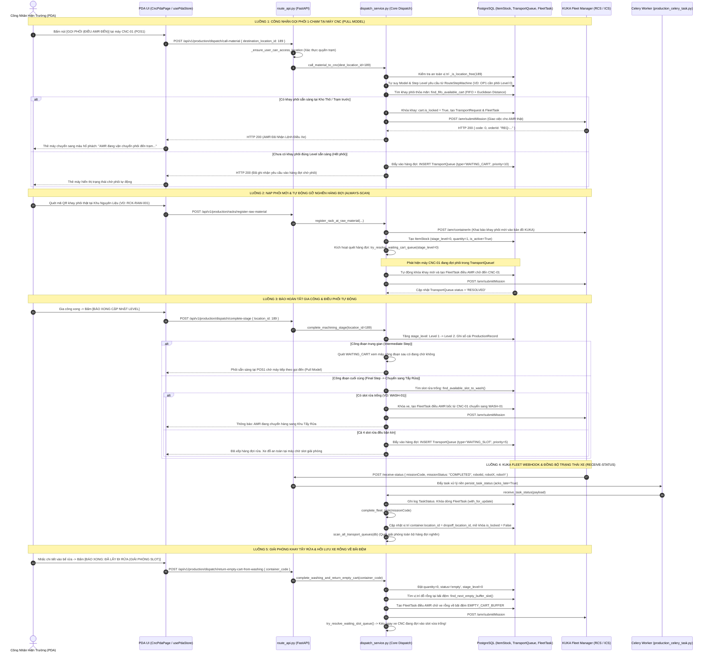

# KẾ HOẠCH & REVIEW TOÀN DIỆN KHỐI 5: LÕI THUẬT TOÁN ĐIỀU PHỐI AMR & HÀNG ĐỢI TỰ ĐỘNG
*(CORE DISPATCH ENGINE, PRIORITY QUEUES, DOUBLE-BUFFERING & BACKGROUND CELERY WORKERS)*

Tài liệu này đặc tả chi tiết toàn bộ các file tham gia, cấu trúc dữ liệu, các luồng tương tác trọn vẹn (Gọi phôi 1-chạm, thuật toán tìm khay FIFO kết hợp khoảng cách Euclidean, cơ chế Double-Buffering POS1/POS2 chống đói máy, hàng đợi ưu tiên `WAITING_CART` & `WAITING_SLOT`, máy trạng thái Webhook KUKA Fleet và Worker Always-Scan) từ **Giao diện PDA Hiện Trường $\rightarrow$ REST API Endpoint $\rightarrow$ Core Dispatch Service $\rightarrow$ Bảng Cơ sở dữ liệu 3NF (PostgreSQL) $\rightarrow$ Celery Worker & KUKA Fleet Manager** của **Khối 5: Lõi Thuật Toán Điều Phối AMR & Hàng Đợi TỰ Động (Dispatch Engine & Queue Worker)** trong hệ sinh thái KUKA WMS.

---

## 1. Sơ đồ luồng tổng thể (Sequence Diagram)



---

## 2. Hình minh họa kiến trúc điều phối xưởng (Wireframe & Concept)

```
========================================================================================================
                                     MÔ HÌNH VẬN HÀNH XƯỞNG KUKA WMS
========================================================================================================

  [ KHU NGUYÊN LIỆU (RAW) ]                      [ KHU GIA CÔNG CNC ]                      [ KHU TẨY RỬA (WASH) ]
  +-----------------------+                      +--------------------+                    +--------------------+
  | RAW-01: [Khay Level 0]|                      | [ MAY CNC-01 ]     |                    | WASH-01: [Đang Rửa]|
  | RAW-02: [Khay Level 0]| ===(AMR Giao Phôi)==>| POS1: [Khay OP1]   | ===(AMR Bốc Sang)==>| WASH-02: [Trống]   |
  | RAW-03: [Ô Trống]     |                      | POS2: [Khay Đệm]   |                    | WASH-03: [Trống]   |
  +-----------------------+                      +--------------------+                    +--------------------+
             ^                                              |                                         |
             |                                              v                                         v
             |                                 (Khay Phôi Nằm Yên Tại Chỗ)               (Lấy Chi Tiết Ra Rửa)
             |                                 (Không chuyển từ POS1 qua POS2)                        |
             |                                                                                        v
             +=====================( AMR Thu Hồi Xe Rỗng Về )========================= [ BÃI XE RỖNG (BUFFER) ]
                                                                                       | EMPTY-01 .. EMPTY-04   |
========================================================================================================
```

---

## 3. Tổng hợp các file tham gia trong Khối 5

| Tầng Kiến Trúc | Đường Dẫn File | Vai Trò & Trách Nhiệm Cụ Thể |
| :--- | :--- | :--- |
| **Backend Core Service (Lõi Điều Phối)** | [`dispatch_service.py`](file:///d:/KuKA/KUKA_WMS/backend/app/modules/production/dispatch_service.py) | **Trung tâm điều phối toàn xưởng**: Tính khoảng cách 2D Euclidean, thuật toán tìm xe FIFO, khóa an toàn vị trí `_is_location_free`, cơ chế Pull Model CNC, định tuyến đa tầng, hàng đợi ưu tiên kép, bộ chuyển đổi KUKA Fleet HTTP Adapter và xử lý webhook. |
| **Backend Celery Background Workers** | [`production_celery_task.py`](file:///d:/KuKA/KUKA_WMS/backend/app/modules/production/production_celery_task.py) | **Xử lý nền & Quét tự động**: Task `robot.persist_task_status` tiếp nhận webhook KUKA không làm nghẽn API; Task tuần hoàn `production.scan_transport_queue` (Always-Scan) định kỳ giải phóng các yêu cầu kẹt hàng đợi phòng ngừa rớt mạng. |
| **Backend REST API Endpoints** | [`route_api.py`](file:///d:/KuKA/KUKA_WMS/backend/app/modules/production/route_api.py) | Khai báo các router nghiệp vụ: `POST /dispatch/call-material`, `POST /dispatch/complete-stage`, `POST /racks/register-raw-material`, `POST /dispatch/return-empty-cart-from-washing`, `POST /receive-status`. |
| **Backend Database Models** | [`production_models.py`](file:///d:/KuKA/KUKA_WMS/backend/app/modules/production/production_models.py) | Định nghĩa các bảng 3NF: `TransportRequest`, `TransportQueue`, `FleetTask`, `TaskStatus`, `FleetApiCall`, `ProductionRecord`, `ItemStock`, `Location`, `Machine`. |
| **Backend Schemas** | [`route_schema.py`](file:///d:/KuKA/KUKA_WMS/backend/app/modules/production/route_schema.py) | Pydantic Request/Response models: `CallMaterialRequest`, `CompleteStageRequest`, `ContainerActionRequest`. |
| **Backend Location Guard** | [`location_guard.py`](file:///d:/KuKA/KUKA_WMS/backend/app/modules/production/location_guard.py) | Kiểm tra hợp lệ tọa độ Map Node KUKA, loại hình vị trí (`RAW_MATERIAL`, `CNC_SLOT`, `WASHING_SLOT`, `EMPTY_CART_BUFFER`). |
| **Frontend PDA Store** | [`usePdaStore.ts`](file:///d:/KuKA/KUKA_WMS/frontend/src/store/usePdaStore.ts) | State management Zustand cho PDA: Kích hoạt API gọi phôi 1-chạm, báo xong công đoạn, nạp phôi QR, giải phóng slot rửa; cập nhật optimistic UI và phản hồi lỗi thật 100%. |
| **Frontend PDA Components** | [`CncLineModal.tsx`](file:///d:/KuKA/KUKA_WMS/frontend/src/components/pda/CncLineModal.tsx) | Giao diện công nghiệp tỉ lệ 4.2-inch: Thẻ máy CNC Double-Buffering (POS1/POS2), nút Gọi Hàng 1-chạm, Báo Xong, Quét QR Camera thực tế. |

---

## 4. Chi tiết các viễn cảnh vận hành & Thuật toán lõi

### 4.1. Nạp phôi tại Khu Nguyên Liệu & Tự động gỡ nghẽn hàng đợi
- **Hàm xử lý:** `register_rack_at_raw_material`
- **Quy trình:**
  1. Quét QR khay phôi (VD: `RCK-RAW-001`).
  2. Tái sử dụng khay cũ (Reusable QR) hoặc tạo mới `ItemStock` với `stage_level = 0`, `status = 'available'`.
  3. Báo KUKA Fleet `POST /amr/containerIn`.
  4. **Kích hoạt Always-Scan:** `try_resolve_waiting_cart_queue(stage_level=0)`. Nếu chuyền CNC đang chờ phôi, AMR được điều đến bốc ngay lập tức.

### 4.2. Gọi phôi 1-chạm & Double-Buffering (POS1 & POS2)
- **Hạ ở đâu bốc ở đó:** Khay hạ tại POS1 thì khi gia công xong AMR sẽ bốc đi từ chính POS1. POS2 là buffer độc lập để gối đầu phôi, chống dừng máy (Zero CNC Starvation).
- **Tự suy Route 1-chạm:** Công nhân chỉ bấm nút gọi, Backend tự tra cứu máy CNC thuộc Model nào và bước nào để điều đúng phôi có Stage Level phù hợp.

### 4.3. Thuật toán chọn phôi tối ưu (Cart Selection Algorithm)
- **Hàm:** `find_fifo_available_cart`
- **Chiến lược phân tầng:**
  - **Tier 1 (Phôi thô Level 0):** Áp dụng **FIFO tuyệt đối** (`created_at ASC, id ASC`) để giải phóng nguyên liệu tồn kho lâu ngày.
  - **Tier 2 (Bán thành phẩm Level > 0):** Áp dụng **Khoảng cách Euclidean 2D**:
    $$D = \sqrt{(x_{cart} - x_{target})^2 + (y_{cart} - y_{target})^2}$$
    Chọn khay phôi đang ở gần máy CNC nhất để tiết kiệm thời gian chạy xe AMR.
  - **Chống Race Condition:** Khóa bản ghi với `.with_for_update(of=ItemStock, skip_locked=True)`.

### 4.4. Hoàn tất gia công: Công đoạn trung gian vs Bước cuối
- **Bước trung gian (`is_final_cnc_step = False`):** Giữ nguyên khay tại máy theo **Pull Model**, đợi máy kế tiếp gọi đến.
- **Bước cuối (`is_final_cnc_step = True`):** Tự động chuyển sang chế độ **Push to Washing**. Tìm slot rửa trống (`find_available_slot_to_wash`). Nếu cả 4 slot rửa bận kín $\rightarrow$ Đẩy vào hàng đợi `WAITING_SLOT` với độ ưu tiên cao (`priority = 5`).

### 4.5. Giải phóng khay rửa & Hồi lưu xe rỗng
- Khi nhấc chi tiết vào bể rửa, công nhân bấm giải phóng trên PDA.
- Hệ thống điều AMR chở xe rỗng về Bãi đệm (`EMPTY_CART_BUFFER`).
- Đồng thời gọi `try_resolve_waiting_slot_queue()` $\rightarrow$ Kéo ngay xe CNC đang chờ vào slot rửa vừa trống.

### 4.6. Hàng đợi ưu tiên kép & Thang đo Priority
- `priority = 5` (Cao nhất): Chuyển phôi sang Khu Rửa (`WAITING_SLOT`). Ưu tiên giải phóng máy CNC trước để máy không nghẽn.
- `priority = 10` (Trung bình): Gọi phôi mới tới máy CNC (`WAITING_CART`).
- `priority = 15` (Thấp hơn): Trả xe rỗng về bãi đệm (`RETURN_EMPTY_CART`).

---

## 5. Đánh giá chất lượng mã nguồn & Điểm mạnh

1. **Bảo vệ đồng thời (Concurrency Safety):** Khóa dòng PostgreSQL `with_for_update` chặt chẽ, loại bỏ hoàn toàn race-condition khi nhiều máy gọi hàng cùng lúc.
2. **Khóa an toàn vị trí 3 tầng (`_is_location_free`):** Kiểm tra xe đang đỗ + xe đang tới + nhiệm vụ FleetTask đang nhắm đến slot $\rightarrow$ Chống tai nạn 2 AMR đâm nhau hoặc hạ đè khay.
3. **Độ tin cậy KUKA Fleet (Real Error Reporting):** Bỏ hoàn toàn mock giả lập, ghi nhận lỗi thật 100% khi KUKA Fleet mất kết nối.
4. **Cơ chế chống nghẽn xưởng (Always-Scan Engine):** Dual-Trigger (Event-driven khi có sự kiện + Celery Beat định kỳ) giúp xưởng tự động vận hành trơn tru.

---

## 6. Các hạn chế còn tồn tại & Đề xuất cải tiến

### 🔴 Hạn chế 1: Thiếu Màn hình Web Giám sát AMR & Hàng đợi Live
- **Vấn đề:** Hiện chưa có trang Web Admin để Quản đốc xưởng theo dõi trực quan: Danh sách AMR đang chạy (Nhiệm vụ gì, tiến độ ra sao), Danh sách các máy đang chờ trong hàng đợi (`TransportQueue`).
- **Đề xuất:** Xây dựng trang **Giám Sát Điều Phối Live** trên Web Admin.

### 🟡 Hạn chế 2: Chưa có Cơ chế Timeout Watchdog cho AMR kẹt
- **Vấn đề:** Nếu AMR bị sự cố phần cứng/kẹt vật lý giữa đường không gửi được webhook, nhiệm vụ sẽ bị treo ở `in_progress`, khóa cứng khay phôi.
- **Đề xuất:** Bổ sung Celery Watchdog task tự phát hiện nhiệm vụ quá thời gian định mức (> 15 phút) để cảnh báo Quản đốc và cung cấp nút can thiệp "Hủy khẩn cấp & Mở khóa".

### 🟡 Hạn chế 3: Tọa độ xe AMR thời gian thực trên Bản đồ 2D
- **Vấn đề:** Bảng `TaskStatus` đã lưu tọa độ `robot_x`, `robot_y` từ webhook nhưng chưa hiển thị icon xe di chuyển trực quan trên bản đồ xưởng.
- **Đề xuất:** Vẽ vị trí xe AMR live trên bản đồ 2D xưởng.

---

## 7. Ý kiến phản hồi & Thảo luận của bạn

Bạn có thể review và để lại comment trực tiếp vào các mục sau:
1. Bạn có muốn điều chỉnh thang điểm độ ưu tiên hàng đợi (`priority = 5` cho rửa, `10` cho gọi phôi) không?
2. Bạn có muốn chúng ta triển khai giải quyết **Hạn chế 1 (Làm Màn hình Web Giám Sát AMR & Hàng Đợi Live cho Quản Đốc)** ngay bây giờ không?
