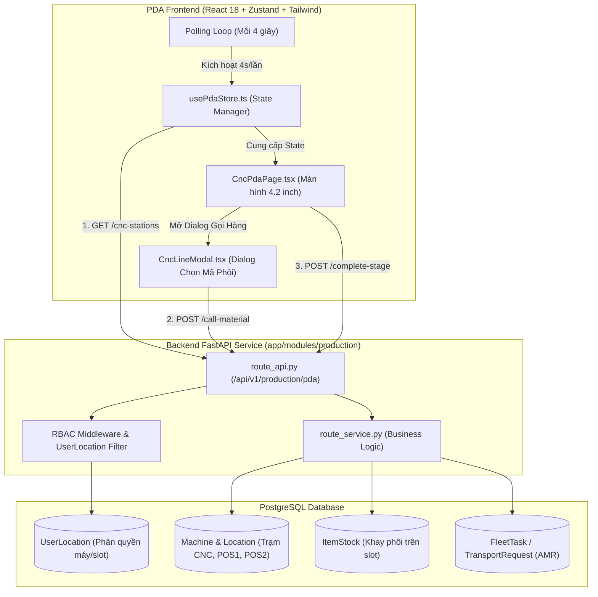
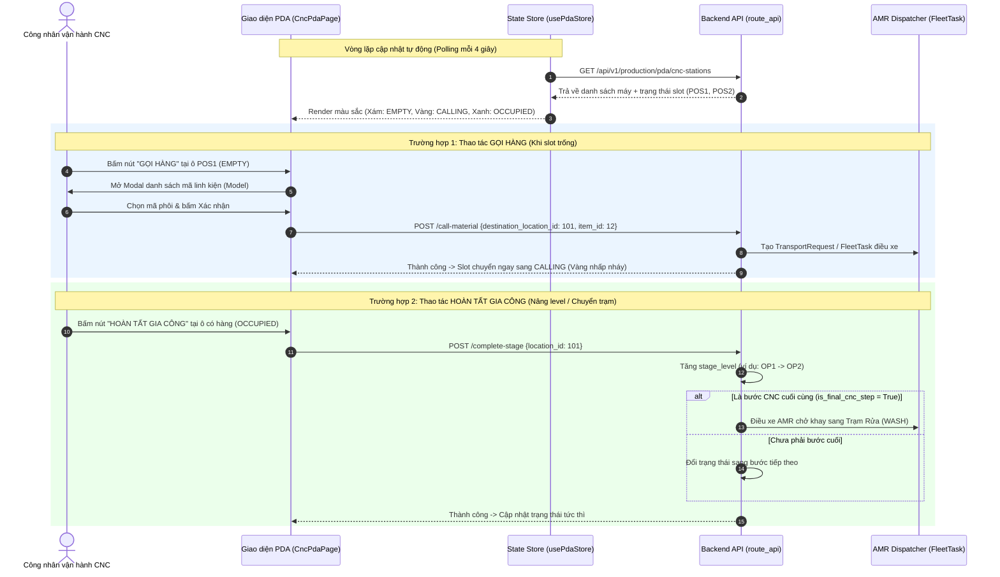

# KẾ HOẠCH & ĐÁNH GIÁ LUỒNG GIAO DIỆN PDA VẬN HÀNH CNC (`/pda/cnc`)

Tài liệu này chi tiết hóa toàn bộ luồng hoạt động từ **Backend đến Frontend**, cấu trúc dữ liệu, sơ đồ kiến trúc và **hình ảnh minh họa Wireframe giao diện PDA** chuẩn công nghiệp (tỉ lệ 4.2-inch cầm tay) để bạn dễ dàng review, đánh giá và để lại ý kiến đóng góp.

---

## 1. Sơ đồ kiến trúc & Luồng dữ liệu End-to-End



---

## 2. Sơ đồ trình tự thao tác của Công nhân (Sequence Diagram)



---

## 3. Hình minh họa giao diện PDA (Wireframe 4.2-inch)

Giao diện được thiết kế chuyên biệt cho thiết bị PDA cầm tay (màn hình hẹp 480x800, thao tác găng tay công nghiệp, nút bấm lớn, màu sắc trạng thái nhận diện ngay tức thì):

### 3.1. Minh họa Màn hình tổng quan trạm máy CNC

```
+-------------------------------------------------------------+
| [KUKA WMS] PDA CNC OPERATOR               [Ca 1] [Dang Xuat]|
| Nguoi van hanh: Nguyen Van A | Tram: CNC KUKA AREA 01       |
| Trang thai ket noi: [Online - 4s]                           |
+-------------------------------------------------------------+
|                                                             |
| [ MAY PHAY CNC-01 ]                       [ Dang chay: RUN ]|
| +-----------------------------+ +-------------------------+ |
| | SLOT 1: POS1 (Vao - Inbound)| | SLOT 2: POS2 (Ra - Out) | |
| | Trang thai: [ CO HANG ]     | | Trang thai: [ TRONG ]   | |
| |                             | |                         | |
| | Ma Khay : RACK-0089         | |     (O trong)           | |
| | Chi tiet: TAY-NAM-CUA-V1    | |                         | |
| | Cong doan: OP1 (Phay tho)   | |                         | |
| | Thoi gian: 14 phut 20 giay  | |                         | |
| |                             | |                         | |
| | +-------------------------+ | | +---------------------+ | |
| | |  [V] HOAN TAT GIA CONG  | | | |  [+] GOI PHOI VAO   | | |
| | |       (Nang Level)      | | | |     (Chon Model)    | | |
| | +-------------------------+ | | +---------------------+ | |
| +-----------------------------+ +-------------------------+ |
|                                                             |
| [ MAY PHAY CNC-02 ]                       [ Dang chay: RUN ]|
| +-----------------------------+ +-------------------------+ |
| | SLOT 1: POS1 (Vao - Inbound)| | SLOT 2: POS2 (Ra - Out) | |
| | Trang thai: [ DANG GOI XE ] | | Trang thai: [ CO HANG ] | |
| |                             | |                         | |
| | [>> AMR DANG CHAY TOI >>]   | | Ma Khay : RACK-0042     | |
| | Model : NAP-HOP-SO-B2       | | Chi tiet: TRUC-KHUYU-X1 | |
| | Ma lenh: AMR-MS-8812        | | Cong doan: OP2 (Phay tinh)|
| | Tien do: 75% khoang cach    | | Thoi gian: 02 phut 10 giay|
| |                             | |                         | |
| | +-------------------------+ | | +---------------------+ | |
| | | [!] DEN NHANH (Mô phỏng)| | | |  [V] HOAN TAT       | | |
| | +-------------------------+ | | +---------------------+ | |
| +-----------------------------+ +-------------------------+ |
+-------------------------------------------------------------+
```

---

### 3.2. Minh họa Modal "Gọi Hàng" (Chọn mã linh kiện vào Slot)

Khi công nhân bấm vào nút `[+] GOI PHOI VAO` tại một ô `EMPTY`, cửa sổ chọn xuất hiện:

```
+----------------------------------------------------+
|               GOI PHOI CHO MAY CNC-01              |
| Vi tri nhan hang: POS1 (Inbound Buffer)            |
+----------------------------------------------------+
| Chon loai chi tiet can gia cong tiep theo:         |
|                                                    |
|  ( ) TAY-NAM-CUA-V1                                |
|      Tay nam cua o to - Phay OP1                   |
|      [Ton kho tho: 12 khay san sang]               |
|                                                    |
|  (*) NAP-HOP-SO-B2                                 |
|      Nap hop so dong co - Phay OP1                 |
|      [Ton kho tho: 5 khay san sang]                |
|                                                    |
|  ( ) TRUC-KHUYU-X1                                 |
|      Truc khuyu - Phay OP1                         |
|      [Ton kho tho: 8 khay san sang]                |
+----------------------------------------------------+
| [ HUY BO ]               [ XAC NHAN DIEU XE AMR ]  |
+----------------------------------------------------+
```

---

## 4. Bảng phân tích trạng thái Slot (Matrix of Slot States)

| Trạng thái | Điều kiện Database | Màu sắc & Nhận diện trên PDA | Nút bấm thao tác trên PDA | Hành động hệ thống khi bấm |
| :--- | :--- | :--- | :--- | :--- |
| **`EMPTY`** *(Ô trống)* | Không có `ItemStock` active, không có `FleetTask` đến vị trí này | **Màu xám**, viền đứt nét | **`GỌI HÀNG`** *(Nút xanh dương lớn)* | Mở modal danh sách mã linh kiện -> Tạo `TransportRequest` điều AMR lấy hàng từ Kho Thô hoặc máy trước. |
| **`CALLING`** *(Đang chuyển hàng)* | Có `FleetTask` đang thực thi (`dispatched`, `in_progress`) có đích đến là slot này | **Màu vàng hổ phách**, hiệu ứng nhấp nháy (Pulse), icon xe tự hành | **`ĐẾN NHANH`** *(Nút phụ màu xám/vàng dùng khi test/mô phỏng)* | Giả lập sự kiện AMR đã hạ pallet thành công để test luồng không cần đợi xe chạy thật. |
| **`OCCUPIED`** *(Đang có hàng)* | `ItemStock.is_active = True` tại `location_id` | **Màu xanh lục đậm**, viền liền, hiển thị mã chi tiết + đồng hồ đếm giờ | **`HOÀN TẤT GIA CÔNG`** *(Nút xanh lục lớn)* | Gọi API hoàn tất: Tăng `stage_level` (nâng OP) hoặc điều xe AMR chở sang máy rửa (`WASH`) nếu là bước cuối. |

---

## 5. Chi tiết các API Contract liên quan

### 5.1. Lấy dữ liệu mặt bằng máy CNC
- **Endpoint:** `GET /api/v1/production/pda/cnc-stations`
- **Quyền hạn (RBAC):** Token của User. Backend tự đối chiếu với bảng `UserLocation`. Công nhân máy nào chỉ nhìn thấy máy đó (Admin nhìn thấy toàn bộ).
- **Tần suất gọi:** Frontend kích hoạt mỗi **4000ms** (4 giây).

### 5.2. Gọi hàng / phôi tới máy
- **Endpoint:** `POST /api/v1/production/pda/call-material`
- **Body:**
  ```json
  {
    "destination_location_id": 101,
    "item_id": 12
  }
  ```
- **Xử lý:** Backend tạo yêu cầu điều xe và trả về ngay kết quả cập nhật trạng thái slot sang `CALLING`.

### 5.3. Báo hoàn tất gia công / Nâng level
- **Endpoint:** `POST /api/v1/production/pda/complete-stage`
- **Body:**
  ```json
  {
    "location_id": 101
  }
  ```
- **Xử lý:** Backend kiểm tra quy trình công nghệ (Routing Step):
  - Nếu còn bước gia công tiếp theo: Nâng `stage_level` (ví dụ từ OP1 lên OP2).
  - Nếu là bước CNC cuối: Đánh dấu sẵn sàng xuất trạm và sinh lệnh gọi xe chuyển sang Trạm Rửa (`WASH`).

---

## 6. Ý kiến phản hồi & Đánh giá của bạn

Bạn có thể review và phản hồi các điểm sau:
1. **Thời gian Polling 4s:** Tần suất 4s đã đủ mượt cho công nhân chưa, hay có muốn chuyển sang WebSocket/SSE khi AMR cập nhật tọa độ không?
2. **Double-buffering (POS1 & POS2):** Hiện tại POS1 đóng vai trò nhận hàng vào, POS2 trả hàng ra. Bạn có muốn quy định chặt chẽ POS1 chỉ cho phép Gọi Hàng, POS2 chỉ cho phép Báo Xong không?
3. **Màn hình chọn Model:** Có cần hiển thị thêm ảnh mô phỏng của linh kiện để tránh công nhân chọn nhầm mã hàng không?
