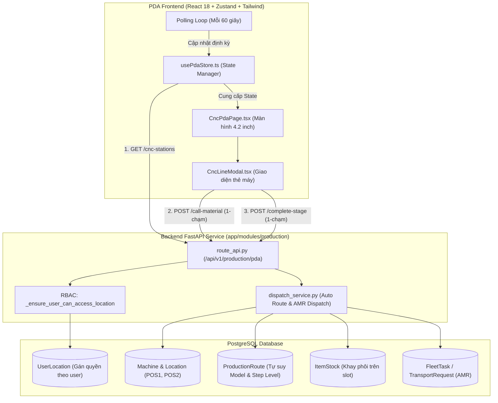
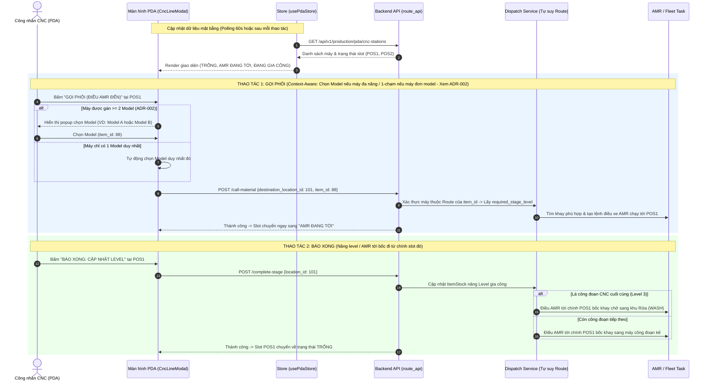

# KẾ HOẠCH & ĐÁNH GIÁ LUỒNG GIAO DIỆN PDA VẬN HÀNH CNC (`/pda/cnc`)

Tài liệu này chi tiết hóa toàn bộ luồng hoạt động từ **Backend đến Frontend**, cấu trúc dữ liệu, sơ đồ kiến trúc và **hình ảnh minh họa Wireframe giao diện PDA** chuẩn công nghiệp (tỉ lệ 4.2-inch cầm tay) đã được cập nhật chuẩn xác theo thực tế sản xuất tại xưởng.

---

## 1. Cơ chế hoạt động cốt lõi tại trạm CNC

1. **Cơ chế 1-Chạm (Không cần chọn Model):**
   - Công nhân **không cần chọn mã linh kiện/Model**. Khi bấm nút **"GỌI PHÔI (ĐIỀU AMR ĐẾN)"**, Frontend chỉ gửi `destination_location_id`.
   - Backend tự động tra cứu cấu hình máy trong bảng `ProductionRoute` / `RouteStepMachine`:
     - Máy CNC này đang tham gia công đoạn nào? Thuộc Model sản phẩm nào?
     - Cần phôi đầu vào là Level mấy? (Ví dụ: Máy gia công OP2 $\rightarrow$ Tự động tìm phôi Level 1 đang sẵn sàng ở kho hoặc máy trước để điều AMR tới).

2. **Cơ chế Slot Độc lập (POS1 & POS2):**
   - Mỗi máy CNC có 2 vị trí đệm độc lập (POS1 và POS2).
   - **Hạ ở đâu thì lấy đi ở đó:** Khi xe AMR chở phôi tới hạ tại **POS1**, công nhân gia công trực tiếp khay tại POS1. Khi bấm **"Báo xong"**, xe AMR sẽ tới bốc hàng đi từ **chính POS1** (chở sang máy tiếp theo hoặc sang khu rửa `WASH`), hoàn toàn không phải chuyển sang POS2.
   - POS2 đóng vai trò là ô đệm song song thứ 2, giúp máy có thể gối đầu (đang gia công POS1 vẫn có thể gọi thêm phôi về POS2 để máy không bị dừng chờ).

---

## 2. Sơ đồ kiến trúc & Luồng dữ liệu End-to-End



---

## 3. Sơ đồ trình tự thao tác của Công nhân (Sequence Diagram)



---

## 4. Hình minh họa giao diện PDA thực tế (Wireframe 4.2-inch)

Giao diện thực tế trong [`CncLineModal.tsx`](file:///d:/KuKA/KUKA_WMS/frontend/src/components/pda/CncLineModal.tsx):

```
+-------------------------------------------------------------+
| [KUKA WMS] DÂY CHUYỀN CNC                 [Ca 1] [Đăng Xuất]|
| Quản Lý Trạm Máy Gia Công | Trạm: CNC KUKA AREA 01          |
| Trạng thái: [Online - 60s]                                  |
+-------------------------------------------------------------+
|                                                             |
| [ CNC-01 (Vị trí 1) ] [P1] [Level 1: Phay Thô]              |
| Trạng thái: [ ĐANG GIA CÔNG ]                               |
| ----------------------------------------------------------- |
|   Mã Rack : RACK-0089                                       |
|   Model   : TAY-NẮM-CỬA-V1                                  |
|   Hiện tại: Level 0: Phôi Thô  -->  Đích: Level 1           |
|                                                             |
| +---------------------------------------------------------+ |
| |        [V] BÁO XONG: CẬP NHẬT LEVEL 1                   | |
| +---------------------------------------------------------+ |
|                                                             |
| [ CNC-01 (Vị trí 2) ] [P2] [Level 1: Phay Thô]              |
| Trạng thái: [ TRỐNG ]                                       |
| ----------------------------------------------------------- |
|   Đầu vào yêu cầu: Level 0 (Phôi thô)                       |
|                                                             |
| +---------------------------------------------------------+ |
| |        [+] GỌI PHÔI (ĐIỀU AMR ĐẾN)                      | |
| |             (1-Chạm: Tự động theo Route)                | |
| +---------------------------------------------------------+ |
|                                                             |
| [ CNC-02 (Vị trí 1) ] [P1] [Level 2: Phay Tinh]             |
| Trạng thái: [ AMR ĐANG TỚI ]                                |
| ----------------------------------------------------------- |
|   Model yêu cầu: Phôi tiêu chuẩn                            |
|                                                             |
| +---------------------------------------------------------+ |
| |        [!] Mô phỏng: AMR Đã Cập Bến                     | |
| +---------------------------------------------------------+ |
+-------------------------------------------------------------+
```

---

## 5. Bảng ma trận trạng thái Slot

| Trạng thái Slot | Trạng thái hiển thị PDA | Nút bấm thao tác | Hành vi hệ thống & AMR |
| :--- | :--- | :--- | :--- |
| **`EMPTY`** | **TRỐNG** *(Nền xám)* | **`GỌI PHÔI (ĐIỀU AMR ĐẾN)`** *(Xanh dương lớn)* | Gửi `destination_location_id`. Backend tự suy ra Model & Level yêu cầu từ Route của máy $\rightarrow$ Điều AMR chở phôi đến đúng vị trí này. |
| **`CALLING`** | **AMR ĐANG TỚI** *(Nền hổ phách)* | **`Mô phỏng: AMR Đã Cập Bến`** *(Dùng khi test)* | Giả lập sự kiện AMR đã cập bến và hạ khay phôi vào slot. |
| **`OCCUPIED`** | **ĐANG GIA CÔNG** *(Nền xanh lục)* | **`BÁO XONG: CẬP NHẬT LEVEL...`** *(Xanh lá/Cam)* | Cập nhật tăng Level gia công cho khay. Nếu là bước cuối $\rightarrow$ Tự động điều xe AMR đến **chính slot này** để bốc khay sang khu rửa `WASH`. |

---

## 6. Phân quyền trạm (RBAC) đã cập nhật

Sau các chỉnh sửa phân quyền gần nhất:
1. **Lấy danh sách máy (`GET /cnc-stations`):** Backend chỉ trả về các máy và vị trí thuộc `UserLocation` của công nhân đăng nhập (Admin thấy toàn bộ).
2. **Bảo vệ thao tác gọi phôi & báo xong:** Hàm `_ensure_user_can_access_location` trực tiếp kiểm tra quyền trước khi tạo lệnh điều xe, ngăn chặn tuyệt đối việc bấm nhầm vào máy không thuộc trách nhiệm.
