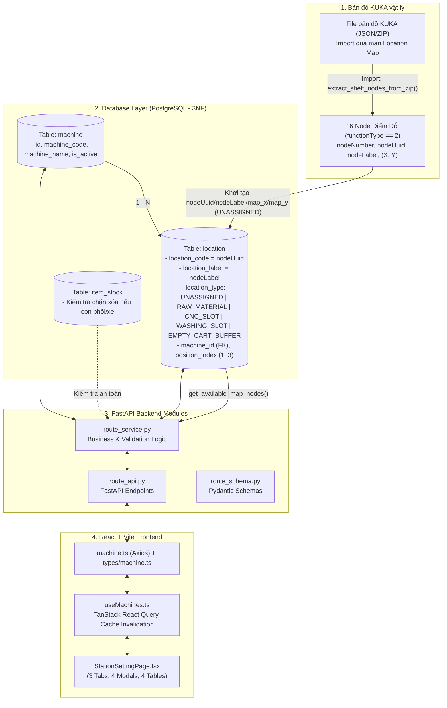

# TÀI LIỆU KỸ THUẬT CHI TIẾT: CẤU HÌNH TRẠM & PHÂN KHU XƯỞNG (/production/stations)

> **Mục đích tài liệu:** Tổng hợp toàn diện, có hệ thống và chi tiết về toàn bộ kiến trúc luồng dữ liệu, REST API backend, Business Service, Database Model/Schema và Frontend Components/Hooks/Types đang vận hành màn hình **Cấu hình Trạm & Phân khu xưởng** (`/production/stations`). Giúp kỹ sư làm chủ và kiểm soát 100% logic mã nguồn, các ràng buộc nghiệp vụ (constraints) và cơ chế vận hành từ bản đồ KUKA vật lý đến giao diện quản trị.

---

## 1. TỔNG QUAN KIẾN TRÚC & TRIẾT LÝ THIẾT KẾ (ARCHITECTURE OVERVIEW)



### Triết lý cốt lõi:
1. **Node bản đồ vật lý là bất biến (Immutable Physical Identity):**
   - Các điểm đỗ thực tế của AMR đến từ file bản đồ KUKA mà người dùng **import** vào hệ thống (JSON hoặc ZIP). Khi import, các node rack được ghi vào bảng `location`; từ đó trở đi bảng `location` là nguồn dữ liệu duy nhất. File `map_CNC001_CNC001_28s.json` trong repo chỉ là **file mẫu tham khảo**, code không đọc file này.
   - Trong số các node, hệ thống chỉ lọc các node có `functionType == 2` (điểm đỗ thao tác/kệ hàng, tổng cộng 16 node). Các node sạc (`3`), trạm thiết bị (`4`), sạc tự động (`10`) do KUKA Fleet Manager tự kiểm soát, không cấu hình nghiệp vụ tại đây.
   - Bảng `location` lưu `location_code = nodeUuid` (hoặc định danh cố định của điểm đỗ) và `location_label = nodeLabel` (số hiệu node như `51`, `216`...). Khi gán, sửa hoặc xóa trạm, **tuyệt đối không xóa bản ghi `location`** mà chỉ cập nhật trạng thái `location_type` sang giá trị chức năng hoặc trả về `UNASSIGNED`.
2. **Quan hệ chuẩn 3NF giữa Máy CNC và Vị trí đỗ:**
   - Thực thể máy CNC được chuẩn hóa riêng trong bảng `machine` (`id`, `machine_code`, `machine_name`, `is_active`).
   - Các điểm đỗ của máy CNC là các bản ghi trong bảng `location` liên kết ngoại khóa `machine_id -> machine.id`, phân định bởi `position_index` (hỗ trợ linh hoạt từ 1 đến 3 vị trí đỗ: POS1, POS2, POS3).
3. **Cơ chế chống gán đè Node chéo phân khu (Collision Prevention):**
   - Cả Backend lẫn Frontend đều giám sát trạng thái từng Node. Một khi Node đã được gán cho Khu Cấp Phôi, Khu Máy CNC, Khu Tẩy Rửa hoặc Bãi Đệm Xe Rỗng, nó sẽ tự động bị vô hiệu hóa (disabled / làm mờ) trên các phân khu khác.
4. **An toàn dữ liệu vận hành (Safety Integrity):**
   - Nghiêm cấm xóa máy hoặc gỡ trạm nếu tại vị trí đó đang có phôi hoặc xe đỗ active trong bảng `item_stock`.

---

## 2. BẢNG DANH MỤC REST API BACKEND

| STT | Phương thức | Endpoint | Router Function | Service Handler | Mục đích | Điều kiện ràng buộc chính |
| :---: | :---: | :--- | :--- | :--- | :--- | :--- |
| **1** | `GET` | `/api/v1/production/stations/catalog` | `get_station_catalog()` | `route_service.get_station_catalog` | Lấy toàn bộ danh mục trạm xưởng phân theo 4 khu vực. | Trả về đủ 4 danh mục: Nguyên liệu, Tẩy rửa, Bãi đệm, Máy CNC (kèm slots con). |
| **2** | `GET` | `/api/v1/production/map/available-nodes` | `get_available_map_nodes()` | `route_service.get_available_map_nodes` | Lấy các node điểm đỗ (đã import từ bản đồ) trong bảng `location` kèm tọa độ và trạng thái đã gán. | `is_active == True`; `function_type == 2`; đã gán khi `location_type != 'UNASSIGNED'`. |
| **3** | `POST` | `/api/v1/production/stations/locations` | `create_station_location()` | `route_service.create_station_slot` | Gán một Node bản đồ thành ô vị trí nghiệp vụ (Nguyên liệu, Tẩy rửa, Bãi đệm). | Node phải tồn tại trong DB; Node phải có `location_type == 'UNASSIGNED'` (chưa gán chỗ khác). |
| **4** | `PUT` | `/api/v1/production/stations/locations/{id}` | `update_station_location()` | `route_service.update_station_slot` | Cập nhật thông tin hiển thị, tọa độ, trạng thái hoạt động của ô vị trí. | `id` phải tồn tại; giữ nguyên `location_code` gốc. |
| **5** | `DELETE` | `/api/v1/production/stations/locations/{id}` | `delete_station_location()` | `route_service.delete_station_slot` | Gỡ gán trạm, trả Node về trạng thái tự do (`UNASSIGNED`). | Vị trí không được có hàng/xe đang đỗ (`item_stock.is_active == True`). |
| **6** | `GET` | `/api/v1/production/machines` | `list_available_machines()` | `route_service.list_available_machines` | Lấy danh sách máy CNC và các slot đỗ con tương ứng. | Sắp xếp theo `machine_code ASC`; slot sắp xếp theo `position_index ASC`. |
| **7** | `GET` | `/api/v1/production/machines/{id}` | `get_machine()` | `route_service.get_machine` | Lấy chi tiết thông tin một máy CNC và các slot đỗ của nó. | `id` phải tồn tại trong DB. |
| **8** | `POST` | `/api/v1/production/machines` | `create_machine()` | `route_service.create_machine` | Tạo mới máy CNC và gán 1..3 slot đỗ bản đồ (POS1, POS2, POS3). | `machine_code` không được trùng lặp; `position_index` thuộc `[1..3]`; các node gán phải ở trạng thái `UNASSIGNED`. |
| **9** | `PUT` | `/api/v1/production/machines/{id}` | `update_machine()` | `route_service.update_machine` | Cập nhật tên máy, trạng thái kích hoạt, thêm/bớt/đổi slot đỗ 1..3. | Tự động giải phóng các slot bị loại bỏ về `UNASSIGNED`; node mới gán không được trùng với trạm khác. |
| **10** | `DELETE` | `/api/v1/production/machines/{id}` | `delete_machine()` | `route_service.delete_machine` | Xóa máy CNC, giải phóng toàn bộ slot đỗ về `UNASSIGNED`. | Các slot của máy không có hàng/xe active (`item_stock`); tự dọn dẹp quan hệ trong bảng `route_step_machine`. |

---

## 3. CHI TIẾT CÁC ENDPOINT, SERVICE & RÀNG BUỘC NGHIỆP VỤ (BACKEND DEEP DIVE)

### 3.1. API Lấy danh mục hợp nhất toàn xưởng: `GET /api/v1/production/stations/catalog`
* **File Router:** [backend/app/modules/production/route_api.py](file:///D:/KuKA/KUKA_WMS/backend/app/modules/production/route_api.py#L174-L184)
* **File Service:** [backend/app/modules/production/route_service.py](file:///D:/KuKA/KUKA_WMS/backend/app/modules/production/route_service.py#L604-L676)
* **Schema trả về:** `StationCatalogResponse`
  - `raw_materials`: Danh sách ô cấp phôi (`location_type == 'RAW_MATERIAL'`).
  - `machines`: Danh sách máy CNC (`MachineCatalogGroup`), mỗi máy kèm danh sách `slots` (`location_type == 'CNC_SLOT'`).
  - `washing_slots`: Danh sách ô tẩy rửa (`location_type == 'WASHING_SLOT'`).
  - `empty_buffers` / `buffer_slots`: Danh sách bãi đệm xe rỗng (`location_type == 'EMPTY_CART_BUFFER'`).
* **Luồng xử lý:**
  1. Quét bảng `Machine` kèm relationship `locations` lọc theo `CNC_SLOT`, sắp xếp theo `position_index ASC, location_code ASC`.
  2. Truy vấn độc lập 3 nhóm vị trí từ bảng `Location`: `RAW_MATERIAL`, `WASHING_SLOT`, `EMPTY_CART_BUFFER`, sắp xếp theo `position_index ASC NULLS LAST, location_code ASC`.
  3. Đóng gói vào `StationCatalogResponse` phục vụ trực tiếp cho toàn bộ 3 Tab trên giao diện Frontend.

---

### 3.2. API Đọc danh sách Node bản đồ vật lý: `GET /api/v1/production/map/available-nodes`
* **File Router:** [backend/app/modules/production/route_api.py](file:///D:/KuKA/KUKA_WMS/backend/app/modules/production/route_api.py#L155-L172)
* **File Service:** [backend/app/modules/production/route_service.py](file:///D:/KuKA/KUKA_WMS/backend/app/modules/production/route_service.py#L798-L841)
* **Nguồn dữ liệu:** Bảng `location`. Bảng này được điền khi người dùng import bản đồ KUKA thật (`location_service.extract_shelf_nodes_from_zip` → `_extract_shelves_from_kuka_floor_map`). API **không đọc file JSON** nào trên server.
* **Query Params:**
  - `only_rack` (mặc định `True`): Chỉ lấy node có `function_type == 2`.
  - `only_functional` (mặc định `True`): Khi `only_rack = False`, lấy các node có `function_type` khác `NULL`. Nếu cả hai đều `False` thì lấy mọi location đang active.
* **Luồng xử lý & Ràng buộc:**
  1. Truy vấn `Location` với `is_active == True`, áp bộ lọc theo hai cờ trên.
  2. Với mỗi bản ghi:
     - `node_label = location_label` (fallback `location_name`, rồi `id`).
     - `node_number`: bảng `location` không lưu `nodeNumber`, nên lấy `int(node_label)` nếu label là số, ngược lại `0`.
     - `map_x`, `map_y`: lấy trực tiếp từ cột cùng tên (đã quy đổi sang mm lúc import).
     - `is_assigned = (location_type != 'UNASSIGNED')`; khi đã gán thì `assigned_to = "LOCATION_TYPE: location_name"`.
  3. Sắp xếp theo `(node_number, node_label) ASC`.
* **Lưu ý:** Nếu chưa import bản đồ, API trả về danh sách rỗng (không báo lỗi).

---

### 3.3. API Quản lý vị trí chung (Nguyên liệu, Tẩy rửa, Bãi đệm)

#### A. Gán vị trí mới: `POST /api/v1/production/stations/locations`
* **Service:** `create_station_slot(db, loc_type, payload)` ([route_service.py](file:///D:/KuKA/KUKA_WMS/backend/app/modules/production/route_service.py#L678-L738))
* **Payload:** `StationSlotCreateRequest` (`location_code`, `location_name`, `location_type`, `node_label`, `position_index`, `map_x`, `map_y`).
* **Điều kiện & Ràng buộc cốt lõi:**
  1. **Tìm Node gốc đã import từ Map:** Tìm theo `location_label == node_label` hoặc `location_name == node_label` hoặc `location_code == req_code`. Nếu không tìm thấy $\rightarrow$ Báo lỗi `400 Bad Request: "Không tìm thấy node bản đồ..."`.
  2. **Kiểm tra xung đột gán vị trí (Collision Check):**
     - Điều kiện hợp lệ: `loc.location_type == 'UNASSIGNED'` hoặc `loc.location_type == loc_type`.
     - Nếu node đã được gán cho khu vực khác $\rightarrow$ Báo lỗi `400 Bad Request: "Node ... đã được gán cho khu vực {loc.location_type}. Không thể gán trùng!"`.
  3. **Bảo toàn ID vật lý:** Giữ nguyên `location_code` (UUID) và `location_label`. Chỉ cập nhật `location_type = loc_type`, `location_name = custom_name`, `position_index`, `map_x`, `map_y`, `is_active = True`.

#### B. Cập nhật vị trí: `PUT /api/v1/production/stations/locations/{location_id}`
* **Service:** `update_station_slot(db, location_id, payload)` ([route_service.py](file:///D:/KuKA/KUKA_WMS/backend/app/modules/production/route_service.py#L740-L775))
* **Payload:** `StationSlotUpdateRequest` (`location_name`, `position_index`, `node_label`, `map_x`, `map_y`, `is_active`).
* **Ràng buộc:** Bản ghi phải tồn tại; cho phép đổi tên hiển thị, tọa độ và bật/tắt kích hoạt `is_active`.

#### C. Gỡ gán trạm (Xóa ô vị trí): `DELETE /api/v1/production/stations/locations/{location_id}`
* **Service:** `delete_station_slot(db, location_id)` ([route_service.py](file:///D:/KuKA/KUKA_WMS/backend/app/modules/production/route_service.py#L777-L798))
* **Điều kiện kiểm tra an toàn nghiêm ngặt:**
  1. Kiểm tra bảng `ItemStock`:
     ```python
     active_stocks = db.query(ItemStock).filter(
         ItemStock.location_id == loc.id,
         ItemStock.is_active.is_(True)
     ).count()
     if active_stocks > 0:
         raise ValueError(f"Không thể giải phóng vị trí {loc.location_name} đang có phôi hoặc xe đỗ.")
     ```
  2. **Không xóa bản ghi vật lý:** Chuyển `location_type = 'UNASSIGNED'`, trả lại `location_name = location_label`, xóa `machine_id = None`, `position_index = None`, giữ `is_active = True`.

---

### 3.4. API Quản lý Máy CNC & Các Slot đỗ linh hoạt (1..3 Slots)

#### A. Tạo máy CNC mới: `POST /api/v1/production/machines`
* **Service:** `create_machine(db, payload)` ([route_service.py](file:///D:/KuKA/KUKA_WMS/backend/app/modules/production/route_service.py#L378-L478))
* **Payload:** `MachineCreateRequest` (`machine_code`, `machine_name`, `warehouse_id`, `slots: list[MachineSlotCreate]`).
* **Điều kiện & Ràng buộc:**
  1. **Trùng lặp mã máy:** Nếu `machine_code` đã tồn tại và `is_active == True` $\rightarrow$ Báo lỗi `400: "Máy CNC với mã ... đã tồn tại"`. Nếu đã tồn tại nhưng `is_active == False` $\rightarrow$ Khôi phục lại máy (Re-activate).
  2. **Cấu hình Slot đỗ:**
     - Cho phép máy có từ 1 đến 3 slot đỗ (`slots: 1..3`). Nếu không truyền slots, mặc định tạo POS1 và POS2.
     - Với mỗi slot: `position_index` bắt buộc từ 1 đến 3 (`1 <= pos <= 3`).
     - Tìm bản ghi Node vật lý trong bảng `Location` theo `node_label` hoặc `location_code`. Nếu không thấy $\rightarrow$ Báo lỗi `400`.
     - **Kiểm tra xung đột Node:** Node phải có `location_type == 'UNASSIGNED'` hoặc là slot thuộc chính máy này. Nếu node đã gán khu khác $\rightarrow$ Báo lỗi `400: "Node ... đã được gán cho {loc.location_type}. Không thể gán cho máy CNC!"`.
  3. **Cập nhật liên kết:** Gán `loc.machine_id = m.id`, `loc.position_index = pos`, `loc.location_type = 'CNC_SLOT'`, `loc.is_active = True`.

#### B. Cập nhật máy CNC: `PUT /api/v1/production/machines/{machine_id}`
* **Service:** `update_machine(db, machine_id, payload)` ([route_service.py](file:///D:/KuKA/KUKA_WMS/backend/app/modules/production/route_service.py#L481-L569))
* **Payload:** `MachineUpdateRequest` (`machine_name`, `is_active`, `slots: list[MachineSlotCreate]`).
* **Xử lý đồng bộ hóa Slot đỗ động (Dynamic Slot Synchronization):**
  1. Duyệt danh sách các slot được gửi lên (`positions_requested`): Cập nhật vị trí hoặc gán node mới cho các `position_index` này. Kiểm tra xung đột node với các máy khác.
  2. **Giải phóng slot bị loại bỏ (Slot Pruning):** Với các slot cũ của máy trước đây mà không còn nằm trong `positions_requested` (ví dụ máy chuyển từ 3 slot xuống 2 slot):
     ```python
     for loc in (m.locations or []):
         if loc.position_index not in positions_requested:
             loc.machine_id = None
             loc.position_index = None
             loc.location_type = "UNASSIGNED"
             loc.location_name = loc.location_label or str(loc.id)
     ```

#### C. Xóa máy CNC: `DELETE /api/v1/production/machines/{machine_id}`
* **Service:** `delete_machine(db, machine_id)` ([route_service.py](file:///D:/KuKA/KUKA_WMS/backend/app/modules/production/route_service.py#L571-L602))
* **Điều kiện & An toàn nghiệp vụ:**
  1. **Kiểm tra tồn kho/xe đỗ:** Nếu bất kỳ slot nào của máy đang có `ItemStock` active $\rightarrow$ Báo lỗi `400: "Không thể xóa máy CNC ... đang có phôi hoặc xe đỗ tại vị trí."`.
  2. **Giải phóng tất cả slot đỗ:** Chuyển toàn bộ các vị trí liên kết sang `UNASSIGNED`, gỡ `machine_id = None`.
  3. **Xóa liên kết quy trình công đoạn:** Xóa các liên kết công đoạn quy trình trong bảng `RouteStepMachine` (`machine_id == m.id`) để không làm hỏng khóa ngoại.
  4. Thực hiện xóa bản ghi máy khỏi bảng `machine`.

---

## 4. CẤU TRÚC DATABASE MODEL & SCHEMAS

### 4.1. Bảng `machine` (Model `Machine`)
* **File:** [backend/app/modules/production/production_models.py](file:///D:/KuKA/KUKA_WMS/backend/app/modules/production/production_models.py#L57-L77)
* **Các cột:**
  - `id`: Khóa chính (Integer, PK, Auto Increment).
  - `machine_code`: Mã máy CNC duy nhất (VARCHAR 50, UNIQUE, NOT NULL, Index).
  - `machine_name`: Tên máy hiển thị (VARCHAR 100).
  - `warehouse_id`: ID kho xưởng (FK `warehouse.id`).
  - `is_active`: Trạng thái hoạt động (Boolean, Default True).
  - Relationship `locations`: Liên kết 1 - N với bảng `Location` (`Location.machine_id`).
  - Relationship `route_step_links`: Liên kết với `RouteStepMachine` (quy trình sản xuất).

### 4.2. Bảng `location` (Model `Location`)
* **File:** [backend/app/modules/warehouse/location_map/location_model.py](file:///D:/KuKA/KUKA_WMS/backend/app/modules/warehouse/location_map/location_model.py#L55-L95)
* **Các cột liên quan trực tiếp đến Trạm & Phân khu:**
  - `location_code`: Lưu `nodeUuid` từ bản đồ KUKA (VARCHAR 100, NOT NULL, Index).
  - `location_label`: Lưu `nodeLabel` (số hiệu node, ví dụ '51', '216') (VARCHAR 50, Index).
  - `location_name`: Tên định danh nghiệp vụ (ví dụ: 'VT-01', 'CNC-01 - Vị trí 1', 'WASH-01') (VARCHAR 100, Index).
  - `function_type`: Mặc định `2` (Rack / Điểm đỗ vận hành).
  - `location_type`: Phân loại phân khu trạm:
    - `'UNASSIGNED'`: Điểm đỗ tự do, chưa được gán cho khu vực nào.
    - `'RAW_MATERIAL'`: Ô cấp phôi đầu vào.
    - `'CNC_SLOT'`: Vị trí đỗ của máy CNC.
    - `'WASHING_SLOT'`: Ô trạm tẩy rửa.
    - `'EMPTY_CART_BUFFER'`: Bãi đệm xe rỗng.
  - `machine_id`: Khóa ngoại trỏ đến `machine.id` (ON DELETE SET NULL), áp dụng khi `location_type == 'CNC_SLOT'`.
  - `position_index`: Thứ tự vị trí đỗ (1, 2, 3 cho máy CNC; hoặc số thứ tự ô cho các khu khác).
  - `map_x`, `map_y`: Tọa độ thực trên bản đồ (mm).
  - `is_active`: Kích hoạt vị trí (Boolean).

---

## 5. KIẾN TRÚC FRONTEND: COMPONENT, HOOKS, CLIENT & TYPES

### 5.1. Trang giao diện chính: [StationSettingPage.tsx](file:///D:/KuKA/KUKA_WMS/frontend/src/pages/production/StationSettingPage.tsx)

#### A. Cấu trúc 3 Tabs & 4 Bảng danh sách:
1. **Tab 1: `raw_material` (Khu Cấp Phôi):**
   - Nút hành động: `+ Thêm Ô Cấp Phôi`.
   - Render bảng `Table`: Cột Tên ô, Mã định danh, Node bản đồ (Tag màu tím), Tọa độ (m), Trạng thái (Switch kích hoạt), Thao tác (Sửa, Xóa).
2. **Tab 2: `cnc` (Khu Máy CNC):**
   - Nút hành động: `+ Thêm Máy CNC Mới`.
   - Render bảng `Table` các máy CNC: Cột Mã máy, Tên máy, Danh sách các slot đỗ (Hiển thị Tag từng POS kèm Node bản đồ và tọa độ), Trạng thái hoạt động, Thao tác (Sửa máy kèm cấu hình slots, Xóa máy).
3. **Tab 3: `washing_buffer` (Khu Tẩy Rửa & Bãi Đệm):**
   - Bảng 1: Bảng Ô Trạm Tẩy Rửa (Washing Slots) + Nút `+ Thêm Slot Tẩy Rửa`.
   - Bảng 2: Bảng Bãi Đệm Xe Rỗng (Empty Cart Buffers) + Nút `+ Thêm Slot Bãi Đệm`.

#### B. Cơ chế Realtime Quản lý Xung đột Node (`assignedNodesMap` & `getNodeOptions`):
```typescript
// Trích đoạn logic tại frontend/src/pages/production/StationSettingPage.tsx
const assignedNodesMap = useMemo(() => {
  const map = new Map<string, { id?: number; name: string; zone: string }>();
  // Quét toàn bộ: raw_materials, machines.slots, washing_slots, empty_buffers
  // Lưu label -> { id, name, zone }
  return map;
}, [catalog]);

const getNodeOptions = useCallback((options?: {
  currentLocationId?: number | null;
  selectedInForm?: (string | undefined)[];
  currentSlotNode?: string;
}) => {
  return availableNodes.map((n) => {
    // 1. Nếu node đang được chọn ở slot khác trong cùng form máy CNC -> disabled = true
    // 2. Nếu node đã gán ở entity khác -> disabled = true kèm badge "[Đã gán: ...]"
    // 3. Nếu node đang thuộc chính entity đang sửa -> disabled = false kèm badge "[Hiện tại: ...]"
    // 4. Nếu node chưa gán -> disabled = false kèm badge "[Chưa gán]"
  });
}, [availableNodes, assignedNodesMap]);
```
* **Ý nghĩa:** Người dùng mở Modal ở bất kỳ tab nào thì dropdown chọn Node vật lý đều tự động xám (không cho chọn) những Node đã được khu vực khác sử dụng. Người dùng không bao giờ chọn nhầm hay gán trùng node.

#### C. Cơ chế Cấu hình Linh hoạt 1..3 Slot Máy CNC:
* Giao diện Modal Thêm/Sửa máy CNC hỗ trợ dynamic slot form:
  - Cho phép bấm **`+ Thêm vị trí đỗ`** (tối đa 3 slots: POS1, POS2, POS3).
  - Cho phép bấm nút **Xóa vị trí** (nếu số slot hiện tại $> 1$, đảm bảo máy luôn có ít nhất 1 slot).
  - Tự động đánh số lại `position_index` (1, 2, 3) và cập nhật mã slot mẫu `CNC-XX-POS{i}` khi người dùng thêm/bớt slot.
  - Tự động điền tọa độ `map_x`, `map_y` tương ứng khi người dùng chọn một Node bản đồ cho slot.

---

### 5.2. React Query Hooks: [useMachines.ts](file:///D:/KuKA/KUKA_WMS/frontend/src/hooks/useMachines.ts)

* Quản lý Cache đồng bộ tức thời: Khi bất kỳ mutation nào thành công (`create`, `update`, `delete`), hook tự động gọi `invalidateQueries` để cập nhật lại 3 key:
  - `['stationCatalog']`: Dữ liệu phân khu và các ô trạm.
  - `['availableMapNodes']`: Trạng thái gán/tự do của 16 node vật lý.
  - `['machines']`: Danh sách máy CNC phục vụ màn hình cấu hình quy trình.

| Tên Hook | Loại | Query Key / Mutation | API gọi |
| :--- | :---: | :--- | :--- |
| `useStationCatalog` | `useQuery` | `['stationCatalog']`, staleTime = 0 | `getStationCatalogApi` |
| `useAvailableNodes` | `useQuery` | `['availableMapNodes']`, staleTime = 0 | `getAvailableMapNodesApi` |
| `useMachines` | `useQuery` | `['machines']`, staleTime = 60s | `getMachinesApi` |
| `useCreateMachine` | `useMutation` | Invalidate: `['machines', 'stationCatalog', 'availableMapNodes']` | `createMachineApi` |
| `useUpdateMachine` | `useMutation` | Invalidate: `['machines', 'stationCatalog', 'availableMapNodes']` | `updateMachineApi` |
| `useDeleteMachine` | `useMutation` | Invalidate: `['machines', 'stationCatalog', 'availableMapNodes']` | `deleteMachineApi` |
| `useCreateStationLocation` | `useMutation` | Invalidate: `['stationCatalog', 'machines', 'availableMapNodes']` | `createStationLocationApi` |
| `useUpdateStationLocation` | `useMutation` | Invalidate: `['stationCatalog', 'machines', 'availableMapNodes']` | `updateStationLocationApi` |
| `useDeleteStationLocation` | `useMutation` | Invalidate: `['stationCatalog', 'machines', 'availableMapNodes']` | `deleteStationLocationApi` |

---

### 5.3. Axios API Client: [machine.ts](file:///D:/KuKA/KUKA_WMS/frontend/src/api/machine.ts)
* Đóng gói toàn bộ request gọi xuống backend thông qua `axiosInstance` (tự động kèm JWT Bearer Token).
* **Cơ chế Fallback Nodes (`FALLBACK_MAP_NODES`):**
  - Nếu kết nối tới backend lấy node bản đồ gặp sự cố mạng, client sẽ tự động fallback về danh sách 16 Node chuẩn đã lưu sẵn (Node 4, 17, 18, 20, 23, 24, 25, 26, 50, 51, 127, 128, 129, 130, 216, 249) giúp giao diện không bị gián đoạn hay crash trang.
* **Cơ chế Fallback Xóa vị trí:**
  - Nếu endpoint xóa `/api/v1/production/stations/locations/{id}` trả về 404, client tự động thử lại endpoint tổng quát `/api/v1/locations/{id}` trước khi báo lỗi.

---

### 5.4. TypeScript Interfaces: [machine.ts](file:///D:/KuKA/KUKA_WMS/frontend/src/types/machine.ts)

* `AvailableMapNode`: Cấu trúc Node bản đồ (`node_number`, `node_label`, `map_x`, `map_y`, `function_type`, `is_assigned`, `assigned_to`).
* `SlotConfigInput`: Payload cấu hình slot khi thêm/sửa máy (`position_index`, `location_code`, `node_label`, `map_x`, `map_y`).
* `StationCatalogItem`: Dữ liệu ô vị trí hoàn chỉnh từ backend (`id`, `location_code`, `location_label`, `location_name`, `location_type`, `machine_code`, `position_index`, `node_label`, `map_x`, `map_y`, `is_active`).
* `MachineCatalogGroup`: Nhóm máy CNC kèm danh sách slots (`id`, `machine_code`, `machine_name`, `is_active`, `slots: StationCatalogItem[]`).
* `StationCatalogResponse`: Dữ liệu phân khu hợp nhất (`machines`, `raw_materials`, `washing_slots`, `empty_buffers`).

---

## 6. MA TRẬN RÀNG BUỘC VÀ QUY TẮC AN TOÀN HỆ THỐNG (RULES MATRIX)

| Hành động | Điều kiện cho phép | Điều kiện bị từ chối / Báo lỗi | Xử lý trong Database |
| :--- | :--- | :--- | :--- |
| **Gán ô cấp phôi / Tẩy rửa / Bãi đệm** | Node bản đồ chọn có `location_type == 'UNASSIGNED'` hoặc chưa gán ở đâu. | Node đã gán cho khu vực khác $\rightarrow$ Báo lỗi 400. | Cập nhật `location_type`, `location_name`, giữ nguyên `location_code` (UUID) và `location_label`. |
| **Gỡ ô trạm về UNASSIGNED** | Vị trí không có hàng tồn kho hoặc xe đỗ (`item_stock.is_active == 0`). | Vị trí đang chứa phôi hoặc xe đỗ $\rightarrow$ Báo lỗi 400. | Chuyển `location_type = 'UNASSIGNED'`, xóa `machine_id`, trả lại tên mặc định. Tuyệt đối không `DELETE` row. |
| **Thêm máy CNC mới** | `machine_code` chưa tồn tại; `slots` từ 1..3; các Node gán đều đang `UNASSIGNED`. | Trùng mã máy đang active; số slot ngoài khoảng 1..3; Node gán đã bị chiếm bởi trạm khác. | Tạo bản ghi trong `machine`; cập nhật các bản ghi tương ứng trong `location` (`machine_id = m.id`, `location_type = 'CNC_SLOT'`). |
| **Sửa máy CNC (Thêm/Bớt Slots)** | Slot mới chọn node hợp lệ; `slots` duy trì từ 1..3. | Node chọn cho slot mới đã bị khu khác gán; số slot $= 0$ hoặc $> 3$. | Cập nhật slot mới; **giải phóng các slot bị xóa về `UNASSIGNED`**. |
| **Xóa máy CNC** | Toàn bộ 1..3 slot của máy không có hàng hoặc xe đỗ active trong `item_stock`. | Có ít nhất 1 slot đang chứa hàng hoặc xe đỗ active $\rightarrow$ Báo lỗi 400. | 1. Giải phóng các slot về `UNASSIGNED`.<br>2. Xóa các liên kết trong `RouteStepMachine`.<br>3. Xóa bản ghi `machine`. |

---

## 7. HƯỚNG DẪN KIỂM SOÁT & DEBUG CODE CHO LẬP TRÌNH VIÊN

1. **Khi cần thêm một phân khu mới vào xưởng:**
   - Cập nhật Enum giá trị `location_type` (ví dụ `QC_INSPECTION`) trong [location_model.py](file:///D:/KuKA/KUKA_WMS/backend/app/modules/warehouse/location_map/location_model.py).
   - Thêm trường vào schema `StationCatalogResponse` trong [route_schema.py](file:///D:/KuKA/KUKA_WMS/backend/app/modules/production/route_schema.py).
   - Thêm hàm truy vấn trong `get_station_catalog()` tại [route_service.py](file:///D:/KuKA/KUKA_WMS/backend/app/modules/production/route_service.py).
   - Thêm Tab mới hoặc Bảng mới trong [StationSettingPage.tsx](file:///D:/KuKA/KUKA_WMS/frontend/src/pages/production/StationSettingPage.tsx).
2. **Khi bản đồ KUKA cập nhật node mới:**
   - Xuất bản đồ mới từ KUKA Fleet Manager và **import lại** qua chức năng import bản đồ (màn Location Map).
   - Đảm bảo các node dùng cho điểm đỗ thao tác có thuộc tính `functionType: 2`.
   - Sau khi import, bảng `location` được đồng bộ và API `get_available_map_nodes` trả danh sách mới ngay, không cần sửa code hay chép file vào server.
3. **Khi gặp lỗi không thể xóa trạm hoặc xóa máy CNC:**
   - Kiểm tra bảng `item_stock`: Xem có pallet, xe gá hoặc khay phôi nào chưa được xuất kho (`is_active = true`) tại vị trí đó hay không. Thực hiện điều xe giải phóng vị trí trước khi xóa.
