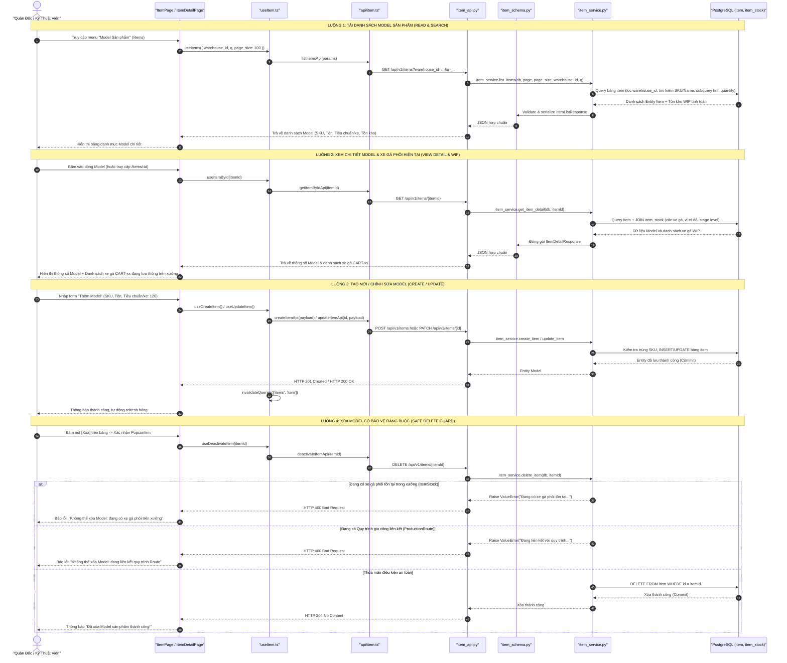
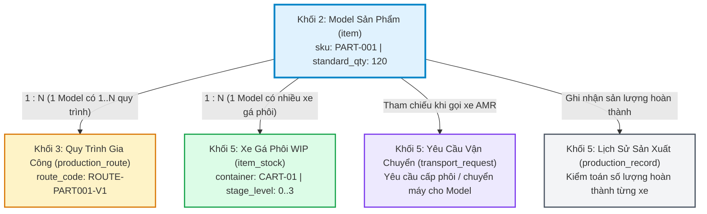

# TÀI LIỆU TOÀN DIỆN REVIEW KHỐI 2: DANH MỤC MODEL SẢN PHẨM & PHÔI GIA CÔNG
*(PRODUCT MODELS & WORKPIECE MASTER DATA SPECIFICATION & TRACEABILITY)*

Tài liệu này đặc tả chi tiết toàn bộ các file tham gia, cấu trúc dữ liệu, các luồng tương tác trọn vẹn CRUD (Create, Read, Update, Delete) từ **Giao diện Component (Frontend) $\rightarrow$ Hook / Client API $\rightarrow$ REST API Endpoint & Schemas $\rightarrow$ Service Logic $\rightarrow$ Bảng Cơ sở dữ liệu (PostgreSQL)** của **Khối 2: Danh Mục Model Sản Phẩm (Product Models / Items)** trong hệ sinh thái KUKA WMS.

---

## 🗺️ 1. SƠ ĐỒ LUỒNG ĐI TỔNG THỂ (FULL-STACK FLOW)



---

## 📂 2. TỔNG HỢP CÁC FILE THAM GIA TRONG KHỐI 2 (INVOLVED FILES)

| Tầng Kiến Trúc | Đường Dẫn File | Vai Trò & Trách Nhiệm Cụ Thể |
| :--- | :--- | :--- |
| **Frontend UI (Page Chính)** | [frontend/src/pages/ItemPage.tsx](file:///D:/KuKA/KUKA_WMS/frontend/src/pages/ItemPage.tsx) | Màn hình quản trị chính `/items`: Hiển thị danh mục Model (Part_number, Tên, Mô tả, Tiêu chuẩn phôi/xe), Modal tạo/sửa Model, Xóa với Popconfirm xác nhận. |
| **Frontend UI (Chi Tiết & WIP)**| [frontend/src/pages/ItemDetailPage.tsx](file:///D:/KuKA/KUKA_WMS/frontend/src/pages/ItemDetailPage.tsx) | Màn hình chi tiết `/items/:id`: Hiển thị thuộc tính kỹ thuật của Model và danh sách các xe gá phôi (`item_stock`) đang đỗ tại các trạm/bãi đệm kèm công đoạn hiện tại. |
| **Frontend UI (File Dư Thừa)** | [frontend/src/pages/ItemSettingPage.tsx](file:///D:/KuKA/KUKA_WMS/frontend/src/pages/ItemSettingPage.tsx) | *File cũ không gắn route*: Bản thiết kế thử nghiệm cũ, có chứa toggle `is_active` không tồn tại trong DB -> **Đề xuất dọn dẹp**. |
| **Frontend Routing** | [frontend/src/routes/index.tsx](file:///D:/KuKA/KUKA_WMS/frontend/src/routes/index.tsx) | Khai báo tuyến đường `/items` $\rightarrow$ `ItemPage` và `/items/:id` $\rightarrow$ `ItemDetailPage`. |
| **Frontend Navigation** | [frontend/src/components/layout/Sidebar.tsx](file:///D:/KuKA/KUKA_WMS/frontend/src/components/layout/Sidebar.tsx) | Menu điều hướng: Icon `BoxPlotOutlined` $\rightarrow$ Nhãn "Model Sản phẩm" (`/items`). |
| **Frontend React Query Hooks** | [frontend/src/hooks/useItem.ts](file:///D:/KuKA/KUKA_WMS/frontend/src/hooks/useItem.ts) | Quản lý state & cache API: `useItems`, `useGetItems`, `useItemById`, `useCreateItem`, `useUpdateItem`, `useDeactivateItem`. |
| **Frontend API Client** | [frontend/src/api/item.ts](file:///D:/KuKA/KUKA_WMS/frontend/src/api/item.ts) | Đóng gói gọi Axios RESTful API: `listItemsApi`, `getItemByIdApi`, `createItemApi`, `updateItemApi`, `deactivateItemApi`. |
| **Frontend TypeScript Types** | [frontend/src/types/item.ts](file:///D:/KuKA/KUKA_WMS/frontend/src/types/item.ts) | Khế ước kiểu dữ liệu: `Item`, `CreateItemInput`, `UpdateItemInput`, `ItemDetails`, `ItemStock`, `ItemListResponse`. |
| **Backend Router** | [backend/app/modules/warehouse/item/item_api.py](file:///D:/KuKA/KUKA_WMS/backend/app/modules/warehouse/item/item_api.py) | Router FastAPI (`@router` mounted tại `/api/v1`): Các endpoint `GET /items`, `GET /items/{id}`, `POST /items`, `PATCH /items/{id}`, `DELETE /items/{id}`. |
| **Backend Pydantic Schemas** | [backend/app/modules/warehouse/item/item_schema.py](file:///D:/KuKA/KUKA_WMS/backend/app/modules/warehouse/item/item_schema.py) | Định nghĩa Schemas: `ItemCreate`, `ItemUpdate`, `ItemResponse`, `ItemListResponse`, `ItemDetailResponse`, `ItemStockInDetail`. |
| **Backend Business Service** | [backend/app/modules/warehouse/item/item_service.py](file:///D:/KuKA/KUKA_WMS/backend/app/modules/warehouse/item/item_service.py) | Xử lý logic nghiệp vụ: Tạo Model (kiểm tra trùng SKU), Cập nhật Model, Xóa an toàn (Guard kiểm tra xe phôi tồn kho và quy trình Route), Subquery tính tồn kho live. |
| **Backend Database Model** | [backend/app/modules/warehouse/item/item_model.py](file:///D:/KuKA/KUKA_WMS/backend/app/modules/warehouse/item/item_model.py) | SQLAlchemy Model bảng `item`: Quản lý thực thể Model sản phẩm phôi cơ khí CNC, quan hệ với `Warehouse` và subquery tính tồn kho `quantity`. |
| **Backend Production Model** | [backend/app/modules/production/production_models.py](file:///D:/KuKA/KUKA_WMS/backend/app/modules/production/production_models.py) | Bảng liên kết ngoại: `production_route.item_id`, `transport_request.item_id`, `production_record.item_id`. |
| **Backend Stock Model** | [backend/app/modules/warehouse/item_stock/item_stock_model.py](file:///D:/KuKA/KUKA_WMS/backend/app/modules/warehouse/item_stock/item_stock_model.py) | Bảng thực thể xe gá phôi `item_stock`: Lưu `item_id`, `container_code`, `current_stage_level`, vị trí đỗ `location_id`. |

---

## 🔍 3. CHI TIẾT CÁC LUỒNG THAO TÁC CỤ THỂ

### 🟢 LUỒNG 1: TẢI DANH MỤC MODEL SẢN PHẨM (READ & SEARCH)
Mục đích: Hiển thị danh sách toàn bộ các Model phôi gia công để Quản đốc xưởng tra cứu, tìm kiếm và quản trị.

1. **Giao diện (Component)**:
   - File: [`frontend/src/pages/ItemPage.tsx`](file:///D:/KuKA/KUKA_WMS/frontend/src/pages/ItemPage.tsx).
   - Component gọi Hook:
     ```typescript
     const { data, isLoading: isItemsLoading } = useItems({
       warehouse_id: selectedWarehouseId,
       q: submittedQuery || undefined,
       page_size: ITEM_FETCH_LIMIT, // 100
     });
     ```
   - Render bảng `Table` Ant Design với các cột:
     * **Part_number (`sku`)**: Mã định danh duy nhất của Model (ví dụ: `PART-001`, `MDL-ALU-A`).
     * **Tên sản phẩm (`name`)**: Tên chi tiết cơ khí (ví dụ: `Trục dẫn hướng nhôm CNC`).
     * **Mô tả (`description`)**: Ghi chú kỹ thuật, mác vật liệu phôi.
     * **Tiêu chuẩn / xe (`standard_quantity_per_cart`)**: Số lượng chi tiết quy định xếp trên 1 xe gá (mặc định 120 phôi/xe).
     * **Ngày tạo (`created_at`)**: Thời điểm khởi tạo Model.
     * **Thao tác**: Nút Sửa (Edit) và Nút Xóa (Delete) với Popconfirm.
2. **Hook & Client API**:
   - `useItems` trong [`useItem.ts`](file:///D:/KuKA/KUKA_WMS/frontend/src/hooks/useItem.ts) $\rightarrow$ gọi `listItemsApi(params)` trong [`api/item.ts`](file:///D:/KuKA/KUKA_WMS/frontend/src/api/item.ts).
   - Gửi request HTTP:
     ```http
     GET /api/v1/items?warehouse_id=1&q=PART&page=1&page_size=100
     ```
3. **Backend API Route**:
   - Endpoint: `@router.get("/items", response_model=ItemListResponse)` trong [`item_api.py`](file:///D:/KuKA/KUKA_WMS/backend/app/modules/warehouse/item/item_api.py).
4. **Backend Service Logic**:
   - Hàm `item_service.list_items(db, page, page_size, warehouse_id, q, is_active)` trong [`item_service.py`](file:///D:/KuKA/KUKA_WMS/backend/app/modules/warehouse/item/item_service.py):
     ```python
     query = db.query(Item)
     if warehouse_id is not None:
         query = query.filter(Item.warehouse_id == warehouse_id)
     if q and q.strip():
         like = f"%{q.strip()}%"
         query = query.filter(or_(Item.sku.ilike(like), Item.name.ilike(like)))
     total = query.count()
     items = query.order_by(Item.id).offset((page - 1) * page_size).limit(page_size).all()
     ```
   - Trường `quantity` (tồn kho live) được tự động tính toán qua `column_property` bằng subquery SQL gom từ các xe `ItemStock` đang có mặt tại các vị trí đỗ hợp lệ trong xưởng.
5. **Schema Đóng Gói**:
   - `ItemListResponse`: `{ items: list[ItemResponse], total: int, page: int, page_size: int }`.

---

### 🔵 LUỒNG 2: XEM CHI TIẾT MODEL & XE GÁ PHÔI HIỆN TẠI (VIEW DETAIL & WIP)
Mục đích: Giúp Quản đốc xưởng biết rõ Model này đang có những xe gá nào (`CART-01`, `CART-02`), đang đỗ ở vị trí nào (Máy CNC nào, Ô cấp phôi nào, hay Trạm rửa), và đang ở Công đoạn Level mấy.

1. **Giao diện (Component)**:
   - File: [`frontend/src/pages/ItemDetailPage.tsx`](file:///D:/KuKA/KUKA_WMS/frontend/src/pages/ItemDetailPage.tsx).
   - Truy cập qua đường dẫn `/items/:id` (click vào hàng trong `ItemPage.tsx`).
   - Gọi Hook: `const { data, isLoading } = useItemById(Number(id));`.
   - Hiển thị 2 khối giao diện chính:
     * **Khối trên (Metadata)**: Tên Model, SKU Part Number, Tiêu chuẩn phôi/xe gá, Tổng số lượng tồn live, Mô tả kỹ thuật.
     * **Khối dưới (Danh sách xe gá WIP `stocks`)**:
       - Bảng danh sách các xe gá phôi:
         * Mã xe gá (`container_code`): `CART-01`, `CART-02`...
         * Vị trí hiện tại (`location_code` / `location_name`): ví dụ `CNC-01 - Vị trí 1 (POS1)` hoặc `VT-01 (Cấp phôi)`.
         * Công đoạn hiện tại (`current_stage_level`): `0` (Phôi thô), `1` (CĐ 1 hoàn thành), `2` (CĐ 2 hoàn thành)...
         * Số lượng trên xe (`quantity`): thường là 120 chi tiết.
         * Trạng thái (`status`): `available` (sẵn sàng), `in_transit` (đang di chuyển), `locked` (đã khóa cho nhiệm vụ AMR).
2. **Hook & Client API**:
   - `useItemById` trong [`useItem.ts`](file:///D:/KuKA/KUKA_WMS/frontend/src/hooks/useItem.ts) $\rightarrow$ gọi `getItemByIdApi(itemId)` trong [`api/item.ts`](file:///D:/KuKA/KUKA_WMS/frontend/src/api/item.ts).
   - Request HTTP:
     ```http
     GET /api/v1/items/{itemId}
     ```
3. **Backend Service Logic**:
   - Hàm `get_item_detail(db, item_id)` trong [`item_service.py`](file:///D:/KuKA/KUKA_WMS/backend/app/modules/warehouse/item/item_service.py):
     ```python
     stocks = (
         db.query(ItemStock, Location.location_code, Location.location_name)
         .outerjoin(Location, Location.id == ItemStock.location_id)
         .filter(
             ItemStock.item_id == item.id,
             ItemStock.is_active.is_(True),
         )
         .order_by(ItemStock.id)
         .all()
     )
     ```
4. **Schema Trả Về**:
   - `ItemDetailResponse`: chứa thông tin `item: ItemResponse`, danh sách `stocks: list[ItemStockInDetail]`, và `available_quantity`.

---

### 🟡 LUỒNG 3: TẠO MỚI MODEL SẢN PHẨM (CREATE MODEL)
Mục đích: Khai báo một loại chi tiết/phôi gia công mới vào hệ thống trước khi thiết lập quy trình Route cho chi tiết đó.

1. **Giao diện (Component)**:
   - Người dùng bấm nút **[+ Thêm sản phẩm]** trên `ItemPage.tsx`.
   - Mở Modal với Form nhập liệu:
     * `sku` (Part_number): Bắt buộc (ví dụ: `PART-A200`).
     * `name` (Tên Model/sản phẩm): Bắt buộc (ví dụ: `Trục then hoa 6 cạnh`).
     * `standard_quantity_per_cart`: Tiêu chuẩn đóng xe gá (mặc định set sẵn `120`).
     * `description`: Mô tả chi tiết kỹ thuật.
     * `detailEntries`: Dynamic key-value pairs (nếu có thông số kỹ thuật bổ sung).
2. **Hook & Client API**:
   - Gọi `createMutation.mutate(payload)` từ `useCreateItem()`.
   - Gửi request HTTP:
     ```http
     POST /api/v1/items
     Content-Type: application/json

     {
       "sku": "PART-A200",
       "name": "Trục then hoa 6 cạnh",
       "description": "Vật liệu thép hợp kim C45",
       "standard_quantity_per_cart": 120,
       "warehouse_id": 1,
       "details": {}
     }
     ```
3. **Backend API Route**:
   - Endpoint: `@router.post("/items", response_model=ItemResponse, status_code=201)` trong [`item_api.py`](file:///D:/KuKA/KUKA_WMS/backend/app/modules/warehouse/item/item_api.py).
4. **Backend Service Logic**:
   - Hàm `item_service.create_item(db, body)` trong [`item_service.py`](file:///D:/KuKA/KUKA_WMS/backend/app/modules/warehouse/item/item_service.py):
     * Kiểm tra trùng mã SKU:
       ```python
       if db.query(Item).filter(Item.sku == body.sku.strip()).first():
           raise ValueError("SKU already exists")
       ```
     * Khởi tạo Entity `Item`:
       ```python
       item = Item(
           sku=body.sku.strip(),
           name=body.name.strip(),
           description=body.description,
           standard_quantity_per_cart=body.standard_quantity_per_cart or 120,
           warehouse_id=body.warehouse_id,
           details=details,
       )
       db.add(item)
       db.commit()
       db.refresh(item)
       ```

---

### 🟠 LUỒNG 4: CẬP NHẬT THÔNG TIN MODEL (UPDATE MODEL)
Mục đích: Hiệu chỉnh tên, mô tả hoặc điều chỉnh quy cách tiêu chuẩn phôi/xe gá.

1. **Giao diện (Component)**:
   - Trên bảng `ItemPage.tsx`, bấm nút icon Chỉnh sửa $\rightarrow$ Mở Modal Edit được fill sẵn thông tin của Model đang chọn.
   - Cho phép sửa: `name`, `description`, `standard_quantity_per_cart`.
   - Mã `sku` được khóa (disabled) để bảo toàn tính toàn vẹn định danh phôi.
2. **Hook & Client API**:
   - Gọi `updateMutation.mutateAsync({ id, data })` từ `useUpdateItem()`.
   - Gửi request HTTP:
     ```http
     PATCH /api/v1/items/{item_id}
     Content-Type: application/json

     {
       "name": "Trục then hoa 6 cạnh (Bản cải tiến)",
       "description": "Nhiệt luyện tôi cao tần",
       "standard_quantity_per_cart": 150
     }
     ```
3. **Backend Service Logic**:
   - Hàm `item_service.update_item(db, item_id, body)`:
     * Cập nhật các trường được truyền lên (bỏ qua các trường `None`).
     * Thực hiện commit và refresh dữ liệu.

---

### 🔴 LUỒNG 5: XÓA MODEL CÓ BẢO VỆ TOÀN VẸN (SAFE DELETE GUARD)
Mục đích: Ngăn ngừa lỗi gãy khóa ngoại và thất thoát dữ liệu nghiêm trọng nếu cố tình xóa Model đang có phôi lưu hành trên xưởng hoặc đang gán vào quy trình gia công.

1. **Giao diện (Component)**:
   - Nút icon Thùng rác đỏ trên từng dòng Model trong `ItemPage.tsx`.
   - Bọc bởi `Popconfirm`: "Xác nhận xóa Model sản phẩm? Thao tác này không thể hoàn tác nếu Model chưa có phôi lưu hành."
   - Khi bấm Xác nhận $\rightarrow$ gọi `handleDeleteItem(record.id)`.
2. **Hook & Client API**:
   - Gọi `deleteMutation.mutateAsync(itemId)` từ `useDeactivateItem()`.
   - Gửi request HTTP:
     ```http
     DELETE /api/v1/items/{item_id}
     ```
3. **Backend Safeguard Checks (Tường lửa bảo vệ 2 lớp)**:
   - Hàm `item_service.delete_item(db, item_id)`:
     * **Lớp 1 (Kiểm tra Phôi tồn kho WIP)**:
       ```python
       if db.query(ItemStock).filter(ItemStock.item_id == item_id, ItemStock.is_active.is_(True)).first():
           raise ValueError("Không thể xóa Model: đang có xe gá phôi tồn tại trong kho hoặc trạm máy.")
       ```
     * **Lớp 2 (Kiểm tra Quy trình gia công ProductionRoute)**:
       ```python
       active_route = db.query(ProductionRoute).filter(ProductionRoute.item_id == item_id).first()
       if active_route:
           raise ValueError(f"Không thể xóa Model: đang được liên kết với quy trình gia công '{active_route.route_name}' ({active_route.route_code}). Vui lòng xóa hoặc hủy quy trình trước.")
       ```
     * Nếu thỏa mãn cả 2 lớp $\rightarrow$ thực hiện `db.delete(item)` an toàn và `db.commit()`.

---

## 🗄️ 4. TỪ ĐIỂN DỮ LIỆU & RÀNG BUỘC CƠ SỞ DỮ LIỆU (DATA DICTIONARY)

### Bảng `item` (PostgreSQL)

| Tên Cột (Column) | Kiểu Dữ Liệu | Khóa | Cho Phép NULL | Mặc Định | Diễn Giải Nghiệp Vụ Xưởng Cơ Khí |
| :--- | :--- | :---: | :---: | :--- | :--- |
| `id` | `INTEGER` | **PK** | `NO` | Auto increment | Khóa chính định danh Model trong toàn hệ thống. |
| `sku` | `VARCHAR(50)` | **UK, IDX** | `NO` | | Part Number / Mã Model sản phẩm (duy nhất trên toàn hệ thống). |
| `name` | `VARCHAR(255)` | | `NO` | | Tên chi tiết cơ khí / Model phôi gia công. |
| `description` | `TEXT` | | `YES` | | Mô tả kỹ thuật, tiêu chuẩn kích thước, yêu cầu phôi. |
| `standard_quantity_per_cart` | `INTEGER` | | `NO` | `120` | **Quy cách tiêu chuẩn trên xe gá**: Số lượng phôi tối đa/chuẩn xếp trên 1 xe gá (`ItemStock`). |
| `warehouse_id` | `INTEGER` | **FK, IDX** | `NO` | | Khóa ngoại tham chiếu đến bảng `warehouse.id`. |
| `details` | `JSONB` | | `NO` | `'{}'` | Cấu trúc dữ liệu JSON linh hoạt lưu thuộc tính động mở rộng. |
| `supplier` | `VARCHAR(50)` | | `YES` | | Tên nhà cung ứng phôi thô (nếu có). |
| `base_unit` | `INTEGER` | | `YES` | | *(Legacy - Di sản cũ)* Đơn vị tính cơ bản FMCG. |
| `created_at` | `TIMESTAMP WITH TIME ZONE` | | `NO` | `now()` | Thời điểm tạo bản ghi. |
| `updated_at` | `TIMESTAMP WITH TIME ZONE` | | `NO` | `now()` | Thời điểm cập nhật bản ghi gần nhất. |

### Cột Tính Toán Động (Calculated Properties)
* **`quantity` (`column_property`)**:
  Được định nghĩa bằng subquery SQLAlchemy tính tổng `SUM(ItemStock.quantity)` của tất cả các xe phôi `ItemStock` có `item_id == Item.id`, `ItemStock.is_active == True`, đỗ tại các vị trí `Location.is_active == True` trong cùng phân xưởng `warehouse_id`.

---

## 🔗 5. MA TRẬN LIÊN KẾT GIỮA CÁC KHỐI TRONG HỆ THỐNG

Model sản phẩm (`Item`) là thực thể trung tâm kết nối trực tiếp với 4 khối nghiệp vụ khác:



1. **Khối 3 (Production Routes & Steps)**: Mỗi Model `item_id` sở hữu một Quy trình công nghệ xác định đường đi từ `Level 1` qua các máy CNC đến `Level N` và Trạm Rửa.
2. **Khối 5 (AMR Dispatch Engine & WIP Stock)**: Khi công nhân bấm nút **Cấp Phôi** tại ô `VT-01..07`, hệ thống yêu cầu chọn Model (`item_id`) để gán vào xe `CART-xx` với số lượng chuẩn `120 phôi`. Khi máy CNC gọi phôi, hệ thống tự động tìm xe có đúng `item_id` tương ứng.

---

## ⚠️ 6. ĐÁNH GIÁ CHẤT LƯỢNG MÃ NGUỒN & CÁC ĐIỂM CẦN CHUẨN HÓA

Qua rà soát chuyên sâu toàn bộ mã nguồn Khối 2, chúng tôi phát hiện và kiến nghị xử lý các điểm tồn tại sau:

### 1. File mồ côi (Orphaned File): `ItemSettingPage.tsx`
* **Hiện trạng**: File [`frontend/src/pages/ItemSettingPage.tsx`](file:///D:/KuKA/KUKA_WMS/frontend/src/pages/ItemSettingPage.tsx) (334 dòng) không được import ở bất kỳ đâu, không có route trong `routes/index.tsx`.
* **Vấn đề**: File này chứa toggle `<Switch checked={record.is_active} />` gọi mutation sửa `is_active` – trong khi bảng `item` trong database hoàn toàn không có cột `is_active`.
* **Kiến nghị**: Xóa bỏ file `ItemSettingPage.tsx` để tránh gây nhầm lẫn cho các kỹ sư phát triển sau này.

### 2. Tàn tích hàng hóa bán lẻ FMCG cũ trong `ItemPage.tsx`
* **Hiện trạng**: File [`ItemPage.tsx`](file:///D:/KuKA/KUKA_WMS/frontend/src/pages/ItemPage.tsx) dài tới 1,158 dòng vì đang ôm đồm nhiều logic FMCG cũ:
  * Nút "Import file Masan" và "Tải file mẫu Masan" (`1_Masan_Item_data.csv`).
  * Tab "Đồ thị tồn kho" vẽ biểu đồ Recharts đường gãy khúc và tính định giá tổng tài sản tồn kho bằng đồng (`VND`).
* **Kiến nghị**: Tách hoặc tinh gọn `ItemPage.tsx` thành màn hình chuyên biệt cho xưởng cơ khí: tập trung vào Part Number, Tiêu chuẩn xe gá, Liên kết xem quy trình Route, và Tồn kho xe phôi WIP.

### 3. Bổ sung Guard chống xóa gãy khóa ngoại trong `item_service.py`
* **Hiện trạng**: Hàm `delete_item` hiện chỉ mới kiểm tra `ItemStock`. Nếu Model đang có bản ghi trong `production_route`, khi gọi `db.delete(item)` sẽ bắn lỗi 500 ForeignKeyViolation của PostgreSQL.
* **Kiến nghị**: Bổ sung kiểm tra tường minh bảng `ProductionRoute` trước khi xóa và trả về thông báo tiếng Việt thân thiện:
  *"Không thể xóa Model: đang được liên kết với quy trình gia công 'X'. Vui lòng xóa hoặc hủy quy trình trước."*

---

## 🧪 7. MA TRẬN KIỂM THỬ & TIÊU CHÍ NGHIỆM THU (TEST CRITERIA)

| Mã Kịch Bản | Thao Tác Kiểm Thử | Dữ Liệu Đầu Vào | Kết Quả Kỳ Vọng | Trạng Thái |
| :--- | :--- | :--- | :--- | :---: |
| **TC-ITEM-01** | Tạo Model sản phẩm hợp lệ | `sku`: "PART-TEST-01", `name`: "Bạc lót trục", `standard_quantity_per_cart`: 120 | Tạo thành công HTTP 201, hiển thị ngay trên bảng `ItemPage`. | Đạt |
| **TC-ITEM-02** | Tạo trùng mã SKU | `sku`: "PART-TEST-01" | Bị chặn, trả về lỗi HTTP 400 "SKU already exists". | Đạt |
| **TC-ITEM-03** | Cập nhật tiêu chuẩn xe gá | Đổi `standard_quantity_per_cart` từ 120 thành 150 | Cập nhật thành công, lưu chuẩn xác vào database. | Đạt |
| **TC-ITEM-04** | Xem chi tiết Model kèm xe phôi | Truy cập `/items/{id}` của Model đang có xe gá | Hiển thị đúng danh sách xe `CART-xx`, vị trí đỗ và Stage Level hiện tại. | Đạt |
| **TC-ITEM-05** | Xóa Model đang có xe phôi WIP | Bấm xóa Model đang có bản ghi trong `ItemStock` | Bị chặn bởi Guard, hiển thị thông báo lỗi thân thiện. | Đạt |
| **TC-ITEM-06** | Xóa Model đang có Quy trình Route | Bấm xóa Model đang gán vào `ProductionRoute` | Bị chặn bởi Guard, không gây sập DB / Foreign Key error. | Đạt |
| **TC-ITEM-07** | Xóa Model trắng hợp lệ | Model mới tạo chưa có xe phôi và chưa có Route | Xóa thành công, biến mất khỏi danh sách. | Đạt |
