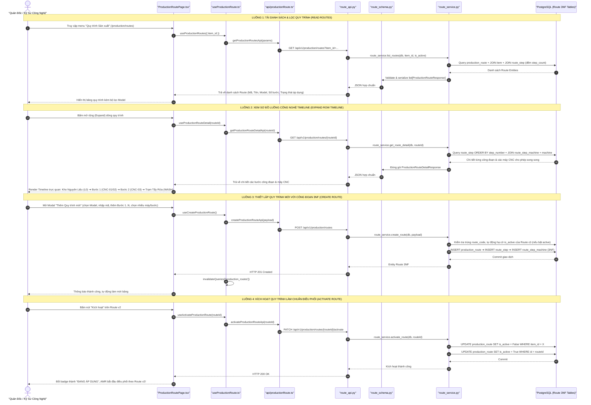
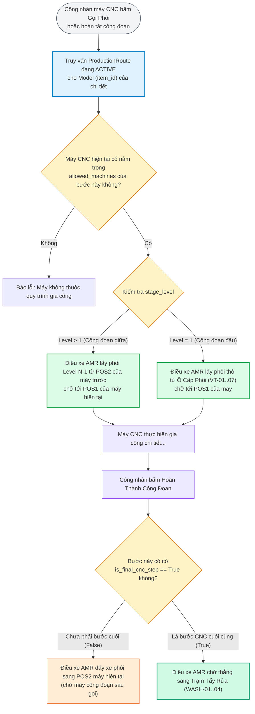

# TÀI LIỆU TOÀN DIỆN REVIEW KHỐI 3: QUY TRÌNH GIA CÔNG SẢN XUẤT (ROUTES & STEPS)
*(PRODUCTION ROUTING & 3NF NORMALIZED MULTI-MACHINE STEP SPECIFICATION & TRACEABILITY)*

Tài liệu này đặc tả chi tiết toàn bộ các file tham gia, cấu trúc dữ liệu, các luồng tương tác trọn vẹn CRUD (Create, Read, Update, Delete, Activate) từ **Giao diện Component (Frontend) $\rightarrow$ Hook / Client API $\rightarrow$ REST API Endpoint & Schemas $\rightarrow$ Service Logic $\rightarrow$ Bảng Cơ sở dữ liệu 3NF (PostgreSQL)** của **Khối 3: Quy Trình Gia Công Sản Xuất (Production Routes & Steps)** trong hệ sinh thái KUKA WMS.

---

## 🗺️ 1. SƠ ĐỒ LUỒNG ĐI TỔNG THỂ (FULL-STACK FLOW)



---

## 📂 2. TỔNG HỢP CÁC FILE THAM GIA TRONG KHỐI 3 (INVOLVED FILES)

| Tầng Kiến Trúc | Đường Dẫn File | Vai Trò & Trách Nhiệm Cụ Thể |
| :--- | :--- | :--- |
| **Frontend UI (Màn Hình Chính)** | [frontend/src/pages/production/ProductionRoutePage.tsx](file:///D:/KuKA/KUKA_WMS/frontend/src/pages/production/ProductionRoutePage.tsx) | Giao diện quản trị chính: Bảng danh sách Route, bộ lọc Model, Sub-component `RouteDetailTimeline` vẽ sơ đồ chu kỳ công nghệ trực quan, Modal tạo/sửa bước gia công động (`Form.List`). |
| **Frontend Routing** | [frontend/src/routes/index.tsx](file:///D:/KuKA/KUKA_WMS/frontend/src/routes/index.tsx) | Khai báo tuyến đường `/production/routes` $\rightarrow$ `ProductionRoutePage`, redirect `/routes` sang `/production/routes`. |
| **Frontend Navigation** | [frontend/src/components/layout/Sidebar.tsx](file:///D:/KuKA/KUKA_WMS/frontend/src/components/layout/Sidebar.tsx) | Menu điều hướng: Icon `BranchesOutlined` $\rightarrow$ "Quy trình Sản xuất" (`/production/routes`). |
| **Frontend Hooks** | [frontend/src/hooks/useProductionRoute.ts](file:///D:/KuKA/KUKA_WMS/frontend/src/hooks/useProductionRoute.ts) | React Query hooks: `useProductionRoutes`, `useProductionRouteDetail`, `useAvailableMachines`, `useCreateProductionRoute`, `useUpdateProductionRoute`, `useActivateProductionRoute`, `useDeleteProductionRoute`. |
| **Frontend API Client** | [frontend/src/api/productionRoute.ts](file:///D:/KuKA/KUKA_WMS/frontend/src/api/productionRoute.ts) | Axios client gọi REST API: `getProductionRoutesApi`, `getProductionRouteDetailApi`, `createProductionRouteApi`, `updateProductionRouteApi`, `activateProductionRouteApi`, `deleteProductionRouteApi`, `getAvailableMachinesApi`. |
| **Frontend Types** | [frontend/src/types/productionRoute.ts](file:///D:/KuKA/KUKA_WMS/frontend/src/types/productionRoute.ts) | Interface TypeScript: `ProductionRoute`, `RouteStep`, `RouteStepInput`, `ProductionRouteCreate`, `ProductionRouteUpdate`, `AvailableMachine`. |
| **Backend Router** | [backend/app/modules/production/route_api.py](file:///D:/KuKA/KUKA_WMS/backend/app/modules/production/route_api.py) | Router FastAPI (`@routes_router`): `GET/POST /production/routes`, `GET/PUT/DELETE /production/routes/{id}`, `PATCH /production/routes/{id}/activate`. |
| **Backend Schemas** | [backend/app/modules/production/route_schema.py](file:///D:/KuKA/KUKA_WMS/backend/app/modules/production/route_schema.py) | Pydantic Models: `RouteStepBase`, `RouteStepCreate`, `RouteStepResponse`, `ProductionRouteCreate`, `ProductionRouteUpdate`, `ProductionRouteResponse`, `ProductionRouteDetailResponse`. |
| **Backend Service** | [backend/app/modules/production/route_service.py](file:///D:/KuKA/KUKA_WMS/backend/app/modules/production/route_service.py) | Xử lý logic 3NF: Khởi tạo/cập nhật Route, gán cầu nối `RouteStepMachine`, đồng bộ cờ `is_final_cnc_step`, kích hoạt đơn nhất cho Model (`is_active = True`). |
| **Database Models** | [backend/app/modules/production/production_models.py](file:///D:/KuKA/KUKA_WMS/backend/app/modules/production/production_models.py) | 3 bảng thực thể cốt lõi chuẩn 3NF: `ProductionRoute`, `RouteStep`, `RouteStepMachine`. |
| **Lõi Điều Phối Tích Hợp** | [backend/app/modules/production/dispatch_service.py](file:///D:/KuKA/KUKA_WMS/backend/app/modules/production/dispatch_service.py) | Bộ não điều xe AMR đọc cấu trúc Route: `get_stage_info_for_machine`, tìm máy CNC kế tiếp, kiểm tra cờ `is_final_cnc_step` để điều xe sang `WASHING_SLOT`. |

---

## 🔍 3. CHI TIẾT CÁC LUỒNG THAO TÁC CỤ THỂ

### 🟢 LUỒNG 1: TẢI DANH SÁCH & LỌC QUY TRÌNH THEO MODEL (READ ROUTES)
Mục đích: Hiển thị toàn bộ các quy trình công nghệ gia công đã ban hành trong xưởng. Cho phép Quản đốc lọc theo từng Model chi tiết để xem lịch sử phiên bản (`v1`, `v2`).

1. **Giao diện (Component)**:
   - File: [`ProductionRoutePage.tsx`](file:///D:/KuKA/KUKA_WMS/frontend/src/pages/production/ProductionRoutePage.tsx).
   - Dropdown `Select` "Lọc theo Model chi tiết" (`selectedItemId`).
   - Gọi Hook: `const { data: routes = [], isLoading: isLoadingRoutes } = useProductionRoutes({ item_id: selectedItemId });`.
   - Bảng hiển thị các cột:
     * **Mã quy trình (`route_code`)**: Tag Mono xám viền nổi bật (ví dụ: `RT-MDL01-V1`).
     * **Tên quy trình (`route_name`)**: Tên quy trình kèm tag nhỏ phiên bản `v1, v2`.
     * **Model chi tiết (`item`)**: Tag cam hiển thị `SKU - Tên Model`.
     * **Công đoạn (`step_count`)**: Badge xanh dương hiển thị số lượng bước (ví dụ: `3 công đoạn`).
     * **Trạng thái (`is_active`)**: Tag xanh lá `ĐANG ÁP DỤNG` hoặc xám `TẠM TẮT`.
     * **Thao tác**: Nút Kích hoạt (nếu đang tắt), Nút Sửa, Nút Xóa.
2. **Hook & Client API**:
   - `useProductionRoutes` trong [`useProductionRoute.ts`](file:///D:/KuKA/KUKA_WMS/frontend/src/hooks/useProductionRoute.ts) $\rightarrow$ gọi `getProductionRoutesApi()` trong [`api/productionRoute.ts`](file:///D:/KuKA/KUKA_WMS/frontend/src/api/productionRoute.ts).
   - Request HTTP:
     ```http
     GET /api/v1/production/routes?item_id=1
     ```
3. **Backend API Route**:
   - Endpoint: `@routes_router.get("/production/routes", response_model=list[ProductionRouteResponse])` trong [`route_api.py`](file:///D:/KuKA/KUKA_WMS/backend/app/modules/production/route_api.py).
4. **Backend Service Logic**:
   - Hàm `list_routes(db, item_id, is_active)` trong [`route_service.py`](file:///D:/KuKA/KUKA_WMS/backend/app/modules/production/route_service.py):
     ```python
     query = db.query(ProductionRoute).options(
         joinedload(ProductionRoute.item),
         joinedload(ProductionRoute.steps)
         .selectinload(RouteStep.allowed_machine_links)
         .joinedload(RouteStepMachine.machine),
     )
     if item_id is not None:
         query = query.filter(ProductionRoute.item_id == item_id)
     if is_active is not None:
         query = query.filter(ProductionRoute.is_active == is_active)
     routes = query.order_by(ProductionRoute.item_id.asc(), ProductionRoute.version.desc()).all()
     ```

---

### 🔵 LUỒNG 2: XEM SƠ ĐỒ LUỒNG CÔNG NGHỆ TRỰC QUAN (ROUTE TIMELINE)
Mục đích: Khi bấm vào nút mở rộng mũi tên trên từng dòng bảng, hệ thống hiển thị sơ đồ Timeline đồ họa mô phỏng đường đi của robot AMR theo đúng chu kỳ khép kín.

1. **Giao diện (Component)**:
   - Sub-component `RouteDetailTimeline` trong [`ProductionRoutePage.tsx`](file:///D:/KuKA/KUKA_WMS/frontend/src/pages/production/ProductionRoutePage.tsx).
   - Gọi Hook: `const { data, isLoading } = useProductionRouteDetail(routeId);`.
   - Render khối đồ họa trực quan liên kết bằng các mũi tên `ArrowRightOutlined`:
     * **Điểm xuất phát (L0)**: Hộp "Kho Nguyên Liệu / Ô Cấp Phôi" (Cấp phôi thô).
     * **Bước 1..N (CNC Stages)**: Hộp hiển thị tên công đoạn (ví dụ: *Tiện thô mặt đầu*) kèm danh sách các máy CNC được phép làm (ví dụ: `CNC-01`, `CNC-02`).
     * **Bước CNC cuối cùng**: Tự động gắn cờ nổi bật màu cam `🏁 Bước cuối ➔ Tự điều AMR sang Tẩy Rửa`.
     * **Điểm kết thúc (WASH)**: Hộp xanh lá "Trạm Tẩy Rửa" (Hoàn thiện chi tiết sạch & trả xe gá rỗng).

---

### 🟡 LUỒNG 3: KHỞI TẠO QUY TRÌNH GIA CÔNG MỚI (CREATE ROUTE)
Mục đích: Thiết lập quy trình công nghệ cho Model sản phẩm mới.

1. **Giao diện (Component)**:
   - Bấm nút **[+ Thêm Quy trình mới]** $\rightarrow$ Mở Modal form kích thước lớn (800px).
   - Nhập thông tin chung:
     * `item_id`: Chọn Model sản phẩm (bắt buộc).
     * `route_code`: Mã quy trình, tự động viết hoa (ví dụ: `RT-MDL01-V1`).
     * `route_name`: Tên quy trình gia công.
     * `version`: Phiên bản (mặc định 1).
     * `is_active`: Switch kích hoạt (mặc định bật).
   - Thiết lập các bước công đoạn động (`Form.List`):
     * Bấm **[+ Thêm bước công đoạn tiếp theo]** để tạo tuần tự Bước 1, Bước 2, Bước 3...
     * Trên từng bước: Nhập `step_name` (Tên nguyên công) và chọn `allowed_machines` (Select Multiple chọn các máy CNC chạy song song).
     * Giao diện tự động đánh dấu bước cuối cùng là bước CNC hoàn thiện.
2. **Hook & Client API**:
   - Gọi `createMutation.mutateAsync(payload)` từ `useCreateProductionRoute()`.
   - Request HTTP:
     ```http
     POST /api/v1/production/routes
     Content-Type: application/json

     {
       "route_code": "RT-MDL01-V1",
       "route_name": "Quy trình tiện phay Trục Rotor v1",
       "item_id": 1,
       "version": 1,
       "is_active": true,
       "steps": [
         {
           "step_number": 1,
           "stage_level": 1,
           "step_name": "Tiện thô mặt đầu & khoan tâm",
           "allowed_machines": ["CNC-01", "CNC-02"],
           "is_final_cnc_step": false
         },
         {
           "step_number": 2,
           "stage_level": 2,
           "step_name": "Phay rãnh then & taro ren",
           "allowed_machines": ["CNC-03"],
           "is_final_cnc_step": true
         }
       ]
     }
     ```
3. **Backend Service Logic (Quy tắc bảo đảm 3NF)**:
   - Hàm `create_route(db, payload)` trong [`route_service.py`](file:///D:/KuKA/KUKA_WMS/backend/app/modules/production/route_service.py):
     1. Kiểm tra không trùng `route_code`.
     2. Xác thực `item_id` tồn tại trong bảng `item`.
     3. **Quy tắc Đơn nhất (Single Active Route Rule)**: Nếu `payload.is_active == True`, tự động chuyển toàn bộ các Route cũ của Model này về `is_active = False`:
        ```python
        if payload.is_active:
            db.query(ProductionRoute).filter(
                ProductionRoute.item_id == payload.item_id,
                ProductionRoute.is_active.is_(True),
            ).update({"is_active": False})
        ```
     4. Thêm `ProductionRoute`.
     5. Lặp qua danh sách `steps`: Tạo `RouteStep` với `step_number` và `stage_level`.
     6. Gọi `_sync_step_machines(db, step, step_data.allowed_machines)`: Duyệt danh sách mã máy, tra cứu ID máy từ bảng `machine` và INSERT vào bảng cầu nối 3NF `route_step_machine`.

---

### 🟠 LUỒNG 4: KÍCH HOẠT QUY TRÌNH LÀM CHUẨN ĐIỀU PHỐI (ACTIVATE ROUTE)
Mục đích: Cho phép xưởng chuyển đổi phiên bản công nghệ (ví dụ: từ `v1` sang `v2` tối ưu hơn) mà không làm mất dữ liệu lịch sử của phiên bản cũ.

1. **Giao diện (Component)**:
   - Bấm nút **[Kích hoạt]** tại dòng quy trình đang có trạng thái `TẠM TẮT`.
2. **Hook & Client API**:
   - Gọi `activateMutation.mutateAsync(routeId)` từ `useActivateProductionRoute()`.
   - Request HTTP:
     ```http
     PATCH /api/v1/production/routes/{routeId}/activate
     ```
3. **Backend Service Logic**:
   - Hàm `activate_route(db, route_id)`:
     ```python
     route = db.query(ProductionRoute).filter(ProductionRoute.id == route_id).first()
     # 1. Tắt active toàn bộ các route khác của cùng Model
     db.query(ProductionRoute).filter(
         ProductionRoute.item_id == route.item_id,
         ProductionRoute.id != route.id,
         ProductionRoute.is_active.is_(True),
     ).update({"is_active": False})
     # 2. Bật active cho route này
     route.is_active = True
     db.commit()
     ```
   - Ngay lập tức, Dispatch Engine (`dispatch_service.py`) sẽ lấy quy trình mới này làm kim chỉ nam để phân bổ phôi và điều xe AMR.

---

### 🔴 LUỒNG 5: XÓA QUY TRÌNH GIA CÔNG (DELETE ROUTE)
Mục đích: Xóa bỏ các quy trình tạo sai hoặc không còn sử dụng.

1. **Giao diện (Component)**:
   - Nút icon Thùng rác đỏ trên từng dòng $\rightarrow$ Bọc trong `Popconfirm`: "Bạn có chắc chắn muốn xóa quy trình này và tất cả các công đoạn bên trong?".
2. **Hook & Client API**:
   - Gọi `deleteMutation.mutateAsync(routeId)` từ `useDeleteProductionRoute()`.
   - Request HTTP:
     ```http
     DELETE /api/v1/production/routes/{routeId}
     ```
3. **Backend Service Logic**:
   - Nhờ cấu hình `cascade="all, delete-orphan"` trên quan hệ `steps` và `ondelete="CASCADE"` trong database, việc xóa bản ghi `ProductionRoute` sẽ tự động xóa sạch các bản ghi con trong `route_step` và `route_step_machine`.

---

## 🗄️ 4. TỪ ĐIỂN DỮ LIỆU & KIẾN TRÚC 3NF (DATA DICTIONARY)

### Bảng 1: `production_route` (Quy trình công nghệ gốc)

| Tên Cột | Kiểu Dữ Liệu | Ràng Buộc | Ý Nghĩa Nghiệp Vụ Xưởng CNC |
| :--- | :--- | :---: | :--- |
| `id` | `INTEGER` | **PK** | Định danh quy trình. |
| `route_code` | `VARCHAR(50)` | **UK, IDX, NOT NULL** | Mã quy trình (ví dụ: `RT-MDL01-V1`). |
| `route_name` | `VARCHAR(100)` | **NOT NULL** | Tên mô tả quy trình gia công. |
| `item_id` | `INTEGER` | **FK -> item.id, IDX, NOT NULL** | Model sản phẩm chi tiết áp dụng quy trình này. |
| `version` | `INTEGER` | **DEFAULT 1, NOT NULL** | Phiên bản quy trình (v1, v2, v3...). |
| `is_active` | `BOOLEAN` | **DEFAULT TRUE, IDX, NOT NULL** | Cờ kích hoạt (mỗi Model chỉ có tối đa 1 Route active). |
| `created_at` | `TIMESTAMP WITH TIME ZONE` | **NOT NULL** | Thời điểm khởi tạo. |
| `updated_at` | `TIMESTAMP WITH TIME ZONE` | **NOT NULL** | Thời điểm cập nhật gần nhất. |

---

### Bảng 2: `route_step` (Từng công đoạn gia công trong quy trình)

| Tên Cột | Kiểu Dữ Liệu | Ràng Buộc | Ý Nghĩa Nghiệp Vụ Xưởng CNC |
| :--- | :--- | :---: | :--- |
| `id` | `INTEGER` | **PK** | Định danh bước công đoạn. |
| `route_id` | `INTEGER` | **FK -> production_route.id (CASCADE)** | Thuộc về quy trình nào. |
| `step_number` | `INTEGER` | **NOT NULL** | Số thứ tự bước (1, 2, 3...). |
| `stage_level` | `INTEGER` | **NOT NULL** | Cấp độ gia công tương ứng (Level 1, 2, 3...). |
| `step_name` | `VARCHAR(100)` | **NOT NULL** | Tên nguyên công (ví dụ: *Tiện thô*, *Phay rãnh*). |
| `is_final_cnc_step` | `BOOLEAN` | **DEFAULT FALSE, NOT NULL** | **Cờ then chốt**: Nếu `True`, sau khi hoàn thành bước này, robot AMR sẽ chở xe phôi sang Trạm Rửa (`WASHING_SLOT`). |
| `created_at` | `TIMESTAMP WITH TIME ZONE` | **NOT NULL** | Thời điểm tạo bước. |

* **Ràng buộc duy nhất (Unique Constraints)**:
  * `uq_route_step_number`: `(route_id, step_number)` $\rightarrow$ Không được trùng số thứ tự bước trong 1 Route.
  * `uq_route_stage_level`: `(route_id, stage_level)` $\rightarrow$ Không được trùng cấp độ Stage Level trong 1 Route.

---

### Bảng 3: `route_step_machine` (Cầu nối 3NF: Bước công nghệ - Máy CNC)

| Tên Cột | Kiểu Dữ Liệu | Ràng Buộc | Ý Nghĩa Nghiệp Vụ Xưởng CNC |
| :--- | :--- | :---: | :--- |
| `id` | `INTEGER` | **PK** | Khóa chính bản ghi liên kết. |
| `route_step_id` | `INTEGER` | **FK -> route_step.id (CASCADE)** | Thuộc về bước công nghệ nào. |
| `machine_id` | `INTEGER` | **FK -> machine.id (CASCADE)** | Mã máy CNC được phép thực hiện bước này. |
| `created_at` | `TIMESTAMP WITH TIME ZONE` | **NOT NULL** | Thời điểm gán máy vào bước. |

* **Ràng buộc duy nhất (Unique Constraint)**:
  * `uq_route_step_machine`: `(route_step_id, machine_id)` $\rightarrow$ Chống gán trùng 1 máy vào cùng 1 bước.

---

## ⚙️ 5. CƠ CHẾ KẾT NỐI VỚI LÕI ĐIỀU PHỐI AMR (DISPATCH ENGINE INTEGRATION)

Quy trình gia công Route là **bản đồ chỉ đường** cho toàn bộ thuật toán điều xe tự động trong [`dispatch_service.py`](file:///D:/KuKA/KUKA_WMS/backend/app/modules/production/dispatch_service.py):



1. **Khả năng chạy song song (Parallel Routing)**:
   Nếu Bước 1 cho phép `['CNC-01', 'CNC-02']`, khi có phôi thô sẵn sàng, Dispatch Engine sẽ tự động kiểm tra slot `POS1` của máy nào đang trống thì cấp phôi vào máy đó trước $\rightarrow$ **Cân bằng tải dây chuyền (Load Balancing)**.
2. **Cờ `is_final_cnc_step`**:
   Quyết định đích đến tiếp theo của xe phôi. Thay vì hardcode theo số thứ tự bước, cờ này giúp hệ thống linh hoạt hỗ trợ các chi tiết có 1 bước, 2 bước hoặc 5 bước CNC khác nhau.

---

## ⚠️ 6. ĐÁNH GIÁ CHẤT LƯỢNG MÃ NGUỒN & CÁC ĐIỂM CẦN CHUẨN HÓA

### 1. Hàm trùng lặp trong [`route_service.py`](file:///D:/KuKA/KUKA_WMS/backend/app/modules/production/route_service.py) (833 dòng)
* **Hiện trạng**: Trong Khối 1, chúng ta đã tách thành công toàn bộ logic Máy CNC và Trạm xưởng sang `machine_service.py` và `station_service.py`. Tuy nhiên, trong `route_service.py` hiện tại từ dòng 294 đến dòng 833 vẫn còn lưu giữ bản copy cũ của các hàm `list_available_machines`, `create_machine`, `update_machine`, `get_station_catalog`...
* **Kiến nghị**: Tinh giản và loại bỏ các hàm copy dư thừa này khỏi `route_service.py`, giúp file rút gọn về đúng nhiệm vụ duy nhất là **Quản lý Quy trình & Công đoạn Route** (~290 dòng).

### 2. Bổ sung Guard chống xóa Route đang kích hoạt trong `delete_route`
* **Hiện trạng**: Hàm `delete_route` trong `route_service.py` hiện tại cho phép xóa trực tiếp bất kỳ quy trình nào (`db.delete(route)`). Nếu một Route đang có cờ `is_active = True` và đang có xe phôi WIP lưu hành tại các máy, khi xóa Route sẽ khiến Dispatch Engine bị lỗi *"Không tìm thấy quy trình gia công đang hoạt động"*.
* **Kiến nghị**: Bổ sung Guard an toàn:
  * Chặn xóa nếu Route đang là `is_active = True` (yêu cầu chuyển kích hoạt sang quy trình khác trước).
  * Kiểm tra xem có xe phôi nào đang gia công dở dang (`ItemStock.current_stage_level > 0`) của Model này hay không.

### 3. Tàn dư `default_stage_level` trong [`types/productionRoute.ts`](file:///D:/KuKA/KUKA_WMS/frontend/src/types/productionRoute.ts)
* **Hiện trạng**: Interface `AvailableMachine` trong `types/productionRoute.ts` vẫn còn thuộc tính `default_stage_level?: number;`.
* **Kiến nghị**: Xóa thuộc tính này để đồng bộ với cam kết kiến trúc ADR và các schema đã loại bỏ vĩnh viễn trường này.

---

## 🧪 7. MA TRẬN KIỂM THỬ & TIÊU CHÍ NGHIỆM THU (TEST CRITERIA)

| Mã Kịch Bản | Thao Tác Kiểm Thử | Dữ Liệu Đầu Vào | Kết Quả Kỳ Vọng | Trạng Thái |
| :--- | :--- | :--- | :--- | :---: |
| **TC-ROUTE-01** | Tạo Route 2 công đoạn hợp lệ | `item_id`: 1, Bước 1: `CNC-01`, `CNC-02`; Bước 2: `CNC-03` | Tạo thành công HTTP 201, lưu đúng 3NF vào 3 bảng. | Đạt |
| **TC-ROUTE-02** | Tạo trùng mã quy trình | `route_code`: "RT-MDL01-V1" | Bị chặn, trả về lỗi HTTP 400 "Mã quy trình đã tồn tại". | Đạt |
| **TC-ROUTE-03** | Quy tắc đơn nhất Active | Tạo Route mới với `is_active: True` cho Model A | Route mới thành Active, các Route cũ của Model A tự chuyển thành Inactive. | Đạt |
| **TC-ROUTE-04** | Kích hoạt phiên bản khác | Bấm Kích hoạt trên Route v2 | Route v2 thành Active, Route v1 tự động tắt. | Đạt |
| **TC-ROUTE-05** | Hiển thị Timeline đồ họa | Mở rộng dòng quy trình | Hiển thị đầy đủ sơ đồ từ Kho Nguyên Liệu ➔ Bước CNC ➔ Trạm Tẩy Rửa. | Đạt |
| **TC-ROUTE-06** | Dispatch AMR nhận diện máy | Máy `CNC-01` gọi phôi cho Model A | Lõi điều phối tra cứu đúng Route Active, điều AMR chở phôi Level 0 tới `CNC-01-POS1`. | Đạt |
| **TC-ROUTE-07** | Nhận diện bước cuối về Rửa | Bấm hoàn thành bước có `is_final_cnc_step=True` | Robot AMR tự động tạo nhiệm vụ chở xe phôi tới Trạm Tẩy Rửa (`WASH`). | Đạt |
