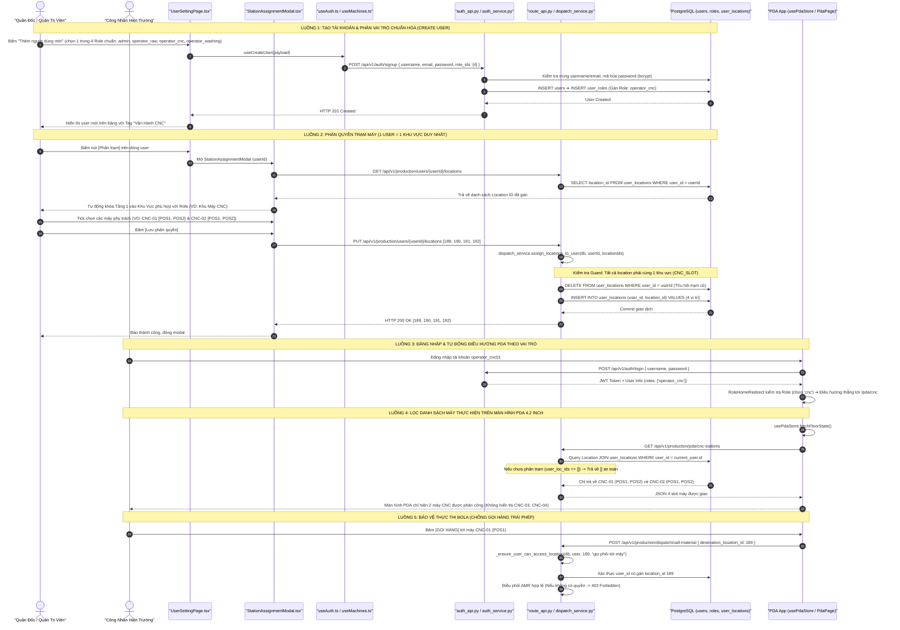

# TÀI LIỆU TOÀN DIỆN REVIEW KHỐI 4: TÀI KHOẢN & PHÂN QUYỀN KHU VỰC TRẠM (USERS & STATION RBAC)
*(USER LIFECYCLE, ROLE-BASED ACCESS CONTROL, 1-USER-1-AREA PRINCIPLE & DYNAMIC PDA FIELD FILTERING)*

Tài liệu này đặc tả chi tiết toàn bộ các file tham gia, cấu trúc dữ liệu, các luồng tương tác trọn vẹn (Tạo user, gán role, phân quyền trạm, chuyển khu vực, điều hướng PDA, lọc máy hiển thị và chốt chặn an toàn BOLA) từ **Giao diện Component (Frontend Admin & PDA) $\rightarrow$ Hook / State Store $\rightarrow$ REST API Endpoint & Schemas $\rightarrow$ Service Logic $\rightarrow$ Bảng Cơ sở dữ liệu 3NF (PostgreSQL)** của **Khối 4: Tài Khoản & Phân Quyền Khu Vực Trạm (Users & Station RBAC)** trong hệ sinh thái KUKA WMS.

---

## 🗺️ 1. SƠ ĐỒ LUỒNG ĐI TỔNG THỂ (FULL-STACK FLOW)



---

## 📂 2. TỔNG HỢP CÁC FILE THAM GIA TRONG KHỐI 4 (INVOLVED FILES)

| Tầng Kiến Trúc | Đường Dẫn File | Vai Trò & Trách Nhiệm Cụ Thể |
| :--- | :--- | :--- |
| **Frontend UI (Admin Users)** | [frontend/src/pages/UserSettingPage.tsx](file:///D:/KuKA/KUKA_WMS/frontend/src/pages/UserSettingPage.tsx) | Trang quản lý danh sách tài khoản: Bảng danh sách user, Tag màu phân định vai trò, Modal tạo/sửa người dùng 1 bước với 4 Role chuẩn hóa, nút [Phân trạm] mở modal gán vị trí. |
| **Frontend Component (Modal Phân Trạm)** | [frontend/src/pages/components/StationAssignmentModal.tsx](file:///D:/KuKA/KUKA_WMS/frontend/src/pages/components/StationAssignmentModal.tsx) | Modal phân quyền 2 tầng chuyên biệt: Tầng 1 chọn 1 trong 3 Khu Vực (`raw_material`, `cnc`, `washing`), Tầng 2 chọn checkbox máy/ô vị trí đỗ. Cảnh báo tự động thu hồi trạm khi đổi khu vực. |
| **Frontend Navigation & Redirect** | [frontend/src/components/auth/RoleHomeRedirect.tsx](file:///D:/KuKA/KUKA_WMS/frontend/src/components/auth/RoleHomeRedirect.tsx) & [frontend/src/utils/authSession.ts](file:///D:/KuKA/KUKA_WMS/frontend/src/utils/authSession.ts) | Định tuyến thông minh sau khi đăng nhập: Quản trị viên $\rightarrow$ `/dashboard`, Cấp phôi $\rightarrow$ `/pda/raw-material`, Đứng máy CNC $\rightarrow$ `/pda/cnc`, Khu rửa $\rightarrow$ `/pda/washing`. Đã chuẩn hóa nhận diện vai trò với `roleNames.some(r => r.includes(...))`. |
| **Frontend PDA Store & Sync** | [frontend/src/store/usePdaStore.ts](file:///D:/KuKA/KUKA_WMS/frontend/src/store/usePdaStore.ts) | Quản lý state PDA hiện trường: Tự động gọi `getUserLocationsApi(user.id)` khi khởi tạo, lọc bỏ các máy/ô ngoài phạm vi phân quyền của công nhân. |
| **Frontend Hooks** | [frontend/src/hooks/useAuth.ts](file:///D:/KuKA/KUKA_WMS/frontend/src/hooks/useAuth.ts) & [frontend/src/hooks/useMachines.ts](file:///D:/KuKA/KUKA_WMS/frontend/src/hooks/useMachines.ts) | React Query hooks: `useUser`, `useCreateUser`, `useUpdateUser`, `useDeleteUser`, `useUpdateUserLocations`. |
| **Frontend API Clients** | [frontend/src/api/auth.ts](file:///D:/KuKA/KUKA_WMS/frontend/src/api/auth.ts) & [frontend/src/api/machine.ts](file:///D:/KuKA/KUKA_WMS/frontend/src/api/machine.ts) | Axios calls: `/api/v1/auth/*`, `/api/v1/users/*`, `GET/PUT /api/v1/production/users/{userId}/locations`. |
| **Frontend Types** | [frontend/src/types/auth.ts](file:///D:/KuKA/KUKA_WMS/frontend/src/types/auth.ts) | Định nghĩa TypeScript: `User`, `RoleBrief`, `ROLE_OPTIONS` (chỉ 4 role chuẩn, đã loại bỏ `operator`), `UserModule` (chỉ còn `operator_raw`, `operator_cnc`, `operator_washing`; đã cắt bỏ `inbound/outbound/stocktake`). |
| **Backend Router (Auth & Users)** | [backend/app/modules/auth/auth_api.py](file:///D:/KuKA/KUKA_WMS/backend/app/modules/auth/auth_api.py) | Router FastAPI: `POST /auth/login`, `POST /auth/signup`, `GET /users`, `GET /users/{id}`, `PATCH /users/{id}`, `DELETE /users/{id}`, `GET /roles`. |
| **Backend Router (PDA & Guard)** | [backend/app/modules/production/route_api.py](file:///D:/KuKA/KUKA_WMS/backend/app/modules/production/route_api.py) | Router FastAPI: Lọc `UserLocation` đồng bộ cả 3 endpoint (`raw`, `cnc`, `washing`); Chốt chặn BOLA `_ensure_user_can_access_location` tại các action: `call-material`, `complete-stage`, `register-raw-material`, `return-empty-cart`. |
| **Backend Schemas** | [backend/app/modules/auth/auth_schema.py](file:///D:/KuKA/KUKA_WMS/backend/app/modules/auth/auth_schema.py) | Pydantic Models: `MODULE_NAMES` đã tinh gọn chuẩn hóa chỉ còn `("operator_raw", "operator_cnc", "operator_washing")`, loại bỏ hoàn toàn `inbound`, `outbound`, `stocktake`, `operator`. |
| **Backend Service (Auth)** | [backend/app/modules/auth/auth_service.py](file:///D:/KuKA/KUKA_WMS/backend/app/modules/auth/auth_service.py) & [auth_access.py](file:///D:/KuKA/KUKA_WMS/backend/app/modules/auth/auth_access.py) | Xác thực bcrypt, JWT token, soft-delete người dùng kèm dọn dẹp liên kết `user_locations`. |
| **Backend Location Guard** | [backend/app/modules/production/location_guard.py](file:///D:/KuKA/KUKA_WMS/backend/app/modules/production/location_guard.py) | Hàm `release_location(loc, db)` tự động dọn dẹp các dòng `UserLocation` khi trạm/máy bị đưa về `UNASSIGNED`. |
| **Backend Service (Location RBAC)** | [backend/app/modules/production/dispatch_service.py](file:///D:/KuKA/KUKA_WMS/backend/app/modules/production/dispatch_service.py#L514-L553) | Hàm `assign_locations_to_user`: Triệt để thực thi quy tắc bất biến **1 User = 1 Area**, kiểm tra tính hợp lệ của node bản đồ, tự động thu hồi trạm cũ và commit giao dịch. |
| **Database Models** | [backend/app/modules/auth/auth_model.py](file:///D:/KuKA/KUKA_WMS/backend/app/modules/auth/auth_model.py) & [backend/app/modules/production/production_models.py](file:///D:/KuKA/KUKA_WMS/backend/app/modules/production/production_models.py#L51-L77) | Bảng CSDL quan hệ: `users`, `roles`, `user_roles`, `user_locations` (`user_id`, `location_id`, `created_at`). |

---

## 🔍 3. CHI TIẾT CÁC VIỄN CẢNH VẬN HÀNH (OPERATIONAL SCENARIOS)

### 🟢 VIỄN CẢNH 1: KHỞI TẠO TÀI KHOẢN CÔNG NHÂN VÀ GÁN VAI TRÒ CHUẨN HÓA
* **Mục đích**: Thiết lập tài khoản đăng nhập cho công nhân trực tiếp vận hành tại các khu vực máy trên xưởng cơ khí, loại bỏ tài khoản dùng chung.
* **Quy chuẩn 4 Role cốt lõi**:
  1. `admin` (ID 2): Quản trị viên / Quản đốc xưởng.
  2. `operator_raw` (ID 3): Công nhân Cấp phôi tại Khu Nguyên Liệu (Khu L0).
  3. `operator_cnc` (ID 4): Công nhân Đứng máy gia công CNC (Khu L1, L2, L3).
  4. `operator_washing` (ID 5): Công nhân Vận hành tại Khu Tẩy Rửa & Xe rỗng (WASH).
* **Luồng dữ liệu**:
  1. Admin mở modal tạo người dùng tại `UserSettingPage.tsx`, nhập Username (VD: `op_cnc01`), Email, Mật khẩu và chọn Vai trò: `Vận Hành CNC`.
  2. Frontend gửi `POST /api/v1/auth/signup` với payload `{ username, email, password, role_ids: [4], is_admin: false }`.
  3. Backend `auth_service.sign_up` kiểm tra username/email chưa tồn tại, băm mật khẩu bằng `passlib.bcrypt`, thêm bản ghi vào bảng `users` và liên kết với role `operator_cnc` trong bảng `user_roles`.
  4. Trả về thông tin người dùng kèm token. Bảng người dùng cập nhật tức thì với Tag màu tím/xanh tương ứng.

---

### 🟢 VIỄN CẢNH 2: PHÂN QUYỀN TRẠM MÁY (STATION ASSIGNMENT & 1 USER = 1 AREA)
* **Mục đích**: Gán cụ thể các máy CNC hoặc vị trí ô đỗ mà công nhân có trách nhiệm vận hành. Ngăn chặn triệt để tình trạng công nhân máy này bấm nhầm hoặc thao tác can thiệp vào máy của công nhân khác.
* **Nguyên tắc bất biến (Gold Rule)**: **1 User chỉ được thuộc về 1 Khu Vực duy nhất** (hoặc chỉ làm Nguyên Liệu, hoặc chỉ làm CNC, hoặc chỉ làm Tẩy Rửa).
* **Luồng dữ liệu**:
  1. Admin bấm nút **[Phân trạm]** tại dòng nhân viên trên bảng `UserSettingPage.tsx`.
  2. `StationAssignmentModal.tsx` mở ra, tự động gọi API `GET /api/v1/production/users/{userId}/locations` để lấy danh sách vị trí hiện tại của nhân viên.
  3. Modal phân quyền gồm 2 tầng:
     - **Tầng 1 (Khu Vực)**: Được khóa tự động hoặc chọn giữa `Khu Nguyên Liệu` | `Khu Máy CNC` | `Khu Tẩy Rửa`.
     - **Tầng 2 (Vị Trí Cụ Thể)**: Nếu là CNC, hiển thị danh sách các máy (`CNC-01`, `CNC-02`...), mỗi máy liệt kê đầy đủ các vị trí đỗ `POS1`, `POS2`, `POS3`. Admin có thể tick chọn nhanh từng máy hoặc từng vị trí đỗ riêng biệt.
  4. Khi Admin bấm **[Lưu phân quyền]**, frontend gửi `PUT /api/v1/production/users/{userId}/locations` kèm mảng `location_ids` (VD: `[189, 190, 191, 192]`).
  5. Backend `dispatch_service.assign_locations_to_user` thực hiện xác thực:
     ```python
     area_types = {loc.location_type for loc in loc_objs}
     if len(area_types) > 1:
         raise ValueError("Một tài khoản công nhân chỉ có thể được phân quyền trong 1 khu vực duy nhất.")
     ```
  6. Xóa bỏ toàn bộ các vị trí đã gán cũ của user trong bảng `user_locations`, sau đó `bulk_insert` danh sách vị trí mới và commit trong cùng một transaction.

---

### 🟢 VIỄN CẢNH 3: CHUYỂN ĐỔI KHU VỰC VẬN HÀNH (AREA TRANSFER SAFEGUARD)
* **Mục đích**: Khi quản đốc điều chuyển một công nhân từ đứng máy CNC sang phụ trách Khu Cấp Phôi hoặc Khu Tẩy Rửa.
* **Cơ chế thu hồi tự động**:
  1. Trong `StationAssignmentModal.tsx`, Admin chuyển tab Segmented từ `Khu Máy CNC` sang `Khu Nguyên Liệu`.
  2. Giao diện hiển thị cảnh báo màu vàng: *"Chuyển khu vực sẽ tự động thu hồi quyền tại các trạm của khu vực cũ."*
  3. Toàn bộ checkbox của các máy CNC bị bỏ chọn; danh sách các ô cấp phôi hiển thị để Admin chọn lại.
  4. Khi lưu, Backend xóa sạch các liên kết `CNC_SLOT` trong `user_locations` và thay thế bằng các `RAW_MATERIAL` ID.
  5. Nhân viên sau khi chuyển khu vực đăng nhập lại PDA sẽ tự động chuyển hướng và chỉ nhìn thấy giao diện của khu vực mới.

---

### 🟢 VIỄN CẢNH 4: ĐĂNG NHẬP HIỆN TRƯỜNG & ĐIỀU HƯỚNG PDA THEO VAI TRÒ
* **Mục đích**: Giúp công nhân cầm máy PDA mở ứng dụng là vào thẳng màn hình làm việc của mình, không cần qua các bước chọn menu phức tạp.
* **Luồng dữ liệu**:
  1. Công nhân đăng nhập tại `/login`. Sau khi xác thực thành công, client lưu JWT và User Profile vào Zustand `useAuthStore`.
  2. Hệ thống chuyển hướng qua component điều phối trung tâm: [`RoleHomeRedirect.tsx`](file:///D:/KuKA/KUKA_WMS/frontend/src/components/auth/RoleHomeRedirect.tsx).
  3. Hàm [`getHomePathFromUser(user)`](file:///D:/KuKA/KUKA_WMS/frontend/src/utils/authSession.ts#L16-L53) phân tích role chuẩn của người dùng:
     - Nếu `is_admin = True` $\rightarrow$ `/dashboard` (Giao diện Quản trị web).
     - Nếu role chứa `raw` $\rightarrow$ `/pda/raw-material` (Khu Cấp Phôi).
     - Nếu role chứa `wash` $\rightarrow$ `/pda/washing` (Khu Tẩy Rửa).
     - Nếu role chứa `cnc` $\rightarrow$ `/pda/cnc` (Khu Vận Hành Máy CNC).
  4. Trình duyệt redirect thẳng vào màn hình làm việc tương ứng dù username đặt tên người bất kỳ (như `nguyen_van_a`).

---

### 🟢 VIỄN CẢNH 5: LỌC DANH SÁCH MÁY HIỂN THỊ TRÊN MÀN HÌNH PDA 4.2 INCH (FIELD VIEW FILTERING)
* **Mục đích**: Màn hình PDA công nghiệp rất nhỏ (4.2 inch). Nếu hiển thị tất cả các máy trong xưởng thì giao diện sẽ bị rối, công nhân phải cuộn trang liên tục và rất dễ bấm nhầm vào máy của người khác.
* **Luồng dữ liệu**:
  1. Tại trang `/pda/cnc`, hook kích hoạt `usePdaStore.fetchFloorState()`.
  2. Store gọi song song API dữ liệu xưởng và API phân quyền.
  3. Backend endpoint `GET /api/v1/production/pda/cnc-stations` ([route_api.py](file:///D:/KuKA/KUKA_WMS/backend/app/modules/production/route_api.py)):
     ```python
     if not is_admin:
         if not user_loc_ids:
             return []  # Chưa được phân trạm -> Trả về rỗng an toàn
         query = query.filter(Location.id.in_(user_loc_ids))
     ```
  4. Kết quả trả về cho PDA chỉ gồm đúng các máy/vị trí đỗ mà công nhân này được phân công (VD: chỉ hiển thị `CNC-01` và `CNC-02`).
  5. Tương tự, `get_pda_raw_materials` và `get_pda_washing_slots` cũng chỉ trả về các ô mà công nhân được phân công quản lý.

---

### 🟢 VIỄN CẢNH 6: CHỐT CHẶN BẢO MẬT BOLA (BROKEN OBJECT LEVEL AUTHORIZATION GUARD)
* **Mục đích**: Ngăn chặn trường hợp công nhân trạm này gửi lệnh API can thiệp vào trạm của công nhân khác (qua sửa payload mạng hoặc Postman).
* **Cơ chế**:
  - Tại 4 endpoint thao tác chính trên PDA:
    1. `POST /production/racks/register-raw-material`
    2. `POST /production/dispatch/call-material`
    3. `POST /production/dispatch/complete-stage`
    4. `POST /production/dispatch/return-empty-cart-from-washing`
  - Backend thực thi chốt chặn:
    ```python
    def _ensure_user_can_access_location(db: Session, user: User, location_id: int, action_desc: str) -> None:
        if bool(any(r.name == "admin" for r in (user.roles or []))):
            return
        assigned = db.query(UserLocation).filter(
            UserLocation.user_id == user.id,
            UserLocation.location_id == location_id,
        ).first()
        if not assigned:
            raise HTTPException(
                status_code=status.HTTP_403_FORBIDDEN,
                detail=f"Bạn không có quyền thực hiện thao tác '{action_desc}' tại trạm/vị trí này (ID={location_id}).",
            )
    ```
  - Nếu vi phạm, hệ thống chặn đứng với mã lỗi `403 Forbidden`.

---

## 🛡️ 4. TỔNG HỢP CÁC ĐIỂM ĐÃ ĐƯỢC CHUẨN HÓA & KHẮC PHỤC TRIỆT ĐỂ

| Hạng Mục | Trạng Thái Cũ (Trước Khi Xử Lý) | Trạng Thái Mới (Đã Khắc Phục Hoàn Toàn) |
| :--- | :--- | :--- |
| **Role chung chung `operator`** | Tồn tại role `operator` (ID 1) không gắn với khu vực nào, gây mập mờ trong UI và DB. | **Đã khai tử hoàn toàn**. Tài khoản cũ được chuyển sang `operator_cnc`. Hệ thống chỉ duy trì đúng 4 Role chuẩn hóa. |
| **Di sản module FMCG cũ** | `auth_schema.py` và `auth.ts` vẫn chứa `"inbound"`, `"outbound"`, `"stocktake"`. | **Đã cắt bỏ 100% rác kỹ thuật**. `MODULE_NAMES` và `UserModule` chỉ còn đúng 3 phân hệ xưởng cơ khí: `operator_raw`, `operator_cnc`, `operator_washing`. |
| **Lọc danh sách máy PDA CNC** | Khi user chưa được phân trạm (`user_loc_ids == []`), API trả về toàn bộ máy trên xưởng. | **Đã khóa chặt**: Trả về danh sách rỗng `[]` khi chưa phân quyền. PDA báo rõ trạng thái chưa được gán máy. |
| **Lọc danh sách ô Nguyên Liệu & Rửa** | `get_pda_raw_materials` và `get_pda_washing_slots` không lọc theo `UserLocation`. | **Đã đồng bộ**: Lọc chặt chẽ theo `user_loc_ids` cho cả 3 màn hình PDA (`raw`, `cnc`, `washing`). |
| **Điều hướng PDA `authSession.ts`** | Kiểm tra cứng `raw_material` và `washing` làm sai lệch với role `operator_raw`/`operator_washing`. | **Đã chuẩn hóa**: Dùng `.some(r => r.includes(...))` nhận diện chính xác vai trò bất kể username. |
| **Rác liên kết mồ côi `UserLocation`** | Khi giải phóng node (`release_location`) hoặc xóa user (`delete_user`), liên kết vị trí không được dọn dẹp. | **Đã dọn dẹp tự động**: Tự động cascade xóa `UserLocation` khi node chuyển về `UNASSIGNED` hoặc khi user bị vô hiệu hóa. |
| **Bảo mật BOLA Action API** | Chỉ lọc hiển thị ở giao diện, không kiểm tra quyền khi gửi lệnh gọi phôi/báo xong. | **Đã thiết lập chốt chặn 403 Forbidden** tại toàn bộ các action endpoint điều phối của PDA. |
