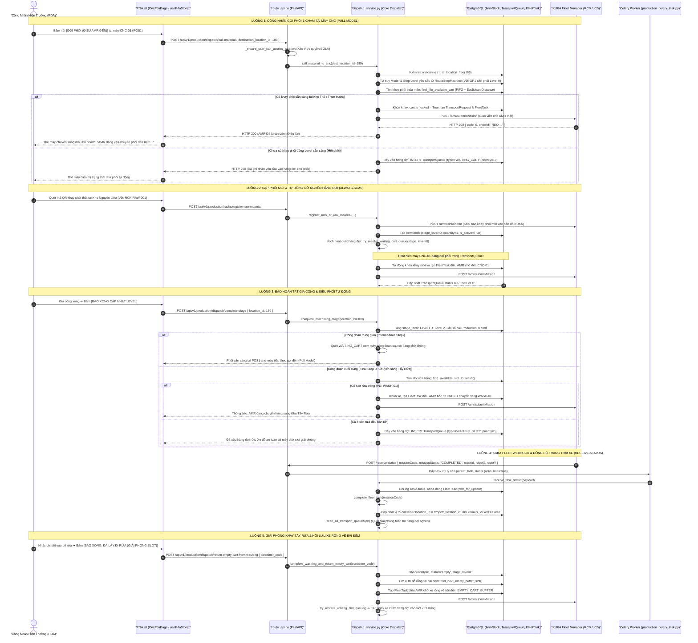

# TÀI LIỆU TOÀN DIỆN REVIEW KHỐI 5: LÕI THUẬT TOÁN ĐIỀU PHỐI AMR & HÀNG ĐỢI TỰ ĐỘNG
*(CORE DISPATCH ENGINE, PRIORITY QUEUES, DOUBLE-BUFFERING & BACKGROUND CELERY WORKERS)*

Tài liệu này đặc tả chi tiết toàn bộ các file tham gia, cấu trúc dữ liệu, các luồng tương tác trọn vẹn (Gọi phôi 1-chạm, thuật toán tìm khay FIFO kết hợp khoảng cách Euclidean, cơ chế Double-Buffering POS1/POS2 chống đói máy, hàng đợi ưu tiên `WAITING_CART` & `WAITING_SLOT`, máy trạng thái Webhook KUKA Fleet và Worker Always-Scan) từ **Giao diện PDA Hiện Trường $\rightarrow$ REST API Endpoint $\rightarrow$ Core Dispatch Service $\rightarrow$ Bảng Cơ sở dữ liệu 3NF (PostgreSQL) $\rightarrow$ Celery Worker & KUKA Fleet Manager** của **Khối 5: Lõi Thuật Toán Điều Phối AMR & Hàng Đợi Tự Động (Dispatch Engine & Queue Worker)** trong hệ sinh thái KUKA WMS.

---

## 🗺️ 1. SƠ ĐỒ LUỒNG ĐI TỔNG THỂ (FULL-STACK FLOW)



---

## 📂 2. TỔNG HỢP CÁC FILE THAM GIA TRONG KHỐI 5 (INVOLVED FILES)

| Tầng Kiến Trúc | Đường Dẫn File | Vai Trò & Trách Nhiệm Cụ Thể |
| :--- | :--- | :--- |
| **Backend Core Service (Lõi Điều Phối)** | [backend/app/modules/production/dispatch_service.py](file:///D:/KuKA/KUKA_WMS/backend/app/modules/production/dispatch_service.py) | **Trung tâm điều phối toàn xưởng**: Tính khoảng cách 2D Euclidean, thuật toán tìm xe FIFO, khóa an toàn vị trí `_is_location_free`, cơ chế Pull Model CNC, định tuyến đa tầng, hàng đợi ưu tiên kép, bộ chuyển đổi KUKA Fleet HTTP Adapter và xử lý webhook. |
| **Backend Celery Background Workers** | [backend/app/modules/production/production_celery_task.py](file:///D:/KuKA/KUKA_WMS/backend/app/modules/production/production_celery_task.py) | **Xử lý nền & Quét tự động**: Task `robot.persist_task_status` tiếp nhận webhook KUKA không làm nghẽn API; Task tuần hoàn `production.scan_transport_queue` (Always-Scan) định kỳ giải phóng các yêu cầu kẹt hàng đợi phòng ngừa rớt mạng. |
| **Backend REST API Endpoints** | [backend/app/modules/production/route_api.py](file:///D:/KuKA/KUKA_WMS/backend/app/modules/production/route_api.py) | Khai báo các router nghiệp vụ: `POST /dispatch/call-material`, `POST /dispatch/complete-stage`, `POST /racks/register-raw-material`, `POST /dispatch/return-empty-cart-from-washing`, `POST /receive-status`. |
| **Backend Database Models** | [backend/app/modules/production/production_models.py](file:///D:/KuKA/KUKA_WMS/backend/app/modules/production/production_models.py) | Định nghĩa các bảng 3NF: `TransportRequest`, `TransportQueue`, `FleetTask`, `TaskStatus`, `FleetApiCall`, `ProductionRecord`, `ItemStock`, `Location`, `Machine`. |
| **Backend Schemas** | [backend/app/modules/production/route_schema.py](file:///D:/KuKA/KUKA_WMS/backend/app/modules/production/route_schema.py) | Pydantic Request/Response models: `CallMaterialRequest`, `CompleteStageRequest`, `ContainerActionRequest`. |
| **Backend Location Guard** | [backend/app/modules/production/location_guard.py](file:///D:/KuKA/KUKA_WMS/backend/app/modules/production/location_guard.py) | Kiểm tra hợp lệ tọa độ Map Node KUKA, loại hình vị trí (`RAW_MATERIAL`, `CNC_SLOT`, `WASHING_SLOT`, `EMPTY_CART_BUFFER`). |
| **Frontend PDA Store** | [frontend/src/store/usePdaStore.ts](file:///D:/KuKA/KUKA_WMS/frontend/src/store/usePdaStore.ts) | State management Zustand cho PDA: Kích hoạt API gọi phôi 1-chạm, báo xong công đoạn, nạp phôi QR, giải phóng slot rửa; cập nhật optimistic UI và phản hồi lỗi thật 100%. |
| **Frontend PDA Components** | [frontend/src/components/pda/CncLineModal.tsx](file:///D:/KuKA/KUKA_WMS/frontend/src/components/pda/CncLineModal.tsx), [RawMaterialWizard.tsx](file:///D:/KuKA/KUKA_WMS/frontend/src/components/pda/RawMaterialWizard.tsx), [WashingStationModal.tsx](file:///D:/KuKA/KUKA_WMS/frontend/src/components/pda/WashingStationModal.tsx) | Giao diện công nghiệp tỉ lệ 4.2-inch: Thẻ máy CNC Double-Buffering (POS1/POS2), nút Gọi Hàng 1-chạm, Báo Xong, Quét QR Camera thực tế. |

---

## 🔍 3. CHI TIẾT CÁC VIỄN CẢNH VẬN HÀNH & THUẬT TOÁN ĐIỀU PHỐI (OPERATIONAL SCENARIOS & CORE ALGORITHMS)

### 🟢 VIỄN CẢNH 1: NẠP PHÔI TẠI KHU NGUYÊN LIỆU & TỰ ĐỘNG GỠ NGHẼN HÀNG ĐỢI
* **Mục đích**: Đăng ký khay phôi thô vừa đưa vào vị trí cấp phôi và kích hoạt điều xe tự động nếu chuyền CNC đang chờ.
* **Quy trình xử lý (`register_rack_at_raw_material`)**:
  1. Công nhân dùng PDA quét tem mã QR dán trên xe phôi (VD: `RCK-RAW-001`).
  2. Hệ thống kiểm tra xem mã khay này đã có sẵn trong hệ thống chưa (Cơ chế Reusable Rack QR). Nếu chưa, tạo mới `ItemStock`; nếu đã có, tái kích hoạt `is_active=True`, gán `location_id`, đặt `current_stage_level=0`, `status='available'`.
  3. Gửi lệnh HTTP `POST /amr/containerIn` sang KUKA Fleet Manager để khai báo xe phôi đã vào tọa độ bản đồ.
  4. **Kích hoạt Always-Scan ngay lập tức**: Gọi `try_resolve_waiting_cart_queue(stage_level=0)`. Nếu có máy CNC gia công OP1 đang chờ phôi trong `TransportQueue`, AMR sẽ tự động được điều động tới nhận khay ngay lập tức mà không cần ai thao tác thêm.

---

### 🟢 VIỄN CẢNH 2: GỌI PHÔI 1-CHẠM & DOUBLE-BUFFERING POS1/POS2 (ZERO CNC STARVATION)
* **Mục đích**: Máy CNC không bao giờ phải dừng chờ phôi (Zero Starvation) và công nhân không cần nhớ mã linh kiện hay cấp độ gia công.
* **Nguyên tắc Double-Buffering**:
  - Mỗi máy CNC sở hữu 2 vị trí đệm độc lập: `POS1` và `POS2`.
  - **Hạ ở đâu bốc ở đó**: AMR hạ khay phôi vào POS1 thì sau khi gia công xong, AMR sẽ tới bốc hàng đi từ chính POS1. Không có việc công nhân phải di chuyển khay giữa POS1 và POS2.
  - **Cơ chế gối đầu (Buffering)**: Khi công nhân đang gia công khay tại POS1, họ có thể bấm gọi phôi cho POS2. AMR sẽ chuyển sẵn khay tiếp theo tới POS2. Khi POS1 xong, máy có thể chuyển sang gia công POS2 ngay lập tức.
* **Tự suy Routing Step 1-Chạm**:
  ```python
  # Tự suy Model từ RouteStepMachine của máy
  if item_id is None:
      step_link = db.query(RouteStepMachine)...filter(Machine.machine_code == dest_loc.machine_code)
      item_id = step_link.route_step.route.item_id
  # Tự suy Cấp độ phôi đầu vào (Input Stage Level)
  if required_stage_level is None:
      input_lvl, _, _ = self.get_stage_info_for_machine(db, dest_loc, item_id)
      required_stage_level = input_lvl
  ```

---

### 🟢 VIỄN CẢNH 3: THUẬT TOÁN CHỌN PHÔI TỐI ƯU (CART SELECTION ALGORITHM)
* **Hàm thực thi**: `find_fifo_available_cart` ([dispatch_service.py](file:///D:/KuKA/KUKA_WMS/backend/app/modules/production/dispatch_service.py#L753-L807)).
* **Tiêu chí đa tầng (Multi-tier Criteria)**:
  1. **Lọc hợp lệ**: `ItemStock.item_id == item_id`, `current_stage_level == required_stage_level`, `is_locked == False`, `is_active == True`, `quantity > 0`.
  2. **Tier 1 - FIFO cho Phôi Thô (Level 0)**: Ưu tiên khay nhập trước xuất trước theo thời gian tạo (`created_at ASC, id ASC`).
  3. **Tier 2 - Khoảng cách Euclidean 2D cho Bán thành phẩm (Level > 0)**:
     $$D = \sqrt{(x_{cart} - x_{target})^2 + (y_{cart} - y_{target})^2}$$
     Khay nào đang ở gần máy CNC gọi nhất trên mặt bằng xưởng sẽ được ưu tiên bốc trước để tối ưu hóa quãng đường di chuyển của AMR. Nếu khoảng cách bằng nhau, tie-break bằng FIFO.
  4. **Chống Race Condition**: Sử dụng khóa hàng nâng cao PostgreSQL:
     ```python
     .with_for_update(of=ItemStock, skip_locked=True)
     ```
     Đảm bảo khi nhiều máy CNC gọi phôi cùng một mili-giây, không bao giờ có 2 máy chọn trùng 1 khay phôi.

---

### 🟢 VIỄN CẢNH 4: HOÀN TẤT GIA CÔNG & ĐỊNH TUYẾN ĐA TẦNG (INTERMEDIATE vs FINAL STEP)
* **Hàm thực thi**: `complete_machining_stage` ([dispatch_service.py](file:///D:/KuKA/KUKA_WMS/backend/app/modules/production/dispatch_service.py#L1036-L1220)).
* **Cơ chế phân nhánh**:
  - Khi công nhân bấm báo xong, `current_stage_level` tăng lên 1 (VD: Level 1 $\rightarrow$ Level 2) và ghi sổ cái `ProductionRecord`.
  - **Trường hợp A: Còn công đoạn gia công tiếp theo (`is_final_cnc_step = False`)**:
    - Áp dụng triệt để mô hình **Pull Model**: Khay phôi được giữ an toàn tại vị trí máy vừa làm xong.
    - Quét ngay hàng đợi `WAITING_CART`: Nếu máy ở công đoạn sau đã đặt lệnh chờ phôi này, AMR lập tức được điều đến chở đi. Nếu chưa máy nào gọi, khay nằm chờ tại chỗ cho đến khi máy sau phát lệnh gọi.
  - **Trường hợp B: Công đoạn CNC cuối cùng (`is_final_cnc_step = True`)**:
    - Hệ thống tự động chuyển sang chế độ **Push to Washing**: Tự tìm slot trống tại Khu Tẩy Rửa (`find_available_slot_to_wash`).
    - Nếu có slot trống $\rightarrow$ Điều AMR chở thẳng sang Khu Tẩy Rửa.
    - Nếu cả 4 slot rửa đều bận $\rightarrow$ Đẩy yêu cầu vào `TransportQueue` (`WAITING_SLOT`, `priority = 5`). Xe phôi đỗ tạm an toàn tại máy CNC cho đến khi có slot rửa giải phóng.

---

### 🟢 VIỄN CẢNH 5: GIẢI PHÓNG KHAY TẨY RỬA & HỒI LƯU XE RỖNG VỀ BÃI ĐỆM
* **Hàm thực thi**: `complete_washing_and_return_empty_cart` ([dispatch_service.py](file:///D:/KuKA/KUKA_WMS/backend/app/modules/production/dispatch_service.py#L1228-L1310)).
* **Quy trình hồi lưu xe rỗng**:
  1. Khi công nhân nhấc chi tiết đưa vào bể rửa, xe phôi trở thành xe rỗng. Công nhân bấm nút giải phóng slot trên PDA.
  2. Hệ thống đặt `quantity = 0`, `status = 'empty'`, `current_stage_level = 0`.
  3. Tìm ô đỗ trống tại Bãi đệm xe rỗng (`find_next_empty_buffer_slot`) theo cơ chế Round-Robin (`EMPTY-01` .. `EMPTY-04`).
  4. Điều xe AMR tới bốc xe rỗng chở về bãi đệm. Khi AMR hạ xe rỗng tại bãi đệm, hệ thống gọi `fleet_container_out` để giải phóng xe khỏi KUKA Fleet.
  5. **Tự động kích hoạt gỡ nghẽn slot rửa**: Ngay khi slot rửa vừa được giải phóng, hàm `try_resolve_waiting_slot_queue()` lập tức tìm trong hàng đợi xem có máy CNC nào đang chờ chuyển phôi sang rửa hay không để điều AMR tới bốc ngay!

---

### 🟢 VIỄN CẢNH 6: LÕI HÀNG ĐỢI ƯU TIÊN KÉP & WORKER ALWAYS-SCAN
* **Hai loại hàng đợi trong `TransportQueue`**:
  1. **`WAITING_CART` (Chờ phôi)**: Máy CNC cần phôi nhưng kho/chuyền chưa có khay đúng Level sẵn sàng.
  2. **`WAITING_SLOT` (Chờ ô đỗ)**: Máy CNC hoàn tất gia công bước cuối nhưng cả 4 slot rửa đều bận, hoặc xe rỗng chờ bãi đệm.
* **Quy ước độ ưu tiên (Priority Scale)**:
  - `priority = 5` (Cao nhất): Chuyển phôi sang Khu Tẩy Rửa (`WAITING_SLOT`). Ưu tiên giải phóng máy CNC trước để máy không bị ách tắc.
  - `priority = 10` (Trung bình): Gọi phôi mới tới máy CNC (`WAITING_CART`).
  - `priority = 15` (Thấp hơn): Trả xe rỗng về bãi đệm (`RETURN_EMPTY_CART`).
* **Cơ chế kích hoạt kép (Dual-Trigger Always-Scan)**:
  - **Kích hoạt phản xạ (Event-Driven)**: Tự động chạy ngay khi có sự kiện nạp phôi mới, máy CNC báo xong, công nhân giải phóng slot rửa, hoặc AMR hoàn thành nhiệm vụ.
  - **Kích hoạt định kỳ (Periodic Celery Beat)**: Task `production.scan_transport_queue` chạy ngầm định kỳ quét toàn bộ các bản ghi `PENDING` trong `TransportQueue` để tự động khớp nối xe và vị trí, loại bỏ 100% rủi ro nghẽn lệnh do mất kết nối mạng tạm thời.

---

### 🟢 VIỄN CẢNH 7: MÁY TRẠNG THÁI WEBHOOK KUKA FLEET (CALLBACK FSM)
* **Endpoint tiếp nhận**: `POST /receive-status` ([route_api.py](file:///D:/KuKA/KUKA_WMS/backend/app/modules/production/route_api.py#L330-L345)).
* **Quy trình xử lý bất đồng bộ**:
  1. API nhận webhook từ KUKA Fleet Manager, ghi log và trả ngay `HTTP 200` theo quy chuẩn KUKA Fleet.
  2. Chuyển payload sang Celery Task `robot.persist_task_status` (`acks_late=True`, retry lũy thừa 3 lần).
  3. Hàm `receive_task_status` khóa dòng `FleetTask` (`with_for_update`) và thực thi Finite State Machine (FSM):
     - **`MOVE_BEGIN` / `ARRIVED`**: AMR bắt đầu di chuyển hoặc đã tới vị trí đón ➔ Cập nhật `FleetTask.status = 'in_progress'`.
     - **`UP_CONTAINER`**: AMR nâng khay phôi lên lưng ➔ Ghi nhận `picked_up_at`, khóa chặt `ItemStock.is_locked = True`.
     - **`DOWN_CONTAINER`**: AMR hạ khay phôi xuống sàn ➔ Giữ nguyên `in_progress` (chưa kết thúc nhiệm vụ, AMR đang rút chốt).
     - **`COMPLETED`**: Nhiệm vụ hoàn thành 100% ➔ Chuyển `FleetTask.status = 'completed'`, đổi vị trí `cart.location_id = dropoff_location_id`, mở khóa `cart.is_locked = False`, và kích hoạt `scan_all_transport_queues(db)`.
     - **`FAILED` / `CANCELLED`**: Nhiệm vụ bị hủy hoặc lỗi phần cứng ➔ Cập nhật `failed`, mở khóa khay phôi để hệ thống khác có thể tái sử dụng.

---

## 🛡️ 4. TỔNG HỢP CÁC ĐIỂM ĐÃ ĐƯỢC CHUẨN HÓA & ĐÁNH GIÁ CHẤT LƯỢNG MÃ NGUỒN

| Hạng Mục | Hiện Trạng Thiết Kế & Đánh Giá Chất Lượng |
| :--- | :--- |
| **Bảo vệ đồng thời (Concurrency Safety)** | Sử dụng `with_for_update(of=ItemStock, skip_locked=True)` và `with_for_update(of=FleetTask)` triệt để. Ngăn chặn 100% xung đột race-condition khi nhiều máy CNC cùng gọi hàng hoặc nhiều robot gửi webhook cùng lúc. |
| **Khóa an toàn vị trí 3 tầng (`_is_location_free`)** | Kiểm tra cùng lúc 3 điều kiện: (1) Không có xe đang đỗ; (2) Không có xe đang trên đường tới; (3) Không có `FleetTask` nào đặt đích đến vị trí này. Ngăn chặn tuyệt đối tai nạn 2 AMR cùng hạ khay vào 1 ô đỗ. |
| **Độ tin cậy KUKA Fleet (Real Error Reporting)** | Đã loại bỏ hoàn toàn chế độ `simulated: True`. Khi máy chủ KUKA Fleet offline hoặc chưa cấu hình URL, hệ thống ghi log lỗi rõ ràng, trả về `HTTP 503` kèm nguyên nhân cụ thể và lưu vết vào `fleet_api_call`. |
| **Cơ chế chống nghẽn xưởng (Always-Scan Engine)** | Kiến trúc hàng đợi ưu tiên kép (`WAITING_CART` & `WAITING_SLOT`) kết hợp Dual-Trigger (Event-driven + Celery Periodic) giúp xưởng tự động gỡ nghẽn trơn tru khi nguồn phôi hoặc ô đỗ sẵn sàng. |
| **Truy xuất nguồn gốc (Genealogy Audit Trail)** | Bảng `production_record` ghi lại chính xác lịch sử: Chi tiết phôi nào, gia công tại máy nào, nâng lên Level mấy, công nhân nào phụ trách, thời điểm nào. |

---

## ⚠️ 5. CÁC HẠN CHẾ CÒN TỒN TẠI & ĐỀ XUẤT CẢI TIẾN TRỌNG YẾU (KEY GAPS & PROPOSALS)

Mặc dù Lõi Điều Phối Backend đã hoàn thiện rất vững chắc và đạt chuẩn công nghiệp, qua rà soát toàn diện vẫn còn **3 hạn chế quan trọng** cần được bổ sung để hoàn thiện 100% trải nghiệm vận hành:

### 🔴 Hạn Chế 1: Thiếu API & Màn Hình Web Giám Sát AMR & Hàng Đợi (Fleet & Queue Monitor)
* **Vấn đề**: Backend có đầy đủ bảng `FleetTask`, `TransportQueue`, `TaskStatus`, `FleetApiCall`. Tuy nhiên hiện tại **chưa có endpoint GET nào** và **chưa có trang giao diện web nào** để Quản đốc xưởng/Admin theo dõi trực quan:
  - Danh sách các xe AMR đang chạy trong xưởng (Nhiệm vụ gì, từ máy nào đến máy nào, tiến độ ra sao).
  - Danh sách hàng đợi đang chờ (`TransportQueue` — máy nào đang đợi phôi, khay nào đang chờ slot rửa).
  - Lịch sử lỗi kết nối KUKA Fleet.
* **Đề xuất**: 
  - Bổ sung 2 endpoint quản trị: `GET /api/v1/production/dispatch/tasks` (phân trang, lọc theo status) và `GET /api/v1/production/dispatch/queues`.
  - Xây dựng trang giao diện giám sát điều phối trực quan trên Web Admin.

### 🟡 Hạn Chế 2: Chưa có Cơ chế Timeout & Tự Động Hủy Task Kẹt (Mission Timeout Watchdog)
* **Vấn đề**: Nếu một robot KUKA gặp sự cố vật lý giữa đường (hết pin, kẹt chướng ngại vật) mà không gửi được webhook `COMPLETED` hay `FAILED`, nhiệm vụ `FleetTask` sẽ mãi ở trạng thái `in_progress`, dẫn đến khay phôi và vị trí đỗ bị khóa cứng vĩnh viễn (`is_locked = True`).
* **Đề xuất**: Bổ sung một Celery Watchdog task định kỳ kiểm tra các `FleetTask` ở trạng thái `in_progress` quá thời gian định mức (VD: > 15 phút không có cập nhật tọa độ mới) để gửi cảnh báo tới Quản đốc và cung cấp nút can thiệp "Hủy khẩn cấp & Mở khóa xe" trên giao diện Admin.

### 🟡 Hạn Chế 3: Đồng Bộ Bảng Điều Khiển Bản Đồ 2D Với Trạng Thái AMR Thực
* **Vấn đề**: Hiện tại bản đồ 2D nhà máy đã vẽ vị trí các máy CNC, trạm rửa và bãi đệm, nhưng chưa hiển thị vị trí thời gian thực của xe AMR dựa trên tọa độ `(robot_x, robot_y)` nhận được từ webhook KUKA.
* **Đề xuất**: Tận dụng dữ liệu tọa độ `robot_x`, `robot_y` có sẵn trong bảng `TaskStatus` để vẽ biểu tượng xe AMR di chuyển trực tiếp trên bản đồ 2D xưởng.

---

### 📌 TỔNG KẾT & BƯỚC TIẾP THEO

Tài liệu này đã bao quát toàn diện kiến trúc và thuật toán của **Khối 5 (Lõi Điều Phối AMR & Hàng Đợi Tự Động)**. Bạn hãy xem xét bản tóm tắt và đánh giá này:
1. Bạn có muốn bổ sung thêm trường thông tin hay yêu cầu nghiệp vụ nào vào tài liệu Khối 5 không?
2. Bạn có muốn chúng ta tiến hành giải quyết các Hạn chế nêu trên (đặc biệt là tạo API & Màn hình Web Giám Sát AMR Live và Hàng Đợi Chờ cho Quản đốc) hay tiếp tục rà soát khối tiếp theo?
