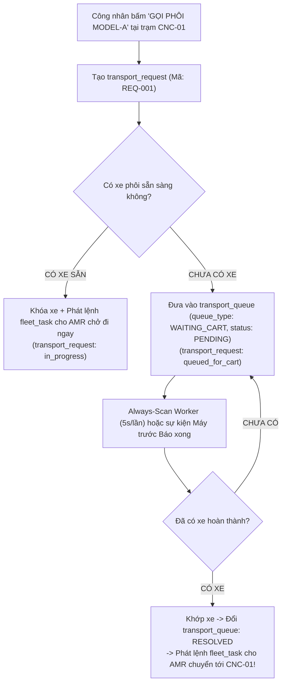

# GIẢI ĐÁP CHI TIẾT CÁC CÂU HỎI VỀ KIẾN TRÚC CƠ SỞ DỮ LIỆU & LUỒNG KUKA AMR

---

### Câu hỏi 1: Tại sao có `transport_request`, `transport_queue` là theo từng vị trí hay sao ?
### Câu hỏi 2: Request mà cũng lưu vào database ư ?

#### 💡 Câu trả lời & Bản chất nghiệp vụ:
1. **`transport_request` KHÔNG PHẢI theo từng vị trí, mà là ĐƠN YÊU CẦU VẬN CHUYỂN (Order/Intent nghiệp vụ):**
   - Giống như khi bạn bấm đặt một chuyến xe Grab hoặc đặt một đơn Shopee: Hệ thống phải sinh ra một **Mã đơn** (`REQ-xxxx`) ghi nhận: *Ai đặt? Gọi xe chở Model gì? Lấy từ đâu và giao đến trạm máy nào? Độ ưu tiên bao nhiêu?*
   - **Vì sao BẮT BUỘC phải lưu vào Database?**
     - **Không bị mất dữ liệu khi sự cố**: Nếu chỉ lưu tạm trên RAM hoặc Redis, lỡ xưởng mất điện hoặc server restart thì toàn bộ yêu cầu gọi phôi của công nhân sẽ bốc hơi sạch, robot không biết chở đi đâu!
     - **Truy vết & Đo lường KPI xưởng**: Quản đốc cần biết hôm nay trạm CNC-01 gọi hàng bao nhiêu lần, thời gian từ lúc công nhân bấm gọi đến khi robot giao xe mất bao nhiêu phút, đơn nào bị hủy, máy nào hay phải chờ phôi nhất.
     - **Quản lý vòng đời**: Đơn đi từ `pending` $\rightarrow$ `in_progress` $\rightarrow$ `completed`.

2. **`transport_queue` là HÀNG ĐỢI ĐIỀU PHỐI TỰ ĐỘNG (Chỉ chứa các đơn BỊ NGHẼN):**
   - Khi máy CNC bấm gọi hàng (`transport_request` sinh ra):
     - **Nếu có xe phôi sẵn sàng ngay**: Hệ thống lập tức phát lệnh cho Robot (`fleet_task`), xe chạy luôn $\rightarrow$ **KHÔNG CẦN vào `transport_queue`**.
     - **Nếu CHƯA CÓ xe sẵn sàng** (ví dụ: máy công đoạn trước chưa gia công xong, hoặc kho nguyên liệu tạm hết phôi Model đó) $\rightarrow$ Đơn gọi hàng này sẽ được đưa vào `transport_queue` (trạng thái `PENDING`).
     - Tương tự: Khi máy CNC cuối gia công xong muốn chuyển xe sang Khu Tẩy Rửa, nhưng cả 4 ô rửa đều đang kín chỗ $\rightarrow$ Đơn chuyển rửa được đưa vào `transport_queue` (loại `WAITING_SLOT`).
   - **Tại sao phải tách riêng 2 bảng mà không gộp chung?**
     - Bảng `transport_request` lưu lịch sử lâu dài (hàng chục nghìn đơn theo tháng).
     - Bảng `transport_queue` là bảng điều phối nhanh, chỉ chứa số ít các đơn đang bị kẹt chờ xe hoặc chờ slot. Background Worker (Always-Scan mỗi 5 giây) chỉ cần quét bảng nhỏ này để khớp lệnh, giúp hệ thống chạy cực nhanh và không bị chậm theo thời gian.

#### 📊 Minh họa trực quan:


---

### Câu hỏi 3: `fleet_task` khác gì `task_status` mà không để status ở trong `fleet_task` luôn nhỉ ?

#### 💡 Câu trả lời & Bản chất nghiệp vụ:
- **Thực tế trong bảng `fleet_task` ĐÃ CÓ trường `status` rồi!** (`created` $\rightarrow$ `sent` $\rightarrow$ `in_progress` $\rightarrow$ `completed` / `failed`).
- Vậy bảng **`task_status`** sinh ra để làm gì?
  - `fleet_task`: Là **Lệnh điều khiển** mà hệ thống phần mềm WMS của bạn gửi sang KUKA Fleet Manager (1 chuyến đi = 1 dòng duy nhất).
  - `task_status`: Là **Sổ nhật ký Webhook (Audit Log)** ghi lại từng gói tin callback mà hãng KUKA bắn ngược về server WMS trong suốt chuyến đi đó.
- **Nếu chỉ lưu status trong `fleet_task` thì xảy ra vấn đề gì?**
  - Trong quá trình robot di chuyển từ điểm A đến điểm B, hệ thống KUKA RCS sẽ gửi callback 4 - 5 lần:
    1. Lần 1: Robot bắt đầu lăn bánh (`status = 6`, `deviceCode = AMR-01`)
    2. Lần 2: Robot đã chui gầm và kích nâng kệ (`subTaskStatus = 2`, `shelfNumber = CART-001`)
    3. Lần 3: Robot đang cõng xe chạy trên hành lang xưởng
    4. Lần 4: Robot đã hạ kệ an toàn xuống trạm máy (`status = 8` hoặc `9`, hoàn tất).
  - Nếu chỉ ghi đè lên `fleet_task.status`, bạn sẽ **mất toàn bộ lịch sử di chuyển và mốc thời gian chi tiết**.
  - Khi robot gặp sự cố (ví dụ robot bị kẹt vật cản, mất tín hiệu WiFi, hoặc công nhân đặt sai kệ): Bảng `task_status` lưu nguyên vẹn toàn bộ mã lỗi, mã thiết bị, mã kệ thực tế để kỹ sư đối soát kỹ thuật mà không thể chối cãi.

#### 📊 Minh họa so sánh:
| Tiêu chí | `fleet_task` (Lệnh điều khiển) | `task_status` (Nhật ký tín hiệu KUKA) |
| :--- | :--- | :--- |
| **Bản chất** | 1 chuyến vận chuyển của AMR (1 task = 1 dòng). | Lịch sử từng gói tin callback hãng gửi về (1 task = 3~5 dòng log). |
| **Ai sinh ra?** | WMS chủ động tạo để ra lệnh cho KUKA. | KUKA RCS chủ động bắn webhook về WMS. |
| **Trường lưu trữ** | `task_code`, `pickup_location_id`, `dropoff_location_id`, `status`. | `order_id`, `sub_task_status`, `device_code`, `device_num`, `qr_code`, `status`, `created_at`. |
| **Mục đích** | Quản lý trạng thái hiện tại của chuyến đi. | Phân tích nhật ký, đối soát lỗi phần cứng robot, xem lịch sử di chuyển. |

---

### Câu hỏi 4: Tôi đang thấy cái tài khoản phân quyền khá rắc rối, đầu tiên là tại sao có cả role cả permission khác gì nhau nhỉ ?

#### 💡 Câu trả lời & Bản chất nghiệp vụ:
Đây là chuẩn bảo mật phân quyền doanh nghiệp quốc tế **RBAC (Role-Based Access Control)**:
- **`Permission` (Quyền hạn nguyên tử)**: Là quyền được làm **MỘT HÀNH ĐỘNG CỤ THỂ** trong hệ thống.
  - Ví dụ:
    - `pda:call_material`: Quyền bấm nút "Gọi phôi"
    - `pda:complete_stage`: Quyền bấm nút "Báo xong công đoạn"
    - `route:create`: Quyền tạo quy trình công nghệ
    - `map:upload`: Quyền upload bản đồ SLAM
    - `user:manage`: Quyền tạo tài khoản mới.
- **`Role` (Vai trò / Chức danh công việc)**: Là một **TẬP HỢP CÁC QUYỀN** được đóng gói lại cho một vị trí công việc.
  - Ví dụ:
    - Role **"Công nhân CNC"** gom 2 quyền: `[pda:call_material, pda:complete_stage]`.
    - Role **"Quản đốc xưởng"** gom các quyền: `[route:create, route:edit, map:upload, report:view, ...]`.
    - Role **"Admin"** có toàn bộ quyền.
- **`User` (Người dùng)**: Bạn chỉ cần gán User vào Role (Ví dụ: Anh Nguyễn Văn A là "Công nhân CNC").

#### ❓ Tại sao không gán thẳng Permission cho User mà phải đẻ ra Role?
- Giả sử xưởng của bạn có **50 công nhân**:
  - **Nếu không có Role**: Khi tuyển 1 công nhân mới, bạn phải ngồi tích chọn 15 checkbox quyền bằng tay. Khi công ty muốn bổ sung thêm 1 tính năng mới, bạn phải mở 50 tài khoản ra để tích chọn 50 lần! Cực kỳ dễ nhầm lẫn và tốn thời gian.
  - **Khi có Role**: Bạn chỉ cần tạo sẵn Role "Công nhân". Người mới vào $\rightarrow$ chọn Role "Công nhân" là xong trong 1 giây. Khi muốn thêm/bớt quyền, chỉ cần sửa đúng 1 chỗ ở Role là tất cả 50 công nhân tự động cập nhật!

---

### Câu hỏi 5: Có phân quyền user nào warehouse nào sao ? Có cao hơn mức location không bởi cần biết user thuộc warehouse nào rồi mới phân location mà ?

#### 💡 Câu trả lời & Bản chất nghiệp vụ:
**Bạn nhận định hoàn toàn chính xác!** Cấp bậc quản lý trong nhà máy cơ khí có tính tôn ti phân tầng:

$$\text{Warehouse (Nhà máy / Phân xưởng)} \longrightarrow \text{Location (Vị trí trạm máy cụ thể)}$$

1. **`user_warehouses` (Phân quyền cấp Phân xưởng - Cấp cao)**:
   - Dành cho doanh nghiệp có nhiều nhà xưởng (VD: *Xưởng Cơ Khí Số 1*, *Xưởng Lắp Ráp Số 2*).
   - Công nhân xưởng 1 khi đăng nhập vào hệ thống sẽ **không bao giờ nhìn thấy** bản đồ, danh sách máy và tồn kho của xưởng 2.
2. **`user_locations` (Phân quyền cấp Trạm máy - Cấp chi tiết)**:
   - Trong cùng một xưởng cơ khí, có thể có 8 vị trí CNC:
     - Anh Tuấn phụ trách trạm `CNC-01` và `CNC-02`. Khi cầm PDA lên, anh Tuấn chỉ thấy các thẻ vị trí của máy mình để bấm gọi phôi hoặc báo xong, không sợ bấm nhầm sang máy của người khác.
     - Anh Hùng phụ trách trạm `CNC-03` và `CNC-04`.
- **Thực tế dự án hiện tại của chúng ta**:
  - Chúng ta chỉ có **1 phân xưởng duy nhất** (`WH-CNC`). Do đó, bảng `user_warehouses` chỉ đóng vai trò giữ chuẩn tương thích hạ tầng Auth gốc, còn quyền điều khiển hàng ngày của công nhân trên PDA được quyết định trực tiếp bởi bảng **`user_locations`** (đã được cấu hình **không giới hạn số lượng vị trí**).

---

### Câu hỏi 6: Cái bảng `notification` có thể bỏ đi tôi hiện tại chưa cần notification ấy ?

#### 💡 Câu trả lời & Giải pháp:
- **HOÀN TOÀN BỎ ĐƯỢC!**
- **Nguồn gốc**: Bảng `notification` vốn là di sản từ hệ thống quản lý kho FMCG cũ (dùng để báo chuông khi hàng sắp hết hạn sử dụng, báo đơn nhập kho mới...).
- **Trong hệ thống KUKA AMR**:
  - Mọi trạng thái vận hành đều là **thời gian thực (Realtime)**: Xe đang tới, xe đã tới, vị trí bận/rảnh đều hiển thị trực tiếp bằng màu sắc (Xanh/Cam/Vàng) trên màn hình PDA của công nhân và màn hình 2D Canvas của Quản đốc qua WebSocket.
  - Công nhân thao tác 1 chạm công nghiệp không ai dừng lại đọc danh sách thông báo dạng chuông cả.
- 👉 **Tôi sẽ tiến hành loại bỏ (DROP) bảng `notification` khỏi PostgreSQL và mã nguồn theo đúng ý bạn.**

---

### Câu hỏi 7: Bảng `warehouse_map` để làm gì nhỉ ?

#### 💡 Câu trả lời & Bản chất nghiệp vụ:
Bảng `warehouse_map` dùng để **quản lý file bản đồ số SLAM của hãng KUKA** (chính là file `map_CNC001_CNC001_28s.json` hoặc file nén `.zip` mà bạn cung cấp). Nó giải quyết 3 nhiệm vụ sống còn:

1. **Vẽ giao diện giám sát 2D Canvas cho Quản đốc**:
   - Frontend không thể tự tưởng tượng ra hình hài nhà xưởng. Frontend gọi API lấy dữ liệu từ `warehouse_map` để vẽ lại chính xác từng đoạn đường robot chạy (704 cạnh `edgeList`), từng điểm giao nhau (493 nút `nodeList`), trạm sạc, vùng cấm đi...
2. **Tự động trích xuất tọa độ ($x, y$) cho bảng `location`**:
   - Khi Quản đốc upload file bản đồ KUKA lên hệ thống, backend đọc các node chức năng (functionType = 4 cho trạm máy, functionType = 2 cho kệ phôi...) và tự động cập nhật tọa độ `map_x`, `map_y` vào bảng `location`. Nhờ vậy mà thuật toán khoảng cách Euclidean mới tính toán được xe nào gần nhất!
3. **Quản lý phiên bản bản đồ khi xưởng thay đổi Layout**:
   - Khi xưởng kê thêm máy CNC mới hoặc dời trạm rửa sang chỗ khác, Quản đốc xuất map mới từ robot và upload lên. Bảng `warehouse_map` lưu phiên bản mới (`is_active = true`), giúp hệ thống cập nhật mặt bằng mà không làm mất lịch sử sản xuất cũ.

---

### Câu hỏi 8: Mối quan hệ `location` và `item_stock` là sao nhỉ ?

#### 💡 Câu trả lời & Bản chất nghiệp vụ:
Đây là mối quan hệ giữa **"CÁI CHỖ ĐỖ CỐ ĐỊNH"** và **"CHIẾC XE DI ĐỘNG"**:

- **`location` là VỊ TRÍ VẬT LÝ CỐ ĐỊNH** (nằm yên một chỗ trên mặt sàn nhà xưởng, không bao giờ di chuyển):
  - Ví dụ: Ô nguyên liệu `RAW-01`, bệ đỗ máy `CNC-01-POS1`, ô rửa `WASH-01`, ô bãi rỗng `EMPTY-01`.
- **`item_stock` là CHIẾC XE GÁ PHÔI (WIP CART / RACK)** di động (có bánh xe, chứa 120 chi tiết phôi, được robot AMR nhấc bốc đi khắp xưởng).
- **Mối quan hệ giữa chúng là "Vị trí Hiện tại" và "Vị trí Đích đến":**

| Trường trong bảng `item_stock` | Quan hệ với `location` | Ý nghĩa thực tế |
| :--- | :--- | :--- |
| **`location_id`** | Trỏ tới `location.id` | **Xe hiện đang đỗ ở đâu?** (VD: xe đang đỗ tại `RAW-01`). |
| **`destination_location_id`** | Trỏ tới `location.id` | **Xe đang được AMR chở tới đâu?** (VD: đang hướng tới `CNC-01-POS1`). |

#### 🔄 Minh họa vòng đời biến đổi vị trí:
```
1. Xe CART-001 đang đỗ ở Kho Nguyên Liệu:
   location_id = RAW-01, destination_location_id = NULL, is_locked = false

2. Máy CNC-01 gọi hàng -> Robot AMR bắt đầu cõng xe đi:
   location_id = RAW-01, destination_location_id = CNC-01-POS1, is_locked = true
   ==> Ô CNC-01-POS1 lập tức đổi trạng thái sang "RESERVED" (Đã đặt chỗ, cấm xe khác đè vào)

3. Robot AMR hạ xe thành công xuống bàn máy CNC-01:
   location_id = CNC-01-POS1, destination_location_id = NULL, is_locked = false
   ==> Ô RAW-01 trở về TRỐNG, ô CNC-01-POS1 trở thành "HAS_STOCK"

4. Khi xe rỗng được chở về bãi đệm EMPTY-01 và hạ xuống:
   location_id = NULL, destination_location_id = NULL, is_active = false
   ==> Ô EMPTY-01 lập tức TRỐNG hoàn toàn để xe rỗng khác có chỗ hạ tiếp!
```

---

### Câu hỏi 9: 1 item có 0 hoặc nhiều production_route sao ? Tôi tưởng chỉ 1 model chỉ có 1 quy trình thôi nhỉ ?

#### 💡 Câu trả lời & Bản chất nghiệp vụ:
- **Trong một ca sản xuất cụ thể**: Bạn nghĩ hoàn toàn đúng, **1 Model tại 1 thời điểm chỉ được phép chạy DUY NHẤT 1 QUY TRÌNH CHUẨN** đang kích hoạt (`is_active = true`).
- **Vậy tại sao thiết kế Database lại cho phép 1 Item có nhiều ProductionRoute?**
  1. **Quản lý Phiên bản Công nghệ (Versioning)**:
     - Tháng 10: Model A chạy theo quy trình V1 (`RT-MDL-A-V1`) gồm 3 bước: Tiện $\rightarrow$ Phay $\rightarrow$ Khoan.
     - Sang tháng 11: Phòng kỹ thuật cải tiến đồ gá, rút gọn quy trình thành V2 (`RT-MDL-A-V2`) chỉ còn 2 bước.
     - Nếu DB chỉ cho phép 1 Model có đúng 1 bản ghi Route, bạn buộc phải **ghi đè/xóa bỏ V1**. Khi đó, toàn bộ dữ liệu lịch sử sản xuất của tháng 10 (`production_record`) sẽ bị sai lệch hoàn toàn vì không còn quy trình cũ để đối soát!
  2. **Quy trình thử nghiệm / Dự phòng**:
     - Kỹ sư có thể tạo sẵn quy trình V3 ở trạng thái nháp (`is_active = false`) để test thử trước khi chính thức áp dụng.
- 👉 **Giải pháp khóa chặt của chúng ta (Điểm quyết định nhỏ)**:
  - Database cho phép lưu nhiều phiên bản quy trình làm lịch sử, NHƯNG sẽ tạo thêm một **Partial Unique Index**:
    ```sql
    CREATE UNIQUE INDEX uq_production_route_active_per_item
    ON production_route (item_id)
    WHERE is_active IS TRUE;
    ```
  - Ràng buộc này đảm bảo ở mức vật lý: **Mỗi Model vĩnh viễn chỉ có DUY NHẤT 1 quy trình được `is_active = true`**. Nếu ai cố tình kích hoạt quy trình thứ hai, database sẽ lập tức chặn lại và báo lỗi!

---

### Câu hỏi 10: Từ từ nhé `route_step` khác gì `machine` nhỉ ? Tại sao quan hệ nhiều - nhiều giữa `machine` và `route_step` nhỉ ?

#### 💡 Câu trả lời & Bản chất nghiệp vụ:
Đây là điểm mấu chốt giữa **QUY TRÌNH CƠ KHÍ LÝ THUYẾT** và **PHẦN CỨNG MÁY MÓC THỰC TẾ**:

- **`route_step` (Bước công nghệ / Nguyên công)**: Là **KHÁI NIỆM TRÊN BẢN VẼ KỸ THUẬT**.
  - Ví dụ:
    - Bước 1 (OP10): "Phay thô mặt đáy"
    - Bước 2 (OP20): "Tiện tinh đường kính ngoài"
    - Bước 3 (OP30): "Khoan lỗ định vị"
- **`machine` (Máy CNC vật lý)**: Là **CỤC MÁY BẰNG SẮT THÉP ĐỨNG TRÊN SÀN XƯỞNG**.
  - Ví dụ: Máy `CNC-01`, Máy `CNC-02`, Máy `CNC-03`, Máy `CNC-04`.

#### ❓ Tại sao lại là quan hệ Nhiều - Nhiều (`route_step_machine`)?

1. **Chiều thứ nhất: MỘT BƯỚC có thể gia công trên NHIỀU MÁY (Máy song song / Dự phòng chống nghẽn)**:
   - Trong xưởng, máy `CNC-01` và `CNC-02` là 2 máy phay giống hệt nhau.
   - Khi gia công Bước 1 (Phay thô), chi tiết này có thể làm tại máy `CNC-01` **HOẶC** `CNC-02`.
   - Nếu bạn gán cứng Bước 1 vào `CNC-01`, khi máy 1 đang bận hoặc hỏng, cả dây chuyền sẽ bị tắc cứng dù máy `CNC-02` đang đứng chơi!
   - Có quan hệ Nhiều - Nhiều: Hệ thống hiểu Bước 1 được phép chạy trên cả `{CNC-01, CNC-02}`, máy nào trống là AMR kéo xe tới máy đó (tự động cân bằng tải).
2. **Chiều thứ hai: MỘT MÁY có thể làm được NHIỀU BƯỚC KHÁC NHAU (Máy gia công đa năng)**:
   - Máy `CNC-03` là máy trung tâm gia công 4 trục đa năng.
   - Trong quy trình của **Model A**: Máy `CNC-03` phụ trách **Bước 2**.
   - Nhưng trong quy trình của **Model B**: Máy `CNC-03` lại phụ trách **Bước 1**.
   - Nếu không có quan hệ Nhiều - Nhiều, bạn sẽ không thể cho phép 1 máy tham gia vào nhiều quy trình sản phẩm khác nhau.

#### 📊 Minh họa bảng nối 3NF `route_step_machine`:
```
   [BƯỚC CÔNG NGHỆ]                      [BẢNG NỐI 3NF]                     [MÁY CNC VẬT LÝ]
      route_step                       route_step_machine                        machine
+--------------------+              +------------------------+             +-----------------+
| Bước 1: Phay thô   | <---+------> | step_id=1, machine_id=1| <---------> | CNC-01 (Máy 1)  |
+--------------------+     |        +------------------------+             +-----------------+
                           +------> | step_id=1, machine_id=2| <---------> | CNC-02 (Máy 2)  |
+--------------------+              +------------------------+             +-----------------+
| Bước 2: Tiện tinh  | <----------> | step_id=2, machine_id=3| <---------> | CNC-03 (Máy 3)  |
+--------------------+              +------------------------+             +-----------------+
```

---

### Câu hỏi 11: `pro` (production_record để làm gì ?)

#### 💡 Câu trả lời & Bản chất nghiệp vụ:
Bảng **`production_record`** là **SỔ NHẬT KÝ SẢN LƯỢNG & TRUY XUẤT NGUỒN GỐC (Traceability Log)**:
- Mỗi khi công nhân tại một máy CNC gia công xong 120 chi tiết trên xe và bấm nút **[BÁO XONG CÔNG ĐOẠN]** trên PDA, hệ thống lập tức chốt 1 dòng vĩnh viễn vào bảng này:
  - *Xe nào? (`cart_code = CART-001`)*
  - *Linh kiện gì? (`item_id = MODEL-A`)*
  - *Làm tại máy nào? (`machine_code = CNC-01`)*
  - *Vừa hoàn thành bước mấy? (`stage_level = 1`)*
  - *Công nhân nào vận hành? (`operator_id = User 3`)*
  - *Vào thời điểm nào? (`completed_at = 2026-10-19 14:30:00`)*
- **Ý nghĩa sống còn trong xưởng**:
  1. **Tính lương / Sản lượng công nhân**: Cuối tháng xuất báo cáo công nhân A làm được bao nhiêu mẻ, bao nhiêu chi tiết.
  2. **Quản lý OEE & Tiến độ**: Quản đốc mở Dashboard là biết xưởng đã gia công được bao nhiêu phôi hôm nay.
  3. **Truy vết lỗi chất lượng (Quality Traceability)**: Khi chi tiết đem đi lắp ráp bị lỗi kích thước, tra lại bảng này là biết ngay chi tiết đó do máy nào phay, ai chạy ca hôm đó để tìm nguyên nhân gốc rễ.
