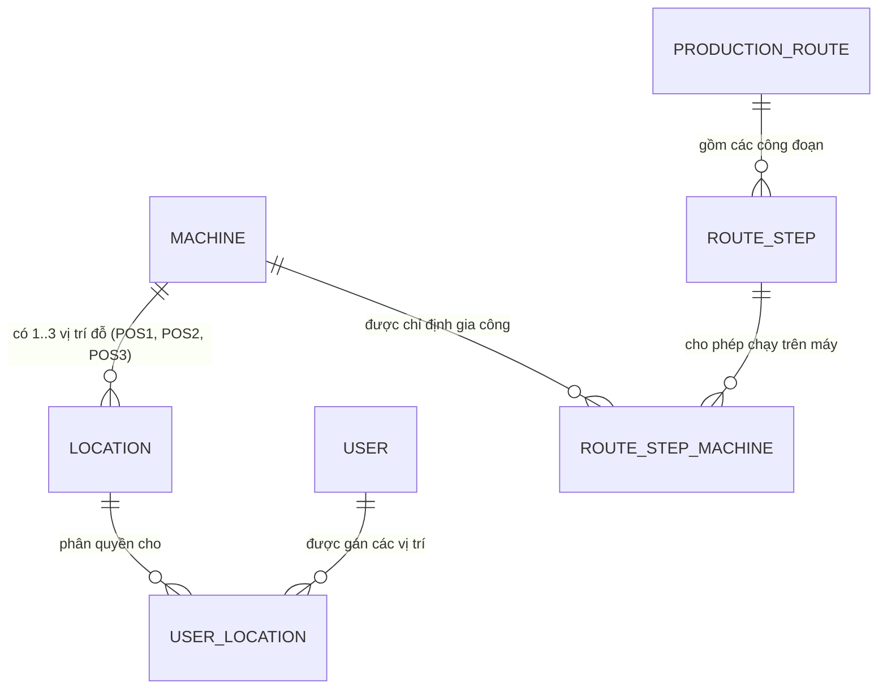

# Implementation Plan: Cấu Hình Trạm Phân Khu, Phân Quyền 1 Khu Vực & Gắn Node Map Thật

## 1. Overview & Locked Decisions
Kế hoạch triển khai toàn diện dựa trên 100% sự thống nhất từ buổi thảo luận chi tiết:
1. **Loại bỏ hoàn toàn khái niệm "Công đoạn mặc định" (`default_stage_level`)**:
   - Công đoạn gia công (Level) thuộc về **Quy trình (Route)** của từng Model sản phẩm (`production_route` -> `route_step` -> `route_step_machine`), không gắn chết cứng vào Máy CNC hay Location.
2. **Xây dựng trang hợp nhất "Cấu hình Trạm & Phân Khu Xưởng" (`/production/stations`) gồm 3 Tab**:
   - **Tab 1: Khu Nguyên Liệu**: Quản lý các ô cấp phôi (`VT-01..07`). Mỗi ô chọn gắn với Node trên Map KUKA đã import.
   - **Tab 2: Khu Máy CNC**: Quản lý các Máy CNC (`CNC-01..`). Mỗi máy hỗ trợ linh hoạt từ 1 đến 3 vị trí đỗ vật lý (`POS1`, `POS2`, `POS3`), mỗi vị trí chọn gắn với Node trên Map KUKA. Không còn `default_stage_level`.
   - **Tab 3: Khu Tẩy Rửa & Bãi Đệm Xe Rỗng**: Quản lý các slot tẩy rửa (`WASH-01..04`) và bãi đệm xe rỗng (`EMPTY-01..04`), mỗi slot gắn với Node trên Map KUKA.
   - Bản đồ 2D (`WarehouseMapCanvas`) được giữ riêng làm màn hình giám sát thời gian thực / vận hành AMR, không bị lẫn các công cụ vẽ/đính trạm.
3. **Phân quyền Người dùng theo 1 Khu vực duy nhất (1 User = 1 Area)**:
   - Trong trang Quản lý Người dùng, modal "Phân trạm" cho phép chọn 1 trong 3 khu vực:
     + Khu Cấp Phôi: Tick chọn cả 7 ô hoặc một vài ô cụ thể.
     + Khu Tẩy Rửa: Tick chọn cả 4 slot hoặc một vài slot cụ thể.
     + Khu CNC: Tick chọn theo Máy CNC (chọn máy nào thì quản lý toàn bộ các slot POS1/POS2/POS3 của máy đó).
   - Khi lưu: Tự động thu hồi các quyền ở khu vực cũ, đảm bảo nghiêm ngặt 1 tài khoản chỉ thuộc 1 khu vực.
4. **Đồng bộ Giao diện PDA Cầm tay 4.2"**:
   - Công nhân đăng nhập tự động vào đúng màn hình khu vực của mình.
   - Màn hình PDA chỉ render đúng các ô hoặc máy CNC (POS1/POS2/POS3) mà công nhân đó được phân công.

---

## 2. Architecture & Database Design

### A. Database Migrations
- Migration `drop_default_stage_level`:
  - `ALTER TABLE machine DROP COLUMN IF EXISTS default_stage_level;`
  - `ALTER TABLE location DROP COLUMN IF EXISTS default_stage_level;`
- Migration cleanup mock locations:
  - Xóa các bản ghi vị trí mock tọa độ ảo cũ (`RAW-01..07`, `CNC-01-POS1..POS2`, `WASH-01..04`, `EMPTY-01..04` với tọa độ giả 500, 2500, 8800).
  - Tái lập và liên kết các vị trí dựa trên 23 functional nodes thật của file map `map_CNC001_CNC001_28s.json`.

### B. Quan hệ Thực thể & Mô hình Dữ liệu

---

## 3. Task Breakdown by Phases

### Phase 1: Gỡ bỏ `default_stage_level` & Chuẩn hóa CSDL
- [x] **Task 1.1**: Tạo migration Alembic gỡ bỏ cột `default_stage_level` khỏi bảng `location` và `machine`.
- [x] **Task 1.2**: Cập nhật backend models (`location_model.py`, `production_models.py`), schemas (`machine_schema.py`) và router.
- [x] **Task 1.3**: Làm sạch dữ liệu: Xóa các vị trí mock ảo tự sinh, liên kết lại các vị trí thực tế với các Node từ file map KUKA.

### Checkpoint 1: Database Clean & Migration Head
- [x] `alembic upgrade head` chạy thành công.
- [x] Không còn `default_stage_level` trong CSDL.

---

### Phase 2: Xây dựng Trang Hợp nhất "Cấu Hình Trạm & Phân Khu Xưởng" (`/production/stations`)
- [x] **Task 2.1**: Backend API quản lý vị trí theo phân khu:
  - CRUD ô nguyên liệu (`location_type = 'RAW_MATERIAL'`).
  - CRUD máy CNC và các vị trí đỗ linh hoạt 1..3 slots (`POS1`, `POS2`, `POS3`) liên kết với Node map.
  - CRUD slot tẩy rửa (`location_type = 'WASHING_SLOT'`) và slot đệm xe rỗng (`EMPTY_CART_BUFFER`).
  - API lấy danh sách các Node điểm đỗ có sẵn từ Map (`/api/v1/production/map/available-nodes`).
- [x] **Task 2.2**: Xây dựng giao diện trang `/production/stations` (StationSettingPage) với 3 Tab:
  - Tab 1: **Khu Cấp Phôi** (Danh sách ô, nút Thêm ô, chọn Node map kèm tọa độ x, y).
  - Tab 2: **Khu Máy CNC** (Danh sách máy, nút Thêm máy, cấu hình 1..3 slot POS1/POS2/POS3 chọn Node map).
  - Tab 3: **Khu Tẩy Rửa & Bãi Đệm** (Danh sách slot rửa và bãi đệm, chọn Node map).
- [x] **Task 2.3**: Cập nhật menu Sidebar và Router chuyển từ `/machines` sang `/production/stations` (kèm alias redirect mượt mà).

### Checkpoint 2: Quản trị Vị trí Hoàn chỉnh
- [x] Quản đốc có thể thêm/sửa/xóa ô nguyên liệu, máy CNC (1..3 slot) và ô tẩy rửa, tất cả đều gắn với Node thật của Map KUKA.

---

### Phase 3: Tái cấu trúc Phân Quyền Người Dùng 1 Khu Vực (User Area Assignment)
- [x] **Task 3.1**: Cập nhật Backend API phân quyền `/api/v1/production/users/{user_id}/locations`:
  - Hỗ trợ lưu danh sách vị trí phân quyền cho user.
  - Tự động xóa các vị trí thuộc khu vực khác khi user được gán khu vực mới.
- [x] **Task 3.2**: Thiết kế lại toàn bộ `StationAssignmentModal.tsx`:
  - Radio/Segmented chọn 1 trong 3 khu vực: `[Khu Cấp Phôi]` | `[Khu Gia Công CNC]` | `[Khu Tẩy Rửa]`.
  - Nếu chọn Khu Cấp Phôi: Hiện các ô phôi (`VT-01..07`) để tick chọn.
  - Nếu chọn Khu Tẩy Rửa: Hiện các slot rửa (`WASH-01..04`) để tick chọn.
  - Nếu chọn Khu CNC: Hiện các Máy CNC trong xưởng (`CNC-01`, `CNC-02`...) để tick chọn máy (chọn máy nào tự động gán toàn bộ slot của máy đó).
- [x] **Task 3.3**: Cập nhật Client PDA (`RoleHomeRedirect.tsx`, `usePdaStore.ts`, các trang PDA):
  - Khi công nhân đăng nhập: Tự động điều hướng vào đúng trang của khu vực.
  - Lọc realtime: PDA chỉ hiển thị đúng các ô / trạm máy mà tài khoản có quyền.

### Checkpoint 3: Phân Quyền 1 Khu Vực Hoạt Động Mượt Mà
- [x] Thao tác phân quyền trên web lưu chính xác.
- [x] Đăng nhập PDA kiểm tra lọc đúng các trạm.

---

### Phase 4: Kiểm thử Toàn diện & Tự động hóa Trình duyệt
- [x] **Task 4.1**: Cập nhật bộ test backend `test_dispatch_engine.py` và `test_pda_live_cycle.py` tương thích với các vị trí Node thật.
- [ ] **Task 4.2**: Chạy kiểm thử tự động Playwright trên Chrome thực tế:
  - Test luồng phân quyền và mở modal cho từng tài khoản.
  - Test giao diện PDA CNC, Raw Material, Washing.
- [x] **Task 4.3**: Chạy `npm run build` frontend đảm bảo 0 lỗi TypeScript.

